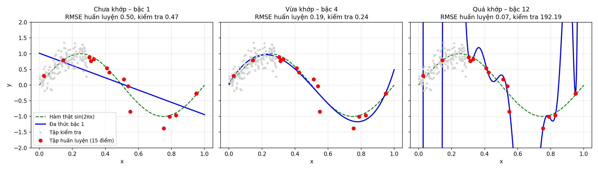
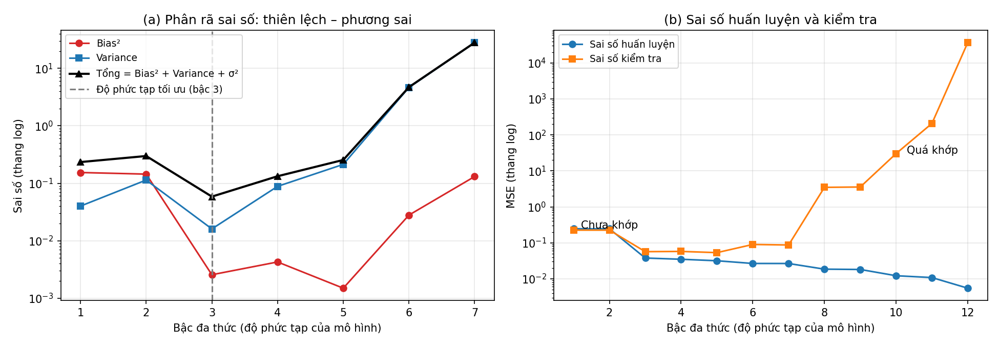

<style>
pre, pre code { font-size: 16px !important; line-height: 1.5 !important; }
</style>

# Bài 2. Quy trình thực hiện một dự án Học máy

> Tài liệu tham khảo: *Giáo trình Machine Learning 2026*, Chương 1 – Các khái niệm cơ bản; Chương 2 – Các kỹ thuật xây dựng đặc trưng; Chương 4 – Hồi quy tuyến tính. Quy tắc IQR phát hiện ngoại lai, kiểm định chéo và các công cụ `SimpleImputer`, `Pipeline`, `GridSearchCV` không có trong giáo trình, tham khảo tài liệu scikit-learn.
>
> Mã nguồn demo: thư mục [codes/](codes/), các notebook đánh số theo thứ tự trình bày trong bài, mỗi notebook chạy độc lập từ đầu đến cuối (mở bằng Jupyter, thư mục hiện hành là `codes/`).

- [2.1. Quy trình một dự án Học máy hoàn chỉnh](#21-quy-trình-một-dự-án-học-máy-hoàn-chỉnh)
- [2.2. Tham số của mô hình Học máy](#22-tham-số-của-mô-hình-học-máy)
- [2.3. Dự án dự đoán giá nhà](#23-dự-án-dự-đoán-giá-nhà)
- [2.4. Kết luận](#24-kết-luận)
- [2.5. Câu hỏi ôn tập](#25-câu-hỏi-ôn-tập)

---

## 2.1. Quy trình một dự án Học máy hoàn chỉnh

### 2.1.1. Phát biểu một dự án Học máy

Mọi dự án học máy bắt đầu bằng câu hỏi: **cần giải quyết vấn đề gì, và học máy giúp được gì?** Phát biểu sai bài toán thì mọi bước sau, dù làm tốt đến đâu, cũng không mang lại giá trị.

#### a) Các thành phần của một phát biểu

| Thành phần | Câu hỏi cần trả lời | Ví dụ: dự đoán giá nhà |
|---|---|---|
| **Mục tiêu thực tế** | Hệ thống phục vụ ai, giải quyết vấn đề gì? | Công ty bất động sản muốn ước lượng nhanh giá bán của một căn nhà |
| **Đầu vào** $\mathbf{x}$ | Có những thông tin gì tại thời điểm dự đoán? | Diện tích, số phòng ngủ, khoảng cách tới trung tâm, khu vực, năm xây dựng |
| **Đầu ra** $y$ | Cần dự đoán đại lượng gì? | Giá bán (triệu VND) |
| **Dạng bài toán** | Có giám sát hay không? Hồi quy hay phân lớp? | Học có giám sát, **hồi quy** |
| **Dữ liệu** (kinh nghiệm E) | Lấy dữ liệu có nhãn ở đâu, bao nhiêu? | Các giao dịch nhà đã thực hiện |
| **Độ đo** (P) | Thế nào là đủ tốt? | Sai số trung bình (MAE, RMSE) dưới 10% giá trung bình |
| **Ràng buộc** | Thời gian, chi phí, khả năng giải thích, quy định pháp lý? | Cần giải thích được giá cho khách hàng |

Phần "dạng bài toán", "dữ liệu" và "độ đo" chính là ba thành phần T, E, P trong định nghĩa học máy của Mitchell (Bài 1).

#### b) Một số ví dụ phát biểu

| Dự án | Đầu vào | Đầu ra | Dạng bài toán | Độ đo |
|---|---|---|---|---|
| Dự đoán giá nhà | Diện tích, số phòng, vị trí, tuổi nhà | Giá bán | Hồi quy | MAE, RMSE, $R^2$ |
| Cảnh báo sớm sinh viên có nguy cơ không đạt | Điểm danh, điểm giữa kỳ, số lần nộp bài | Đạt / không đạt | Phân lớp nhị phân | Recall của lớp "không đạt" |
| Phát hiện giao dịch thẻ gian lận | Số tiền, thời gian, địa điểm giao dịch | Gian lận / hợp lệ | Phân lớp nhị phân (mất cân bằng mạnh) | Precision, Recall |
| Phân nhóm khách hàng | Lịch sử mua sắm | Nhóm khách hàng | Học không giám sát – phân cụm | Độ tách biệt giữa các nhóm |

**Lưu ý khi phát biểu:**
- Đầu vào phải là thông tin **có sẵn tại thời điểm dự đoán**. Ví dụ, dự đoán sinh viên có đạt không mà dùng điểm thi cuối kỳ làm đầu vào là vô nghĩa, vì khi có điểm cuối kỳ thì đã biết kết quả.
- Trước khi làm, cần có một **mô hình cơ sở** (baseline) đơn giản để so sánh, ví dụ luôn dự đoán giá trung bình. Mô hình học máy chỉ có giá trị khi tốt hơn rõ rệt so với mô hình cơ sở.

---

### 2.1.2. Các bước thực hiện một dự án Học máy

#### a) Bảy bước của quy trình

Phần lớn các dự án học máy đi qua bảy bước sau:

| Bước | Công việc chính | Kết quả |
|---|---|---|
| 1. **Xác định bài toán** | Phát biểu mục tiêu, đầu vào, đầu ra, độ đo (mục 2.1.1) | Bản mô tả bài toán |
| 2. **Thu thập và hiểu dữ liệu** | Xác định nguồn dữ liệu, thu thập, mô tả ý nghĩa từng cột | Tập dữ liệu thô, bảng mô tả dữ liệu |
| 3. **Khám phá và phân tích dữ liệu** | Thống kê mô tả, vẽ phân phối, tìm ngoại lai, xem tương quan | Hiểu biết về dữ liệu, danh sách vấn đề cần xử lý |
| 4. **Chuẩn bị dữ liệu** | Làm sạch, xử lý giá trị thiếu, mã hóa, chuẩn hóa, thiết kế đặc trưng, chia tập (mục 2.1.3, 2.1.4) | Ma trận đặc trưng $\mathbf{X}$, vector nhãn $\mathbf{y}$ |
| 5. **Huấn luyện và lựa chọn mô hình** | Thử nhiều mô hình, học tham số trên tập huấn luyện | Các mô hình ứng viên |
| 6. **Tinh chỉnh và đánh giá** | Chọn siêu tham số bằng tập xác thực hoặc kiểm định chéo, đánh giá cuối cùng trên tập kiểm tra (mục 2.2) | Mô hình cuối cùng và chất lượng ước lượng |
| 7. **Triển khai và giám sát** | Đưa mô hình vào ứng dụng, theo dõi chất lượng theo thời gian, huấn luyện lại khi cần | Hệ thống hoạt động thực tế |

Các bước **không đi theo một đường thẳng**. Sau khi đánh giá, ta thường quay lại các bước trước: thu thập thêm dữ liệu, thiết kế thêm đặc trưng, thử mô hình khác. Sau khi triển khai, dữ liệu thực tế có thể thay đổi (giá nhà tăng theo thời gian, thói quen người dùng thay đổi) khiến mô hình kém dần, cần giám sát và huấn luyện lại.

```
 ┌──────────────┐   ┌──────────────┐   ┌──────────────┐   ┌──────────────┐
 │ 1. Xác định  │──►│ 2. Thu thập  │──►│ 3. Khám phá  │──►│ 4. Chuẩn bị  │
 │    bài toán  │   │    dữ liệu   │   │    dữ liệu   │   │    dữ liệu   │
 └──────────────┘   └──────────────┘   └──────────────┘   └──────┬───────┘
        ▲                  ▲                                     │
        │                  │      chưa đạt yêu cầu               ▼
 ┌──────┴───────┐   ┌──────┴───────┐                      ┌──────────────┐
 │ 7. Triển khai│◄──│ 6. Tinh chỉnh│◄─────────────────────│ 5. Huấn luyện│
 │   và giám sát│   │   và đánh giá│                      │   mô hình    │
 └──────────────┘   └──────────────┘                      └──────────────┘
```

#### b) Ví dụ: dự án dự đoán giá nhà

1. **Xác định bài toán:** công ty bất động sản muốn ước lượng giá bán nhà; bài toán hồi quy có giám sát.
2. **Thu thập dữ liệu:** từ các giao dịch trước đó, mỗi giao dịch gồm diện tích, số phòng ngủ, khoảng cách tới trung tâm, năm xây dựng, giá bán thực tế.
3. **Khám phá dữ liệu:** xem phân phối giá, tìm các điểm ngoại lai, xem giá tương quan với thuộc tính nào.
4. **Chuẩn bị dữ liệu:** xử lý giá trị thiếu, chuẩn hóa đặc trưng, chuyển biến phân loại (khu vực) thành dạng số; chia tập huấn luyện và kiểm tra.
5. **Huấn luyện mô hình:** ví dụ hồi quy tuyến tính $\hat{y} = w_1 x_1 + w_2 x_2 + w_3 x_3 + b$, học các tham số bằng cách cực tiểu hàm mất mát MSE.
6. **Tinh chỉnh:** điều chỉnh siêu tham số, thử các mô hình khác như cây quyết định, mạng nơ-ron, chọn mô hình tốt nhất.
7. **Triển khai:** trang web bất động sản cho người dùng nhập diện tích, số phòng, vị trí và trả về giá ước lượng (một ứng dụng như vậy có ở Bài 3).

Toàn bộ quy trình này được thực hành ở mục 2.3.

#### c) Pha huấn luyện và pha kiểm tra

Giáo trình mô tả mọi hệ thống học máy gồm hai pha dùng chung một **bộ trích chọn đặc trưng**:

```
 Pha huấn luyện:
   Dữ liệu huấn luyện thô ──► Bộ trích chọn đặc trưng ──► X_train ──┐
                                                                    ├──► Thuật toán học ──► Mô hình (θ*)
   Nhãn y_train ────────────────────────────────────────────────────┘

 Pha kiểm tra:
   Dữ liệu kiểm tra thô ──► Bộ trích chọn đặc trưng ──► X_test ──► Mô hình (θ*) ──► ŷ_test ──► so sánh với y_test
                            (cùng bộ đã dùng khi huấn luyện)
```

- **Pha huấn luyện**: tìm tham số tối ưu $\theta^*$ sao cho $\hat{\mathbf{y}} = f(\mathbf{X}_{\text{train}}; \theta)$ gần $\mathbf{y}_{\text{train}}$ nhất, bằng cách cực tiểu một hàm mất mát.
- **Pha kiểm tra**: đưa dữ liệu mới qua **đúng bộ trích chọn đặc trưng đã dùng khi huấn luyện**, dự đoán $\hat{\mathbf{y}}_{\text{test}} = f(\mathbf{X}_{\text{test}}; \theta^*)$ và so sánh với nhãn thật để đánh giá khả năng tổng quát hóa.

#### d) Phân biệt giai đoạn tiền xử lý dữ liệu và giai đoạn huấn luyện mô hình

| | Tiền xử lý dữ liệu (bước 2–4) | Huấn luyện mô hình (bước 5–6) |
|---|---|---|
| Mục đích | Biến dữ liệu thô thành ma trận đặc trưng $\mathbf{X}$ sạch, đúng định dạng | Tìm tham số $\theta$ để mô hình dự đoán tốt |
| Đầu vào | Dữ liệu thô: bảng, ảnh, văn bản, có lỗi | $\mathbf{X}_{\text{train}}$, $\mathbf{y}_{\text{train}}$ đã chuẩn bị |
| Đầu ra | $\mathbf{X}$, $\mathbf{y}$ | Mô hình với tham số $\theta^*$ |
| Hoạt động | Làm sạch, điền giá trị thiếu, mã hóa, chuẩn hóa, thiết kế và chọn đặc trưng, chia tập | Chọn mô hình, cực tiểu hàm mất mát, chọn siêu tham số, đánh giá |
| Có dùng nhãn $y$? | Phần lớn không (trừ khi chọn đặc trưng theo mức liên quan đến $y$) | Có, nhãn là "người giám sát" |
| Công cụ (scikit-learn) | `SimpleImputer`, `OneHotEncoder`, `StandardScaler`, `PCA` (các bộ biến đổi: `fit`, `transform`) | `LinearRegression`, `LogisticRegression`, … (các mô hình: `fit`, `predict`) |

Hai giai đoạn liên quan chặt chẽ: các bộ biến đổi của tiền xử lý cũng **học** từ dữ liệu (trung bình, độ lệch chuẩn, danh sách giá trị phân loại), và phải học **chỉ trên tập huấn luyện** giống như mô hình (mục 2.1.3 d).

#### e) Vì sao mỗi bước đều ảnh hưởng đến kết quả cuối cùng

- **Phát biểu sai** → mô hình tối ưu sai mục tiêu (ví dụ tối ưu Accuracy cho bài toán gian lận chỉ có 0.1% giao dịch gian lận, mô hình "luôn báo hợp lệ" đạt 99.9% nhưng vô dụng).
- **Dữ liệu kém** → "rác vào, rác ra" (*garbage in, garbage out*): dữ liệu thiếu, thiên lệch, nhiều lỗi thì mô hình tốt đến đâu cũng học sai quy luật.
- **Đặc trưng kém** → mô hình không có thông tin để học; trong nhiều trường hợp, cải thiện đặc trưng mang lại hiệu quả lớn hơn đổi sang thuật toán phức tạp hơn.
- **Đánh giá sai cách** (dùng tập kiểm tra để chọn mô hình, rò rỉ dữ liệu) → kết quả báo cáo đẹp hơn thực tế, mô hình thất bại khi triển khai.
- **Không giám sát sau triển khai** → mô hình lỗi thời khi dữ liệu thay đổi.

Ví dụ ở mục 2.3: chỉ nhờ thiết kế thêm hai đặc trưng (tuổi nhà, khu vực), sai số của cùng một mô hình hồi quy tuyến tính giảm từ 297 xuống 255 triệu.

#### f) Quy trình học máy trong các lĩnh vực thực tế

| Bước | Tài chính: chấm điểm tín dụng | Y tế: sàng lọc bệnh từ chỉ số xét nghiệm | Thương mại điện tử: gợi ý sản phẩm |
|---|---|---|---|
| Xác định bài toán | Dự đoán khách hàng có trả nợ đúng hạn không (phân lớp) | Dự đoán nguy cơ mắc bệnh (phân lớp); ưu tiên không bỏ sót | Dự đoán sản phẩm người dùng sẽ mua (khuyến nghị) |
| Dữ liệu | Thu nhập, lịch sử tín dụng, khoản vay cũ | Hồ sơ bệnh án, kết quả xét nghiệm; cần bảo mật, đồng thuận | Lịch sử xem, giỏ hàng, đánh giá |
| Khó khăn khi chuẩn bị | Mất cân bằng lớp (ít khách vỡ nợ); không được dùng đặc trưng gây phân biệt đối xử | Thiếu dữ liệu, đơn vị đo khác nhau giữa các bệnh viện | Dữ liệu cực lớn, rất thưa |
| Độ đo | Precision, Recall, AUC; mức lỗ dự kiến | Recall (độ nhạy), độ đặc hiệu | Tỉ lệ nhấp, tỉ lệ mua |
| Triển khai, giám sát | Giải thích được lý do từ chối cho khách hàng; huấn luyện lại khi kinh tế biến động | Là công cụ hỗ trợ bác sĩ, không thay thế quyết định | Cập nhật liên tục theo hành vi mới |

---

### 2.1.3. Quản lý và làm sạch dữ liệu

#### a) Quản lý dữ liệu

Dữ liệu là "kinh nghiệm E" mà mô hình học từ đó, nên cần được quản lý cẩn thận:

- **Mô tả dữ liệu** (data dictionary): ghi rõ ý nghĩa, đơn vị, khoảng giá trị, nguồn gốc của từng cột. Ví dụ bảng mô tả dữ liệu giá nhà ở mục 2.3.1.
- **Giữ nguyên dữ liệu gốc**, mọi bước làm sạch viết thành code (notebook) để chạy lại được, không sửa tay trực tiếp trên file. Như vậy có thể kiểm tra lại, sửa sai và áp dụng lại cho dữ liệu mới.
- **Quản lý phiên bản**: dữ liệu thay đổi theo thời gian; cần biết mô hình được huấn luyện trên phiên bản dữ liệu nào.
- **Bảo mật và quyền riêng tư**: dữ liệu cá nhân (bệnh án, tài chính, học tập) chỉ được thu thập và sử dụng khi có sự cho phép, đúng quy định; ẩn danh hóa khi có thể.

#### b) Các vấn đề thường gặp của dữ liệu

| Vấn đề | Mô tả | Hậu quả |
|---|---|---|
| **Thiếu dữ liệu huấn luyện** | Quá ít mẫu để học quy luật | Mô hình học không đầy đủ, dễ quá khớp |
| **Dữ liệu không mang tính đại diện** | Dữ liệu chỉ gồm một nhóm trường hợp đặc biệt (ví dụ hệ thống nhận diện khuôn mặt chủ yếu học từ một nhóm người) | **Thiên lệch dữ liệu** (data bias): hoạt động kém, thiếu công bằng với nhóm khác |
| **Dữ liệu nhiễu, sai lệch** | Lỗi đo lường, lỗi nhập liệu, giá trị ngoại lai | Mô hình học theo lỗi |
| **Giá trị thiếu** | Ô dữ liệu bị bỏ trống | Nhiều thuật toán không chạy được |
| **Trùng lặp** | Một bản ghi xuất hiện nhiều lần | Mẫu đó có trọng số lớn hơn; có thể vừa ở tập huấn luyện vừa ở tập kiểm tra |
| **Không thống nhất** | Cùng một giá trị viết nhiều kiểu (`center`, ` Center`, `CENTER`), đơn vị khác nhau | Mô hình coi là các giá trị khác nhau |
| **Đặc trưng không phù hợp** | Đặc trưng không liên quan đến bài toán | Mô hình khó học quy luật có ý nghĩa |

#### c) Làm sạch dữ liệu: ví dụ

Dữ liệu [data/house_prices_raw.csv](data/house_prices_raw.csv) gồm 1020 dòng giao dịch nhà, mô phỏng dữ liệu thu thập thực tế (mô tả các cột ở mục 2.3.1). Kiểm tra ban đầu:

```python
from pathlib import Path
import pandas as pd

DATA = Path('..') / 'data'
df = pd.read_csv(DATA / 'house_prices_raw.csv')
print(df.isna().sum())            # số giá trị thiếu của từng cột
print(df.duplicated().sum())      # số dòng trùng lặp: 20
print(df['district'].unique())    # 12 cách viết cho 3 khu vực
df.describe()                     # diện tích lớn nhất 1989 m², phân vị 75% chỉ 161.6 m²
```

Kết quả cho thấy bốn vấn đề: 20 dòng trùng lặp; cột khu vực có 12 cách viết khác nhau cho 3 giá trị; thiếu 15 giá trị số phòng ngủ, 41 giá trị năm xây dựng, 6 giá trị giá bán; diện tích có giá trị ngoại lai. Cách xử lý:

| Bước | Vấn đề | Cách xử lý | Code | Số dòng còn lại |
|---|---|---|---|---|
| 1 | Dòng trùng lặp | Xóa | `df.drop_duplicates()` | 1000 |
| 2 | Chữ viết không thống nhất | Bỏ khoảng trắng thừa, đưa về chữ thường | `df['district'].str.strip().str.lower()` | 1000 |
| 3 | Thiếu **nhãn** (giá bán) | Xóa dòng (không dùng để huấn luyện được) | `df.dropna(subset=['price'])` | 995 |
| 4 | Thiếu **đặc trưng** (số phòng, năm xây dựng) | Điền bằng trung vị (ít bị ảnh hưởng bởi ngoại lai hơn trung bình) | `fillna(median)` hoặc `SimpleImputer` | 995 |
| 5 | Ngoại lai diện tích | Phát hiện bằng quy tắc IQR, kiểm tra rồi xóa nếu là lỗi | xem dưới | 989 |

**Quy tắc IQR.** Gọi $Q_1, Q_3$ là phân vị 25% và 75%, $\text{IQR} = Q_3 - Q_1$. Điểm nằm ngoài khoảng $[Q_1 - 1.5\,\text{IQR},\ Q_3 + 1.5\,\text{IQR}]$ được coi là ngoại lai. Với diện tích: $Q_1 = 78.3$, $Q_3 = 161.6$, khoảng hợp lệ là $[-46.6;\ 286.5]$, có 6 căn vượt ngưỡng (diện tích từ 844 đến 1989 m²).

```python
q1, q3 = df['area'].quantile([0.25, 0.75])
iqr = q3 - q1
outliers = df[(df['area'] < q1 - 1.5 * iqr) | (df['area'] > q3 + 1.5 * iqr)]
```

Các căn "1305 m² mà chỉ 3 phòng, giá chưa tới 4 tỷ" rõ ràng là **lỗi nhập liệu** (gõ thừa một chữ số 0), nên được xóa. Không phải ngoại lai nào cũng là lỗi: một biệt thự 280 m² có thể hoàn toàn hợp lệ. Trước khi xóa cần kiểm tra bằng hiểu biết về bài toán; nếu là giá trị thật, có thể giữ lại hoặc dùng mô hình ít nhạy với ngoại lai (Bài 3).

*Mã nguồn: [codes/04_data_cleaning.ipynb](codes/04_data_cleaning.ipynb).*

#### d) Chia dữ liệu và tránh rò rỉ thông tin

Dữ liệu được chia thành tập **huấn luyện** (học tham số), **xác thực** (chọn siêu tham số, chọn mô hình) và **kiểm tra** (đánh giá một lần duy nhất ở cuối). Tỉ lệ thường dùng: 60/20/20 hoặc 70/15/15; khi dữ liệu ít, thay tập xác thực bằng **kiểm định chéo** (mục 2.2.2).

**Rò rỉ dữ liệu** (data leakage) xảy ra khi thông tin của tập kiểm tra lọt vào quá trình huấn luyện, khiến kết quả đánh giá đẹp hơn thực tế. Các lỗi thường gặp:

- Tính trung bình, độ lệch chuẩn để chuẩn hóa, hoặc trung vị để điền giá trị thiếu, trên **toàn bộ** dữ liệu rồi mới chia tập.
- Không xóa dòng trùng lặp trước khi chia, khiến cùng một mẫu vừa ở tập huấn luyện vừa ở tập kiểm tra.
- Dùng tập kiểm tra để chọn mô hình hoặc siêu tham số.
- Dùng đặc trưng chỉ có sau khi biết kết quả (như điểm cuối kỳ khi dự đoán đạt/không đạt).

Quy tắc: **làm sạch những lỗi rõ ràng (trùng lặp, chữ viết, lỗi nhập liệu) trước; chia tập; mọi bước biến đổi có "học" từ dữ liệu (điền giá trị thiếu, chuẩn hóa, mã hóa) chỉ `fit` trên tập huấn luyện.** Trong scikit-learn, cách an toàn là gói các bước này vào `Pipeline` (mục 2.3.2).

---

### 2.1.4. Chọn và thiết kế đặc trưng (features)

#### a) Vector đặc trưng và ma trận dữ liệu

Mỗi mẫu dữ liệu được biểu diễn bằng một **vector đặc trưng** $\mathbf{x} = (x_1, x_2, \dots, x_d) \in \mathbb{R}^d$, mỗi thành phần là một đặc trưng. Mọi mẫu phải có **cùng số đặc trưng** để thực hiện được các phép toán đại số tuyến tính. Ghép $N$ mẫu thành **ma trận dữ liệu** $\mathbf{X} \in \mathbb{R}^{N \times d}$, mỗi hàng là một mẫu.

Dữ liệu thô thường chưa ở dạng này: ảnh có kích thước khác nhau, văn bản có độ dài khác nhau, bảng có cột chữ. Quá trình biến dữ liệu thô $\mathbf{x} \in \mathbb{R}^D$ thành vector đặc trưng phù hợp $\mathbf{z} = \phi(\mathbf{x}) \in \mathbb{R}^d$ (thường $d \le D$) gọi là **trích chọn đặc trưng** (feature extraction). Chất lượng đặc trưng ảnh hưởng trực tiếp đến chất lượng mô hình, nhiều khi còn quan trọng hơn việc chọn thuật toán.

Ba nhóm công việc với đặc trưng:

| Công việc | Ý nghĩa | Ví dụ |
|---|---|---|
| **Biểu diễn** (vector hóa, mã hóa, chuẩn hóa) | Đưa dữ liệu về dạng số, cùng thang đo | Ảnh → vector điểm ảnh; khu vực → one-hot; chuẩn hóa z-score |
| **Thiết kế** (feature engineering) | Tạo đặc trưng mới có ý nghĩa hơn từ đặc trưng có sẵn | Năm xây dựng → tuổi nhà |
| **Lựa chọn** (feature selection) và **giảm chiều** | Giữ lại các đặc trưng quan trọng, loại bỏ dư thừa | Loại màu sơn; PCA |

#### b) Vector hóa dữ liệu thô: ảnh

Ảnh xám kích thước $m \times n$ là một ma trận độ sáng điểm ảnh (0 = đen, 255 = trắng). Xếp nối các hàng (hoặc các cột) được vector $mn$ chiều. Ví dụ ảnh $2 \times 2$:

$$
\begin{bmatrix} 10 & 20 \\ 30 & 40 \end{bmatrix}
\;\longrightarrow\;
\mathbf{x} = (10, 20, 30, 40) \;\text{(theo hàng)} \quad \text{hoặc} \quad (10, 30, 20, 40) \;\text{(theo cột)}
$$

Cách này đơn giản nhưng **mất thông tin về quan hệ không gian** giữa các điểm ảnh (hai điểm cạnh nhau theo chiều dọc bị đặt cách xa nhau trong vector).

*Mã nguồn: [codes/01_grayscale_image.ipynb](codes/01_grayscale_image.ipynb) (ảnh xám $20 \times 20$ thành vector 400 phần tử).*

#### c) Vector hóa văn bản: túi từ và TF–IDF

**Túi từ** (Bag of Words): xây dựng từ điển gồm $V$ từ khác nhau trong tập văn bản; mỗi văn bản được biểu diễn bằng vector $\mathbf{x} = (c_1, \dots, c_V)$, với $c_i$ là số lần từ thứ $i$ xuất hiện. Ví dụ hai câu "Sinh viên ICTU học trí tuệ nhân tạo" và "Sinh viên ICTU học khoa học dữ liệu", với từ điển `[Sinh, viên, ICTU, học, trí, tuệ, nhân, tạo, khoa, dữ, liệu]`:

$$
\mathbf{x}_1 = [1, 1, 1, 1, 1, 1, 1, 1, 0, 0, 0], \qquad
\mathbf{x}_2 = [1, 1, 1, 2, 0, 0, 0, 0, 1, 1, 1]
$$

(từ "học" xuất hiện 2 lần trong câu thứ hai). Hạn chế: **mất thứ tự từ**, hai câu cùng tập từ nhưng khác thứ tự có cùng vector.

**TF–IDF** giảm trọng số của các từ xuất hiện ở hầu hết văn bản (ít giá trị phân biệt) và tăng trọng số của từ hiếm:

$$
\text{TF}(t, d) = \frac{f_{t,d}}{\sum_k f_{k,d}}, \qquad
\text{IDF}(t) = \log\frac{N}{n_t}, \qquad
\text{TFIDF}(t, d) = \text{TF}(t, d) \times \text{IDF}(t)
$$

với $f_{t,d}$ là số lần từ $t$ xuất hiện trong văn bản $d$, $N$ là số văn bản, $n_t$ là số văn bản chứa $t$. Trong ví dụ trên, "Sinh", "viên", "ICTU" có mặt ở cả hai câu nên $\text{IDF} = \log(2/2) = 0$, còn "trí", "tuệ", "dữ", "liệu" có TF–IDF dương, mang thông tin phân biệt hai câu.

*Mã nguồn: [codes/02_bag_of_words.ipynb](codes/02_bag_of_words.ipynb).*

#### d) Mã hóa biến phân loại: one-hot

Biến phân loại có $K$ giá trị (khu vực: trung tâm, ven đô, ngoại thành) được thay bằng $K$ cột 0/1, mỗi mẫu có đúng một cột bằng 1:

| `district` | `district_center` | `district_outskirts` | `district_suburb` |
|---|---|---|---|
| center | 1 | 0 | 0 |
| suburb | 0 | 0 | 1 |
| outskirts | 0 | 1 | 0 |

Không mã hóa thành 0, 1, 2, vì mô hình sẽ hiểu sai là có thứ tự và khoảng cách ("ngoại thành = 2" gấp đôi "ven đô = 1").

```python
from sklearn.preprocessing import OneHotEncoder

encoder = OneHotEncoder()
district_onehot = encoder.fit_transform(df[['district']]).toarray()
print(encoder.get_feature_names_out())   # ['district_center' 'district_outskirts' 'district_suburb']
```

*Mã nguồn: [codes/03_vectorization.ipynb](codes/03_vectorization.ipynb).*

#### e) Chuẩn hóa đặc trưng

Khi các đặc trưng có đơn vị, thang đo rất khác nhau (diện tích hàng trăm, số phòng vài đơn vị), nhiều thuật toán bị ảnh hưởng: k láng giềng gần nhất (khoảng cách bị đặc trưng lớn chi phối), Gradient Descent (hội tụ chậm, Bài 5), điều chuẩn (Bài 3). Ba cách chuẩn hóa phổ biến:

| Phương pháp | Công thức | Kết quả | Ví dụ |
|---|---|---|---|
| Chuyển khoảng (min-max) | $x' = \dfrac{x - \min}{\max - \min}$ | Giá trị trong $[0, 1]$ | Diện tích trong $[50, 200]$, nhà 120 m²: $x' = \frac{120 - 50}{200 - 50} = 0.47$ |
| Theo phân phối chuẩn (z-score, `StandardScaler`) | $x' = \dfrac{x - \bar{x}}{\sigma}$ | Trung bình 0, độ lệch chuẩn 1 | Tuổi trung bình 40, độ lệch chuẩn 10, người 50 tuổi: $x' = 1$ |
| Theo norm | $\mathbf{x}' = \dfrac{\mathbf{x}}{\lVert \mathbf{x} \rVert_2}$ | Vector có độ dài 1 | $\mathbf{x} = (3, 4)$, $\lVert \mathbf{x} \rVert_2 = 5$: $\mathbf{x}' = (0.6, 0.8)$ |

Trong đó $\lVert \mathbf{x} \rVert_2 = \sqrt{\sum_i x_i^2}$ là **chuẩn $\ell_2$** (độ dài Euclid); tổng quát, chuẩn $\ell_p$ là $\lVert \mathbf{x} \rVert_p = \left(\sum_i |x_i|^p\right)^{1/p}$, với $\ell_1$ là tổng trị tuyệt đối.

```python
from sklearn.preprocessing import MinMaxScaler, StandardScaler

scaler = StandardScaler()
X_train_scaled = scaler.fit_transform(X_train)   # học trung bình, độ lệch chuẩn trên tập huấn luyện
X_test_scaled = scaler.transform(X_test)         # dùng lại chính các giá trị đó cho tập kiểm tra
```

*Mã nguồn: [codes/03_vectorization.ipynb](codes/03_vectorization.ipynb).*

#### f) Thiết kế đặc trưng mới

Tạo đặc trưng mới từ các đặc trưng có sẵn bằng phép biến đổi hoặc kết hợp, dựa trên hiểu biết về bài toán:

| Đặc trưng gốc | Đặc trưng mới | Lý do |
|---|---|---|
| Năm xây dựng | Tuổi nhà = 2026 − năm xây dựng | Điều ảnh hưởng đến giá là nhà cũ hay mới |
| Diện tích, số phòng ngủ | Diện tích trung bình mỗi phòng | Phản ánh mức rộng rãi |
| Ngày giao dịch | Thứ trong tuần, tháng, mùa | Giá có thể theo mùa |
| Vĩ độ, kinh độ | Khoảng cách tới trung tâm | Mô hình tuyến tính không tự tính được khoảng cách |
| $x$ | $x^2, x^3, \dots$ | Biểu diễn quan hệ phi tuyến (hồi quy đa thức, mục 2.2.4) |

#### g) Lựa chọn đặc trưng

Dữ liệu ban đầu có $D$ đặc trưng nhưng chỉ một số thực sự có ý nghĩa. **Lựa chọn đặc trưng** giữ lại $d$ đặc trưng quan trọng nhất, giúp mô hình đơn giản hơn, giảm quá khớp, huấn luyện nhanh hơn và dễ diễn giải. Ví dụ (giáo trình): dự đoán giá nhà mà dữ liệu có cả màu sơn, số cây trong sân; các đặc trưng này ít ảnh hưởng đến giá và có thể loại bỏ.

Một số cách đơn giản để đánh giá mức độ liên quan:

- Với đặc trưng số: **hệ số tương quan** với nhãn.
- Với đặc trưng phân loại: so sánh **giá trị trung bình của nhãn theo từng nhóm**.
- Đáng tin cậy nhất: so sánh sai số **kiểm định chéo** của mô hình khi có và không có đặc trưng đó (mục 2.3.3).

Trên dữ liệu giá nhà đã làm sạch:

| Đặc trưng số | Hệ số tương quan với giá |
|---|---|
| Diện tích | 0.944 |
| Số phòng ngủ | 0.841 |
| Khoảng cách tới trung tâm | −0.226 |
| Diện tích mỗi phòng | −0.087 |
| Tuổi nhà | −0.062 |

| Khu vực | Giá trung bình (triệu) | | Màu sơn | Giá trung bình (triệu) |
|---|---|---|---|---|
| Trung tâm | 4475 | | Xanh | 3833 |
| Ven đô | 3921 | | Xám | 3945 |
| Ngoại thành | 3395 | | Trắng | 3790 |
| | | | Vàng | 3691 |

Giá chênh lệch hơn 1 tỷ giữa các khu vực, nhưng gần như không đổi theo màu sơn: **giữ** khu vực, **loại** màu sơn. Lưu ý: hệ số tương quan của tuổi nhà nhỏ (−0.062) không có nghĩa tuổi nhà vô dụng; nó chỉ ảnh hưởng ít hơn nhiều so với diện tích, và mô hình ở mục 2.3 vẫn học được mỗi năm tuổi làm giảm giá khoảng 11 triệu. Tương quan chỉ đo quan hệ tuyến tính **một biến**, nên chỉ dùng để tham khảo ban đầu.

*Mã nguồn: [codes/05_feature_selection.ipynb](codes/05_feature_selection.ipynb).*

#### h) Giảm chiều dữ liệu

Khi số chiều $d$ rất lớn, xuất hiện **lời nguyền số chiều** (curse of dimensionality): chia mỗi chiều thành $k$ khoảng thì không gian có $k^d$ ô; với $k = 10$, $d = 1, 2, 3$ cho $10, 100, 1000$ ô. Số ô tăng theo cấp số mũ, dữ liệu trở nên **thưa**, khoảng cách giữa các điểm mất dần ý nghĩa, cần rất nhiều dữ liệu để học, chi phí tính toán tăng.

**Giảm chiều** ánh xạ dữ liệu sang không gian ít chiều hơn, $\mathbf{z} = \mathbf{A}\mathbf{x}$ với $\mathbf{A} \in \mathbb{R}^{d \times D}$, $d < D$, mà vẫn giữ phần lớn thông tin. Phương pháp phổ biến nhất là **PCA** (Principal Component Analysis): tìm các trục mới sao cho phương sai của dữ liệu theo các trục đó lớn nhất.

*Ví dụ:* diện tích và số phòng ngủ tương quan 0.86. Sau khi chuẩn hóa, PCA tìm được trục $z = 0.707\,x_1 + 0.707\,x_2$ giữ **93%** phương sai của hai đặc trưng; có thể thay hai cột bằng một cột $z$ ("quy mô căn nhà") mà mất ít thông tin. PCA hữu ích nhất khi dữ liệu có hàng trăm, hàng nghìn chiều (ảnh, văn bản).

*Mã nguồn: [codes/05_feature_selection.ipynb](codes/05_feature_selection.ipynb).*

> **Đặc trưng học tự động.** Trong học sâu, đặc trưng thường được mô hình **tự học** thay vì do con người thiết kế: vector nhúng (embedding) biểu diễn mỗi từ bằng một vector sao cho các từ gần nghĩa có vector gần nhau; autoencoder là mạng nơ-ron nén dữ liệu (ví dụ ảnh $28 \times 28 = 784$ điểm ảnh còn 32 đặc trưng) rồi tái tạo lại, phần nén ở giữa chính là đặc trưng mới. Các kỹ thuật này được tìm hiểu trong môn Học sâu.

---

## 2.2. Tham số của mô hình Học máy

Phần này dùng một ví dụ mô phỏng để thấy rõ vai trò của tham số: dữ liệu sinh theo $y = \sin(2\pi x) + \text{nhiễu}$, với 15 điểm huấn luyện, 15 điểm xác thực, 500 điểm kiểm tra. Mô hình là **hồi quy đa thức** bậc $p$:

$$
\hat{y} = w_0 + w_1 x + w_2 x^2 + \dots + w_p x^p
$$

### 2.2.1. Khái niệm tham số của mô hình

**Tham số mô hình** (model parameters), ký hiệu chung là $\theta$, là các đại lượng quyết định cách mô hình ánh xạ đầu vào thành đầu ra, và được **học từ dữ liệu**. Ví dụ, với hồi quy tuyến tính một biến

$$
\hat{y} = wx + b
$$

hệ số $w$ và hệ số chệch $b$ là hai tham số. Để đánh giá mức độ phù hợp, dùng **hàm mất mát**, ví dụ sai số bình phương trung bình:

$$
L(w, b) = \frac{1}{2N} \sum_{i=1}^{N} (y_i - \hat{y}_i)^2
$$

Huấn luyện là tìm tham số làm hàm mất mát nhỏ nhất:

$$
\theta^* = \arg\min_{\theta} L(\theta)
$$

Phân biệt với **siêu tham số** (hyperparameters): các giá trị được **chọn trước khi huấn luyện**, không học được bằng cách cực tiểu hàm mất mát trên tập huấn luyện, nhưng ảnh hưởng lớn đến chất lượng mô hình.

| | Tham số | Siêu tham số |
|---|---|---|
| Ai xác định | Thuật toán học, từ dữ liệu huấn luyện | Người xây dựng mô hình, chọn trước khi huấn luyện |
| Cách tìm | Cực tiểu hàm mất mát trên tập huấn luyện | Thử nhiều giá trị, đánh giá trên tập xác thực hoặc kiểm định chéo |
| Trong scikit-learn | Thuộc tính có dấu `_` sau khi `fit`: `coef_`, `intercept_` | Đối số khi tạo mô hình: `PolynomialFeatures(degree=3)`, `Ridge(alpha=1.0)` |

| Mô hình | Tham số | Siêu tham số |
|---|---|---|
| Hồi quy tuyến tính, đa thức (Bài 3) | Các hệ số $w_0, w_1, \dots, w_d$ | Bậc đa thức $p$ |
| Hồi quy Ridge, Lasso (Bài 3) | Các hệ số $w_j$ | Hệ số điều chuẩn $\lambda$ |
| Hồi quy Logistic (Bài 4) | Các trọng số $w_j$ | Ngưỡng phân loại, hệ số điều chuẩn |
| Gradient Descent (Bài 5) | (tham số của mô hình được tối ưu) | Tốc độ học $\eta$, số vòng lặp, kích thước mini-batch |
| k láng giềng gần nhất | Không có (lưu toàn bộ dữ liệu) | Số láng giềng $k$ |
| Cây quyết định (Bài 6) | Các điều kiện chia ở mỗi nút | Độ sâu tối đa |
| Mạng nơ-ron (Bài 9) | Trọng số, hệ số chệch của các lớp | Số lớp, số nơ-ron, hàm kích hoạt, tốc độ học |

*Ví dụ:* với siêu tham số $p = 3$, `fit` trên 15 điểm huấn luyện học được 4 tham số $w_0, w_1, w_2, w_3$ và đạt RMSE huấn luyện 0.194.

*Mã nguồn: [codes/06_model_parameters.ipynb](codes/06_model_parameters.ipynb).*

---

### 2.2.2. Tinh chỉnh tham số

"Tinh chỉnh" diễn ra ở hai mức:

1. **Tối ưu tham số**: với siêu tham số cố định, thuật toán tối ưu điều chỉnh $\theta$ để giảm dần hàm mất mát, bằng công thức nghiệm (bình phương tối thiểu, Bài 3) hoặc phương pháp lặp (Gradient Descent, Bài 5). Đây chính là quá trình "học".
2. **Tinh chỉnh siêu tham số** (hyperparameter tuning): thử nhiều giá trị siêu tham số, mỗi giá trị huấn luyện một mô hình, rồi chọn giá trị cho mô hình **tổng quát hóa** tốt nhất.

#### a) Dùng tập xác thực

Không thể chọn siêu tham số theo sai số huấn luyện: bậc đa thức càng cao, sai số huấn luyện càng nhỏ, nên sẽ luôn chọn bậc cao nhất. Cũng **không được** chọn theo tập kiểm tra, vì khi đó tập kiểm tra không còn là "dữ liệu chưa từng thấy". Quy trình đúng:

1. Với mỗi giá trị siêu tham số: học tham số trên **tập huấn luyện**, đo sai số trên **tập xác thực**.
2. Chọn giá trị có sai số xác thực nhỏ nhất.
3. Đánh giá mô hình cuối cùng **một lần** trên **tập kiểm tra**.

```python
for degree in range(1, 13):
    model = poly_model(degree).fit(X_train, y_train)          # học tham số
    print(degree, rmse(model, X_train, y_train), rmse(model, X_val, y_val))
```

| Bậc $p$ | 1 | 2 | 3 | 4 | **5** | 6 | 8 | 10 | 12 |
|---|---|---|---|---|---|---|---|---|---|
| RMSE huấn luyện | 0.495 | 0.495 | 0.194 | 0.187 | **0.178** | 0.163 | 0.136 | 0.110 | 0.074 |
| RMSE xác thực | 0.427 | 0.427 | 0.173 | 0.174 | **0.169** | 0.264 | 1.088 | 4.652 | 150.6 |

Sai số huấn luyện **giảm liên tục** khi tăng bậc, còn sai số xác thực giảm rồi **tăng vọt**. Tập xác thực chọn bậc 5; RMSE trên tập kiểm tra là 0.231.

#### b) Kiểm định chéo k-fold

Với ít dữ liệu, một tập xác thực nhỏ cho kết quả dao động, lại "lãng phí" dữ liệu không dùng để huấn luyện. **Kiểm định chéo k-fold** (k-fold cross-validation) gộp huấn luyện và xác thực, chia thành $k$ phần bằng nhau; lần lượt dùng $k - 1$ phần để huấn luyện, 1 phần để đánh giá; lấy trung bình $k$ lần đánh giá:

```
 Lần 1:  [Xác thực][ Huấn luyện ][ Huấn luyện ][ Huấn luyện ][ Huấn luyện ]
 Lần 2:  [Huấn luyện][ Xác thực ][ Huấn luyện ][ Huấn luyện ][ Huấn luyện ]
  ...
 Lần 5:  [Huấn luyện][ Huấn luyện ][ Huấn luyện ][ Huấn luyện ][ Xác thực ]
 → Sai số kiểm định chéo = trung bình 5 lần
```

`GridSearchCV` của scikit-learn tự động thử mọi giá trị trong một "lưới" siêu tham số bằng kiểm định chéo:

```python
from sklearn.model_selection import GridSearchCV, KFold

search = GridSearchCV(poly_model(1),
                      param_grid={'polynomialfeatures__degree': list(range(1, 13))},
                      cv=KFold(n_splits=5, shuffle=True, random_state=0),
                      scoring='neg_root_mean_squared_error')
search.fit(X_dev, y_dev)                       # 30 điểm = huấn luyện + xác thực
print(search.best_params_)                     # {'polynomialfeatures__degree': 5}
```

Kiểm định chéo cũng chọn bậc 5 (RMSE kiểm định chéo 0.170); mô hình huấn luyện lại trên cả 30 điểm đạt RMSE kiểm tra 0.217, tốt hơn khi chỉ dùng 15 điểm huấn luyện.

*Mã nguồn: [codes/06_model_parameters.ipynb](codes/06_model_parameters.ipynb).*

**Một số cách tìm kiếm siêu tham số:** thủ công (dựa vào kinh nghiệm, đồ thị sai số); tìm kiếm lưới (`GridSearchCV`, thử mọi tổ hợp); tìm kiếm ngẫu nhiên (`RandomizedSearchCV`, thử ngẫu nhiên một số tổ hợp, hiệu quả khi có nhiều siêu tham số). Siêu tham số có phạm vi rộng như $\lambda$, $\eta$ nên thử theo thang log: $0.001, 0.01, 0.1, 1, 10, \dots$

---

### 2.2.3. Đánh giá chất lượng mô hình qua tham số

Sau khi học được tham số $\theta^*$, cần đánh giá mô hình với bộ tham số đó tốt đến đâu. Có ba góc nhìn.

#### a) Sai số huấn luyện và sai số kiểm tra

**Sai số huấn luyện** đo mức độ mô hình khớp với dữ liệu đã học, thường chính là hàm mất mát tính trên tập huấn luyện:

$$
\text{Training Error} = \frac{1}{2N_{\text{train}}} \sum_{i=1}^{N_{\text{train}}} (y_i - \hat{y}_i)^2
$$

**Sai số kiểm tra** tính trên tập dữ liệu độc lập, không tham gia huấn luyện, phản ánh **khả năng tổng quát hóa**:

$$
\text{Test Error} = \frac{1}{2N_{\text{test}}} \sum_{i=1}^{N_{\text{test}}} (y_i - \hat{y}_i)^2
$$

Lấy trung bình (chia cho $N$) để so sánh được hai tập có kích thước khác nhau. Trong thực tế thường báo cáo các độ đo dễ diễn giải hơn: với hồi quy là MAE, RMSE (cùng đơn vị với $y$), $R^2$ (Bài 3); với phân lớp là Accuracy, Precision, Recall, F1 (Bài 4).

#### b) So sánh hai sai số để chẩn đoán mô hình

| Sai số huấn luyện | Sai số kiểm tra | Chẩn đoán | Hướng xử lý |
|---|---|---|---|
| Cao | Cao | **Chưa khớp**: mô hình quá đơn giản | Tăng độ phức tạp, thêm đặc trưng, giảm điều chuẩn |
| Thấp | Thấp, gần sai số huấn luyện | **Vừa khớp** | Dùng được |
| Rất thấp | Cao hơn nhiều | **Quá khớp**: mô hình học thuộc cả nhiễu | Đơn giản hóa, thêm dữ liệu, điều chuẩn |

Một sai số "thấp" phải được so với **mô hình cơ sở** và với **mức nhiễu** của dữ liệu: ở ví dụ hình sin, nhiễu có độ lệch chuẩn 0.2, nên không mô hình nào có RMSE kiểm tra thấp hơn đáng kể 0.2.

#### c) Xem xét giá trị của tham số

Bản thân các tham số học được cũng cho biết nhiều điều về mô hình:

- **Dấu và độ lớn có hợp lý không?** Với giá nhà, hệ số của diện tích phải dương, của khoảng cách tới trung tâm phải âm. Một hệ số trái với hiểu biết thông thường là dấu hiệu của lỗi dữ liệu, đặc trưng tương quan mạnh hoặc mô hình không ổn định.
- **Độ lớn bất thường** là dấu hiệu quá khớp. Trên dữ liệu hình sin (các đặc trưng đã chuẩn hóa):

| Mô hình | RMSE huấn luyện | RMSE kiểm tra | Độ lớn hệ số lớn nhất $\max_j \lvert w_j \rvert$ |
|---|---|---|---|
| Bậc 1 | 0.495 | 0.474 | 0.54 |
| Bậc 4 | 0.187 | 0.240 | 1.6 |
| Bậc 12 | 0.074 | 192.2 | 13 000 |

Mô hình bậc 12 có hệ số lớn gấp hàng nghìn lần, trái dấu nhau để triệt tiêu: một thay đổi nhỏ của $x$ làm $\hat{y}$ thay đổi rất mạnh. Đây là cơ sở của **điều chuẩn** (Bài 3): thêm vào hàm mất mát một thành phần phạt độ lớn của tham số.

*Mã nguồn: [codes/07_overfitting_underfitting.ipynb](codes/07_overfitting_underfitting.ipynb).*

---

### 2.2.4. Hiện tượng overfitting và underfitting

#### a) Khái niệm

- **Quá khớp** (overfitting): mô hình học quá sát dữ liệu huấn luyện, **kể cả nhiễu** và những biến động ngẫu nhiên; kết quả rất tốt trên tập huấn luyện nhưng kém trên dữ liệu mới. Thường xảy ra khi mô hình quá phức tạp so với lượng dữ liệu.
- **Chưa khớp** (underfitting, còn gọi là dưới khớp): mô hình **quá đơn giản**, không đủ khả năng biểu diễn cấu trúc của dữ liệu; kết quả kém cả trên tập huấn luyện lẫn tập kiểm tra.



*Hình 2.1: Hồi quy đa thức trên 15 điểm huấn luyện (đỏ) sinh từ hàm $\sin(2\pi x)$ (xanh lá, nét đứt) cộng nhiễu. Bậc 1 là đường thẳng, không biểu diễn được hình sin. Bậc 4 bám sát hàm thật. Bậc 12 đi gần sát mọi điểm huấn luyện nhưng dao động dữ dội giữa các điểm, sai số kiểm tra lớn gấp hàng trăm lần. Mã nguồn vẽ hình: [images/plot_underfitting_overfitting.py](images/plot_underfitting_overfitting.py).*

#### b) Nguyên nhân và cách khắc phục

| | Chưa khớp | Quá khớp |
|---|---|---|
| Biểu hiện | Sai số huấn luyện và kiểm tra đều cao | Sai số huấn luyện rất thấp, sai số kiểm tra cao |
| Nguyên nhân | Mô hình quá đơn giản; thiếu đặc trưng quan trọng; điều chuẩn quá mạnh | Mô hình quá phức tạp; quá ít dữ liệu; dữ liệu nhiễu; quá nhiều đặc trưng không liên quan |
| Khắc phục | Dùng mô hình phức tạp hơn; thêm đặc trưng có ý nghĩa; giảm mức điều chuẩn | Đơn giản hóa mô hình; thêm dữ liệu huấn luyện; điều chuẩn; chọn bớt đặc trưng; dừng sớm |

Với mô hình bậc 12 ở trên (RMSE kiểm tra 192.2), cả ba cách khắc phục quá khớp đều hiệu quả:

| Cách khắc phục | RMSE kiểm tra |
|---|---|
| Bậc 12, 15 điểm (quá khớp) | 192.2 |
| Thêm dữ liệu: bậc 12, 200 điểm | 0.222 |
| Điều chuẩn: bậc 12 + Ridge ($\lambda = 0.1$), 15 điểm | 0.243 |
| Đơn giản hóa: bậc 4, 15 điểm | 0.240 |

*Mã nguồn: [codes/07_overfitting_underfitting.ipynb](codes/07_overfitting_underfitting.ipynb).*

#### c) Đánh đổi thiên lệch – phương sai

Hai khái niệm giúp giải thích quá khớp và chưa khớp:

- **Thiên lệch** (bias): mức sai lệch giữa dự đoán **trung bình** của mô hình (nếu huấn luyện trên nhiều tập dữ liệu khác nhau) và quan hệ thực sự. Thiên lệch cao → mô hình quá đơn giản → **chưa khớp**.
- **Phương sai** (variance): mức độ dự đoán của mô hình **thay đổi theo tập huấn luyện**. Phương sai cao → mô hình nhạy với nhiễu → **quá khớp**.

Giả sử dữ liệu sinh theo $y = f(x) + \epsilon$, với $f$ là hàm thật, $\epsilon$ là nhiễu có $\mathbb{E}[\epsilon] = 0$, $\text{Var}(\epsilon) = \sigma^2$. Sai số dự đoán trung bình của mô hình $\hat{f}$ tại điểm $x$ phân rã thành ba thành phần:

$$
\mathbb{E}\big[(y - \hat{f}(x))^2\big] =
\underbrace{\big(\mathbb{E}[\hat{f}(x)] - f(x)\big)^2}_{\text{Bias}^2}
+ \underbrace{\mathbb{E}\big[(\hat{f}(x) - \mathbb{E}[\hat{f}(x)])^2\big]}_{\text{Variance}}
+ \underbrace{\sigma^2}_{\text{nhiễu}}
$$

Thành phần nhiễu $\sigma^2$ không thể giảm, dù dùng mô hình nào. Tăng độ phức tạp của mô hình làm giảm thiên lệch nhưng tăng phương sai, và ngược lại: đó là **sự đánh đổi thiên lệch – phương sai**. Mục tiêu là tìm **độ phức tạp tối ưu**, nơi tổng sai số nhỏ nhất.

Có thể ước lượng hai thành phần bằng mô phỏng: sinh 200 tập huấn luyện 15 điểm khác nhau, huấn luyện mô hình trên từng tập, rồi tính trung bình và phương sai của các dự đoán ($\sigma^2 = 0.2^2 = 0.04$):

| Bậc đa thức | 1 | 2 | **3** | 4 | 5 | 6 | 7 |
|---|---|---|---|---|---|---|---|
| $\text{Bias}^2$ | 0.154 | 0.144 | **0.003** | 0.004 | 0.002 | 0.028 | 0.131 |
| Variance | 0.040 | 0.114 | **0.016** | 0.088 | 0.213 | 4.65 | 27.9 |
| Tổng sai số | 0.234 | 0.298 | **0.059** | 0.133 | 0.255 | 4.72 | 28.1 |



*Hình 2.2: (a) Thiên lệch giảm mạnh khi đủ độ phức tạp (từ bậc 3), phương sai tăng nhanh khi mô hình phức tạp hơn; tổng sai số có dạng chữ U và nhỏ nhất ở bậc 3. (b) Trên một tập dữ liệu cụ thể: sai số huấn luyện giảm liên tục theo độ phức tạp, sai số kiểm tra giảm rồi tăng. Mã nguồn vẽ hình: [images/plot_bias_variance.py](images/plot_bias_variance.py).*

Nhiều kỹ thuật trong các bài sau đều nhằm kiểm soát sự cân bằng này: điều chuẩn (Bài 3), cắt tỉa cây quyết định (Bài 6), học tổ hợp (Bài 9).

---

## 2.3. Dự án dự đoán giá nhà

Phần này thực hiện đầy đủ quy trình ở mục 2.1 trên dữ liệu giá nhà thô. Toàn bộ code: [codes/08_house_price_project.ipynb](codes/08_house_price_project.ipynb).

### 2.3.1. Tìm hiểu bộ dữ liệu giá nhà

**Bài toán:** ước lượng giá bán của một căn nhà từ các thông tin của nó; học có giám sát, hồi quy.

Dữ liệu [data/house_prices_raw.csv](data/house_prices_raw.csv) (sinh bởi [data/generate_house_prices_raw.ipynb](data/generate_house_prices_raw.ipynb)) gồm 1020 giao dịch, 7 cột:

| Cột | Ý nghĩa | Đơn vị / giá trị |
|---|---|---|
| `area` | Diện tích | m² |
| `bedrooms` | Số phòng ngủ | phòng |
| `distance` | Khoảng cách tới trung tâm | km |
| `district` | Khu vực | `center` (trung tâm), `suburb` (ven đô), `outskirts` (ngoại thành) |
| `year_built` | Năm xây dựng | năm |
| `paint_color` | Màu sơn | `white`, `yellow`, `blue`, `gray` |
| `price` | Giá bán, **biến mục tiêu** | triệu VND |

```python
raw = pd.read_csv(DATA / 'house_prices_raw.csv')
print(raw.shape)                   # (1020, 7)
print(raw.isna().sum().to_dict())  # thiếu: bedrooms 15, year_built 41, price 6
print(raw.duplicated().sum())      # 20 dòng trùng lặp
raw.describe(include='all')
```

Khám phá cho thấy: giá từ 300 đến khoảng 7700 triệu, trung bình khoảng 3800 triệu; giá tăng rõ theo diện tích, giảm nhẹ theo khoảng cách; dữ liệu có đủ các lỗi đã nêu ở mục 2.1.3 (trùng lặp, chữ viết không thống nhất, giá trị thiếu, ngoại lai diện tích).

### 2.3.2. Tiền xử lý dữ liệu và lựa chọn đặc trưng

**Làm sạch** (như mục 2.1.3) và **thiết kế đặc trưng** tuổi nhà:

```python
df = raw.drop_duplicates().copy()                               # xóa dòng trùng
df['district'] = df['district'].str.strip().str.lower()         # thống nhất chữ viết
df = df.dropna(subset=['price'])                                # xóa dòng thiếu nhãn
q1, q3 = df['area'].quantile([0.25, 0.75])
df = df[df['area'] <= q3 + 1.5 * (q3 - q1)]                     # xóa ngoại lai (lỗi nhập liệu)
df['age'] = 2026 - df['year_built']                             # đặc trưng mới: tuổi nhà
```

Còn 989 căn nhà. **Lựa chọn đặc trưng** (mục 2.1.4 g): dùng diện tích, số phòng ngủ, khoảng cách, tuổi nhà và khu vực; loại màu sơn.

**Chia tập** 80/20 (791 căn huấn luyện, 198 căn kiểm tra), rồi gói các bước biến đổi có "học" từ dữ liệu vào `Pipeline` để chúng chỉ `fit` trên tập huấn luyện:

```python
from sklearn.compose import ColumnTransformer
from sklearn.impute import SimpleImputer
from sklearn.pipeline import make_pipeline
from sklearn.preprocessing import OneHotEncoder

X = df[['area', 'bedrooms', 'distance', 'age', 'district']]
y = df['price']
X_train, X_test, y_train, y_test = train_test_split(X, y, test_size=0.2, random_state=42)

preprocessor = ColumnTransformer([
    ('num', SimpleImputer(strategy='median'), ['area', 'bedrooms', 'distance', 'age']),   # điền trung vị
    ('cat', OneHotEncoder(), ['district']),                                                # mã hóa one-hot
])
```

### 2.3.3. Lựa chọn mô hình Học máy phù hợp

So sánh một số mô hình ứng viên bằng **kiểm định chéo 5 phần trên tập huấn luyện** (tập kiểm tra chưa được dùng). k láng giềng gần nhất và cây quyết định (Bài 6) được dùng như "hộp đen" qua giao diện chung `fit`, `predict` của scikit-learn:

| Mô hình | RMSE kiểm định chéo (triệu) |
|---|---|
| Hồi quy tuyến tính, 3 đặc trưng gốc (diện tích, số phòng, khoảng cách) | 297.2 ± 9.1 |
| **Hồi quy tuyến tính, đủ đặc trưng** (thêm tuổi nhà, khu vực) | **255.1 ± 3.4** |
| Hồi quy tuyến tính, đủ đặc trưng + màu sơn | 255.8 ± 3.8 |
| k láng giềng gần nhất ($k = 10$, dữ liệu chuẩn hóa) | 377.9 ± 17.8 |
| Cây quyết định (độ sâu tối đa 5) | 392.1 ± 17.8 |

Nhận xét:
- Thiết kế thêm tuổi nhà và khu vực giảm sai số từ 297 xuống 255 triệu: **đặc trưng tốt quan trọng không kém mô hình tốt**.
- Thêm màu sơn không cải thiện (còn hơi tệ hơn): khẳng định quyết định loại bỏ đặc trưng này.
- k-NN và cây quyết định kém hơn, vì quan hệ trong dữ liệu chủ yếu là tuyến tính, và hai mô hình này cần nhiều dữ liệu hơn để xấp xỉ quan hệ đó.

Chọn **hồi quy tuyến tính với đủ đặc trưng**: sai số nhỏ nhất, ổn định nhất (độ lệch chuẩn qua các lần nhỏ nhất), lại đơn giản và dễ giải thích, phù hợp yêu cầu "giải thích được giá cho khách hàng" khi phát biểu bài toán.

### 2.3.4. Ước lượng tham số và xây dựng mô hình dự đoán

Huấn luyện mô hình đã chọn trên toàn bộ tập huấn luyện để **ước lượng tham số**:

```python
from sklearn.linear_model import LinearRegression

model = make_pipeline(preprocessor, LinearRegression()).fit(X_train, y_train)
print(model[-1].intercept_, model[-1].coef_)
```

| Đặc trưng | Tham số $w_j$ | Ý nghĩa |
|---|---|---|
| (hệ số chệch $w_0$) | 541.96 | |
| Diện tích | 29.85 | Thêm 1 m², giá tăng khoảng 30 triệu |
| Số phòng ngủ | 155.65 | Thêm 1 phòng, giá tăng khoảng 156 triệu |
| Khoảng cách | −35.68 | Xa trung tâm thêm 1 km, giá giảm khoảng 36 triệu |
| Tuổi nhà | −11.09 | Cũ thêm 1 năm, giá giảm khoảng 11 triệu |
| Khu vực trung tâm | 358.01 | |
| Khu vực ven đô | −35.91 | Đắt hơn ngoại thành khoảng $-35.91 - (-322.10) = 286$ triệu |
| Khu vực ngoại thành | −322.10 | Trung tâm đắt hơn ngoại thành khoảng $358.01 - (-322.10) = 680$ triệu |

Với biến phân loại mã hóa one-hot, chỉ **chênh lệch** giữa các hệ số khu vực mới có ý nghĩa. Các tham số đều có dấu và độ lớn hợp lý (mục 2.2.3 c), và khá gần quy luật dùng để sinh dữ liệu (30 triệu/m², 150 triệu/phòng, −40 triệu/km, −10 triệu/năm tuổi, trung tâm đắt hơn ngoại thành 600 triệu, ven đô đắt hơn ngoại thành 200 triệu).

**Đánh giá một lần duy nhất trên tập kiểm tra:**

| MAE | RMSE | $R^2$ |
|---|---|---|
| 188.3 triệu | 236.3 triệu | 0.980 |

RMSE xấp xỉ độ lệch chuẩn của nhiễu khi sinh dữ liệu (250 triệu): mô hình đã khai thác gần hết phần có quy luật của dữ liệu. RMSE kiểm tra (236) không cao hơn RMSE kiểm định chéo (255), nên mô hình **không quá khớp**.

**Dự đoán** cho một căn nhà mới 100 m², 3 phòng ngủ, cách trung tâm 10 km, khu ven đô, xây năm 2015:

```python
new_house = pd.DataFrame({'area': [100], 'bedrooms': [3], 'distance': [10],
                          'age': [2026 - 2015], 'district': ['suburb']})
print(model.predict(new_house))     # khoảng 3479 triệu VND
```

Vì toàn bộ tiền xử lý nằm trong `Pipeline`, dữ liệu mới chỉ cần đưa vào ở dạng thô (cột chữ `district`, có thể thiếu giá trị), mô hình tự áp dụng đúng các bước đã học. Đây là điều kiện để triển khai mô hình (bước 7), ví dụ trong một ứng dụng web như ở Bài 3.

*Mã nguồn: [codes/08_house_price_project.ipynb](codes/08_house_price_project.ipynb).*

---

## 2.4. Kết luận

- Một dự án học máy bắt đầu bằng **phát biểu bài toán**: mục tiêu, đầu vào, đầu ra, dạng bài toán, dữ liệu, độ đo, ràng buộc.
- Quy trình gồm 7 bước: xác định bài toán → thu thập dữ liệu → khám phá dữ liệu → chuẩn bị dữ liệu → huấn luyện → tinh chỉnh và đánh giá → triển khai và giám sát; các bước **lặp lại** nhiều lần.
- **Tiền xử lý** biến dữ liệu thô thành $\mathbf{X}$, $\mathbf{y}$; **huấn luyện** tìm tham số $\theta^*$. Mọi bước biến đổi có học từ dữ liệu chỉ được `fit` trên tập huấn luyện để tránh **rò rỉ dữ liệu**.
- **Làm sạch dữ liệu**: xóa trùng lặp, thống nhất cách viết, xử lý giá trị thiếu (xóa dòng thiếu nhãn, điền đặc trưng thiếu), phát hiện và xử lý ngoại lai (quy tắc IQR, kiểm tra bằng hiểu biết về bài toán).
- **Đặc trưng**: vector hóa (ảnh, văn bản), mã hóa one-hot, chuẩn hóa (min-max, z-score, norm), thiết kế đặc trưng mới, lựa chọn đặc trưng, giảm chiều (PCA). Đặc trưng tốt có thể quan trọng hơn thuật toán.
- **Tham số** được học bằng cách cực tiểu hàm mất mát; **siêu tham số** được chọn trước, tinh chỉnh bằng tập xác thực hoặc **kiểm định chéo**; tập kiểm tra chỉ dùng một lần ở cuối.
- So sánh **sai số huấn luyện và sai số kiểm tra**, cùng giá trị của tham số, để chẩn đoán **chưa khớp** (cả hai cao) và **quá khớp** (huấn luyện rất thấp, kiểm tra cao, tham số rất lớn).
- **Đánh đổi thiên lệch – phương sai**: mô hình đơn giản có thiên lệch cao, mô hình phức tạp có phương sai cao; cần tìm độ phức tạp tối ưu.

---

## 2.5. Câu hỏi ôn tập

### Câu hỏi lý thuyết

1. Nêu các thành phần cần có khi phát biểu một dự án học máy. Phát biểu dự án "dự đoán sinh viên có nguy cơ bỏ học" theo các thành phần đó. Đặc trưng nào **không được** dùng làm đầu vào, vì sao?
2. Trình bày 7 bước của quy trình thực hiện một dự án học máy. Vì sao quy trình thường phải lặp lại? Vì sao cần giám sát mô hình sau khi triển khai?
3. Phân biệt giai đoạn tiền xử lý dữ liệu và giai đoạn huấn luyện mô hình về mục đích, đầu vào, đầu ra và các hoạt động chính.
4. Giải thích vì sao mỗi bước trong quy trình đều ảnh hưởng đến hiệu quả cuối cùng của mô hình. Cho ví dụ về một lỗi ở bước chuẩn bị dữ liệu làm kết quả đánh giá "đẹp" hơn thực tế.
5. Liên hệ quy trình học máy với một dự án trong lĩnh vực tài chính, y tế hoặc thương mại điện tử: dữ liệu, độ đo, khó khăn đặc thù.
6. Nêu các vấn đề thường gặp của dữ liệu thực tế và cách xử lý. Khi nào nên xóa dòng có giá trị thiếu, khi nào nên điền? Vì sao thường điền bằng trung vị thay vì trung bình?
7. Rò rỉ dữ liệu là gì? Nêu ba tình huống gây rò rỉ dữ liệu và cách phòng tránh.
8. Trình bày các cách biểu diễn dữ liệu thành vector đặc trưng: ảnh, văn bản (túi từ, TF–IDF), biến phân loại (one-hot). Nêu hạn chế của vector hóa ảnh trực tiếp và của túi từ.
9. Vì sao cần chuẩn hóa đặc trưng? So sánh chuẩn hóa min-max, z-score và chuẩn hóa theo norm.
10. Phân biệt thiết kế đặc trưng, lựa chọn đặc trưng và giảm chiều dữ liệu. Lời nguyền số chiều là gì?
11. Phân biệt tham số và siêu tham số; cho ví dụ với hồi quy đa thức, hồi quy Ridge, Gradient Descent, k láng giềng gần nhất.
12. Vì sao không được chọn siêu tham số theo sai số huấn luyện, cũng không được theo tập kiểm tra? Trình bày kiểm định chéo k-fold.
13. Định nghĩa sai số huấn luyện, sai số kiểm tra. Dựa vào hai sai số này và giá trị của tham số, làm thế nào để nhận biết mô hình chưa khớp hay quá khớp?
14. Trình bày hiện tượng quá khớp và chưa khớp: biểu hiện, nguyên nhân, cách khắc phục.
15. Giải thích khái niệm thiên lệch, phương sai và công thức phân rã sai số. Vì sao nói có sự "đánh đổi" giữa hai đại lượng này?

### Bài tập

16. Chuẩn hóa vector $\mathbf{x} = (6, 8)$ theo norm $\ell_2$. Một tập điểm thi có trung bình 6.5, độ lệch chuẩn 1.5: chuẩn hóa z-score điểm 8.0. Diện tích trong khoảng $[30, 200]$: chuẩn hóa min-max căn 115 m². *(Đáp số: $(0.6, 0.8)$; $1$; $0.5$.)*
17. Cho ba câu: "tôi thích học máy", "tôi thích học sâu", "học máy học sâu". Xây dựng từ điển và vector túi từ cho từng câu. Tính IDF của từ "học" và từ "máy" (dùng $\log$ tự nhiên).
18. Một biến "phương tiện" nhận các giá trị {xe máy, ô tô, xe đạp, xe buýt}. Viết mã hóa one-hot. Vì sao không nên mã hóa thành 1, 2, 3, 4?
19. Một mô hình có RMSE huấn luyện 0.05 và RMSE kiểm tra 3.2; một mô hình khác có RMSE huấn luyện 2.9 và RMSE kiểm tra 3.0, trong khi một mô hình cơ sở luôn dự đoán giá trị trung bình có RMSE 3.1. Chẩn đoán từng mô hình và đề xuất cách cải thiện.
20. Với dữ liệu điểm $x$: 30, 32, 35, 36, 38, 40, 41, 45, 120. Tính $Q_1$, $Q_3$, IQR và khoảng hợp lệ theo quy tắc IQR. Điểm nào là ngoại lai?

### Bài tập thực hành

21. Với dữ liệu [data/house_prices_raw.csv](data/house_prices_raw.csv):
    - a. Thay vì xóa, sửa các ngoại lai diện tích bằng cách chia cho 10. Huấn luyện lại mô hình và so sánh kết quả.
    - b. Thay cách điền trung vị bằng xóa các dòng thiếu giá trị. Mô hình còn bao nhiêu mẫu huấn luyện? Sai số thay đổi thế nào?
    - c. Thêm đặc trưng `area_per_bedroom` vào mô hình, so sánh RMSE kiểm định chéo. Đặc trưng này có giúp ích không?
    - d. Cố tình gây rò rỉ dữ liệu: chuẩn hóa và điền giá trị thiếu trên toàn bộ dữ liệu trước khi chia. Kết quả có thay đổi nhiều không? Giải thích.
22. Với ví dụ hồi quy đa thức trên dữ liệu hình sin ([codes/07_overfitting_underfitting.ipynb](codes/07_overfitting_underfitting.ipynb)):
    - a. Vẽ sai số huấn luyện và kiểm tra theo bậc đa thức khi tăng số điểm huấn luyện lên 30, 100. Bậc tối ưu thay đổi thế nào?
    - b. Với bậc 12 và hồi quy Ridge, dùng `GridSearchCV` chọn $\lambda$ trong $\{10^{-4}, 10^{-3}, \dots, 10\}$.
23. Dùng `GridSearchCV` chọn số láng giềng $k \in \{1, 3, 5, 10, 20, 50\}$ cho mô hình k-NN ở dự án giá nhà. Vẽ RMSE kiểm định chéo theo $k$; với $k$ nhỏ và $k$ lớn, mô hình có xu hướng quá khớp hay chưa khớp?
