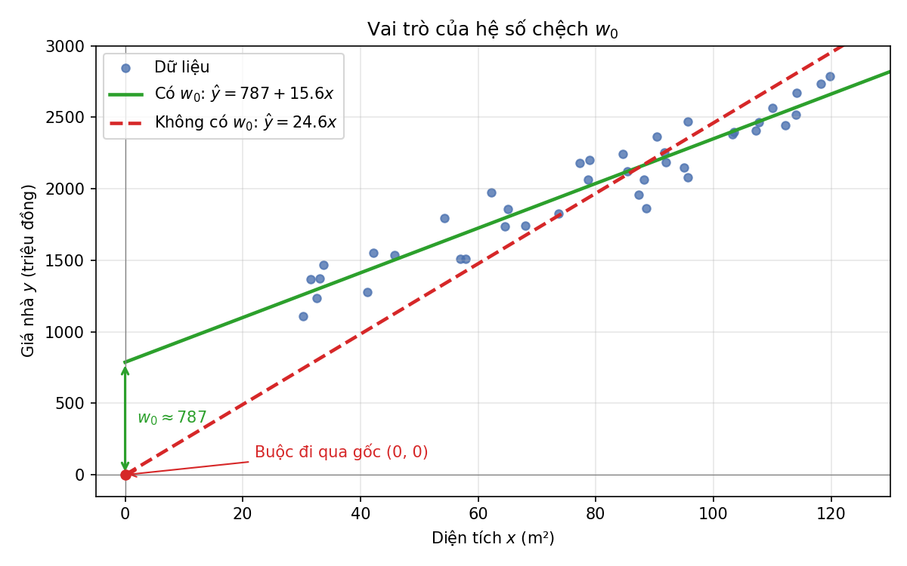

<style>
pre, pre code { font-size: 16px !important; line-height: 1.5 !important; }
</style>

# BÀI 03: CÁC BÀI TOÁN TRONG HỌC MÁY VÀ HỒI QUY TUYẾN TÍNH

- [Phần I. Các lớp bài toán trong học máy](#phần-i-các-lớp-bài-toán-trong-học-máy)
- [Phần II. Hồi quy tuyến tính](#phần-ii-hồi-quy-tuyến-tính-linear-regression)

## PHẦN I. CÁC LỚP BÀI TOÁN TRONG HỌC MÁY

### 1. Học máy là gì?

**Học máy (Machine Learning)** là một nhánh của Trí tuệ nhân tạo, nghiên cứu các phương pháp giúp máy tính **tự học từ dữ liệu** để cải thiện hiệu năng trên một nhiệm vụ mà không cần lập trình tường minh từng quy tắc.

Định nghĩa của Tom Mitchell (1997):

> Một chương trình máy tính được gọi là *học* từ kinh nghiệm **E** đối với nhiệm vụ **T** và độ đo hiệu năng **P**, nếu hiệu năng của nó trên **T**, đo bằng **P**, được cải thiện nhờ kinh nghiệm **E**.

Ví dụ: Lọc thư rác
- **T**: phân loại email là *rác* hay *không rác*
- **E**: tập email đã được gán nhãn
- **P**: tỉ lệ email được phân loại đúng

---

### 2. Các lớp bài toán trong học máy

Dựa vào **cách thức học** và **dạng dữ liệu huấn luyện**, học máy thường được chia thành các lớp chính sau:

| Lớp bài toán | Dữ liệu huấn luyện | Mục tiêu | Ví dụ |
|---|---|---|---|
| Học có giám sát (Supervised) | Có nhãn `(x, y)` | Học ánh xạ `x → y` | Dự đoán giá nhà, nhận dạng chữ viết |
| Học không giám sát (Unsupervised) | Không nhãn `x` | Tìm cấu trúc ẩn trong dữ liệu | Phân cụm khách hàng |
| Học bán giám sát (Semi-supervised) | Ít dữ liệu có nhãn + nhiều dữ liệu không nhãn | Tận dụng dữ liệu không nhãn để học tốt hơn | Phân loại ảnh y tế |
| Học tự giám sát (Self-supervised) | Không nhãn, nhãn được tự sinh từ dữ liệu | Học biểu diễn dữ liệu | Mô hình ngôn ngữ (BERT, GPT) |
| Học tăng cường (Reinforcement) | Tương tác với môi trường, nhận phần thưởng | Học chính sách hành động tối ưu | Chơi cờ, robot, xe tự lái |

#### 2.1. Học có giám sát (Supervised Learning)

Dữ liệu huấn luyện gồm các cặp `(xᵢ, yᵢ)`, trong đó `xᵢ` là đặc trưng đầu vào và `yᵢ` là nhãn (đầu ra mong muốn). Mô hình học một hàm `f` sao cho `f(x) ≈ y`.

Hai bài toán con chính:
- **Hồi quy (Regression)**: `y` là giá trị liên tục (số thực).
- **Phân lớp (Classification)**: `y` là giá trị rời rạc (nhãn lớp).

#### 2.2. Học không giám sát (Unsupervised Learning)

Chỉ có dữ liệu đầu vào `xᵢ`, không có nhãn. Mô hình tự khám phá cấu trúc, quy luật trong dữ liệu.

Các bài toán con chính:
- **Phân cụm (Clustering)**
- **Giảm chiều dữ liệu (Dimensionality Reduction)**
- **Khai phá luật kết hợp (Association Rule Mining)**
- **Phát hiện bất thường (Anomaly Detection)**

#### 2.3. Học bán giám sát (Semi-supervised Learning)

Kết hợp một lượng nhỏ dữ liệu có nhãn với lượng lớn dữ liệu không nhãn. Phù hợp khi việc gán nhãn tốn kém (cần chuyên gia, mất thời gian).

Kỹ thuật tiêu biểu: *Self-training*, *Co-training*, *Label Propagation*.

#### 2.4. Học tự giám sát (Self-supervised Learning)

Mô hình tự tạo nhãn từ chính dữ liệu, ví dụ: che một từ trong câu và yêu cầu mô hình đoán lại từ đó. Đây là nền tảng của các mô hình ngôn ngữ lớn và mô hình nền tảng (foundation models).

#### 2.5. Học tăng cường (Reinforcement Learning)

Một **tác tử (agent)** tương tác với **môi trường (environment)**: tại mỗi **trạng thái (state)**, tác tử chọn một **hành động (action)** và nhận về **phần thưởng (reward)**. Mục tiêu là học **chính sách (policy)** tối đa hóa tổng phần thưởng tích lũy.

Thuật toán tiêu biểu: *Q-Learning*, *SARSA*, *Deep Q-Network (DQN)*, *Policy Gradient*, *PPO*.

---

### 3. Các bài toán cơ bản trong học máy

#### 3.1. Bài toán hồi quy (Regression)

- **Mục tiêu**: Dự đoán một giá trị số liên tục.
- **Ví dụ**: Dự đoán giá nhà, nhiệt độ, doanh thu, giá cổ phiếu.
- **Thuật toán**: Hồi quy tuyến tính, Hồi quy đa thức, Ridge, Lasso, SVR, Cây hồi quy, Gradient Boosting.
- **Độ đo đánh giá**: MAE, MSE, RMSE, R².

#### 3.2. Bài toán phân lớp (Classification)

- **Mục tiêu**: Gán mỗi đối tượng vào một trong các lớp đã biết trước.
- **Đầu ra**: Nhãn rời rạc.
- **Phân loại**:
  - Phân lớp nhị phân (2 lớp): email rác / không rác.
  - Phân lớp đa lớp (nhiều lớp): nhận dạng chữ số 0–9.
  - Phân lớp đa nhãn: một bài báo có thể thuộc nhiều chủ đề.
- **Thuật toán**: k-NN, Naive Bayes, Logistic Regression, Cây quyết định, Random Forest, SVM, Mạng nơ-ron.
- **Độ đo đánh giá**: Accuracy, Precision, Recall, F1-score, Ma trận nhầm lẫn, ROC-AUC.

#### 3.3. Bài toán phân cụm (Clustering)

- **Mục tiêu**: Chia tập dữ liệu thành các nhóm sao cho các phần tử trong cùng nhóm giống nhau, khác nhóm thì khác nhau.
- **Ví dụ**: Phân khúc khách hàng, gom nhóm văn bản, phân đoạn ảnh.
- **Thuật toán**: K-Means, Phân cụm phân cấp (Hierarchical), DBSCAN, Gaussian Mixture Model (GMM).
- **Độ đo đánh giá**: Silhouette score, Davies–Bouldin index, Inertia (SSE).

#### 3.4. Bài toán giảm chiều dữ liệu (Dimensionality Reduction)

- **Mục tiêu**: Biểu diễn dữ liệu nhiều chiều trong không gian ít chiều hơn mà vẫn giữ được thông tin quan trọng.
- **Ứng dụng**: Trực quan hóa dữ liệu, giảm nhiễu, tăng tốc huấn luyện, tránh "lời nguyền số chiều".
- **Thuật toán**: PCA, LDA, t-SNE, UMAP, Autoencoder.

#### 3.5. Bài toán khai phá luật kết hợp (Association Rule Mining)

- **Mục tiêu**: Tìm các mối quan hệ dạng `A ⇒ B` giữa các thuộc tính/mặt hàng.
- **Ví dụ**: Phân tích giỏ hàng — "Khách mua bánh mì thường mua thêm sữa".
- **Thuật toán**: Apriori, FP-Growth.
- **Độ đo**: Support, Confidence, Lift.

#### 3.6. Bài toán phát hiện bất thường (Anomaly Detection)

- **Mục tiêu**: Phát hiện các điểm dữ liệu khác biệt đáng kể so với phần lớn dữ liệu.
- **Ví dụ**: Phát hiện gian lận thẻ tín dụng, xâm nhập mạng, lỗi thiết bị.
- **Thuật toán**: Isolation Forest, One-Class SVM, Local Outlier Factor (LOF).

#### 3.7. Bài toán xếp hạng và gợi ý (Ranking & Recommendation)

- **Mục tiêu**: Sắp xếp hoặc gợi ý các đối tượng phù hợp nhất với người dùng.
- **Ví dụ**: Gợi ý phim (Netflix), sản phẩm (Shopee), xếp hạng kết quả tìm kiếm.
- **Phương pháp**: Lọc cộng tác (Collaborative Filtering), Lọc theo nội dung (Content-based), Phân rã ma trận (Matrix Factorization).

---

### 4. Quy trình chung giải một bài toán học máy

1. **Xác định bài toán**: Thuộc lớp nào? Hồi quy, phân lớp hay phân cụm?
2. **Thu thập dữ liệu**.
3. **Tiền xử lý dữ liệu**: làm sạch, xử lý giá trị thiếu, chuẩn hóa, mã hóa biến phân loại.
4. **Trích chọn / xây dựng đặc trưng** (Feature engineering).
5. **Chia dữ liệu**: tập huấn luyện (train), kiểm định (validation), kiểm tra (test).
6. **Lựa chọn và huấn luyện mô hình**.
7. **Đánh giá mô hình** bằng các độ đo phù hợp.
8. **Tinh chỉnh siêu tham số** (Grid Search, Random Search, Cross-validation).
9. **Triển khai và giám sát mô hình**.

---

### 5. Gợi ý lựa chọn bài toán

```
Dữ liệu có nhãn?
├── Có
│   ├── Nhãn liên tục   → HỒI QUY
│   └── Nhãn rời rạc    → PHÂN LỚP
└── Không
    ├── Muốn gom nhóm         → PHÂN CỤM
    ├── Muốn giảm số chiều    → GIẢM CHIỀU
    ├── Muốn tìm quy luật     → LUẬT KẾT HỢP
    └── Muốn tìm điểm lạ      → PHÁT HIỆN BẤT THƯỜNG

Học qua tương tác + phần thưởng → HỌC TĂNG CƯỜNG
```

---

### 6. Tóm tắt

- Học máy có các lớp chính: **có giám sát**, **không giám sát**, **bán giám sát**, **tự giám sát** và **tăng cường**.
- Các bài toán cơ bản: **hồi quy**, **phân lớp**, **phân cụm**, **giảm chiều**, **luật kết hợp**, **phát hiện bất thường**, **gợi ý**.
- Việc xác định đúng lớp bài toán là bước đầu tiên và quan trọng nhất để chọn thuật toán và độ đo đánh giá phù hợp.

---

## PHẦN II. HỒI QUY TUYẾN TÍNH (LINEAR REGRESSION)

> Tài liệu tham khảo: *Giáo trình Machine Learning 2026*, Chương 4 – Hồi quy tuyến tính.

**Hồi quy tuyến tính** là một phương pháp **học có giám sát** dùng cho bài toán **hồi quy**, trong đó mối quan hệ giữa biến đầu vào và biến đầu ra được mô hình hóa bằng một **hàm tuyến tính**. Đây là một trong những mô hình cơ bản và đơn giản nhất trong học máy, đồng thời là nền tảng cho nhiều phương pháp hồi quy phức tạp hơn.

---

### 1. Phát biểu bài toán

Xét bài toán **dự đoán giá nhà**. Mỗi căn nhà được mô tả bởi ba đặc trưng:

| Ký hiệu | Đặc trưng | Đơn vị |
|---|---|---|
| $x_1$ | Diện tích | m² |
| $x_2$ | Số phòng ngủ | phòng |
| $x_3$ | Khoảng cách tới trung tâm | km |

Cho tập dữ liệu gồm 10.000 căn nhà đã biết giá bán. Với một căn nhà mới, ta cần xây dựng hàm dự đoán:

$$
y = f(\mathbf{x}), \qquad \mathbf{x} = [x_1, x_2, x_3]^T
$$

Thực tế cho thấy giá nhà **tăng** khi diện tích lớn hơn, số phòng nhiều hơn, và **giảm** khi xa trung tâm hơn. Do đó, một giả thiết hợp lý là giá nhà được xấp xỉ bởi một **hàm tuyến tính**:

$$
y \approx \hat{y} = f(\mathbf{x}) = w_0 + w_1 x_1 + w_2 x_2 + w_3 x_3
$$

trong đó:
- $w_0$: **hệ số chệch** (bias)
- $\mathbf{w} = [w_1, w_2, w_3]^T$: **vector trọng số** cần ước lượng từ dữ liệu

#### Viết gọn bằng vector mở rộng

Thêm phần tử $1$ vào đầu vector đặc trưng:

$$
\bar{\mathbf{x}} = [1, x_1, x_2, x_3]^T, \qquad \bar{\mathbf{w}} = [w_0, w_1, w_2, w_3]^T
$$

Khi đó mô hình viết gọn thành:

$$
\hat{y} = \bar{\mathbf{x}}^T \bar{\mathbf{w}}
$$

> **Vì sao cần hệ số chệch $w_0$?**
> Nếu không có $w_0$, đường hồi quy buộc phải đi qua gốc tọa độ (khi $\mathbf{x} = \mathbf{0}$ thì $\hat{y} = 0$). Điều này thường không hợp lý trong thực tế. Hệ số chệch cho phép đường hồi quy dịch chuyển song song với trục tung, giúp mô tả dữ liệu tốt hơn.



*Hình: Mô phỏng 40 căn nhà với giá thực $y \approx 800 + 15x$. Đường **có** $w_0$ (xanh) bám sát dữ liệu. Đường **không có** $w_0$ (đỏ, nét đứt) bị buộc đi qua gốc tọa độ nên phải "dốc" hơn để bù: nó dự đoán thấp với nhà nhỏ và cao với nhà lớn. Mã nguồn vẽ hình: [images/ve_he_so_chech.py](images/ve_he_so_chech.py).*

---

### 2. Xây dựng và tối ưu hàm mất mát

#### 2.1. Mô hình tổng quát

Với dữ liệu có $d$ đặc trưng, $\mathbf{x} \in \mathbb{R}^d$:

$$
y = w_0 + w_1 x_1 + w_2 x_2 + \dots + w_d x_d = w_0 + \mathbf{x}^T \mathbf{w}
$$

#### 2.2. Sai số dự đoán

Sai số giữa giá trị thực và giá trị dự đoán:

$$
e = y - \hat{y}
$$

Dùng **sai số bình phương**:

$$
\frac{1}{2} e^2 = \frac{1}{2}(y - \hat{y})^2 = \frac{1}{2}(y - \mathbf{x}^T \mathbf{w})^2
$$

**Tại sao dùng bình phương?**

1. Sai số $e$ có thể âm hoặc dương. Nếu cộng trực tiếp, các sai số sẽ **triệt tiêu lẫn nhau**. Bình phương đảm bảo mọi sai số đều không âm.
2. Có thể dùng trị tuyệt đối $|e|$, nhưng hàm này **không khả vi tại $e = 0$**, gây khó khăn cho các thuật toán tối ưu dựa trên đạo hàm như Gradient Descent.
3. Hệ số $\frac{1}{2}$ chỉ để thuận tiện: khi lấy đạo hàm, nó triệt tiêu với số $2$ sinh ra từ bình phương.

> **Lưu ý:** Trong bài này ta dùng **sai số bình phương** vì nó khả vi, lồi và cho **nghiệm dạng đóng** (mục 2.5). Khi lấy trung bình các sai số trên toàn bộ tập dữ liệu, ta thu được các độ đo đánh giá mô hình như MAE, MSE, RMSE (xem mục 6).

#### 2.3. Hàm mất mát

Với tập huấn luyện gồm $N$ mẫu $(\mathbf{x}_i, y_i)$, hàm mất mát là **trung bình sai số bình phương**:

$$
\mathcal{L}(\mathbf{w}) = \frac{1}{2N} \sum_{i=1}^{N} (y_i - \mathbf{x}_i^T \mathbf{w})^2
$$

Bài toán huấn luyện trở thành bài toán tối ưu:

$$
\mathbf{w}^* = \arg\min_{\mathbf{w}} \mathcal{L}(\mathbf{w})
$$

> **Vì sao chia cho $N$?**
> Nhân hàm mất mát với một hằng số dương **không làm thay đổi nghiệm tối ưu**. Tuy nhiên, lấy trung bình giúp giá trị hàm mất mát **không phụ thuộc vào kích thước tập dữ liệu**, nhờ đó có thể so sánh chất lượng mô hình giữa các tập dữ liệu khác nhau.

#### 2.4. Dạng ma trận

Đặt ma trận dữ liệu $\mathbf{X} \in \mathbb{R}^{N \times d}$, **mỗi hàng là một mẫu** $\mathbf{x}_i^T$, và $\mathbf{y} = [y_1, y_2, \dots, y_N]^T$:

$$
\mathbf{X} =
\begin{bmatrix}
\mathbf{x}_1^T \\ \mathbf{x}_2^T \\ \vdots \\ \mathbf{x}_N^T
\end{bmatrix}
\quad\Rightarrow\quad
\mathcal{L}(\mathbf{w}) = \frac{1}{2N} \left\| \mathbf{y} - \mathbf{X}\mathbf{w} \right\|_2^2
$$

Như vậy hàm mất mát là bình phương **chuẩn $\ell_2$** của vector sai số.

#### 2.5. Nghiệm của hồi quy tuyến tính (Normal Equation)

Hàm mất mát khả vi với mọi $\mathbf{w}$, nên nghiệm tối ưu thỏa mãn gradient bằng $0$:

$$
\nabla_{\mathbf{w}} \mathcal{L}(\mathbf{w}) = \frac{1}{N} \mathbf{X}^T (\mathbf{X}\mathbf{w} - \mathbf{y}) = \mathbf{0}
\quad\Leftrightarrow\quad
\mathbf{X}^T \mathbf{X}\, \mathbf{w} = \mathbf{X}^T \mathbf{y}
$$

**Trường hợp 1:** $\mathbf{X}^T\mathbf{X}$ khả nghịch → nghiệm duy nhất:

$$
\mathbf{w} = (\mathbf{X}^T \mathbf{X})^{-1} \mathbf{X}^T \mathbf{y}
$$

**Trường hợp 2:** $\mathbf{X}^T\mathbf{X}$ không khả nghịch → dùng **giả nghịch đảo** (pseudo-inverse) $(\cdot)^\dagger$:

$$
\mathbf{w} = (\mathbf{X}^T \mathbf{X})^{\dagger} \mathbf{X}^T \mathbf{y}
$$

Giả nghịch đảo **luôn tồn tại**, kể cả khi ma trận không vuông hoặc không khả nghịch. Nghiệm này là vector $\mathbf{w}$ có **chuẩn $\ell_2$ nhỏ nhất** trong số các nghiệm làm cực tiểu sai số bình phương. Khi ma trận vuông và khả nghịch, giả nghịch đảo trùng với nghịch đảo thông thường.

Vì vậy, **nghiệm tổng quát** là:

$$
\boxed{\mathbf{w} = (\mathbf{X}^T \mathbf{X})^{\dagger} \mathbf{X}^T \mathbf{y}}
$$

Trong Python, giả nghịch đảo được tính bằng `numpy.linalg.pinv()`.

> **Ghi chú:** Giáo trình viết $\mathbf{X} = [\mathbf{x}_1, \dots, \mathbf{x}_N]$ (mỗi **cột** là một mẫu), khi đó công thức có dạng $\mathbf{w} = (\mathbf{X}\mathbf{X}^T)^\dagger \mathbf{X}\mathbf{y}$. Tài liệu này dùng quy ước **mỗi hàng là một mẫu** để khớp với NumPy và scikit-learn. Hai cách viết là tương đương.

#### 2.6. Giải bằng Gradient Descent

Ngoài nghiệm giải tích, có thể tìm $\mathbf{w}$ bằng **Gradient Descent** (xem Chương 3), lặp lại cập nhật:

$$
\mathbf{w} \leftarrow \mathbf{w} - \eta \, \nabla_{\mathbf{w}} \mathcal{L}(\mathbf{w}) = \mathbf{w} - \frac{\eta}{N} \mathbf{X}^T (\mathbf{X}\mathbf{w} - \mathbf{y})
$$

với $\eta$ là tốc độ học (learning rate). Cách này phù hợp khi dữ liệu lớn, vì việc tính nghịch đảo ma trận $d \times d$ trở nên tốn kém.

---

### 3. Ví dụ trên Python: Dự đoán cân nặng theo chiều cao

#### 3.1. Bài toán

Cho dữ liệu chiều cao và cân nặng của 15 người. Hai người có chiều cao **155 cm** và **160 cm** được tách ra làm **tập kiểm tra**, 13 người còn lại là **tập huấn luyện**.

<table width="100%" style="width: 100%;">
  <thead>
    <tr><th>STT</th><th>Chiều cao (cm)</th><th>Cân nặng (kg)</th><th>Tập dữ liệu</th></tr>
  </thead>
  <tbody>
    <tr><td>1</td><td>147</td><td>49</td><td>Huấn luyện</td></tr>
    <tr><td>2</td><td>150</td><td>50</td><td>Huấn luyện</td></tr>
    <tr><td>3</td><td>153</td><td>51</td><td>Huấn luyện</td></tr>
    <tr><td>4</td><td>158</td><td>54</td><td>Huấn luyện</td></tr>
    <tr><td>5</td><td>163</td><td>58</td><td>Huấn luyện</td></tr>
    <tr><td>6</td><td>165</td><td>59</td><td>Huấn luyện</td></tr>
    <tr><td>7</td><td>168</td><td>60</td><td>Huấn luyện</td></tr>
    <tr><td>8</td><td>170</td><td>62</td><td>Huấn luyện</td></tr>
    <tr><td>9</td><td>173</td><td>63</td><td>Huấn luyện</td></tr>
    <tr><td>10</td><td>175</td><td>64</td><td>Huấn luyện</td></tr>
    <tr><td>11</td><td>178</td><td>66</td><td>Huấn luyện</td></tr>
    <tr><td>12</td><td>180</td><td>67</td><td>Huấn luyện</td></tr>
    <tr><td>13</td><td>183</td><td>68</td><td>Huấn luyện</td></tr>
    <tr><td><b>14</b></td><td><b>155</b></td><td><b>52</b></td><td><b>Kiểm tra</b></td></tr>
    <tr><td><b>15</b></td><td><b>160</b></td><td><b>56</b></td><td><b>Kiểm tra</b></td></tr>
  </tbody>
</table>

*(Các dòng in đậm là tập kiểm tra.)*

> **Lưu ý:** Bảng 4.1 trong giáo trình ghi cân nặng của người cao 170 cm là **72 kg**, nhưng code minh họa trong giáo trình dùng **62 kg**. Giá trị 62 kg phù hợp với xu hướng chung của dữ liệu và cho đúng kết quả trong sách, nên tài liệu này dùng 62 kg.

Giữa chiều cao và cân nặng có mối quan hệ **thuận chiều** (người cao hơn thường nặng hơn), nên dùng mô hình:

$$
\text{(cân nặng)} = w_1 \cdot \text{(chiều cao)} + w_0
$$

#### 3.2. Khai báo và hiển thị dữ liệu

```python
import numpy as np
import matplotlib.pyplot as plt

# Du lieu chieu cao (cm) - moi hang la mot mau du lieu
X = np.array([[147, 150, 153, 158, 163, 165, 168, 170,
               173, 175, 178, 180, 183]]).T

# Du lieu can nang tuong ung (kg) - bien muc tieu
y = np.array([49, 50, 51, 54, 58, 59, 60, 62, 63, 64, 66, 67, 68])

plt.plot(X, y, 'ro')
plt.xlabel('Chieu cao (cm)')
plt.ylabel('Can nang (kg)')
plt.show()
```


*Hình: Chiều cao và cân nặng của 13 người trong tập huấn luyện. Mã nguồn vẽ hình: [images/ve_chieu_cao_can_nang.py](images/ve_chieu_cao_can_nang.py).*

Các điểm dữ liệu nằm **gần như trên một đường thẳng**, vì vậy hồi quy tuyến tính có khả năng cho kết quả tốt.

#### 3.3. Nghiệm theo công thức

```python
# Bước 1: Tạo ma trận Xbar (thêm cột 1 vào trước ma trận X)
# X.shape[0] = 13 là số mẫu -> one là vector cột gồm 13 số 1, kích thước 13 x 1
one = np.ones((X.shape[0], 1))
# Ghép theo chiều ngang (axis=1): cột 1 là số 1, cột 2 là chiều cao
# Xbar kích thước 13 x 2, mỗi hàng là [1, x_i] => [1, x_i] . [w_0, w_1] = w_0 + w_1 * x_i
Xbar = np.concatenate((one, X), axis=1)

# Tính w = (Xbar^T Xbar)^+ Xbar^T y
# Bước 2: A = Xbar^T Xbar, kích thước (2 x 13)(13 x 2) = 2 x 2
#         A = [[N, tổng x_i], [tổng x_i, tổng x_i^2]] = [[13, 2163], [2163, 361527]]
A = np.dot(Xbar.T, Xbar)
# Bước 3: b = Xbar^T y, kích thước (2 x 13)(13) = 2
#         b = [tổng y_i, tổng x_i*y_i] = [771, 129198]
b = np.dot(Xbar.T, y)
# Bước 4: Giải hệ phương trình chuẩn A w = b bằng giả nghịch đảo: w = A^+ b
#         pinv vẫn cho nghiệm khi A không khả nghịch (inv sẽ báo lỗi)
w = np.dot(np.linalg.pinv(A), b)

# w là mảng 1 chiều: w[0] là hệ số chệch w_0, w[1] là hệ số góc w_1
w_0, w_1 = w[0], w[1]
print('w_0 =', w_0)
print('w_1 =', w_1)

# Vẽ đường hồi quy
x0 = np.linspace(145, 185, 2)
y0 = w_0 + w_1 * x0
plt.plot(X, y, 'ro')
plt.plot(x0, y0)
plt.xlabel('Chieu cao (cm)')
plt.ylabel('Can nang (kg)')
plt.show()

# Dự đoán trên tập kiểm tra
y1 = w_1 * 155 + w_0
y2 = w_1 * 160 + w_0
print('Chiều cao 155 cm, cân nặng thực tế 52 kg, dự đoán %.2f kg' % y1)
print('Chiều cao 160 cm, cân nặng thực tế 56 kg, dự đoán %.2f kg' % y2)
```

##### Giải thích chi tiết phần tính nghiệm

Phần tính nghiệm gồm 4 bước, ứng với công thức ở mục 2.5:

$$
\bar{\mathbf{w}} = (\bar{\mathbf{X}}^T \bar{\mathbf{X}})^{\dagger} \bar{\mathbf{X}}^T \mathbf{y}
$$

| Bước | Code | Công thức | Kích thước |
| --- | --- | --- | --- |
| 1 | `Xbar = np.concatenate((one, X), axis=1)` | $\bar{\mathbf{X}}$ | $13 \times 2$ |
| 2 | `A = np.dot(Xbar.T, Xbar)` | $\mathbf{A} = \bar{\mathbf{X}}^T \bar{\mathbf{X}}$ | $(2 \times 13)(13 \times 2) = 2 \times 2$ |
| 3 | `b = np.dot(Xbar.T, y)` | $\mathbf{b} = \bar{\mathbf{X}}^T \mathbf{y}$ | $(2 \times 13)(13) = 2$ |
| 4 | `w = np.dot(np.linalg.pinv(A), b)` | $\bar{\mathbf{w}} = \mathbf{A}^{\dagger} \mathbf{b}$ | $(2 \times 2)(2) = 2$ |

**Bước 1: Thêm cột toàn số 1 vào trước $\mathbf{X}$**

```python
one = np.ones((X.shape[0], 1))
Xbar = np.concatenate((one, X), axis=1)
```

- `X.shape[0]` là số mẫu (13), nên `one` là vector cột gồm 13 số 1, kích thước $13 \times 1$.
- `np.concatenate(..., axis=1)` ghép **theo chiều ngang** (thêm cột): cột 1 là `one`, cột 2 là chiều cao. Nếu dùng `axis=0` thì hai mảng bị xếp chồng theo chiều dọc, sai ý đồ.

$$
\mathbf{X} = \begin{bmatrix} 147 \\ 150 \\ \vdots \\ 183 \end{bmatrix}
\quad \longrightarrow \quad
\bar{\mathbf{X}} = \begin{bmatrix} 1 & 147 \\ 1 & 150 \\ \vdots & \vdots \\ 1 & 183 \end{bmatrix}
$$

Lý do thêm cột 1: mỗi hàng của $\bar{\mathbf{X}}$ là $\bar{\mathbf{x}}^T = [1, x]$, nên

$$
\bar{\mathbf{x}}^T \bar{\mathbf{w}} = 1 \cdot w_0 + x \cdot w_1 = w_0 + w_1 x
$$

Nhờ cột 1, hệ số chệch $w_0$ được gộp vào vector $\bar{\mathbf{w}}$ và tính cùng lúc với $w_1$ bằng một công thức duy nhất.

**Bước 2: Tính $\mathbf{A} = \bar{\mathbf{X}}^T \bar{\mathbf{X}}$**

```python
A = np.dot(Xbar.T, Xbar)
```

`Xbar.T` là ma trận chuyển vị, kích thước $2 \times 13$. Nhân với `Xbar` ($13 \times 2$) được ma trận vuông $2 \times 2$:

$$
\mathbf{A} = \begin{bmatrix} N & \sum x_i \\ \sum x_i & \sum x_i^2 \end{bmatrix}
= \begin{bmatrix} 13 & 2163 \\ 2163 & 361527 \end{bmatrix}
$$

- $N = 13$: tổng các tích $1 \cdot 1$, tức số mẫu.
- $\sum x_i = 2163$: tổng chiều cao.
- $\sum x_i^2 = 361527$: tổng bình phương chiều cao.

**Bước 3: Tính $\mathbf{b} = \bar{\mathbf{X}}^T \mathbf{y}$**

```python
b = np.dot(Xbar.T, y)
```

`Xbar.T` ($2 \times 13$) nhân với `y` (13 phần tử) được vector 2 phần tử:

$$
\mathbf{b} = \begin{bmatrix} \sum y_i \\ \sum x_i y_i \end{bmatrix}
= \begin{bmatrix} 771 \\ 129198 \end{bmatrix}
$$

- $\sum y_i = 771$: tổng cân nặng.
- $\sum x_i y_i = 129198$: tổng các tích chiều cao × cân nặng.

**Bước 4: Tính $\bar{\mathbf{w}} = \mathbf{A}^{\dagger} \mathbf{b}$**

```python
w = np.dot(np.linalg.pinv(A), b)
```

Bước 2 và 3 thực chất là lập **hệ phương trình chuẩn** $\mathbf{A}\bar{\mathbf{w}} = \mathbf{b}$ (mục 2.5). Viết tường minh:

$$
\begin{cases}
13\, w_0 + 2163\, w_1 = 771 \\
2163\, w_0 + 361527\, w_1 = 129198
\end{cases}
$$

Giải hệ 2 phương trình 2 ẩn này được $w_0 \approx -33.7354$ và $w_1 \approx 0.5592$. Code giải hệ bằng cách nhân $\mathbf{b}$ với giả nghịch đảo của $\mathbf{A}$:

$$
\mathbf{A}^{\dagger} \approx \begin{bmatrix} 16.98745 & -0.10164 \\ -0.10164 & 0.00061 \end{bmatrix},
\qquad
\bar{\mathbf{w}} = \mathbf{A}^{\dagger}\mathbf{b} \approx \begin{bmatrix} -33.7354 \\ 0.5592 \end{bmatrix}
$$

Vì sao dùng `pinv` (giả nghịch đảo) mà không dùng `inv` (nghịch đảo)?

- Ở ví dụ này, $\det(\mathbf{A}) = 13 \cdot 361527 - 2163^2 = 21282 \neq 0$, nên $\mathbf{A}$ khả nghịch và `pinv(A)` cho cùng kết quả với `inv(A)`.
- Khi $\mathbf{A}$ không khả nghịch (ví dụ có hai đặc trưng trùng nhau, hoặc số mẫu ít hơn số đặc trưng), `inv` báo lỗi, còn `pinv` vẫn cho nghiệm. Vì vậy `pinv` an toàn hơn.

**Ghi chú về NumPy**

- `np.dot(P, Q)` là phép nhân ma trận; có thể viết gọn là `P @ Q`. Cả 4 bước có thể viết thành một dòng: `w = np.linalg.pinv(Xbar.T @ Xbar) @ Xbar.T @ y`.
- `y` là mảng 1 chiều nên `b` và `w` cũng là mảng 1 chiều: `w[0]` là $w_0$, `w[1]` là $w_1$.

**Ý nghĩa của nghiệm**

- $w_1 \approx 0.5592$: cao thêm 1 cm thì cân nặng tăng trung bình khoảng 0.56 kg.
- $w_0 \approx -33.7354$: là điểm cắt trục tung, giúp đường thẳng nằm đúng vị trí. Giá trị này không có ý nghĩa thực tế (không ai cao 0 cm), vì mô hình chỉ đáng tin trong khoảng chiều cao của dữ liệu (147–183 cm).

**Kết quả:**

```
w_0 = -33.7354
w_1 = 0.5592
Chiều cao 155 cm, cân nặng thực tế 52 kg, dự đoán 52.94 kg
Chiều cao 160 cm, cân nặng thực tế 56 kg, dự đoán 55.74 kg
```


*Hình: Đường hồi quy $\hat{y} = 0.5592x - 33.7354$ tìm được bằng công thức (xanh dương) đi sát 13 điểm huấn luyện (đỏ). Với tập kiểm tra, ô vuông xanh lá là cân nặng thực tế, dấu × là giá trị dự đoán; đường chấm nối hai giá trị cho thấy sai số. Mã nguồn vẽ hình: [images/ve_nghiem_cong_thuc.py](images/ve_nghiem_cong_thuc.py).*

Kết quả dự đoán khá sát với giá trị thực tế.

#### 3.4. Sử dụng thư viện scikit-learn

```python
from sklearn import linear_model

model = linear_model.LinearRegression()
model.fit(X, y)   # moi mau du lieu la mot hang

print("Ket qua tu scikit-learn:")
print("w1 =", model.coef_[0])     # he so goc
print("w0 =", model.intercept_)   # he so chech

print("Ket qua tinh toan thu cong:")
print("w1 =", w[1])
print("w0 =", w[0])
```

Hai kết quả **trùng nhau**: $w_1 \approx 0.5592$, $w_0 \approx -33.7354$.

---

### 4. Thảo luận

#### 4.1. Hồi quy đa thức

Mô hình $y \approx \mathbf{x}^T\mathbf{w} + b$ tuyến tính theo cả $\mathbf{w}$ và $\mathbf{x}$. Thực ra, hồi quy tuyến tính **chỉ cần tuyến tính theo $\mathbf{w}$**. Ví dụ:

$$
y \approx w_1 x_1 + w_2 x_2 + w_3 x_1^2 + w_4 \sin(x_2) + w_5 x_1 x_2 + w_0
$$

không tuyến tính theo $\mathbf{x}$ nhưng vẫn tuyến tính theo $\mathbf{w}$. Ta chỉ cần tạo vector đặc trưng mới:

$$
\tilde{\mathbf{x}} = [x_1,\ x_2,\ x_1^2,\ \sin(x_2),\ x_1 x_2]^T
$$

rồi áp dụng hồi quy tuyến tính như bình thường.

Trong thực tế, **hồi quy đa thức** (polynomial regression) hay được dùng hơn, với vector đặc trưng dạng $[1, x, x^2, x^3, \dots]^T$.

```python
from sklearn.preprocessing import PolynomialFeatures
from sklearn.linear_model import LinearRegression
from sklearn.pipeline import make_pipeline

# Hoi quy da thuc bac 3
poly_model = make_pipeline(PolynomialFeatures(degree=3), LinearRegression())
poly_model.fit(X, y)
```

#### 4.2. Hạn chế của hồi quy tuyến tính

##### a) Nhạy cảm với nhiễu và giá trị ngoại lai (outliers)

Giả sử dữ liệu có thêm một điểm bất thường **(150 cm, 90 kg)**. Vì hồi quy tuyến tính tối thiểu hóa **sai số bình phương**, các sai số lớn bị **khuếch đại**, nên chỉ một vài điểm ngoại lai cũng có thể làm lệch đáng kể đường hồi quy.

**Cách khắc phục:**
- Loại bỏ điểm nhiễu trước khi huấn luyện. Cách này khó áp dụng khi dữ liệu lớn hoặc nhiều chiều.
- Dùng **hàm mất mát kháng nhiễu** (robust loss):
  - **Huber loss** (hồi quy Huber): hoạt động như **L2 loss** khi sai số nhỏ và như **L1 loss** khi sai số lớn.
  - **Least Absolute Deviations** (L1 regression): tối thiểu hóa tổng sai số tuyệt đối.
  - **RANSAC**: chọn ngẫu nhiên các tập con dữ liệu để tìm mô hình tốt nhất và loại bỏ điểm ngoại lai.
  - **Theil–Sen estimator**: ước lượng hệ số dựa trên **trung vị** của nhiều ước lượng.

```python
from sklearn.linear_model import HuberRegressor, RANSACRegressor, TheilSenRegressor

huber = HuberRegressor().fit(X, y)
ransac = RANSACRegressor().fit(X, y)
theil = TheilSenRegressor().fit(X, y)
```

##### b) Khả năng biểu diễn hạn chế

Mô hình giả định quan hệ **tuyến tính**, trong khi nhiều bài toán thực tế có quan hệ **phi tuyến**. Có thể thêm đặc trưng phi tuyến ($x_1^2$, $\sin(x_2)$, $x_1x_2$, …), nhưng khi số chiều tăng thì số đặc trưng tăng rất nhanh, dẫn đến **bùng nổ số chiều** (curse of dimensionality).

##### c) Các hạn chế khác

- **Đa cộng tuyến** (multicollinearity): khi các biến đầu vào tương quan cao, ước lượng hệ số trở nên **không ổn định**.
- **Giả định tuyến tính mạnh**: không phải lúc nào cũng đúng với dữ liệu thực.
- **Phương sai thay đổi** (heteroscedasticity): khi phương sai của sai số thay đổi theo đầu vào, hiệu quả mô hình giảm.

→ Với bài toán phức tạp, thường dùng **cây quyết định, random forest, mạng nơ-ron** hoặc **mô hình kernel**.

---

### 5. Hồi quy Ridge và Lasso

Để khắc phục hiện tượng **quá khớp** (overfitting) và **đa cộng tuyến**, ta dùng kỹ thuật **điều chuẩn** (regularization): bổ sung một **thành phần phạt** vào hàm mất mát để hạn chế độ lớn của các tham số.

Hàm mất mát thông thường:

$$
\mathcal{L}(\mathbf{w}) = \sum_{i=1}^{n} (y_i - \hat{y}_i)^2
$$

#### 5.1. Hồi quy Ridge (điều chuẩn L2)

$$
\mathcal{L}_{\text{Ridge}}(\mathbf{w}) = \sum_{i=1}^{n} (y_i - \hat{y}_i)^2 + \lambda \sum_{j=1}^{d} w_j^2
$$

- $\lambda \ge 0$: **hệ số điều chuẩn**. $\lambda$ càng lớn thì các hệ số càng bị "co" về gần $0$.
- Thành phần phạt làm giảm độ lớn các hệ số, giúp mô hình **ổn định hơn** và **giảm overfitting**.

Nghiệm dạng ma trận:

$$
\mathbf{w} = (\mathbf{X}^T\mathbf{X} + \lambda \mathbf{I})^{-1} \mathbf{X}^T \mathbf{y}
$$

với $\mathbf{I}$ là ma trận đơn vị. Khi $\lambda > 0$, ma trận $\mathbf{X}^T\mathbf{X} + \lambda\mathbf{I}$ **luôn khả nghịch**, vì vậy Ridge còn giải quyết được trường hợp $\mathbf{X}^T\mathbf{X}$ suy biến.

#### 5.2. Hồi quy Lasso (điều chuẩn L1)

**Lasso** = *Least Absolute Shrinkage and Selection Operator*.

$$
\mathcal{L}_{\text{Lasso}}(\mathbf{w}) = \sum_{i=1}^{n} (y_i - \hat{y}_i)^2 + \lambda \sum_{j=1}^{d} |w_j|
$$

Lasso có thể đưa **một số hệ số $w_j$ về đúng bằng $0$**, tương đương với việc **loại bỏ các đặc trưng không quan trọng**. Vì vậy Lasso thường được dùng để **lựa chọn đặc trưng** (feature selection).

#### 5.3. So sánh Ridge và Lasso

| Tiêu chí | Ridge | Lasso |
|---|---|---|
| Thành phần phạt | $\lambda \sum w_j^2$ (chuẩn L2) | $\lambda \sum \lvert w_j \rvert$ (chuẩn L1) |
| Ảnh hưởng lên hệ số | Giảm độ lớn, **hiếm khi bằng 0** | Có thể đưa hệ số **về đúng 0** |
| Lựa chọn đặc trưng | Không | Có |
| Nghiệm giải tích | Có | Không (giải bằng phương pháp lặp) |
| Phù hợp khi | **Tất cả** đặc trưng đều có ảnh hưởng | Chỉ **một số ít** đặc trưng thực sự quan trọng |

#### 5.4. Ví dụ Python

```python
import numpy as np
from sklearn.linear_model import Ridge, Lasso

X = np.array([[147, 150, 153, 158, 163, 165, 168, 170,
               173, 175, 178, 180, 183]]).T
y = np.array([49, 50, 51, 54, 58, 59, 60, 62, 63, 64, 66, 67, 68])

# Ridge Regression (alpha chinh la lambda)
ridge_model = Ridge(alpha=1.0)
ridge_model.fit(X, y)
print("Ridge: w1 =", ridge_model.coef_[0], ", w0 =", ridge_model.intercept_)

# Lasso Regression
lasso_model = Lasso(alpha=0.1)
lasso_model.fit(X, y)
print("Lasso: w1 =", lasso_model.coef_[0], ", w0 =", lasso_model.intercept_)

# Du doan can nang cho nguoi cao 160 cm
h = np.array([[160]])
print("Du doan bang Ridge:", ridge_model.predict(h))
print("Du doan bang Lasso:", lasso_model.predict(h))
```

**Kết quả:**

```
Ridge: w1 = 0.5589 , w0 = -33.6786
Lasso: w1 = 0.5584 , w0 = -33.6033
Du doan bang Ridge: [55.74]
Du doan bang Lasso: [55.74]
```

Với dữ liệu chỉ có 1 đặc trưng và không bị nhiễu, Ridge và Lasso cho kết quả rất gần với hồi quy tuyến tính thông thường. Sự khác biệt thể hiện rõ hơn khi dữ liệu có **nhiều đặc trưng** hoặc các đặc trưng **tương quan mạnh**.

---

### 6. Đánh giá mô hình hồi quy

| Độ đo | Công thức | Ý nghĩa |
|---|---|---|
| MAE | $\frac{1}{N}\sum \lvert y_i - \hat{y}_i \rvert$ | Sai số tuyệt đối trung bình |
| MSE | $\frac{1}{N}\sum (y_i - \hat{y}_i)^2$ | Sai số bình phương trung bình |
| RMSE | $\sqrt{\text{MSE}}$ | Cùng đơn vị với $y$, dễ diễn giải |
| $R^2$ | $1 - \frac{\sum (y_i - \hat{y}_i)^2}{\sum (y_i - \bar{y})^2}$ | Tỉ lệ phương sai được giải thích (càng gần 1 càng tốt) |

```python
from sklearn.metrics import mean_absolute_error, mean_squared_error, r2_score

X_test = np.array([[155], [160]])
y_test = np.array([52, 56])
y_pred = model.predict(X_test)

print("MAE  =", mean_absolute_error(y_test, y_pred))
print("MSE  =", mean_squared_error(y_test, y_pred))
print("RMSE =", np.sqrt(mean_squared_error(y_test, y_pred)))
```

---

### 7. Kết luận

- **Hồi quy tuyến tính** mô tả quan hệ giữa biến phụ thuộc và một hoặc nhiều biến độc lập bằng một **hàm tuyến tính**.
- Tham số được tìm bằng cách **tối thiểu hóa sai số bình phương trung bình (MSE)**, thông qua:
  - **Nghiệm giải tích** (Normal Equation): $\mathbf{w} = (\mathbf{X}^T\mathbf{X})^\dagger\mathbf{X}^T\mathbf{y}$
  - **Gradient Descent**: phù hợp khi dữ liệu lớn.
- **Hạn chế**: nhạy cảm với ngoại lai, chỉ biểu diễn được quan hệ tuyến tính, gặp vấn đề đa cộng tuyến.
- **Điều chuẩn** giúp giảm overfitting: **Ridge** (L2) làm co hệ số; **Lasso** (L1) có thể loại bỏ đặc trưng.
- Hồi quy tuyến tính đơn giản nhưng là **nền tảng** cho nhiều mô hình phức tạp hơn trong học sâu và thống kê hiện đại.

---

### 8. Câu hỏi ôn tập

#### Câu hỏi lý thuyết

1. Trình bày khái niệm mô hình hồi quy tuyến tính. Mục tiêu của bài toán hồi quy tuyến tính là gì?
2. Viết biểu thức toán học của mô hình hồi quy tuyến tính với $d$ biến đầu vào.
3. Trình bày hàm mất mát thường dùng trong hồi quy tuyến tính. Tại sao MSE được sử dụng phổ biến?
4. Giải thích phương pháp tìm nghiệm giải tích (Normal Equation) trong hồi quy tuyến tính.
5. Trình bày nguyên lý của Gradient Descent trong việc tối ưu tham số mô hình hồi quy.
6. Giải thích hiện tượng quá khớp (overfitting) trong hồi quy tuyến tính. Tại sao hiện tượng này thường xảy ra khi số chiều dữ liệu lớn?
7. So sánh Ridge Regression và Lasso Regression. Hai phương pháp khác nhau như thế nào trong cách điều chuẩn tham số?

#### Bài tập thực hành

8. Cho tập dữ liệu: $(1, 2), (2, 3), (3, 5), (4, 4), (5, 6)$.
   - a. Xây dựng mô hình hồi quy tuyến tính $y = w_0 + w_1 x$.
   - b. Tính $w_0$, $w_1$ bằng phương pháp bình phương tối thiểu. *(Đáp số kiểm tra: $w_1 = 0.9$, $w_0 = 1.3$.)*

9. Cho hàm mất mát của Ridge Regression:
   $J(\mathbf{w}) = \sum_{i=1}^{n}(y_i - \hat{y}_i)^2 + \lambda \sum_{j=1}^{d} w_j^2$
   - a. Giải thích ý nghĩa của tham số $\lambda$.
   - b. Điều gì xảy ra khi $\lambda$ rất lớn hoặc rất nhỏ?
   - c. Ridge Regression giúp giảm overfitting như thế nào?

10. Cho hàm mất mát của Lasso Regression:
    $J(\mathbf{w}) = \sum_{i=1}^{n}(y_i - \hat{y}_i)^2 + \lambda \sum_{j=1}^{d} |w_j|$
    - a. So sánh thành phần điều chuẩn của Lasso với Ridge.
    - b. Giải thích tại sao Lasso có khả năng lựa chọn đặc trưng.
    - c. Trong trường hợp nào nên dùng Lasso thay vì Ridge?
