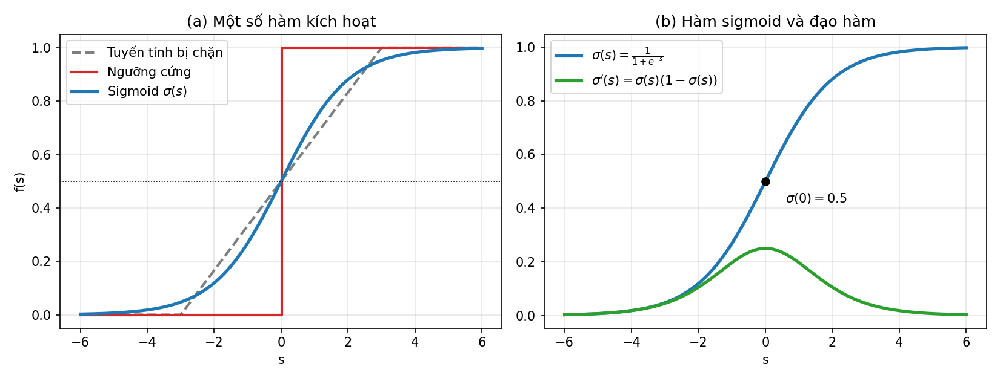
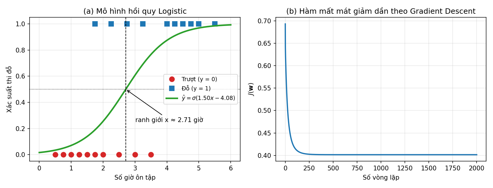
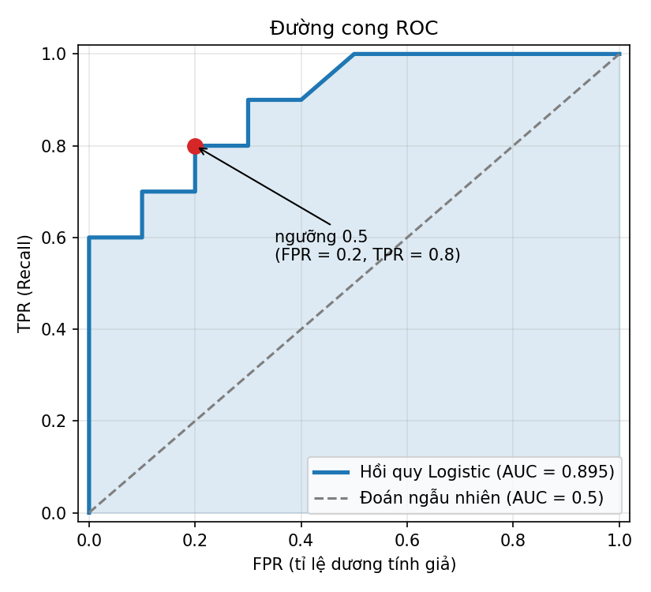
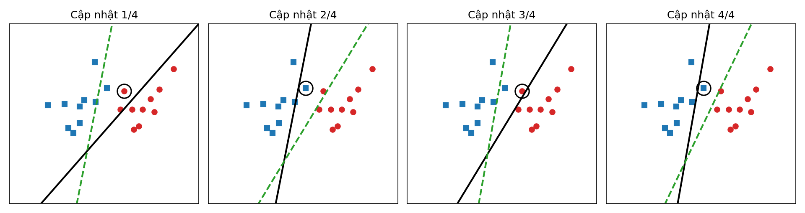
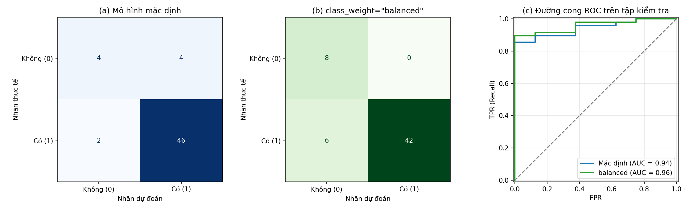

<style>
pre, pre code { font-size: 16px !important; line-height: 1.5 !important; }
</style>

# Bài 4. Hồi quy Logistic và thuật toán PLA

> Tài liệu tham khảo: *Giáo trình Machine Learning 2026*, Chương 9 – Hồi quy logistic; Chương 7 – Mô hình nơ-ron Perceptron. Phần ma trận nhầm lẫn, các chỉ số đánh giá và ROC-AUC tham khảo thêm tài liệu scikit-learn (*Model evaluation*) và T. Fawcett, *An introduction to ROC analysis*, Pattern Recognition Letters, 2006.
>
> Mã nguồn demo: thư mục [codes/](codes/), các file đánh số theo thứ tự trình bày trong bài, mỗi notebook chạy độc lập từ đầu đến cuối (mở bằng Jupyter, thư mục hiện hành là `codes/`).

- [4.1. Mô hình hồi quy Logistic](#41-mô-hình-hồi-quy-logistic)
- [4.2. Thuật toán PLA](#42-thuật-toán-pla)
- [4.3. Thực hành: dự đoán nguy cơ mắc ung thư phổi](#43-thực-hành-dự-đoán-nguy-cơ-mắc-ung-thư-phổi)
- [4.4. Kết luận](#44-kết-luận)
- [4.5. Câu hỏi ôn tập](#45-câu-hỏi-ôn-tập)

---

## 4.1. Mô hình hồi quy Logistic

### 4.1.1. Phát biểu bài toán phân loại dữ liệu

#### a) Bài toán phân loại

Ở Bài 3, nhãn $y$ là một số thực (giá nhà, cân nặng), ta gọi đó là bài toán **hồi quy**. Khi nhãn $y$ chỉ nhận một số hữu hạn giá trị rời rạc, mỗi giá trị là một **lớp** (class), ta có bài toán **phân loại** (classification).

Cho tập huấn luyện gồm $N$ mẫu đã gán nhãn:

$$
\mathcal{D} = \{(\mathbf{x}_1, y_1), (\mathbf{x}_2, y_2), \dots, (\mathbf{x}_N, y_N)\}, \qquad \mathbf{x}_i \in \mathbb{R}^d, \quad y_i \in \{c_1, c_2, \dots, c_C\}
$$

Mục tiêu là học một hàm $f$ sao cho với một mẫu mới $\mathbf{x}$, nhãn dự đoán $\hat{y} = f(\mathbf{x})$ trùng với nhãn thật càng nhiều càng tốt.

| Dạng bài toán | Số lớp | Ví dụ |
|---|---|---|
| **Phân loại nhị phân** | $C = 2$ | Email rác / không rác; giao dịch gian lận / hợp lệ; có / không mắc bệnh; thi đỗ / trượt |
| **Phân loại đa lớp** | $C > 2$ | Nhận dạng chữ số viết tay 0–9; phân loại loài hoa Iris (3 loài) |

Bài này tập trung vào **phân loại nhị phân**. Hai lớp thường được mã hóa là $y \in \{0, 1\}$ (dùng cho hồi quy Logistic) hoặc $y \in \{-1, +1\}$ (dùng cho PLA). Lớp $1$ gọi là **lớp dương** (positive), thường là lớp ta quan tâm phát hiện (có bệnh, là thư rác, gian lận); lớp $0$ là **lớp âm** (negative).

#### b) Ví dụ: thời gian ôn tập và kết quả thi

Bảng sau ghi lại số giờ ôn tập và kết quả thi của 20 sinh viên ($y = 1$: đỗ, $y = 0$: trượt):

| Số giờ | 0.50 | 0.75 | 1.00 | 1.25 | 1.50 | 1.75 | 1.75 | 2.00 | 2.25 | 2.50 |
|---|---|---|---|---|---|---|---|---|---|---|
| **Đỗ?** | 0 | 0 | 0 | 0 | 0 | 0 | 1 | 0 | 1 | 0 |
| **Số giờ** | **2.75** | **3.00** | **3.25** | **3.50** | **4.00** | **4.25** | **4.50** | **4.75** | **5.00** | **5.50** |
| **Đỗ?** | 1 | 0 | 1 | 0 | 1 | 1 | 1 | 1 | 1 | 1 |

Học càng nhiều thì càng dễ đỗ, nhưng **không có ngưỡng giờ nào tách hoàn toàn** hai nhóm: có người học 1.75 giờ vẫn đỗ, có người học 3.5 giờ vẫn trượt. Vì vậy, thay vì cố đưa ra quyết định cứng "đỗ/trượt", hợp lý hơn là ước lượng **xác suất thi đỗ** theo số giờ ôn tập:

$$
P(y = 1 \mid \mathbf{x}) \in (0, 1)
$$

rồi mới so sánh xác suất này với một ngưỡng để ra quyết định. Đây chính là ý tưởng của **hồi quy Logistic**.

#### c) Vì sao không dùng hồi quy tuyến tính cho phân loại?

Có thể nghĩ đến việc dùng luôn hồi quy tuyến tính $\hat{y} = \mathbf{x}^T\mathbf{w}$ rồi phân loại theo ngưỡng $0.5$. Cách này có hai nhược điểm:

1. **Đầu ra không bị chặn**: $\hat{y}$ có thể âm hoặc lớn hơn 1, không thể hiểu là xác suất.
2. **Nhạy với điểm ngoại lai**: nếu có thêm một sinh viên học 20 giờ và đỗ, đường thẳng bị kéo nghiêng đi, ngưỡng $\hat{y} = 0.5$ dịch sang phải và nhiều người đỗ thật bị dự đoán thành trượt.

Ta cần một hàm biến $\mathbf{x}^T\mathbf{w} \in (-\infty, +\infty)$ thành một giá trị trong khoảng $(0, 1)$. Hàm đó là **hàm sigmoid**.

---

### 4.1.2. Hàm sigmoid

#### a) Định nghĩa

**Hàm sigmoid** (còn gọi là hàm logistic) được định nghĩa:

$$
\sigma(s) = \frac{1}{1 + e^{-s}}
$$



*Hình 4.1: (a) So sánh hàm tuyến tính bị chặn, hàm ngưỡng cứng và hàm sigmoid. (b) Hàm sigmoid và đạo hàm của nó. Mã nguồn vẽ hình: [images/plot_sigmoid.py](images/plot_sigmoid.py).*

#### b) Tính chất

| Tính chất | Ý nghĩa |
|---|---|
| $0 < \sigma(s) < 1$ với mọi $s$ | Đầu ra được hiểu là **xác suất** |
| $\lim_{s \to -\infty} \sigma(s) = 0$, $\lim_{s \to +\infty} \sigma(s) = 1$ | $s$ rất âm → gần chắc chắn lớp 0; $s$ rất dương → gần chắc chắn lớp 1 |
| $\sigma(0) = 0.5$ | $s = 0$ là điểm "phân vân" nhất, tương ứng **ranh giới quyết định** |
| Đơn điệu tăng | $s$ càng lớn, xác suất lớp 1 càng lớn |
| $\sigma(-s) = 1 - \sigma(s)$ | Đối xứng qua điểm $(0;\, 0.5)$ |
| Liên tục, khả vi tại mọi điểm | Dùng được Gradient Descent (khác với hàm ngưỡng cứng) |

So với hàm ngưỡng cứng (nhảy từ 0 lên 1 tại $s = 0$), sigmoid chuyển **mượt**: điểm nằm gần ranh giới có xác suất gần 0.5 (mô hình không chắc), điểm nằm xa ranh giới có xác suất gần 0 hoặc 1 (mô hình rất chắc).

#### c) Đạo hàm của hàm sigmoid

Một tính chất rất quan trọng, sẽ dùng ở mục 4.1.4:

$$
\sigma'(s) = \sigma(s)\big(1 - \sigma(s)\big)
$$

**Chứng minh:**

$$
\sigma'(s) = \frac{d}{ds}\left(1 + e^{-s}\right)^{-1} = \frac{e^{-s}}{(1 + e^{-s})^2} = \frac{1}{1 + e^{-s}} \cdot \frac{e^{-s}}{1 + e^{-s}} = \sigma(s)\big(1 - \sigma(s)\big)
$$

vì $\dfrac{e^{-s}}{1 + e^{-s}} = 1 - \dfrac{1}{1 + e^{-s}} = 1 - \sigma(s)$. Đạo hàm đạt cực đại $0.25$ tại $s = 0$ (Hình 4.1b).

> **Hàm tanh.** Một hàm có hình dạng tương tự là $\tanh(s) = \dfrac{e^{s} - e^{-s}}{e^{s} + e^{-s}} = 2\sigma(2s) - 1$, nhận giá trị trong $(-1, 1)$. Hàm tanh hay dùng trong mạng nơ-ron (Bài 9); với hồi quy Logistic ta dùng sigmoid vì cần đầu ra trong $(0, 1)$.

```python
import numpy as np

def sigmoid(s):
    return 1 / (1 + np.exp(-s))

print(sigmoid(np.array([-5, -1, 0, 1, 5])))
# [0.0067 0.2689 0.5    0.7311 0.9933]
```

*Mã nguồn: [codes/01_sigmoid_function.ipynb](codes/01_sigmoid_function.ipynb).*

---

### 4.1.3. Mô hình hồi quy Logistic

#### a) Công thức mô hình

Mô hình **hồi quy Logistic** (Logistic Regression) gồm hai bước:

1. Tính tổ hợp tuyến tính của các đặc trưng (giống hồi quy tuyến tính):
$$
z = w_0 + w_1 x_1 + \dots + w_d x_d = \mathbf{x}^T\mathbf{w}
$$
2. Đưa $z$ qua hàm sigmoid để được xác suất thuộc lớp 1:
$$
\hat{y} = P(y = 1 \mid \mathbf{x}; \mathbf{w}) = \sigma(\mathbf{x}^T\mathbf{w}) = \frac{1}{1 + e^{-\mathbf{x}^T\mathbf{w}}}
$$

Từ đây trở đi, giống giáo trình, $\mathbf{x}$ và $\mathbf{w}$ được hiểu là **vector mở rộng** (Bài 3, mục 3.1.2): $\mathbf{x} = [1, x_1, \dots, x_d]^T$, $\mathbf{w} = [w_0, w_1, \dots, w_d]^T$, nên $w_0$ đã nằm trong $\mathbf{x}^T\mathbf{w}$.

Xác suất thuộc lớp 0 là phần bù:

$$
P(y = 0 \mid \mathbf{x}; \mathbf{w}) = 1 - \sigma(\mathbf{x}^T\mathbf{w})
$$

Dù tên có chữ "hồi quy", đây là **mô hình phân loại**: đầu ra xác suất được dùng để gán nhãn.

#### b) Quy tắc phân loại và ranh giới quyết định

Với ngưỡng $0.5$, mẫu $\mathbf{x}$ được gán nhãn 1 khi:

$$
\sigma(\mathbf{x}^T\mathbf{w}) \ge 0.5 \iff e^{-\mathbf{x}^T\mathbf{w}} \le 1 \iff \mathbf{x}^T\mathbf{w} \ge 0
$$

Do đó:

$$
\hat{y} = \begin{cases} 1, & \text{nếu } \mathbf{x}^T\mathbf{w} \ge 0 \\ 0, & \text{nếu } \mathbf{x}^T\mathbf{w} < 0 \end{cases}
$$

**Ranh giới quyết định** (decision boundary) là tập các điểm có $P(y = 1 \mid \mathbf{x}) = 0.5$, tức:

$$
\mathbf{x}^T\mathbf{w} = w_0 + w_1 x_1 + \dots + w_d x_d = 0
$$

Đây là một **siêu phẳng**: với 1 đặc trưng là một điểm trên trục số, với 2 đặc trưng là một đường thẳng, với 3 đặc trưng là một mặt phẳng. Vì vậy hồi quy Logistic là một **bộ phân loại tuyến tính**: dù đầu ra (xác suất) là hàm phi tuyến, ranh giới giữa hai lớp vẫn là tuyến tính.

> **Ngưỡng không nhất thiết là 0.5.** Ta có thể chọn ngưỡng $\tau \in (0, 1)$ bất kỳ: $\hat{y} = 1$ nếu $\sigma(\mathbf{x}^T\mathbf{w}) \ge \tau$. Ví dụ, trong phát hiện gian lận hay sàng lọc bệnh, bỏ sót một ca dương tính nguy hiểm hơn báo nhầm, nên thường **hạ ngưỡng** (ví dụ $\tau = 0.3$) để bắt được nhiều ca hơn, chấp nhận nhiều cảnh báo nhầm hơn. Ảnh hưởng của ngưỡng được phân tích ở mục 4.1.6 và 4.3.4.

#### c) Ý nghĩa của trọng số: log-odds

Gọi $p = P(y = 1 \mid \mathbf{x})$. Tỉ số $\dfrac{p}{1 - p}$ gọi là **odds** (tỉ lệ cược): odds $= 3$ nghĩa là khả năng xảy ra gấp 3 lần khả năng không xảy ra. Từ $p = \sigma(\mathbf{x}^T\mathbf{w})$ suy ra:

$$
\ln \frac{p}{1 - p} = \mathbf{x}^T\mathbf{w} = w_0 + w_1 x_1 + \dots + w_d x_d
$$

Vậy hồi quy Logistic là **mô hình tuyến tính của log-odds**. Khi $x_j$ tăng 1 đơn vị (các đặc trưng khác giữ nguyên), log-odds tăng $w_j$, tức odds được **nhân lên $e^{w_j}$ lần**:
- $w_j > 0$: $x_j$ tăng làm tăng khả năng thuộc lớp 1.
- $w_j < 0$: $x_j$ tăng làm giảm khả năng thuộc lớp 1.
- $w_j = 0$: $x_j$ không ảnh hưởng.

*Ví dụ:* ở mục 4.1.4, mô hình tìm được cho bài toán ôn thi là $P(\text{đỗ}) = \sigma(1.50 \cdot \text{giờ} - 4.08)$. Mỗi giờ ôn tập thêm nhân odds thi đỗ lên $e^{1.50} \approx 4.5$ lần.

#### d) So sánh với hồi quy tuyến tính

| | Hồi quy tuyến tính | Hồi quy Logistic |
|---|---|---|
| Bài toán | Hồi quy | Phân loại nhị phân |
| Nhãn $y$ | Số thực | $\{0, 1\}$ |
| Đầu ra | $\hat{y} = \mathbf{x}^T\mathbf{w} \in \mathbb{R}$ | $\hat{y} = \sigma(\mathbf{x}^T\mathbf{w}) \in (0, 1)$ là xác suất |
| Hàm mất mát | MSE | Cross-entropy (mục 4.1.4) |
| Tìm nghiệm | Có nghiệm giải tích (OLS) hoặc GD | Không có nghiệm giải tích, dùng GD |
| Độ đo đánh giá | MAE, MSE, RMSE, $R^2$ | Accuracy, Precision, Recall, F1, ROC-AUC (mục 4.1.5, 4.1.6) |

Cả hai đều có dạng chung $\hat{y} = f(\mathbf{x}^T\mathbf{w})$, chỉ khác **hàm kích hoạt** $f$: hồi quy tuyến tính dùng $f(s) = s$, hồi quy Logistic dùng $f(s) = \sigma(s)$. Thuật toán PLA ở mục 4.2 dùng $f(s) = \text{sgn}(s)$.

---

### 4.1.4. Hàm mất mát và tối ưu hàm mất mát

#### a) Ước lượng hợp lý cực đại (MLE)

Không thể dùng MSE như hồi quy tuyến tính, vì khi kết hợp với sigmoid, MSE không còn là hàm lồi (có nhiều cực tiểu địa phương). Hàm mất mát của hồi quy Logistic được xây dựng từ phương pháp **ước lượng hợp lý cực đại** (Maximum Likelihood Estimation – MLE): *chọn $\mathbf{w}$ sao cho xác suất mô hình sinh ra đúng các nhãn quan sát được là lớn nhất.*

**Bước 1 – Xác suất của một mẫu.** Đặt $a_i = \sigma(\mathbf{x}_i^T\mathbf{w})$. Theo mô hình:

$$
P(y_i = 1 \mid \mathbf{x}_i; \mathbf{w}) = a_i, \qquad P(y_i = 0 \mid \mathbf{x}_i; \mathbf{w}) = 1 - a_i
$$

Vì $y_i \in \{0, 1\}$, hai công thức gộp lại thành một:

$$
P(y_i \mid \mathbf{x}_i; \mathbf{w}) = a_i^{\,y_i} (1 - a_i)^{1 - y_i}
$$

(thay $y_i = 1$ được $a_i$; thay $y_i = 0$ được $1 - a_i$).

**Bước 2 – Hàm hợp lý (likelihood) của cả tập dữ liệu.** Giả sử các mẫu độc lập với nhau:

$$
L(\mathbf{w}) = P(\mathbf{y} \mid \mathbf{X}; \mathbf{w}) = \prod_{i=1}^{N} a_i^{\,y_i} (1 - a_i)^{1 - y_i}
$$

Bài toán MLE: $\mathbf{w}^* = \arg\max_{\mathbf{w}} L(\mathbf{w})$.

**Bước 3 – Lấy logarit, đổi dấu.** Tích của nhiều số nhỏ hơn 1 rất dễ tràn số dưới, và khó lấy đạo hàm. Vì $\ln$ là hàm đồng biến, cực đại $L$ tương đương cực đại $\ln L$, và tương đương cực tiểu $-\frac{1}{N}\ln L$. Ta được **hàm mất mát cross-entropy** (log loss):

$$
\boxed{J(\mathbf{w}) = -\frac{1}{N}\sum_{i=1}^{N} \Big[ y_i \ln a_i + (1 - y_i) \ln(1 - a_i) \Big], \qquad a_i = \sigma(\mathbf{x}_i^T\mathbf{w})}
$$

**Ý nghĩa trực quan.** Với một mẫu:
- Nếu $y_i = 1$: mất mát là $-\ln a_i$. Mô hình dự đoán $a_i \to 1$ (đúng) thì mất mát $\to 0$; dự đoán $a_i \to 0$ (sai) thì mất mát $\to +\infty$.
- Nếu $y_i = 0$: mất mát là $-\ln(1 - a_i)$, tương tự theo chiều ngược lại.

Như vậy cross-entropy **phạt rất nặng** những dự đoán sai mà lại tự tin. $J(\mathbf{w})$ là hàm **lồi** theo $\mathbf{w}$, nên Gradient Descent hội tụ về cực tiểu toàn cục (khi chọn tốc độ học phù hợp).

#### b) Gradient của hàm mất mát

Xét mất mát của một mẫu $J_i = -[y_i \ln a_i + (1 - y_i)\ln(1 - a_i)]$ với $a_i = \sigma(z_i)$, $z_i = \mathbf{x}_i^T\mathbf{w}$. Theo quy tắc đạo hàm hàm hợp:

$$
\frac{\partial J_i}{\partial a_i} = -\frac{y_i}{a_i} + \frac{1 - y_i}{1 - a_i} = \frac{a_i - y_i}{a_i(1 - a_i)}, \qquad \frac{\partial a_i}{\partial z_i} = a_i(1 - a_i), \qquad \frac{\partial z_i}{\partial \mathbf{w}} = \mathbf{x}_i
$$

Nhân lại, nhờ đạo hàm đẹp của sigmoid mà mẫu số triệt tiêu:

$$
\nabla_{\mathbf{w}} J_i = \frac{a_i - y_i}{a_i(1 - a_i)} \cdot a_i(1 - a_i) \cdot \mathbf{x}_i = (a_i - y_i)\,\mathbf{x}_i
$$

Lấy trung bình trên $N$ mẫu, dạng ma trận ($\mathbf{X}$ kích thước $N \times (d+1)$, mỗi hàng là một $\mathbf{x}_i^T$):

$$
\boxed{\nabla_{\mathbf{w}} J(\mathbf{w}) = \frac{1}{N}\sum_{i=1}^{N} (a_i - y_i)\,\mathbf{x}_i = \frac{1}{N}\mathbf{X}^T\big(\sigma(\mathbf{X}\mathbf{w}) - \mathbf{y}\big)}
$$

Gradient này có dạng **giống hệt** gradient của MSE trong hồi quy tuyến tính, $\frac{1}{N}\mathbf{X}^T(\mathbf{X}\mathbf{w} - \mathbf{y})$, chỉ thay dự đoán $\mathbf{X}\mathbf{w}$ bằng $\sigma(\mathbf{X}\mathbf{w})$. Phương trình $\nabla J = \mathbf{0}$ không giải được dạng công thức (vì có hàm sigmoid), nên phải dùng phương pháp lặp.

#### c) Tối ưu bằng Gradient Descent

Khởi tạo $\mathbf{w}$ (ví dụ $\mathbf{w} = \mathbf{0}$), lặp lại cho đến khi hội tụ:

$$
\mathbf{w} \leftarrow \mathbf{w} - \eta\,\frac{1}{N}\mathbf{X}^T\big(\sigma(\mathbf{X}\mathbf{w}) - \mathbf{y}\big)
$$

với $\eta$ là **tốc độ học** (learning rate). Nếu mỗi lần chỉ dùng một mẫu $(\mathbf{x}_i, y_i)$ chọn ngẫu nhiên thì được **Stochastic Gradient Descent** (SGD), cách giáo trình sử dụng:

$$
\mathbf{w} \leftarrow \mathbf{w} - \eta\,\big(\sigma(\mathbf{x}_i^T\mathbf{w}) - y_i\big)\,\mathbf{x}_i
$$

Các biến thể Batch / Stochastic / Mini-batch và cách chọn $\eta$ được học chi tiết ở Bài 5.

**Diễn giải quy tắc cập nhật.** Đại lượng $a_i - y_i$ là **sai số dự đoán**:
- Mẫu có $y_i = 1$ nhưng $a_i$ nhỏ: $a_i - y_i < 0$, nên $\mathbf{w}$ được cộng thêm một phần $\mathbf{x}_i$, làm $\mathbf{x}_i^T\mathbf{w}$ tăng, $a_i$ tăng lên gần 1.
- Mẫu có $y_i = 0$ nhưng $a_i$ lớn: $\mathbf{w}$ bị trừ đi một phần $\mathbf{x}_i$, làm $a_i$ giảm.
- Mẫu đã dự đoán đúng và tự tin ($a_i \approx y_i$): gần như không cập nhật.

> **Điều chuẩn (weight decay).** Giống Ridge ở Bài 3, có thể thêm thành phần phạt L2 để giảm quá khớp: $J(\mathbf{w}) + \frac{\lambda}{2N}\|\mathbf{w}\|_2^2$. Khi dữ liệu tách biệt tuyến tính hoàn toàn, nếu không điều chuẩn thì $\|\mathbf{w}\|$ tăng vô hạn (sigmoid càng ngày càng giống hàm ngưỡng cứng). Lớp `LogisticRegression` của scikit-learn **mặc định có điều chuẩn L2** với tham số `C` $= 1/\lambda$ (mặc định `C=1.0`).

#### d) Ví dụ: dự đoán khả năng thi đỗ

**Tính tay một bước lặp.** Khởi tạo $\mathbf{w} = [w_0, w_1]^T = [0, 0]^T$, $\eta = 0.5$. Khi đó mọi $a_i = \sigma(0) = 0.5$ và

$$
J(\mathbf{0}) = -\frac{1}{20}\sum_{i=1}^{20} \ln 0.5 = \ln 2 \approx 0.6931
$$

Gradient:
- Thành phần $w_0$: $\frac{1}{20}\sum (0.5 - y_i) \cdot 1 = \frac{1}{20}(20 \times 0.5 - 10) = 0$ (vì có 10 người đỗ).
- Thành phần $w_1$: $\frac{1}{20}\sum (0.5 - y_i)\, x_i = \frac{1}{20}\big(0.5 \times 55.75 - 38\big) = \frac{-10.125}{20} = -0.50625$, trong đó $55.75$ là tổng số giờ của 20 người, $38$ là tổng số giờ của 10 người đỗ.

Cập nhật: $w_0 = 0 - 0.5 \times 0 = 0$, $\; w_1 = 0 - 0.5 \times (-0.50625) = 0.2531$. Mất mát giảm từ $0.6931$ xuống $J = 0.6410$. Mô hình đã "học" được rằng số giờ càng lớn thì xác suất đỗ càng cao.

**Cài đặt Gradient Descent bằng NumPy:**

```python
import numpy as np

# Dữ liệu: số giờ ôn tập và kết quả thi (1: đỗ, 0: trượt)
X = np.array([0.50, 0.75, 1.00, 1.25, 1.50, 1.75, 1.75, 2.00, 2.25, 2.50,
              2.75, 3.00, 3.25, 3.50, 4.00, 4.25, 4.50, 4.75, 5.00, 5.50])
y = np.array([0, 0, 0, 0, 0, 0, 1, 0, 1, 0, 1, 0, 1, 0, 1, 1, 1, 1, 1, 1])

# Vector mở rộng: thêm cột 1 vào trước -> mỗi hàng là [1, x_i]
Xbar = np.column_stack([np.ones(len(X)), X])

def sigmoid(s):
    return 1 / (1 + np.exp(-s))

def loss(w, Xbar, y):
    a = sigmoid(Xbar @ w)
    return -np.mean(y * np.log(a) + (1 - y) * np.log(1 - a))

def logistic_gd(Xbar, y, eta=0.5, n_iters=2000):
    w = np.zeros(Xbar.shape[1])
    history = [loss(w, Xbar, y)]
    for _ in range(n_iters):
        a = sigmoid(Xbar @ w)                    # xác suất dự đoán cho N mẫu
        grad = Xbar.T @ (a - y) / len(y)         # gradient = (1/N) X^T (a - y)
        w = w - eta * grad                       # cập nhật trọng số
        history.append(loss(w, Xbar, y))
    return w, history

w, history = logistic_gd(Xbar, y)
print('w0 = %.4f, w1 = %.4f' % (w[0], w[1]))
print('J(w) = %.4f' % history[-1])
```

**Kết quả:**

```
w0 = -4.0777, w1 = 1.5046
J(w) = 0.4015
```

Mô hình thu được:

$$
P(\text{đỗ} \mid x) = \sigma(1.5046\,x - 4.0777)
$$

Ranh giới quyết định: $1.5046\,x - 4.0777 = 0 \Rightarrow x \approx 2.71$ giờ. Sinh viên ôn tập trên 2.71 giờ được dự đoán đỗ.

```python
for hours in [1, 2, 3, 4, 5]:
    print(hours, 'giờ -> P(đỗ) = %.3f' % sigmoid(w[0] + w[1] * hours))
```

*Mã nguồn: [codes/02_logistic_gd_study_hours.ipynb](codes/02_logistic_gd_study_hours.ipynb).*

| Số giờ | 1 | 2 | 3 | 4 | 5 |
|---|---|---|---|---|---|
| $P(\text{đỗ})$ | 0.071 | 0.256 | 0.607 | 0.874 | 0.969 |



*Hình 4.2: (a) Đường cong xác suất thi đỗ theo số giờ ôn tập và ranh giới quyết định $x \approx 2.71$. (b) Hàm mất mát giảm nhanh trong khoảng 200 vòng lặp đầu rồi hội tụ về $0.4015$. Mã nguồn vẽ hình: [images/plot_logistic_study_hours.py](images/plot_logistic_study_hours.py).*

**Sử dụng thư viện scikit-learn:**

```python
from sklearn.linear_model import LogisticRegression

# penalty=None: không điều chuẩn, để so sánh với nghiệm MLE ở trên
model = LogisticRegression(penalty=None)
model.fit(X.reshape(-1, 1), y)          # scikit-learn cần X dạng ma trận (N, d)
print(model.intercept_, model.coef_)    # [-4.0787] [[1.5050]]

print(model.predict_proba([[2], [4]]))  # cột 0: P(y=0), cột 1: P(y=1)
print(model.predict([[2], [4]]))        # [0 1]
```

Nghiệm của scikit-learn khớp với nghiệm Gradient Descent tự cài đặt (sai khác ở chữ số thập phân thứ ba do điều kiện dừng của bộ tối ưu). Nếu để mặc định (`C=1.0`, có điều chuẩn L2), các hệ số sẽ nhỏ hơn về độ lớn ($w_0 \approx -3.14$, $w_1 \approx 1.15$) do bị phạt.

*Mã nguồn: [codes/03_logistic_sklearn_study_hours.ipynb](codes/03_logistic_sklearn_study_hours.ipynb).*

---

### 4.1.5. Ma trận nhầm lẫn (Confusion Matrix)

#### a) Bốn loại kết quả dự đoán

Với bài toán nhị phân, so sánh nhãn dự đoán $\hat{y}$ với nhãn thật $y$ cho bốn trường hợp:

| Ký hiệu | Tên | Nhãn thật | Dự đoán | Ý nghĩa |
|---|---|---|---|---|
| **TP** | True Positive (dương tính thật) | 1 | 1 | Dự đoán đúng một ca dương |
| **TN** | True Negative (âm tính thật) | 0 | 0 | Dự đoán đúng một ca âm |
| **FP** | False Positive (dương tính giả) | 0 | 1 | Báo nhầm, còn gọi là **sai lầm loại I** |
| **FN** | False Negative (âm tính giả) | 1 | 0 | Bỏ sót, còn gọi là **sai lầm loại II** |

Chữ đầu (True/False) cho biết dự đoán **đúng hay sai**; chữ sau (Positive/Negative) cho biết **mô hình dự đoán** là lớp nào.

#### b) Ma trận nhầm lẫn

**Ma trận nhầm lẫn** xếp bốn số trên thành bảng 2 × 2. Trong bài này dùng cùng quy ước với scikit-learn: **hàng là nhãn thật, cột là nhãn dự đoán**, lớp 0 đứng trước:

| | Dự đoán 0 | Dự đoán 1 |
|---|---|---|
| **Thật 0** | TN | FP |
| **Thật 1** | FN | TP |

Đường chéo chính (TN, TP) là các dự đoán đúng; ngoài đường chéo (FP, FN) là các dự đoán sai. Ma trận nhầm lẫn cho biết **mô hình nhầm theo kiểu nào**, điều mà một con số độ chính xác không thể hiện được.

> **Lưu ý:** một số sách đặt lớp dương lên trước (TP ở góc trên bên trái). Khi đọc ma trận nhầm lẫn luôn cần xác định hàng là gì, cột là gì.

Với $C$ lớp, ma trận nhầm lẫn có kích thước $C \times C$, phần tử hàng $i$ cột $j$ là số mẫu thuộc lớp $i$ bị dự đoán thành lớp $j$.

#### c) Ví dụ

Dùng mô hình ở mục 4.1.4 với ngưỡng 0.5 (dự đoán đỗ khi số giờ $\ge 2.75$) trên 20 sinh viên:

| Số giờ | 0.50 – 1.50 | 1.75 | 1.75 | 2.00 | 2.25 | 2.50 | 2.75 | 3.00 | 3.25 | 3.50 | 4.00 – 5.50 |
|---|---|---|---|---|---|---|---|---|---|---|---|
| Thật | 0 (5 người) | 0 | 1 | 0 | 1 | 0 | 1 | 0 | 1 | 0 | 1 (6 người) |
| Dự đoán | 0 | 0 | 0 | 0 | 0 | 0 | 1 | 1 | 1 | 1 | 1 |
| Kết quả | TN | TN | **FN** | TN | **FN** | TN | TP | **FP** | TP | **FP** | TP |

Đếm được TN = 8, FP = 2 (học 3.00 và 3.50 giờ nhưng trượt), FN = 2 (học 1.75 và 2.25 giờ nhưng đỗ), TP = 8.

| | Dự đoán trượt (0) | Dự đoán đỗ (1) |
|---|---|---|
| **Thật trượt (0)** | TN = 8 | FP = 2 |
| **Thật đỗ (1)** | FN = 2 | TP = 8 |

```python
from sklearn.metrics import confusion_matrix

y_pred = (sigmoid(Xbar @ w) >= 0.5).astype(int)
print(confusion_matrix(y, y_pred))
# [[8 2]
#  [2 8]]
tn, fp, fn, tp = confusion_matrix(y, y_pred).ravel()
```

*Mã nguồn: [codes/04_confusion_matrix.ipynb](codes/04_confusion_matrix.ipynb).*

---

### 4.1.6. Các chỉ số đánh giá: Accuracy, Precision, Recall, F1-Score, ROC-AUC

#### a) Accuracy (độ chính xác)

$$
\text{Accuracy} = \frac{TP + TN}{TP + TN + FP + FN}
$$

Tỉ lệ mẫu được dự đoán đúng trên tổng số mẫu. Ví dụ trên: $\frac{8 + 8}{20} = 0.80$.

**Hạn chế với dữ liệu mất cân bằng.** Giả sử 1.000 người đi khám có 10 người mắc bệnh. Một "mô hình" luôn trả lời *không bệnh* đạt Accuracy $= 990/1000 = 99\%$ nhưng **bỏ sót toàn bộ** người bệnh, hoàn toàn vô dụng. Khi các lớp chênh lệch nhiều, cần thêm các chỉ số sau.

#### b) Precision (độ chuẩn xác)

$$
\text{Precision} = \frac{TP}{TP + FP}
$$

*Trong số các mẫu mô hình **dự đoán là dương**, bao nhiêu phần trăm thật sự dương?* Precision cao nghĩa là ít báo nhầm. Quan trọng khi **FP gây tốn kém**, ví dụ lọc thư rác (đưa nhầm thư quan trọng vào thư mục rác), gợi ý sản phẩm. Ví dụ trên: $\frac{8}{8 + 2} = 0.80$.

#### c) Recall (độ nhạy, độ phủ)

$$
\text{Recall} = \frac{TP}{TP + FN}
$$

*Trong số các mẫu **thật sự dương**, mô hình tìm ra được bao nhiêu phần trăm?* Recall còn gọi là **độ nhạy** (sensitivity) hay **TPR** (True Positive Rate). Recall cao nghĩa là ít bỏ sót. Quan trọng khi **FN gây hậu quả nghiêm trọng**, ví dụ sàng lọc ung thư, phát hiện gian lận. Ví dụ trên: $\frac{8}{8 + 2} = 0.80$.

Tương tự, với lớp âm có **độ đặc hiệu** (specificity) $= \frac{TN}{TN + FP}$: tỉ lệ mẫu âm được nhận ra đúng.

**Đánh đổi Precision – Recall.** Hạ ngưỡng $\tau$ thì mô hình dự đoán "dương" nhiều hơn: Recall tăng nhưng Precision thường giảm (báo nhầm nhiều hơn). Nâng ngưỡng thì ngược lại. Không thể chỉ tối ưu một chỉ số.

#### d) F1-Score

$$
F_1 = 2 \cdot \frac{\text{Precision} \cdot \text{Recall}}{\text{Precision} + \text{Recall}} = \frac{2\,TP}{2\,TP + FP + FN}
$$

F1 là **trung bình điều hòa** của Precision và Recall. Trung bình điều hòa nhỏ khi một trong hai số nhỏ, nên F1 chỉ cao khi **cả hai đều cao**. Ví dụ: Precision $= 1$, Recall $= 0.1$ thì trung bình cộng là $0.55$ nhưng $F_1 \approx 0.18$. Ví dụ ôn thi: $F_1 = \frac{2 \times 8}{2 \times 8 + 2 + 2} = 0.80$.

| Chỉ số | Câu hỏi trả lời | Dùng khi |
|---|---|---|
| Accuracy | Đúng bao nhiêu phần trăm tất cả? | Các lớp tương đối cân bằng |
| Precision | Báo dương thì đáng tin đến đâu? | FP tốn kém (lọc thư rác) |
| Recall | Bỏ sót bao nhiêu ca dương? | FN nguy hiểm (y tế, gian lận) |
| F1 | Cân bằng giữa Precision và Recall | Dữ liệu mất cân bằng, cần một con số tổng hợp |

```python
from sklearn.metrics import accuracy_score, precision_score, recall_score, f1_score
from sklearn.metrics import classification_report

print('Accuracy :', accuracy_score(y, y_pred))    # 0.8
print('Precision:', precision_score(y, y_pred))   # 0.8
print('Recall   :', recall_score(y, y_pred))      # 0.8
print('F1       :', f1_score(y, y_pred))          # 0.8
print(classification_report(y, y_pred))           # báo cáo cho từng lớp
```

Trong `classification_report`, dòng **macro avg** là trung bình cộng chỉ số của các lớp (mỗi lớp có vai trò như nhau), dòng **weighted avg** là trung bình có trọng số theo số mẫu của mỗi lớp.

#### e) Đường cong ROC và AUC

Các chỉ số trên đều tính tại **một ngưỡng** cố định. Đường cong **ROC** (Receiver Operating Characteristic) đánh giá mô hình trên **mọi ngưỡng**. Với mỗi ngưỡng $\tau$ từ 1 giảm về 0, tính:

$$
\text{TPR} = \frac{TP}{TP + FN} \;(\text{chính là Recall}), \qquad \text{FPR} = \frac{FP}{FP + TN} \;(= 1 - \text{độ đặc hiệu})
$$

rồi vẽ điểm (FPR, TPR). Ngưỡng $\tau = 1$ cho điểm $(0, 0)$ (không dự đoán dương mẫu nào); ngưỡng $\tau = 0$ cho điểm $(1, 1)$ (dự đoán dương tất cả).



*Hình 4.3: Đường cong ROC của mô hình ôn thi. Điểm đỏ ứng với ngưỡng 0.5 (FPR = 2/10, TPR = 8/10). Mã nguồn vẽ hình: [images/plot_roc_study_hours.py](images/plot_roc_study_hours.py).*

**AUC** (Area Under the Curve) là diện tích dưới đường cong ROC, $0 \le \text{AUC} \le 1$:

| AUC | Ý nghĩa |
|---|---|
| 1.0 | Phân loại hoàn hảo: tồn tại ngưỡng tách đúng hết hai lớp |
| 0.9 – 1.0 | Rất tốt |
| 0.7 – 0.9 | Khá |
| 0.5 | Không hơn đoán ngẫu nhiên (đường chéo) |
| < 0.5 | Tệ hơn ngẫu nhiên (thường do đảo nhãn) |

**Diễn giải xác suất:** AUC bằng xác suất để một mẫu dương chọn ngẫu nhiên được mô hình cho điểm (xác suất dự đoán) **cao hơn** một mẫu âm chọn ngẫu nhiên. Ví dụ ôn thi có AUC $= 0.895$: trong $10 \times 10 = 100$ cặp (người đỗ, người trượt), khoảng 89.5% số cặp người đỗ được mô hình cho xác suất cao hơn.

Ưu điểm của ROC-AUC: **không phụ thuộc ngưỡng**, dùng để so sánh các mô hình với nhau; ít bị ảnh hưởng bởi tỉ lệ giữa hai lớp hơn Accuracy. Để tính AUC cần dùng **xác suất dự đoán** (`predict_proba`), không phải nhãn 0/1.

```python
from sklearn.metrics import roc_curve, roc_auc_score

p = sigmoid(Xbar @ w)                    # xác suất dự đoán lớp 1
fpr, tpr, thresholds = roc_curve(y, p)
print('AUC =', roc_auc_score(y, p))      # 0.895
```

*Mã nguồn: [codes/05_metrics_roc_auc.ipynb](codes/05_metrics_roc_auc.ipynb).*

---

## 4.2. Thuật toán PLA

### 4.2.1. Khái niệm Perceptron

#### a) Từ nơ-ron sinh học đến Perceptron

**Perceptron** do Frank Rosenblatt đề xuất năm 1958, là mô hình nơ-ron nhân tạo đơn giản nhất và là nền tảng của mạng nơ-ron hiện đại (Bài 9). Perceptron mô phỏng nơ-ron sinh học: các tín hiệu đi vào qua **sợi nhánh** (dendrites), được tổng hợp ở **thân tế bào**; nếu tổng tín hiệu vượt một ngưỡng, nơ-ron phát tín hiệu ra theo **sợi trục** (axon).

```
  x1 ──w1──┐
  x2 ──w2──┤
   ⋮       ├──► z = w0 + Σ wj·xj ──► sgn(z) ──► ŷ ∈ {-1, +1}
  xd ──wd──┘
  1  ──w0──┘  (hệ số chệch / bias)
```

Perceptron thực hiện hai bước:

1. **Tổng có trọng số** của các tín hiệu đầu vào: $z = w_0 + w_1 x_1 + \dots + w_d x_d = \mathbf{x}^T\mathbf{w}$ (vector mở rộng).
2. **Hàm kích hoạt** là hàm dấu:
$$
\hat{y} = \text{sgn}(z) = \begin{cases} +1, & z \ge 0 \\ -1, & z < 0 \end{cases}
$$
(quy ước $\text{sgn}(0) = 1$).

Perceptron dùng nhãn $y \in \{-1, +1\}$, trả về **nhãn cứng**, không trả về xác suất như hồi quy Logistic.

#### b) Thuật toán học Perceptron (PLA)

**PLA** (Perceptron Learning Algorithm) là thuật toán tìm trọng số $\mathbf{w}$ cho Perceptron từ dữ liệu có nhãn. Ý tưởng: bắt đầu từ một $\mathbf{w}$ bất kỳ, mỗi khi gặp một điểm bị phân loại sai thì **xoay ranh giới** về phía làm điểm đó đúng hơn, lặp lại cho đến khi không còn điểm sai.

PLA chỉ đảm bảo tìm được nghiệm khi dữ liệu **tách biệt tuyến tính** (linearly separable): tồn tại một siêu phẳng chia hai lớp mà không có điểm nào nằm sai phía.

---

### 4.2.2. Phương trình siêu phẳng phân loại

#### a) Siêu phẳng

Ranh giới phân loại của Perceptron là **siêu phẳng**:

$$
w_0 + w_1 x_1 + \dots + w_d x_d = \mathbf{x}^T\mathbf{w} = 0
$$

| Số chiều $d$ | Siêu phẳng là |
|---|---|
| 2 | Đường thẳng $w_0 + w_1 x_1 + w_2 x_2 = 0$ |
| 3 | Mặt phẳng |
| $d > 3$ | Siêu phẳng $(d-1)$ chiều |

Phần $[w_1, \dots, w_d]$ là **vector pháp tuyến** của siêu phẳng (vuông góc với siêu phẳng), $w_0$ quyết định vị trí dịch chuyển của siêu phẳng so với gốc tọa độ.

#### b) Hai nửa không gian

Siêu phẳng chia không gian thành hai nửa. Các điểm cùng phía cho $\mathbf{x}^T\mathbf{w}$ cùng dấu:
- Nửa $\mathbf{x}^T\mathbf{w} > 0$ (phía vector pháp tuyến chỉ tới): dự đoán lớp $+1$.
- Nửa $\mathbf{x}^T\mathbf{w} < 0$: dự đoán lớp $-1$.

Quy tắc phân loại: $\hat{y} = \text{sgn}(\mathbf{x}^T\mathbf{w})$.

**Điều kiện phân loại đúng.** Vì $y_i \in \{-1, +1\}$, điểm $\mathbf{x}_i$ được phân loại đúng khi $\mathbf{x}_i^T\mathbf{w}$ cùng dấu với $y_i$, tức:

$$
y_i\, \mathbf{x}_i^T\mathbf{w} > 0 \quad \text{(đúng)}, \qquad y_i\, \mathbf{x}_i^T\mathbf{w} \le 0 \quad \text{(sai)}
$$

Đây là lý do PLA chọn mã hóa nhãn là $\pm 1$: chỉ cần một phép nhân để kiểm tra đúng sai.

*Ví dụ:* Perceptron có $w_0 = -1$, $w_1 = 2$, $w_2 = -1$. Siêu phẳng (đường thẳng) phân loại là $2x_1 - x_2 - 1 = 0$. Với điểm $\mathbf{x} = (1, 2)$: $z = -1 + 2 \cdot 1 - 1 \cdot 2 = -1 < 0$, điểm thuộc lớp $-1$.

#### c) So sánh với ranh giới của hồi quy Logistic

Cả hồi quy Logistic và Perceptron đều có ranh giới là siêu phẳng $\mathbf{x}^T\mathbf{w} = 0$. Khác biệt nằm ở cách dùng khoảng cách tới siêu phẳng: Perceptron chỉ quan tâm điểm nằm phía nào ($\text{sgn}$), còn hồi quy Logistic biến khoảng cách thành độ tự tin ($\sigma$): càng xa siêu phẳng, xác suất càng gần 0 hoặc 1.

---

### 4.2.3. Hàm mất mát và quy tắc cập nhật trọng số

#### a) Hàm mất mát

Gọi $\mathcal{M}$ là tập các điểm bị phân loại sai với $\mathbf{w}$ hiện tại. Cách tự nhiên nhất là đếm số điểm sai:

$$
J_1(\mathbf{w}) = \sum_{\mathbf{x}_i \in \mathcal{M}} \big(-y_i\, \text{sgn}(\mathbf{x}_i^T\mathbf{w})\big)
$$

(mỗi điểm sai có $y_i\,\text{sgn}(\mathbf{x}_i^T\mathbf{w}) = -1$, đóng góp $+1$). Nhưng hàm $\text{sgn}$ rời rạc, không khả vi, không dùng được Gradient Descent. Bỏ hàm $\text{sgn}$ đi, ta được **hàm mất mát Perceptron**:

$$
\boxed{J(\mathbf{w}) = \sum_{\mathbf{x}_i \in \mathcal{M}} \big(-y_i\, \mathbf{x}_i^T\mathbf{w}\big)}
$$

Tính chất:
- $J(\mathbf{w}) \ge 0$, vì mỗi điểm sai có $y_i\,\mathbf{x}_i^T\mathbf{w} \le 0$.
- $J(\mathbf{w}) = 0$ khi không còn điểm nào sai.
- Điểm sai nằm **càng sâu** trong vùng của lớp kia (càng xa siêu phẳng) thì đóng góp càng lớn. $J$ không chỉ đếm lỗi mà còn đo **mức độ sai**.

#### b) Quy tắc cập nhật trọng số

Xét một điểm bị phân loại sai $(\mathbf{x}_i, y_i)$. Mất mát và gradient tại điểm đó:

$$
J(\mathbf{w}; \mathbf{x}_i, y_i) = -y_i\,\mathbf{x}_i^T\mathbf{w}, \qquad \nabla_{\mathbf{w}} J = -y_i\,\mathbf{x}_i
$$

Áp dụng SGD với tốc độ học $\eta$: $\mathbf{w} \leftarrow \mathbf{w} - \eta(-y_i\,\mathbf{x}_i) = \mathbf{w} + \eta\, y_i\,\mathbf{x}_i$. Với PLA thường chọn $\eta = 1$:

$$
\boxed{\mathbf{w}_{t+1} = \mathbf{w}_t + y_i\,\mathbf{x}_i}
$$

Viết tách hệ số chệch: $w_j \leftarrow w_j + y_i\, x_{ij}$ với $j = 1..d$, và $w_0 \leftarrow w_0 + y_i$.

**Vì sao cập nhật này làm điểm sai "đúng hơn"?**

$$
y_i\,\mathbf{x}_i^T\mathbf{w}_{t+1} = y_i\,\mathbf{x}_i^T(\mathbf{w}_t + y_i\,\mathbf{x}_i) = y_i\,\mathbf{x}_i^T\mathbf{w}_t + \underbrace{y_i^2}_{=1}\|\mathbf{x}_i\|_2^2 > y_i\,\mathbf{x}_i^T\mathbf{w}_t
$$

Đại lượng $y_i\,\mathbf{x}_i^T\mathbf{w}$ tăng thêm $\|\mathbf{x}_i\|^2 \ge 1$ (vector mở rộng có thành phần đầu bằng 1), tức điểm $\mathbf{x}_i$ dịch về phía được phân loại đúng. Về hình học: điểm lớp $+1$ bị sai thì $\mathbf{w}$ được kéo về phía $\mathbf{x}_i$; điểm lớp $-1$ bị sai thì $\mathbf{w}$ bị đẩy ra xa $\mathbf{x}_i$.

Lưu ý: một lần cập nhật có thể làm **điểm khác** đang đúng trở thành sai. Tuy vậy, người ta chứng minh được (định lý hội tụ Perceptron, giáo trình mục 7.2.4) rằng **nếu dữ liệu tách biệt tuyến tính thì PLA dừng sau hữu hạn bước**.

#### c) Thuật toán

> **Thuật toán PLA**
> 1. Khởi tạo $\mathbf{w}_0$ (ngẫu nhiên hoặc $\mathbf{0}$), $t = 0$.
> 2. Nếu không có điểm nào bị phân loại sai ($y_i\,\mathbf{x}_i^T\mathbf{w}_t > 0$ với mọi $i$; điểm có $\mathbf{x}_i^T\mathbf{w}_t = 0$ được xét theo quy ước $\text{sgn}(0) = 1$), **dừng**.
> 3. Chọn một điểm bị phân loại sai $(\mathbf{x}_i, y_i)$, cập nhật $\mathbf{w}_{t+1} = \mathbf{w}_t + y_i\,\mathbf{x}_i$.
> 4. $t \leftarrow t + 1$, quay lại bước 2.

Với dữ liệu không tách biệt tuyến tính, bước 2 không bao giờ thỏa, thuật toán lặp mãi. Trong thực tế phải đặt **số vòng lặp tối đa**.

#### d) Ví dụ tính tay

Cho 4 điểm, khởi tạo $\mathbf{w} = [w_0, w_1, w_2] = [0, 0, 0]$, duyệt các điểm theo thứ tự:

| Điểm | $x_1$ | $x_2$ | $y$ | Vector mở rộng $\mathbf{x}$ |
|---|---|---|---|---|
| A | 1 | 1 | +1 | $[1, 1, 1]$ |
| B | 2 | 1 | +1 | $[1, 2, 1]$ |
| C | 1 | −1 | −1 | $[1, 1, -1]$ |
| D | −1 | −2 | −1 | $[1, -1, -2]$ |

**Vòng 1:**
- A: $z = 0 \Rightarrow \hat{y} = \text{sgn}(0) = +1 = y$. Đúng.
- B: $z = 0 \Rightarrow \hat{y} = +1$. Đúng.
- C: $z = 0 \Rightarrow \hat{y} = +1 \ne -1$. **Sai**, cập nhật $\mathbf{w} = [0, 0, 0] + (-1)[1, 1, -1] = [-1, -1, 1]$.
- D: $z = -1 + 1 - 2 = -2 \Rightarrow \hat{y} = -1$. Đúng.

**Vòng 2:**
- A: $z = -1 - 1 + 1 = -1 \Rightarrow \hat{y} = -1 \ne +1$. **Sai**, cập nhật $\mathbf{w} = [-1, -1, 1] + (+1)[1, 1, 1] = [0, 0, 2]$.
- B: $z = 2 > 0$. Đúng. C: $z = -2 < 0$. Đúng. D: $z = -4 < 0$. Đúng.

**Vòng 3:** A, B, C, D có $z = 2, 2, -2, -4$, tất cả đúng. **Dừng.**

Nghiệm $\mathbf{w} = [0, 0, 2]$, siêu phẳng phân loại là $2x_2 = 0$, tức trục hoành $x_2 = 0$: hai điểm lớp $+1$ nằm phía trên, hai điểm lớp $-1$ nằm phía dưới.

*Mã nguồn: [codes/06_pla_manual_example.ipynb](codes/06_pla_manual_example.ipynb).*

#### e) Cài đặt PLA bằng Python

```python
import numpy as np

def predict(w, Xbar):
    """Dự đoán nhãn +1/-1 cho mỗi hàng của Xbar (quy ước sgn(0) = 1)."""
    return np.where(Xbar @ w >= 0, 1, -1)

def perceptron(Xbar, y, w_init, max_iter=1000):
    """Thuật toán PLA. Xbar: (N, d+1) đã thêm cột 1; y: nhãn +1/-1."""
    w = w_init.copy()
    for t in range(max_iter):
        misclassified = np.where(predict(w, Xbar) != y)[0]   # chỉ số các điểm bị phân loại sai
        if len(misclassified) == 0:                          # không còn điểm sai -> dừng
            return w, t
        i = np.random.choice(misclassified)                  # chọn ngẫu nhiên một điểm sai
        w = w + y[i] * Xbar[i]                               # cập nhật w <- w + y_i x_i
    return w, max_iter

# Hai nhóm điểm sinh ngẫu nhiên theo phân phối chuẩn
np.random.seed(2)
means = [[-1, 0], [1, 0]]
cov = [[.3, .2], [.2, .3]]
N = 10
X0 = np.random.multivariate_normal(means[0], cov, N)   # lớp +1
X1 = np.random.multivariate_normal(means[1], cov, N)   # lớp -1
X = np.concatenate((X0, X1), axis=0)
y = np.concatenate((np.ones(N), -1 * np.ones(N)))
Xbar = np.concatenate((np.ones((2 * N, 1)), X), axis=1)

w, n_updates = perceptron(Xbar, y, np.random.randn(3))
print('w =', w, '- số lần cập nhật:', n_updates)
print('Số điểm sai:', np.sum(predict(w, Xbar) != y))   # 0
```

*Mã nguồn: [codes/07_pla_numpy.ipynb](codes/07_pla_numpy.ipynb).*



*Hình 4.4: Các lần cập nhật của PLA trên 20 điểm hai chiều (hình vuông: lớp $+1$, hình tròn: lớp $-1$). Đường liền là ranh giới hiện tại, điểm khoanh tròn là điểm bị phân loại sai được chọn, đường nét đứt là ranh giới sau khi cập nhật $\mathbf{w} \leftarrow \mathbf{w} + y_i\mathbf{x}_i$. Thuật toán dừng sau 4 lần cập nhật. Mã nguồn vẽ hình: [images/plot_pla.py](images/plot_pla.py).*

scikit-learn có sẵn lớp `sklearn.linear_model.Perceptron`:

```python
from sklearn.linear_model import Perceptron

perceptron_model = Perceptron(max_iter=1000, random_state=0).fit(X, y)
print(perceptron_model.intercept_, perceptron_model.coef_, perceptron_model.score(X, y))   # score = Accuracy
```

*Mã nguồn: [codes/08_perceptron_sklearn.ipynb](codes/08_perceptron_sklearn.ipynb).*

#### f) So sánh PLA và hồi quy Logistic

| | PLA (Perceptron) | Hồi quy Logistic |
|---|---|---|
| Hàm kích hoạt | $\text{sgn}(s)$ | $\sigma(s)$ |
| Nhãn | $\{-1, +1\}$ | $\{0, 1\}$ |
| Đầu ra | Nhãn cứng | Xác suất, cho phép chọn ngưỡng |
| Hàm mất mát | $\sum_{\mathcal{M}} -y_i\,\mathbf{x}_i^T\mathbf{w}$ (chỉ điểm sai) | Cross-entropy (mọi điểm) |
| Quy tắc cập nhật | $\mathbf{w} \leftarrow \mathbf{w} + y_i\,\mathbf{x}_i$ khi điểm sai | $\mathbf{w} \leftarrow \mathbf{w} - \eta(a_i - y_i)\,\mathbf{x}_i$ |
| Dữ liệu không tách biệt tuyến tính | Không hội tụ | Vẫn hội tụ (hàm mất mát lồi) |
| Nghiệm | Nhiều nghiệm, phụ thuộc khởi tạo và thứ tự duyệt; có thể nằm sát dữ liệu | Duy nhất (với điều chuẩn), xác định bởi toàn bộ dữ liệu |

Nhược điểm "nghiệm nằm sát dữ liệu" của PLA dẫn tới ý tưởng chọn siêu phẳng có **lề lớn nhất** của SVM (Bài 7). Nhược điểm "chỉ phân tách tuyến tính" (ví dụ không học được hàm XOR) được khắc phục bằng **mạng nơ-ron nhiều lớp** (Bài 9).

---

## 4.3. Thực hành: dự đoán nguy cơ mắc ung thư phổi

### 4.3.1. Thu thập dữ liệu từ Kaggle

Bộ dữ liệu **Lung Cancer** trên Kaggle: <https://www.kaggle.com/datasets/mysarahmadbhat/lung-cancer>, file `survey lung cancer.csv`. Dữ liệu thu thập từ một hệ thống khảo sát trực tuyến về triệu chứng và thói quen của người tham gia.

**Cách tải:**
1. Đăng nhập Kaggle, mở trang bộ dữ liệu, bấm **Download** và giải nén.
2. Hoặc dùng Kaggle API (cần file `kaggle.json` lấy ở mục *Settings → API → Create New Token*):
   ```
   pip install kaggle
   kaggle datasets download -d mysarahmadbhat/lung-cancer --unzip -p data
   ```

Bản sao của file đã để sẵn tại [data/survey lung cancer.csv](data/survey%20lung%20cancer.csv).

**Mô tả dữ liệu:** 309 dòng, 16 cột.

| Cột | Ý nghĩa | Giá trị |
|---|---|---|
| `GENDER` | Giới tính | M (nam), F (nữ) |
| `AGE` | Tuổi | 21 – 87 |
| `SMOKING` | Hút thuốc | 1 = không, 2 = có |
| `YELLOW_FINGERS` | Ngón tay vàng | 1 = không, 2 = có |
| `ANXIETY` | Lo âu | 1 = không, 2 = có |
| `PEER_PRESSURE` | Áp lực từ bạn bè | 1 = không, 2 = có |
| `CHRONIC DISEASE` | Bệnh mãn tính | 1 = không, 2 = có |
| `FATIGUE` | Mệt mỏi | 1 = không, 2 = có |
| `ALLERGY` | Dị ứng | 1 = không, 2 = có |
| `WHEEZING` | Thở khò khè | 1 = không, 2 = có |
| `ALCOHOL CONSUMING` | Uống rượu bia | 1 = không, 2 = có |
| `COUGHING` | Ho | 1 = không, 2 = có |
| `SHORTNESS OF BREATH` | Khó thở | 1 = không, 2 = có |
| `SWALLOWING DIFFICULTY` | Khó nuốt | 1 = không, 2 = có |
| `CHEST PAIN` | Đau ngực | 1 = không, 2 = có |
| `LUNG_CANCER` | Mắc ung thư phổi, **biến mục tiêu** | YES, NO |

```python
import numpy as np
import pandas as pd

df = pd.read_csv('data/survey lung cancer.csv')
print(df.shape)                          # (309, 16)
print(df.head())
df.info()
print(df['LUNG_CANCER'].value_counts())  # YES 270, NO 39
```

---

### 4.3.2. Tiền xử lý dữ liệu

Kiểm tra dữ liệu cho thấy bốn vấn đề cần xử lý:

| Vấn đề | Cách xử lý |
|---|---|
| Tên cột `FATIGUE ` và `ALLERGY ` có khoảng trắng thừa ở cuối | `str.strip()` |
| 33 dòng trùng lặp hoàn toàn | Xóa dòng trùng **trước khi** chia tập, tránh cùng một mẫu vừa ở tập huấn luyện vừa ở tập kiểm tra |
| Cột chữ (`GENDER`, `LUNG_CANCER`) và mã 1/2 | Mã hóa về 0/1 |
| `AGE` có thang đo khác hẳn các cột 0/1 | Chuẩn hóa `StandardScaler` (Bài 2) |

Dữ liệu không có giá trị thiếu (`df.isna().sum()` đều bằng 0).

```python
# 1. Chuẩn hóa tên cột
df.columns = df.columns.str.strip()

# 2. Xóa dòng trùng lặp
print('Số dòng trùng:', df.duplicated().sum())   # 33
df = df.drop_duplicates()
print(df.shape)                                  # (276, 16)

# 3. Mã hóa về 0/1
df['GENDER'] = (df['GENDER'] == 'M').astype(int)             # nam = 1, nữ = 0
df['LUNG_CANCER'] = (df['LUNG_CANCER'] == 'YES').astype(int) # có bệnh = 1 (lớp dương)
symptoms = df.columns.drop(['GENDER', 'AGE', 'LUNG_CANCER'])
df[symptoms] = df[symptoms] - 1                  # 1/2 -> 0/1

print(df['LUNG_CANCER'].value_counts())          # 1: 238, 0: 38
```

Sau khi xóa trùng còn **276 mẫu**, trong đó 238 mẫu mắc bệnh (86.2%) và 38 mẫu không mắc (13.8%). Dữ liệu **mất cân bằng mạnh**, cần lưu ý khi chia tập và khi đánh giá.

**Chia tập huấn luyện / kiểm tra** theo tỉ lệ 80/20. Tham số `stratify=y` giữ nguyên tỉ lệ hai lớp trong cả hai tập (nếu không, tập kiểm tra có thể có quá ít mẫu lớp 0):

```python
from sklearn.model_selection import train_test_split

X = df.drop(columns='LUNG_CANCER')
y = df['LUNG_CANCER']
X_train, X_test, y_train, y_test = train_test_split(
    X, y, test_size=0.2, stratify=y, random_state=42)
print(len(X_train), len(X_test))        # 220 56
print(y_test.value_counts())            # 1: 48, 0: 8
```

*Mã nguồn: [codes/09_lung_cancer_preprocessing.ipynb](codes/09_lung_cancer_preprocessing.ipynb).*

---

### 4.3.3. Xây dựng mô hình hồi quy Logistic

Dùng `Pipeline` ghép bước chuẩn hóa và mô hình: `StandardScaler` chỉ học trung bình, độ lệch chuẩn trên tập huấn luyện rồi áp dụng cho tập kiểm tra, tránh rò rỉ thông tin.

```python
from sklearn.pipeline import make_pipeline
from sklearn.preprocessing import StandardScaler
from sklearn.linear_model import LogisticRegression

model = make_pipeline(StandardScaler(), LogisticRegression(max_iter=1000))
model.fit(X_train, y_train)

y_pred = model.predict(X_test)                 # nhãn 0/1 (ngưỡng 0.5)
y_prob = model.predict_proba(X_test)[:, 1]     # xác suất mắc bệnh

# Hệ số của mô hình (trên dữ liệu đã chuẩn hóa)
logistic_model = model[-1]
coefs = pd.Series(logistic_model.coef_[0], index=X.columns).sort_values(ascending=False)
print('w0 =', logistic_model.intercept_)
print(coefs.round(3))
```

**Hệ số của mô hình** ($w_0 \approx 3.78$):

| Đặc trưng | $w_j$ | | Đặc trưng | $w_j$ |
|---|---|---|---|---|
| CHRONIC DISEASE | 1.363 | | YELLOW_FINGERS | 0.562 |
| FATIGUE | 1.094 | | WHEEZING | 0.482 |
| ALLERGY | 0.785 | | SMOKING | 0.464 |
| PEER_PRESSURE | 0.746 | | ANXIETY | 0.423 |
| SWALLOWING DIFFICULTY | 0.740 | | CHEST PAIN | 0.302 |
| COUGHING | 0.736 | | GENDER | 0.000 |
| ALCOHOL CONSUMING | 0.717 | | AGE | −0.043 |
| | | | SHORTNESS OF BREATH | −0.093 |

Vì các đặc trưng đã được chuẩn hóa nên có thể so sánh độ lớn hệ số: bệnh mãn tính, mệt mỏi, dị ứng là các yếu tố làm tăng log-odds mắc bệnh nhiều nhất; giới tính, tuổi và khó thở gần như không đóng góp trong mô hình này. Đây là **mối liên hệ thống kê** trên một bộ dữ liệu khảo sát nhỏ, không phải quan hệ nhân quả và không dùng để chẩn đoán y khoa.

---

### 4.3.4. Đánh giá mô hình

#### a) Ma trận nhầm lẫn và các chỉ số

```python
from sklearn.metrics import (confusion_matrix, accuracy_score, precision_score,
                             recall_score, f1_score, roc_auc_score, classification_report)

print(confusion_matrix(y_test, y_pred))
print('Accuracy :', accuracy_score(y_test, y_pred))
print('Precision:', precision_score(y_test, y_pred))
print('Recall   :', recall_score(y_test, y_pred))
print('F1       :', f1_score(y_test, y_pred))
print('ROC-AUC  :', roc_auc_score(y_test, y_prob))
print(classification_report(y_test, y_pred, digits=3))
```

**Kết quả trên tập kiểm tra (56 mẫu):**

| | Dự đoán không bệnh (0) | Dự đoán có bệnh (1) |
|---|---|---|
| **Thật không bệnh (0)** | TN = 4 | FP = 4 |
| **Thật có bệnh (1)** | FN = 2 | TP = 46 |

| Accuracy | Precision | Recall | F1 | ROC-AUC |
|---|---|---|---|---|
| 0.893 | 0.920 | 0.958 | 0.939 | 0.943 |

**Nhận xét:**
- Mô hình phát hiện được 46/48 người bệnh (Recall 95.8%), chỉ bỏ sót 2 người.
- Nhưng với lớp không bệnh, mô hình chỉ nhận đúng 4/8 người (độ đặc hiệu 50%): một nửa người khỏe bị báo nhầm là có bệnh.

**So sánh với mô hình "ngây thơ".** Một mô hình luôn dự đoán "có bệnh" (`DummyClassifier(strategy='most_frequent')`) đạt Accuracy $= 48/56 = 0.857$ và F1 $= 0.923$, chỉ thấp hơn mô hình của ta một chút. Đây là minh họa rõ ràng cho mục 4.1.6: **với dữ liệu mất cân bằng, Accuracy và F1 của lớp đa số không đủ để đánh giá**. Cần xem thêm ma trận nhầm lẫn, chỉ số của lớp thiểu số (cột `recall` của lớp 0 trong `classification_report`) và ROC-AUC (mô hình ngây thơ có AUC = 0.5, mô hình của ta có AUC = 0.943).

#### b) Xử lý mất cân bằng lớp: `class_weight='balanced'`

Tham số `class_weight='balanced'` gán trọng số cho mỗi mẫu trong hàm mất mát tỉ lệ nghịch với tần suất lớp của nó, nên mỗi mẫu lớp thiểu số (không bệnh) "nặng" hơn khoảng 6 lần:

```python
model_balanced = make_pipeline(StandardScaler(),
                         LogisticRegression(class_weight='balanced', max_iter=1000))
model_balanced.fit(X_train, y_train)
```

| Mô hình | TN | FP | FN | TP | Accuracy | Precision | Recall | F1 | ROC-AUC |
|---|---|---|---|---|---|---|---|---|---|
| Luôn dự đoán "có bệnh" | 0 | 8 | 0 | 48 | 0.857 | 0.857 | 1.000 | 0.923 | 0.500 |
| Logistic mặc định | 4 | 4 | 2 | 46 | 0.893 | 0.920 | 0.958 | 0.939 | 0.943 |
| Logistic `balanced` | 8 | 0 | 6 | 42 | 0.893 | 1.000 | 0.875 | 0.933 | 0.958 |



*Hình 4.5: Ma trận nhầm lẫn của (a) mô hình mặc định, (b) mô hình `class_weight='balanced'`, và (c) đường cong ROC của hai mô hình trên tập kiểm tra. Mã nguồn vẽ hình: [images/plot_lung_cancer.py](images/plot_lung_cancer.py).*

Hai mô hình có cùng Accuracy nhưng nhầm theo hai kiểu khác nhau: mô hình mặc định ít bỏ sót người bệnh hơn (FN = 2) nhưng báo nhầm nhiều (FP = 4); mô hình `balanced` không báo nhầm ai (FP = 0) nhưng bỏ sót 6 người bệnh.

#### c) Chọn ngưỡng phân loại

Thay vì đổi trọng số lớp, có thể giữ mô hình mặc định và thay đổi ngưỡng $\tau$:

```python
for tau in [0.5, 0.7, 0.8, 0.9]:
    y_tau = (y_prob >= tau).astype(int)
    tn, fp, fn, tp = confusion_matrix(y_test, y_tau).ravel()
    print(tau, 'TN=%d FP=%d FN=%d TP=%d' % (tn, fp, fn, tp),
          'Recall=%.3f Đặc hiệu=%.3f' % (tp / (tp + fn), tn / (tn + fp)))
```

| Ngưỡng $\tau$ | TN | FP | FN | TP | Recall (lớp bệnh) | Độ đặc hiệu (lớp không bệnh) |
|---|---|---|---|---|---|---|
| 0.5 | 4 | 4 | 2 | 46 | 0.958 | 0.500 |
| 0.7 | 5 | 3 | 3 | 45 | 0.938 | 0.625 |
| 0.8 | 7 | 1 | 6 | 42 | 0.875 | 0.875 |
| 0.9 | 8 | 0 | 8 | 40 | 0.833 | 1.000 |

Nâng ngưỡng làm giảm báo nhầm nhưng tăng bỏ sót. Với bài toán **sàng lọc** ung thư, bỏ sót một người bệnh (FN) nguy hiểm hơn nhiều so với yêu cầu một người khỏe đi xét nghiệm thêm (FP), nên ưu tiên **Recall cao**, chọn ngưỡng thấp (ví dụ $\tau = 0.5$ hoặc thấp hơn). Việc chọn ngưỡng là quyết định theo bài toán thực tế, không phải chỉ theo một chỉ số.

#### d) Đánh giá ổn định bằng kiểm định chéo

Tập kiểm tra chỉ có 8 mẫu lớp 0, nên mỗi mẫu đoán sai làm độ đặc hiệu thay đổi 12.5%: kết quả phụ thuộc nhiều vào cách chia ngẫu nhiên. Kiểm định chéo 5 phần (Bài 3, mục 3.3.2) cho đánh giá ổn định hơn:

```python
from sklearn.model_selection import cross_val_score, StratifiedKFold

cv = StratifiedKFold(n_splits=5, shuffle=True, random_state=42)
for metric in ['accuracy', 'f1', 'roc_auc']:
    scores = cross_val_score(model, X, y, cv=cv, scoring=metric)
    print(metric, scores.round(3), 'trung bình = %.3f' % scores.mean())
```

*Mã nguồn: [codes/10_lung_cancer_logistic_regression.ipynb](codes/10_lung_cancer_logistic_regression.ipynb).*

| Chỉ số | Fold 1 | Fold 2 | Fold 3 | Fold 4 | Fold 5 | Trung bình |
|---|---|---|---|---|---|---|
| Accuracy | 0.911 | 0.909 | 0.927 | 0.945 | 0.891 | 0.917 |
| F1 | 0.947 | 0.949 | 0.959 | 0.969 | 0.938 | 0.953 |
| ROC-AUC | 0.948 | 0.952 | 0.932 | 0.973 | 0.859 | 0.933 |

ROC-AUC trung bình khoảng 0.93: mô hình hồi quy Logistic phân biệt khá tốt hai nhóm trên bộ dữ liệu này.

---

## 4.4. Kết luận

- **Phân loại** là bài toán học có giám sát với nhãn rời rạc; phân loại nhị phân có hai lớp, thường mã hóa $\{0, 1\}$ hoặc $\{-1, +1\}$.
- **Hàm sigmoid** $\sigma(s) = \frac{1}{1 + e^{-s}}$ ánh xạ $\mathbb{R}$ vào $(0, 1)$, khả vi, có đạo hàm $\sigma' = \sigma(1 - \sigma)$.
- **Hồi quy Logistic** dự đoán xác suất $P(y = 1 \mid \mathbf{x}) = \sigma(\mathbf{x}^T\mathbf{w})$; ranh giới quyết định là siêu phẳng $\mathbf{x}^T\mathbf{w} = 0$; $w_j$ là mức thay đổi log-odds khi $x_j$ tăng 1 đơn vị.
- Hàm mất mát **cross-entropy** thu được từ **MLE**; gradient $\frac{1}{N}\mathbf{X}^T(\sigma(\mathbf{X}\mathbf{w}) - \mathbf{y})$; tối ưu bằng **Gradient Descent** vì không có nghiệm giải tích.
- **Ma trận nhầm lẫn** (TP, TN, FP, FN) cho biết mô hình nhầm theo kiểu nào. **Accuracy** dễ gây hiểu lầm với dữ liệu mất cân bằng; **Precision** đo độ tin cậy khi báo dương, **Recall** đo khả năng không bỏ sót, **F1** cân bằng cả hai; **ROC-AUC** đánh giá mô hình trên mọi ngưỡng.
- **Perceptron** dùng hàm dấu, phân loại bằng siêu phẳng $\mathbf{x}^T\mathbf{w} = 0$. **PLA** cập nhật $\mathbf{w} \leftarrow \mathbf{w} + y_i\mathbf{x}_i$ tại điểm bị phân loại sai; hội tụ sau hữu hạn bước khi dữ liệu tách biệt tuyến tính, không hội tụ nếu ngược lại.
- Thực hành với dữ liệu ung thư phổi cho thấy quy trình đầy đủ: làm sạch (xóa trùng, mã hóa), chia tập có `stratify`, chuẩn hóa trong `Pipeline`, đánh giá bằng nhiều chỉ số, xử lý mất cân bằng bằng `class_weight` hoặc chọn ngưỡng phù hợp với bài toán.

---

## 4.5. Câu hỏi ôn tập

### Câu hỏi lý thuyết

1. Phát biểu bài toán phân loại nhị phân. Tại sao không nên dùng hồi quy tuyến tính rồi phân loại theo ngưỡng 0.5?
2. Trình bày các tính chất của hàm sigmoid. Chứng minh $\sigma'(s) = \sigma(s)(1 - \sigma(s))$ và $\sigma(-s) = 1 - \sigma(s)$.
3. Viết công thức mô hình hồi quy Logistic. Chứng minh ranh giới quyết định với ngưỡng 0.5 là siêu phẳng $\mathbf{x}^T\mathbf{w} = 0$. Ranh giới thay đổi thế nào nếu dùng ngưỡng $\tau = 0.8$?
4. Giải thích ý nghĩa của trọng số $w_j$ trong hồi quy Logistic thông qua log-odds. Với mô hình $P(\text{đỗ}) = \sigma(1.5\,x - 4)$, mỗi giờ ôn tập thêm làm odds thi đỗ thay đổi bao nhiêu lần?
5. Từ giả thiết $P(y_i = 1 \mid \mathbf{x}_i; \mathbf{w}) = \sigma(\mathbf{x}_i^T\mathbf{w})$, hãy xây dựng hàm mất mát cross-entropy bằng phương pháp MLE và tính gradient của nó.
6. Giải thích ý nghĩa của quy tắc cập nhật $\mathbf{w} \leftarrow \mathbf{w} - \eta(\sigma(\mathbf{x}_i^T\mathbf{w}) - y_i)\mathbf{x}_i$. Điều gì xảy ra với một mẫu đã được dự đoán đúng và rất tự tin?
7. Định nghĩa TP, TN, FP, FN, Accuracy, Precision, Recall, F1. Cho ví dụ một bài toán cần ưu tiên Precision và một bài toán cần ưu tiên Recall.
8. Đường cong ROC được xây dựng như thế nào? Ý nghĩa của AUC = 0.5 và AUC = 1? Tại sao tính AUC phải dùng xác suất dự đoán thay vì nhãn?
9. Trình bày mô hình Perceptron, hàm mất mát và quy tắc cập nhật của PLA. Chứng minh sau một lần cập nhật tại điểm sai $\mathbf{x}_i$ thì $y_i\,\mathbf{x}_i^T\mathbf{w}$ tăng.
10. Thế nào là dữ liệu tách biệt tuyến tính? Tại sao PLA không hội tụ với dữ liệu XOR: $(0,0) \to -1$, $(1,1) \to -1$, $(0,1) \to +1$, $(1,0) \to +1$?
11. So sánh PLA và hồi quy Logistic về hàm kích hoạt, đầu ra, hàm mất mát, quy tắc cập nhật và yêu cầu đối với dữ liệu.

### Bài tập

12. Một mô hình sàng lọc bệnh cho kết quả trên 200 người: TP = 30, FN = 10, FP = 20, TN = 140.
    - a. Lập ma trận nhầm lẫn. Tính Accuracy, Precision, Recall, F1, độ đặc hiệu.
    - b. Một mô hình khác luôn dự đoán "không bệnh". Tính Accuracy và Recall của mô hình này và rút ra nhận xét. *(Đáp số kiểm tra câu a: Accuracy = 0.85, Precision = 0.6, Recall = 0.75, F1 ≈ 0.667.)*
13. Cho mô hình hồi quy Logistic $P(y = 1 \mid \mathbf{x}) = \sigma(-6 + 2x_1 + x_2)$.
    - a. Tính xác suất thuộc lớp 1 của các điểm $(1, 1)$, $(2, 2)$, $(3, 1)$.
    - b. Viết phương trình và vẽ ranh giới quyết định với ngưỡng 0.5.
14. Với dữ liệu ôn thi ở mục 4.1.1, khởi tạo $\mathbf{w} = [0, 0]^T$, $\eta = 0.5$. Tính tay $\mathbf{w}$ sau 2 bước Gradient Descent (bước 1 đã có ở mục 4.1.4 d)). Kiểm tra lại bằng code.
15. Cho Perceptron với $\mathbf{x} = (2, 1)$, $\mathbf{w} = (1, -1)$, $w_0 = 0$. Tính $z$ và đầu ra. Nếu nhãn thật là $y = -1$, hãy cập nhật trọng số theo PLA.
16. Thực hiện PLA bằng tay với dữ liệu: $(2, 2) \to +1$, $(3, 1) \to +1$, $(0, 1) \to -1$, $(1, -1) \to -1$, khởi tạo $\mathbf{w} = [0, 0, 0]$, duyệt theo thứ tự. Kiểm tra kết quả bằng hàm `perceptron` ở mục 4.2.3 e).

### Bài tập thực hành

17. Với dữ liệu ung thư phổi:
    - a. Không xóa dòng trùng lặp, huấn luyện lại và so sánh kết quả. Vì sao không xóa trùng có thể làm kết quả đánh giá "đẹp" hơn thực tế?
    - b. Vẽ đường cong Precision – Recall (`PrecisionRecallDisplay`) và chọn ngưỡng sao cho Recall lớp bệnh $\ge 0.95$ với Precision cao nhất có thể.
    - c. Huấn luyện `Perceptron` của scikit-learn trên cùng dữ liệu, so sánh với hồi quy Logistic theo Accuracy, F1, ma trận nhầm lẫn. Có tính được ROC-AUC từ `predict_proba` cho Perceptron không? Dùng hàm nào thay thế?
    - d. Thử `LogisticRegression` với `C` $\in \{0.01, 0.1, 1, 10, 100\}$, chọn `C` tốt nhất bằng kiểm định chéo theo `roc_auc`.
