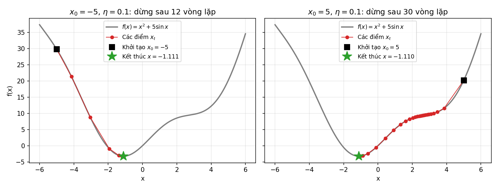
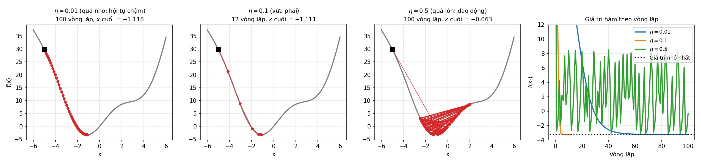
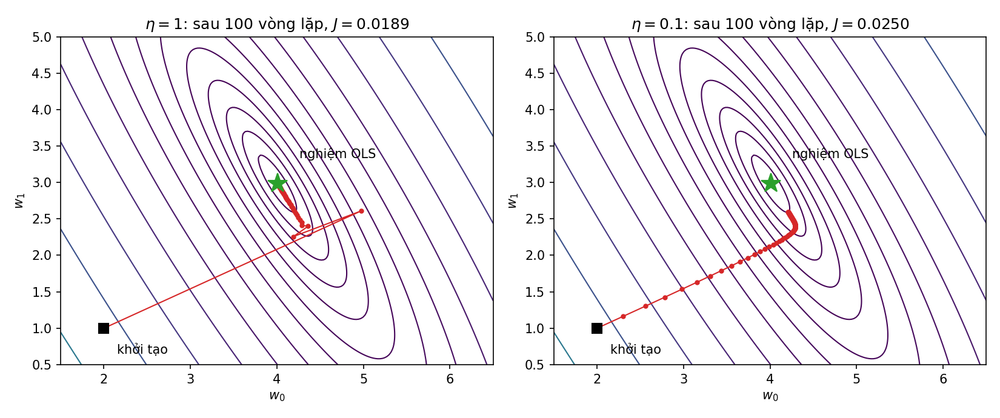
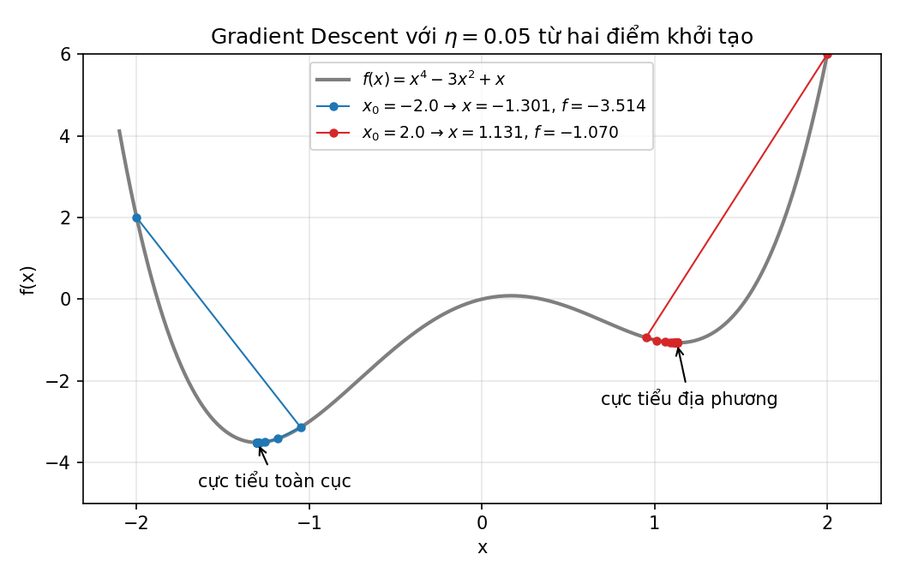
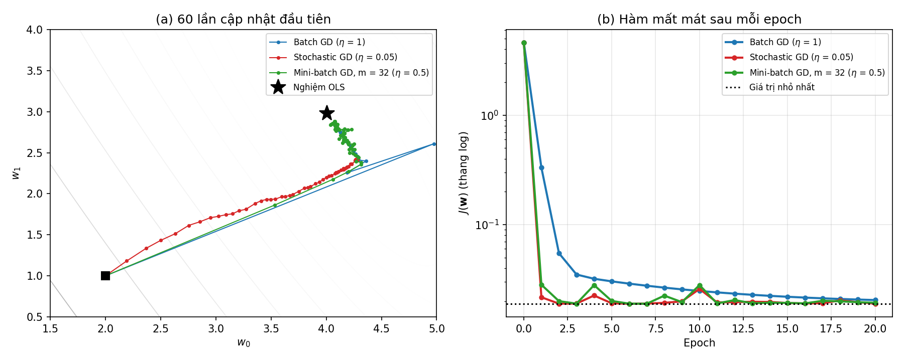
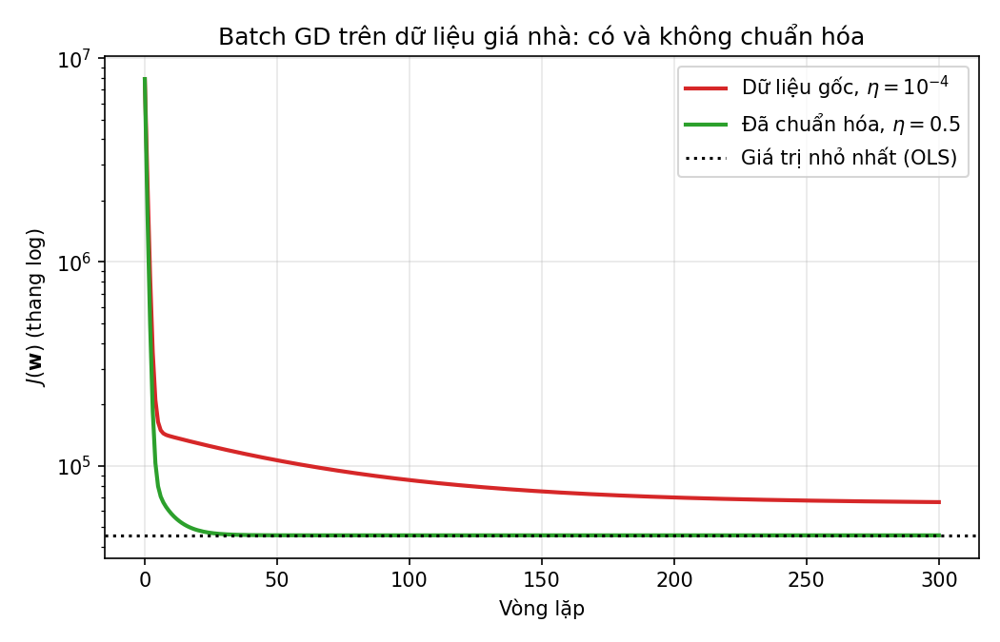

<style>
pre, pre code { font-size: 16px !important; line-height: 1.5 !important; }
</style>

# Bài 5. Thuật toán Gradient Descent

> Tài liệu tham khảo: *Giáo trình Machine Learning 2026*, Chương 3 – Tối ưu hóa bằng hạ dốc; Chương 4 – Hồi quy tuyến tính (mục Xây dựng và tối ưu hàm mất mát).
>
> Mã nguồn demo: thư mục [codes/](codes/), các file đánh số theo thứ tự trình bày trong bài, mỗi notebook chạy độc lập từ đầu đến cuối (mở bằng Jupyter, thư mục hiện hành là `codes/`).

- [5.1. Gradient Descent](#51-gradient-descent)
- [5.2. Các biến thể của Gradient Descent](#52-các-biến-thể-của-gradient-descent)
- [5.3. Tối ưu hàm mất mát bằng Gradient Descent](#53-tối-ưu-hàm-mất-mát-bằng-gradient-descent)
- [5.4. Kết luận](#54-kết-luận)
- [5.5. Câu hỏi ôn tập](#55-câu-hỏi-ôn-tập)

---

## 5.1. Gradient Descent

### 5.1.1. Vai trò của tối ưu hóa trong Học máy

#### a) Huấn luyện mô hình là giải bài toán tối ưu

Ở các bài trước, mọi mô hình đều được huấn luyện theo cùng một khuôn mẫu:

1. Chọn dạng mô hình có tham số $\mathbf{w}$ (ví dụ $\hat{y} = \mathbf{x}^T\mathbf{w}$).
2. Định nghĩa **hàm mất mát** $\mathcal{L}(\mathbf{w})$ đo mức độ sai khác giữa dự đoán và nhãn thật trên tập huấn luyện.
3. Tìm tham số làm hàm mất mát nhỏ nhất:
$$
\mathbf{w}^* = \arg\min_{\mathbf{w}} \mathcal{L}(\mathbf{w})
$$

Bước 3 là một **bài toán tối ưu**. Nói cách khác, "học" trong học máy chính là **tối ưu hàm mất mát**.

| Mô hình | Hàm mất mát | Bài |
|---|---|---|
| Hồi quy tuyến tính | $\mathcal{L}(\mathbf{w}) = \frac{1}{2N}\sum_{i=1}^{N}(y_i - \mathbf{x}_i^T\mathbf{w})^2$ (MSE) | 3 |
| Hồi quy Logistic | $J(\mathbf{w}) = -\frac{1}{N}\sum_{i=1}^{N}\big[y_i\ln a_i + (1 - y_i)\ln(1 - a_i)\big]$ (cross-entropy) | 4 |
| Perceptron | $J(\mathbf{w}) = \sum_{\mathbf{x}_i \in \mathcal{M}} -y_i\,\mathbf{x}_i^T\mathbf{w}$ | 4 |
| Mạng nơ-ron | Cross-entropy hoặc MSE, với hàng nghìn đến hàng tỉ tham số | 9 |

#### b) Nghiệm giải tích và phương pháp lặp

Có hai cách tìm cực tiểu:

- **Nghiệm giải tích** (dạng đóng): giải phương trình $\nabla\mathcal{L}(\mathbf{w}) = \mathbf{0}$ ra công thức. Ví dụ nghiệm OLS của hồi quy tuyến tính $\mathbf{w} = (\mathbf{X}^T\mathbf{X})^\dagger\mathbf{X}^T\mathbf{y}$ (Bài 3). Cách này chỉ dùng được với rất ít mô hình, và tốn kém khi số đặc trưng $d$ lớn (tính giả nghịch đảo ma trận $d \times d$ có độ phức tạp khoảng $O(d^3)$).
- **Phương pháp lặp**: bắt đầu từ một điểm khởi tạo $\mathbf{w}_0$, cập nhật từng bước $\mathbf{w}_0 \to \mathbf{w}_1 \to \mathbf{w}_2 \to \dots$ sao cho hàm mất mát giảm dần. Hồi quy Logistic, mạng nơ-ron **không có** nghiệm giải tích nên bắt buộc phải dùng cách này.

**Gradient Descent** (GD, phương pháp hạ dốc) là phương pháp lặp cơ bản và phổ biến nhất trong học máy. Hầu hết các thuật toán huấn luyện hiện đại (SGD, Momentum, Adam, …) đều là biến thể của nó.

#### c) Cực tiểu toàn cục và cực tiểu địa phương

Xét hàm $f: \mathbb{R}^d \to \mathbb{R}$:
- $\mathbf{x}^*$ là **cực tiểu toàn cục** nếu $f(\mathbf{x}) \ge f(\mathbf{x}^*)$ với **mọi** $\mathbf{x}$.
- $\mathbf{x}^*$ là **cực tiểu địa phương** nếu $f(\mathbf{x}) \ge f(\mathbf{x}^*)$ với mọi $\mathbf{x}$ **trong một lân cận** của $\mathbf{x}^*$.

Mọi cực tiểu toàn cục đều là cực tiểu địa phương, nhưng điều ngược lại không đúng. Tại cực tiểu (của hàm khả vi), đạo hàm bằng 0.

Với **hàm lồi** (đồ thị có dạng "cái bát", như MSE của hồi quy tuyến tính hay cross-entropy của hồi quy Logistic), mọi cực tiểu địa phương đều là cực tiểu toàn cục, nên GD (với tốc độ học phù hợp) tìm được nghiệm tốt nhất. Với hàm không lồi (như hàm mất mát của mạng nơ-ron), GD có thể dừng ở cực tiểu địa phương; trong thực tế, một cực tiểu địa phương đủ tốt thường vẫn được chấp nhận.

---

### 5.1.2. Hàm mất mát và đạo hàm riêng theo từng tham số

#### a) Đạo hàm và độ dốc

Với hàm một biến $f(x)$, **đạo hàm** $f'(x)$ là **hệ số góc của tiếp tuyến** tại $x$, cho biết độ dốc của đồ thị:
- $f'(x) > 0$: hàm đang **tăng**, đi sang phải thì $f$ tăng.
- $f'(x) < 0$: hàm đang **giảm**, đi sang phải thì $f$ giảm.
- $f'(x) = 0$: tiếp tuyến nằm ngang, có thể là điểm cực trị.
- $|f'(x)|$ càng lớn thì đồ thị càng dốc.

*Ví dụ:* $f(x) = \frac{1}{2}(x - 1)^2 - 2$ có $f'(x) = x - 1$. Tại $x = 3$: $f'(3) = 2 > 0$, cực tiểu nằm **bên trái**. Tại $x = -1$: $f'(-1) = -2 < 0$, cực tiểu nằm **bên phải**. Tại $x^* = 1$: $f'(1) = 0$, đây là cực tiểu.

Nhận xét then chốt: **muốn giảm $f$, ta di chuyển $x$ ngược dấu với đạo hàm.**

#### b) Đạo hàm riêng và vector gradient

Hàm mất mát thường phụ thuộc nhiều tham số $\mathbf{w} = [w_0, w_1, \dots, w_d]^T$. **Đạo hàm riêng** $\dfrac{\partial \mathcal{L}}{\partial w_j}$ là đạo hàm của $\mathcal{L}$ theo $w_j$ khi coi các tham số còn lại là hằng số; nó cho biết $\mathcal{L}$ thay đổi nhanh thế nào khi chỉ thay đổi $w_j$.

Ghép các đạo hàm riêng thành một vector, ta được **gradient**:

$$
\nabla_{\mathbf{w}}\mathcal{L}(\mathbf{w}) = \left[\frac{\partial \mathcal{L}}{\partial w_0}, \frac{\partial \mathcal{L}}{\partial w_1}, \dots, \frac{\partial \mathcal{L}}{\partial w_d}\right]^T
$$

**Ý nghĩa hình học:** tại mỗi điểm, vector gradient chỉ theo **hướng hàm số tăng nhanh nhất**, độ dài của nó là tốc độ tăng theo hướng đó. Do đó $-\nabla\mathcal{L}$ là **hướng giảm nhanh nhất** (hướng "xuống dốc"). Gradient luôn vuông góc với đường đồng mức (tập các điểm có cùng giá trị $\mathcal{L}$) đi qua điểm đó.

#### c) Ví dụ: đạo hàm riêng của hàm mất mát MSE

Xét hồi quy tuyến tính một biến $\hat{y} = w_0 + w_1 x$ với hàm mất mát

$$
\mathcal{L}(w_0, w_1) = \frac{1}{2N}\sum_{i=1}^{N}(w_0 + w_1 x_i - y_i)^2
$$

Đặt sai số $e_i = \hat{y}_i - y_i = w_0 + w_1 x_i - y_i$. Áp dụng quy tắc đạo hàm hàm hợp, hệ số $\frac{1}{2}$ triệt tiêu với số 2 của bình phương:

$$
\frac{\partial \mathcal{L}}{\partial w_0} = \frac{1}{N}\sum_{i=1}^{N} e_i, \qquad
\frac{\partial \mathcal{L}}{\partial w_1} = \frac{1}{N}\sum_{i=1}^{N} e_i\, x_i
$$

**Tính tay.** Dữ liệu 3 điểm $(x, y)$: $(1, 2)$, $(2, 3)$, $(3, 5)$. Tại $w_0 = 0$, $w_1 = 0$: mọi dự đoán bằng 0, sai số $e = (-2, -3, -5)$.

$$
\mathcal{L}(0, 0) = \frac{1}{6}(4 + 9 + 25) = 6.333, \qquad
\frac{\partial \mathcal{L}}{\partial w_0} = \frac{-2 - 3 - 5}{3} = -3.333, \qquad
\frac{\partial \mathcal{L}}{\partial w_1} = \frac{-2 \cdot 1 - 3 \cdot 2 - 5 \cdot 3}{3} = -7.667
$$

Cả hai đạo hàm riêng đều âm: tăng $w_0$ hoặc $w_1$ đều làm mất mát giảm, và tăng $w_1$ có tác dụng mạnh hơn.

**Dạng tổng quát (ma trận).** Với $\mathbf{X}$ có mỗi hàng là một vector mở rộng $\mathbf{x}_i^T = [1, x_{i1}, \dots, x_{id}]$:

$$
\mathcal{L}(\mathbf{w}) = \frac{1}{2N}\|\mathbf{X}\mathbf{w} - \mathbf{y}\|_2^2
\quad\Rightarrow\quad
\nabla_{\mathbf{w}}\mathcal{L}(\mathbf{w}) = \frac{1}{N}\mathbf{X}^T(\mathbf{X}\mathbf{w} - \mathbf{y})
$$

Thành phần thứ $j$ của vector này chính là $\frac{1}{N}\sum_i e_i\, x_{ij}$, khớp với công thức tính riêng ở trên.

#### d) Kiểm tra gradient bằng đạo hàm số

Tính sai gradient là lỗi rất thường gặp khi tự cài đặt. Có thể kiểm tra bằng **xấp xỉ sai phân trung tâm**: với $\varepsilon$ nhỏ (ví dụ $10^{-6}$),

$$
\frac{\partial \mathcal{L}}{\partial w_j} \approx \frac{\mathcal{L}(\mathbf{w} + \varepsilon\mathbf{e}_j) - \mathcal{L}(\mathbf{w} - \varepsilon\mathbf{e}_j)}{2\varepsilon}
$$

trong đó $\mathbf{e}_j$ là vector có phần tử thứ $j$ bằng 1, còn lại bằng 0.

```python
import numpy as np

X = np.array([[1, 1], [1, 2], [1, 3]], dtype=float)   # mỗi hàng [1, x_i]
y = np.array([2, 3, 5], dtype=float)

def loss(w):
    return np.sum((X @ w - y)**2) / (2 * len(y))

def grad(w):
    return X.T @ (X @ w - y) / len(y)

def numerical_grad(w, eps=1e-6):
    g = np.zeros_like(w)
    for j in range(len(w)):
        e = np.zeros_like(w); e[j] = eps
        g[j] = (loss(w + e) - loss(w - e)) / (2 * eps)
    return g

w = np.zeros(2)
print(loss(w))       # 6.333
print(grad(w))       # [-3.333 -7.667]
print(numerical_grad(w))    # [-3.333 -7.667]  -> khớp với công thức
```

*Mã nguồn: [codes/01_mse_partial_derivatives.ipynb](codes/01_mse_partial_derivatives.ipynb).*

---

### 5.1.3. Cập nhật trọng số trong Gradient Descent

#### a) Hàm một biến

Giả sử sau vòng lặp $t$ ta đang ở $x_t$. Từ mục 5.1.2:
- Nếu $f'(x_t) > 0$, $x_t$ nằm bên phải cực tiểu, cần **giảm** $x$; nếu $f'(x_t) < 0$, cần **tăng** $x$. Vậy bước dịch chuyển phải **ngược dấu** với $f'(x_t)$.
- Càng xa cực tiểu, $|f'(x_t)|$ thường càng lớn, nên bước dịch chuyển nên **tỉ lệ** với $|f'(x_t)|$: xa thì bước dài, gần thì bước ngắn.

Từ đó có quy tắc cập nhật:

$$
\boxed{x_{t+1} = x_t - \eta\, f'(x_t)}
$$

trong đó $\eta > 0$ là **tốc độ học** (learning rate). Dấu trừ thể hiện việc đi **ngược** hướng đạo hàm, tức "xuống dốc".

**Tính tay.** Tìm cực tiểu của $f(x) = x^2 + 4x + 4 = (x + 2)^2$, có $f'(x) = 2x + 4$. Chọn $x_0 = 0$, $\eta = 0.25$:

| $t$ | $x_t$ | $f'(x_t)$ | $x_{t+1} = x_t - 0.25\,f'(x_t)$ | $f(x_{t+1})$ |
|---|---|---|---|---|
| 0 | 0 | 4 | −1 | 1 |
| 1 | −1 | 2 | −1.5 | 0.25 |
| 2 | −1.5 | 1 | −1.75 | 0.0625 |
| 3 | −1.75 | 0.5 | −1.875 | 0.0156 |

$x_t$ tiến dần về cực tiểu $x^* = -2$, mỗi bước khoảng cách tới $x^*$ giảm một nửa, và bước đi ngắn dần khi đạo hàm nhỏ dần.

#### b) Hàm nhiều biến

Với vector tham số $\mathbf{w}$, thay đạo hàm bằng gradient:

$$
\boxed{\mathbf{w}_{t+1} = \mathbf{w}_t - \eta\,\nabla_{\mathbf{w}}\mathcal{L}(\mathbf{w}_t)}
$$

hay viết theo từng tham số, **cập nhật đồng thời** mọi $j$:

$$
w_j \leftarrow w_j - \eta\,\frac{\partial \mathcal{L}}{\partial w_j}, \qquad j = 0, 1, \dots, d
$$

Lưu ý "đồng thời": phải tính đủ mọi đạo hàm riêng tại $\mathbf{w}_t$ rồi mới cập nhật, không dùng $w_0$ mới để tính đạo hàm theo $w_1$.

*Tiếp ví dụ 3 điểm ở mục 5.1.2 c),* với $\eta = 0.1$:

$$
w_0 = 0 - 0.1 \times (-3.333) = 0.333, \qquad w_1 = 0 - 0.1 \times (-7.667) = 0.767
$$

Mất mát giảm từ $6.333$ xuống $1.283$ chỉ sau một bước.

#### c) Thuật toán

> **Thuật toán Gradient Descent**
> 1. Chọn điểm khởi tạo $\mathbf{w}_0$ (ví dụ $\mathbf{0}$ hoặc ngẫu nhiên), tốc độ học $\eta$, số vòng lặp tối đa.
> 2. Lặp với $t = 0, 1, 2, \dots$:
>    - Tính gradient $\mathbf{g}_t = \nabla\mathcal{L}(\mathbf{w}_t)$.
>    - Cập nhật $\mathbf{w}_{t+1} = \mathbf{w}_t - \eta\,\mathbf{g}_t$.
>    - Dừng nếu thỏa điều kiện dừng.
> 3. Trả về $\mathbf{w}$ cuối cùng.

**Điều kiện dừng** thường dùng (có thể kết hợp):
- Độ lớn gradient đủ nhỏ: $\|\nabla\mathcal{L}(\mathbf{w}_t)\| < \varepsilon$ (gần điểm dừng).
- Hàm mất mát gần như không giảm nữa: $|\mathcal{L}(\mathbf{w}_{t+1}) - \mathcal{L}(\mathbf{w}_t)| < \varepsilon$.
- Đạt số vòng lặp tối đa (luôn nên có, tránh lặp vô hạn khi không hội tụ).

#### d) Ví dụ trên Python: hàm $f(x) = x^2 + 5\sin x$

Hàm này có đạo hàm $f'(x) = 2x + 5\cos x$. Phương trình $f'(x) = 0$ không giải được bằng công thức, nên dùng GD:

```python
import numpy as np

def f(x):
    return x**2 + 5 * np.sin(x)

def grad(x):
    return 2 * x + 5 * np.cos(x)

def gd_1d(x0, eta, max_iter=100, tol=1e-3):
    x = x0
    history = [x0]
    for t in range(max_iter):
        x = x - eta * grad(x)        # x_{t+1} = x_t - eta * f'(x_t)
        history.append(x)
        if abs(grad(x)) < tol:       # đạo hàm đủ nhỏ -> dừng
            break
    return history

for x0 in [-5, 5]:
    x_history = gd_1d(x0, eta=0.1)
    print('x0 = %2d: x = %.4f, f(x) = %.4f, sau %d vòng lặp' % (x0, x_history[-1], f(x_history[-1]), len(x_history) - 1))
```

**Kết quả:**

```
x0 = -5: x = -1.1106, f(x) = -3.2464, sau 12 vong lap
x0 =  5: x = -1.1105, f(x) = -3.2464, sau 30 vong lap
```

*Mã nguồn: [codes/02_gd_weight_update.ipynb](codes/02_gd_weight_update.ipynb).*



*Hình 5.1: GD với $\eta = 0.1$ từ hai điểm khởi tạo khác nhau. Mã nguồn vẽ hình: [images/plot_gd_1d.py](images/plot_gd_1d.py).*

Cả hai điểm khởi tạo đều tới cùng nghiệm $x \approx -1.11$, nhưng số vòng lặp khác nhau. Từ $x_0 = 5$, quỹ đạo phải đi qua vùng quanh $x \approx 2.5$ nơi đồ thị gần như **nằm ngang** (đạo hàm nhỏ nhưng khác 0), các bước rất ngắn nên tiến triển chậm. Đây là hiện tượng **vùng bằng phẳng** (plateau) thường gặp trong huấn luyện mạng nơ-ron.

---

### 5.1.4. Tốc độ học (learning rate)

Tốc độ học $\eta$ quyết định độ dài mỗi bước đi. Đây là **siêu tham số** (Bài 2): không được học từ dữ liệu mà do người dùng chọn.

#### a) Ảnh hưởng của tốc độ học



*Hình 5.2: GD trên $f(x) = x^2 + 5\sin x$ từ $x_0 = -5$ với ba tốc độ học, và giá trị $f(x_t)$ theo vòng lặp. Mã nguồn vẽ hình: [images/plot_learning_rate.py](images/plot_learning_rate.py).*

| $\eta$ | Hiện tượng |
|---|---|
| Quá nhỏ ($0.01$) | Mỗi bước rất ngắn, **hội tụ chậm**: sau 100 vòng lặp vẫn chưa thỏa điều kiện dừng. Với bài toán lớn, tốn rất nhiều thời gian tính toán. |
| Vừa phải ($0.1$) | Hội tụ nhanh và ổn định, chỉ cần 12 vòng lặp. |
| Quá lớn ($0.5$) | Bước đi quá dài, **vượt qua** cực tiểu sang phía bên kia, rồi lại vượt ngược lại: **dao động** mãi quanh cực tiểu mà không hội tụ. |
| Lớn hơn nữa | Mỗi bước vượt xa hơn bước trước, $f(x_t)$ tăng dần đến vô cùng: **phân kỳ** (trong code thấy giá trị `inf`, `nan`). |

**Phân tích với hàm bậc hai.** Với $f(x) = (x + 2)^2$, quy tắc cập nhật là $x_{t+1} = x_t - 2\eta(x_t + 2)$, hay

$$
x_{t+1} + 2 = (1 - 2\eta)(x_t + 2)
$$

Khoảng cách tới cực tiểu được nhân với $(1 - 2\eta)$ sau mỗi bước, nên:
- $0 < \eta < 0.5$: hội tụ đơn điệu ($\eta = 0.25$ ở ví dụ mục 5.1.3 cho hệ số $0.5$).
- $\eta = 0.5$: tới đúng cực tiểu sau 1 bước.
- $0.5 < \eta < 1$: hội tụ nhưng **nhảy qua lại** hai bên cực tiểu.
- $\eta \ge 1$: không hội tụ ($\eta = 1$ dao động giữa hai điểm, $\eta > 1$ phân kỳ).

Như vậy tồn tại một **ngưỡng** tốc độ học: vượt ngưỡng thì GD không hội tụ. Ngưỡng này phụ thuộc vào độ cong của hàm (hàm càng "dốc đứng" thì ngưỡng càng nhỏ).

*Mã nguồn: [codes/03_learning_rate.ipynb](codes/03_learning_rate.ipynb).*

#### b) Chọn tốc độ học trong thực tế

- Thử các giá trị theo thang log: $1, 0.3, 0.1, 0.03, 0.01, \dots$, vẽ đồ thị hàm mất mát theo vòng lặp và chọn giá trị lớn nhất mà mất mát vẫn giảm ổn định.
- Nếu mất mát tăng hoặc dao động mạnh: giảm $\eta$. Nếu giảm quá chậm: tăng $\eta$.
- **Giảm dần tốc độ học** (learning rate decay): bắt đầu với $\eta$ lớn để tiến nhanh, sau đó giảm dần để không dao động khi gần cực tiểu, ví dụ $\eta_t = \dfrac{\eta_0}{1 + k\,t}$.
- Các thuật toán tối ưu hiện đại như Momentum, Adam tự điều chỉnh bước đi theo từng tham số (giới thiệu ở Bài 9).

#### c) Đường đồng mức và ảnh hưởng của thang đo đặc trưng

Với hàm hai biến $\mathcal{L}(w_0, w_1)$, có thể vẽ **đường đồng mức** (contour): mỗi đường nối các điểm có cùng giá trị mất mát, giống đường đồng mức độ cao trên bản đồ địa hình. Cực tiểu nằm ở tâm các đường; GD đi theo hướng vuông góc với đường đồng mức.



*Hình 5.3: Đường đồng mức của hàm mất mát MSE (dữ liệu 1000 điểm gần đường $y = 4 + 3x$, mục 5.3.1) và quỹ đạo GD từ $\mathbf{w} = (2, 1)$ với $\eta = 1$ và $\eta = 0.1$ trong 100 vòng lặp. Mã nguồn vẽ hình: [images/plot_contours.py](images/plot_contours.py).*

Các đường đồng mức có dạng **elip dẹt**: theo một hướng hàm rất dốc, theo hướng kia lại rất thoải. GD đi nhanh xuống "đáy thung lũng" rồi bò chậm dọc theo đáy. Với $\eta = 0.1$, sau 100 vòng lặp vẫn chưa tới nghiệm.

Elip càng dẹt khi các đặc trưng có **thang đo chênh lệch lớn** (ví dụ diện tích hàng trăm m², số phòng chỉ 1–6). Khi đó tốc độ học phải rất nhỏ để không phân kỳ theo hướng dốc, dẫn tới cực kỳ chậm theo hướng thoải. **Chuẩn hóa đặc trưng** (Bài 2, `StandardScaler`) làm các đường đồng mức tròn hơn và giúp GD hội tụ nhanh hơn nhiều; xem ví dụ thực tế ở mục 5.3.1.

#### d) Mắc kẹt tại cực tiểu địa phương

Với hàm không lồi, kết quả của GD phụ thuộc vào **điểm khởi tạo**.



*Hình 5.4: Hàm $f(x) = x^4 - 3x^2 + x$ có cực tiểu toàn cục tại $x \approx -1.30$ và cực tiểu địa phương tại $x \approx 1.13$. GD từ $x_0 = -2$ tới cực tiểu toàn cục, từ $x_0 = 2$ mắc kẹt ở cực tiểu địa phương. Mã nguồn vẽ hình: [images/plot_local_minima.py](images/plot_local_minima.py).*

Tại cực tiểu địa phương, đạo hàm bằng 0 nên GD dừng lại, không có cách nào "biết" rằng còn điểm thấp hơn ở chỗ khác. Một số cách giảm thiểu: chạy GD nhiều lần với các điểm khởi tạo khác nhau rồi chọn kết quả tốt nhất; dùng SGD hoặc mini-batch (nhiễu trong gradient có thể giúp thoát khỏi cực tiểu nông, mục 5.2); dùng Momentum. Với các hàm lồi như MSE của hồi quy tuyến tính, vấn đề này không xảy ra.

**Tóm tắt các vấn đề thường gặp của GD:**

| Vấn đề | Nguyên nhân | Cách khắc phục |
|---|---|---|
| Hội tụ chậm | $\eta$ quá nhỏ; đặc trưng khác thang đo; vùng bằng phẳng | Tăng $\eta$; chuẩn hóa đặc trưng; Momentum, Adam |
| Dao động, phân kỳ | $\eta$ quá lớn | Giảm $\eta$; giảm dần tốc độ học |
| Mắc kẹt ở cực tiểu địa phương | Hàm mất mát không lồi | Khởi tạo nhiều lần; SGD/mini-batch; Momentum |

---

## 5.2. Các biến thể của Gradient Descent

Hàm mất mát trong học máy thường là **trung bình** mất mát trên từng mẫu:

$$
\mathcal{L}(\mathbf{w}) = \frac{1}{N}\sum_{i=1}^{N}\mathcal{L}_i(\mathbf{w})
\quad\Rightarrow\quad
\nabla\mathcal{L}(\mathbf{w}) = \frac{1}{N}\sum_{i=1}^{N}\nabla\mathcal{L}_i(\mathbf{w})
$$

với $\mathcal{L}_i$ là mất mát trên mẫu thứ $i$ (với MSE: $\mathcal{L}_i = \frac{1}{2}(\mathbf{x}_i^T\mathbf{w} - y_i)^2$, $\nabla\mathcal{L}_i = (\mathbf{x}_i^T\mathbf{w} - y_i)\,\mathbf{x}_i$). Ba biến thể của GD khác nhau ở chỗ **dùng bao nhiêu mẫu để tính gradient cho mỗi lần cập nhật**.

**Thuật ngữ:**
- **Lần cập nhật** (iteration, step): một lần thực hiện $\mathbf{w} \leftarrow \mathbf{w} - \eta\,\mathbf{g}$.
- **Epoch**: một lượt duyệt qua **toàn bộ** $N$ mẫu huấn luyện.
- **Batch size** $m$: số mẫu dùng để tính gradient trong một lần cập nhật. Số lần cập nhật trong một epoch là $\lceil N/m \rceil$.

### 5.2.1. Batch Gradient Descent

**Batch GD** (GD chuẩn) dùng **toàn bộ** $N$ mẫu để tính gradient ở mỗi lần cập nhật:

$$
\mathbf{w} \leftarrow \mathbf{w} - \eta\,\frac{1}{N}\sum_{i=1}^{N}\nabla\mathcal{L}_i(\mathbf{w})
$$

Mỗi epoch chỉ có **một** lần cập nhật.

```
for epoch in range(so_epoch):
    g = gradient tren toan bo N mau
    w = w - eta * g
```

- **Ưu điểm:** gradient chính xác, quỹ đạo mượt, mất mát giảm đều sau mỗi bước; với hàm lồi và $\eta$ phù hợp, hội tụ về đúng cực tiểu. Dễ tận dụng tính toán ma trận (vector hóa).
- **Nhược điểm:** khi $N$ lớn (hàng triệu mẫu), mỗi lần cập nhật phải duyệt hết dữ liệu, **rất chậm** và có thể không đủ bộ nhớ; không cập nhật được khi có dữ liệu mới (học trực tuyến).

### 5.2.2. Stochastic Gradient Descent

**Stochastic GD** (SGD, GD ngẫu nhiên) dùng **một mẫu** chọn ngẫu nhiên cho mỗi lần cập nhật:

$$
\mathbf{w} \leftarrow \mathbf{w} - \eta\,\nabla\mathcal{L}_i(\mathbf{w})
$$

Mỗi epoch có $N$ lần cập nhật. Trước mỗi epoch, **xáo trộn** thứ tự dữ liệu để các mẫu được chọn ngẫu nhiên và không lặp lại theo một trật tự cố định.

```
for epoch in range(so_epoch):
    xao tron thu tu N mau
    for i in thu_tu:
        g = gradient tren mau i
        w = w - eta * g
```

Gradient trên một mẫu là **ước lượng nhiễu** của gradient thật: trung bình thì đúng hướng, nhưng từng bước có thể lệch.

- **Ưu điểm:** mỗi lần cập nhật rất rẻ; tiến rất nhanh trong giai đoạn đầu (sau 1 epoch đã cập nhật $N$ lần); dùng được cho dữ liệu lớn và học trực tuyến; nhiễu có thể giúp thoát khỏi cực tiểu địa phương nông.
- **Nhược điểm:** quỹ đạo **zig-zag**, mất mát dao động, không dừng hẳn tại cực tiểu mà dao động quanh nó (thường phải giảm dần $\eta$ để hội tụ); xử lý từng mẫu một không tận dụng được tính toán vector hóa nên chậm khi cài đặt bằng Python.

Hồi quy Logistic trong giáo trình (Bài 4) và thuật toán PLA (mỗi lần cập nhật theo một điểm sai) đều là dạng SGD.

### 5.2.3. Mini-batch Gradient Descent

**Mini-batch GD** dùng một nhóm nhỏ $m$ mẫu (**mini-batch** $\mathcal{B}$) cho mỗi lần cập nhật, là phương án trung gian giữa hai cách trên:

$$
\mathbf{w} \leftarrow \mathbf{w} - \eta\,\frac{1}{m}\sum_{i \in \mathcal{B}}\nabla\mathcal{L}_i(\mathbf{w})
$$

Mỗi epoch: xáo trộn dữ liệu, chia thành $\lceil N/m \rceil$ mini-batch rồi cập nhật lần lượt trên từng mini-batch.

```
for epoch in range(so_epoch):
    xao tron thu tu N mau
    for B in chia thu tu thanh cac nhom m mau:
        g = gradient trung binh tren nhom B
        w = w - eta * g
```

- Gradient ít nhiễu hơn SGD (trung bình trên $m$ mẫu), quỹ đạo ổn định hơn.
- Mỗi lần cập nhật vẫn rẻ hơn nhiều so với Batch GD, và tính trên $m$ mẫu cùng lúc tận dụng được phép toán ma trận, GPU.
- Batch size thường chọn trong khoảng 16 – 256 (hay chọn lũy thừa của 2: 32, 64, 128). Đây là phương pháp **được dùng phổ biến nhất** để huấn luyện mạng nơ-ron.

Batch GD và SGD là hai trường hợp đặc biệt của Mini-batch GD với $m = N$ và $m = 1$.

#### So sánh ba biến thể



*Hình 5.5: Ba biến thể GD trên dữ liệu 1000 điểm ở mục 5.3.1, cùng khởi tạo $\mathbf{w} = (2, 1)$. (a) Quỹ đạo của 60 lần cập nhật đầu tiên: Batch GD (60 lần cập nhật = 60 epoch) đi những bước lớn và mượt; SGD (60 lần cập nhật = 60 mẫu, chưa hết 1 epoch) đi những bước nhỏ, zig-zag; mini-batch nằm giữa. (b) Mất mát sau mỗi epoch: tính theo epoch, SGD và mini-batch giảm nhanh hơn Batch GD rất nhiều nhưng dao động quanh cực tiểu. Mã nguồn vẽ hình: [images/plot_gd_variants.py](images/plot_gd_variants.py).*

| | Batch GD | Stochastic GD | Mini-batch GD |
|---|---|---|---|
| Số mẫu cho một lần cập nhật | $N$ | 1 | $m$ (16 – 256) |
| Số lần cập nhật mỗi epoch | 1 | $N$ | $\lceil N/m \rceil$ |
| Chi phí một lần cập nhật | Cao | Rất thấp | Thấp |
| Độ chính xác của gradient | Chính xác | Nhiễu nhiều | Nhiễu ít |
| Quỹ đạo | Mượt | Zig-zag | Tương đối ổn định |
| Gần cực tiểu | Hội tụ | Dao động quanh cực tiểu | Dao động nhẹ |
| Vector hóa, GPU | Tốt nhưng tốn bộ nhớ | Kém | Tốt |
| Phù hợp | Dữ liệu nhỏ | Dữ liệu rất lớn, học trực tuyến | Hầu hết trường hợp, học sâu |

---

## 5.3. Tối ưu hàm mất mát bằng Gradient Descent

### 5.3.1. Tối ưu hàm mất mát bằng Gradient Descent

Phần thực hành áp dụng GD để tối ưu hàm mất mát MSE của hồi quy tuyến tính (Bài 3):

$$
\mathcal{L}(\mathbf{w}) = \frac{1}{2N}\|\mathbf{X}\mathbf{w} - \mathbf{y}\|_2^2, \qquad
\nabla_{\mathbf{w}}\mathcal{L}(\mathbf{w}) = \frac{1}{N}\mathbf{X}^T(\mathbf{X}\mathbf{w} - \mathbf{y})
$$

Vì hồi quy tuyến tính có nghiệm OLS, ta dùng nó để **kiểm tra** nghiệm tìm được bằng GD.

#### Bước 1: Batch GD trên dữ liệu một biến

Tạo 1000 điểm nằm gần đường thẳng $y = 4 + 3x$:

```python
import numpy as np

np.random.seed(2)
X = np.random.rand(1000)                       # x trong [0, 1)
y = 4 + 3 * X + .2 * np.random.randn(1000)     # y = 4 + 3x + nhiễu
Xbar = np.column_stack([np.ones(len(X)), X])   # mỗi hàng [1, x_i]

# Nghiệm OLS để đối chiếu
w_ols = np.linalg.pinv(Xbar.T @ Xbar) @ Xbar.T @ y
print('OLS: w =', w_ols)

def loss(w, Xb, y):
    return np.sum((Xb @ w - y)**2) / (2 * len(y))

def grad(w, Xb, y):
    return Xb.T @ (Xb @ w - y) / len(y)

def batch_gd(Xb, y, w_init, eta, max_iter=10000, tol=1e-4):
    w = w_init.copy()
    history = [loss(w, Xb, y)]
    for t in range(1, max_iter + 1):
        w = w - eta * grad(w, Xb, y)
        history.append(loss(w, Xb, y))
        if np.linalg.norm(grad(w, Xb, y)) < tol:   # gradient đủ nhỏ -> dừng
            break
    return w, t, history

for eta in [1, 0.1]:
    w, t, history = batch_gd(Xbar, y, np.array([2., 1.]), eta)
    print('eta = %-4s w = %s, sau %d vòng lặp, loss = %.6f' % (eta, w.round(4), t, history[-1]))
```

**Kết quả:**

```
OLS: w = [4.0072 2.9823]
eta = 1    w = [4.0079 2.9809], sau 95 vong lap, loss = 0.018906
eta = 0.1  w = [4.0079 2.9809], sau 975 vong lap, loss = 0.018906
```

GD tìm được nghiệm rất gần nghiệm OLS (sai khác do điều kiện dừng $\|\nabla\mathcal{L}\| < 10^{-4}$), và mô hình $\hat{y} \approx 4.01 + 2.98x$ khớp với quy luật sinh dữ liệu. Tốc độ học nhỏ hơn 10 lần thì cần số vòng lặp nhiều hơn khoảng 10 lần. Thử $\eta = 2.5$ sẽ thấy `w` thành `nan`: GD phân kỳ.

*Mã nguồn: [codes/04_batch_gd_linear_regression.ipynb](codes/04_batch_gd_linear_regression.ipynb).*

#### Bước 2: Cài đặt chung cho ba biến thể

Một hàm duy nhất với tham số `batch_size` bao gồm cả ba biến thể: `batch_size = N` là Batch GD, `batch_size = 1` là SGD, giá trị ở giữa là Mini-batch GD.

```python
def minibatch_gd(Xb, y, eta, batch_size, n_epochs, w_init=None, seed=0):
    rng = np.random.default_rng(seed)
    N = len(y)
    w = np.zeros(Xb.shape[1]) if w_init is None else w_init.copy()
    history = [loss(w, Xb, y)]                    # loss trên toàn bộ dữ liệu sau mỗi epoch
    for epoch in range(n_epochs):
        order = rng.permutation(N)               # xáo trộn dữ liệu mỗi epoch
        for s in range(0, N, batch_size):
            B = order[s:s + batch_size]          # chỉ số các mẫu trong mini-batch
            w = w - eta * grad(w, Xb[B], y[B])    # gradient trung bình trên mini-batch
        history.append(loss(w, Xb, y))
    return w, history

w0 = np.array([2., 1.])
for name, batch_size, eta in [('Batch', 1000, 1.0), ('SGD', 1, 0.05), ('Mini-batch', 32, 0.5)]:
    w, history = minibatch_gd(Xbar, y, eta, batch_size, n_epochs=20, w_init=w0)
    print('%-10s w = %s, loss sau epoch 1, 2, 20: %s' %
          (name, w.round(4), np.round([history[1], history[2], history[20]], 4)))
```

**Kết quả** (giá trị nhỏ nhất của hàm mất mát là $0.0189$):

| Biến thể | Batch size | $\eta$ | Cập nhật/epoch | Loss sau epoch 1 | Loss sau epoch 2 | Loss sau epoch 20 | $\mathbf{w}$ sau 20 epoch |
|---|---|---|---|---|---|---|---|
| Batch GD | 1000 | 1.0 | 1 | 0.3320 | 0.0548 | 0.0205 | $(4.109,\ 2.787)$ |
| SGD | 1 | 0.05 | 1000 | 0.0217 | 0.0190 | 0.0189 | $(4.021,\ 2.972)$ |
| Mini-batch GD | 32 | 0.5 | 32 | 0.0282 | 0.0200 | 0.0193 | $(4.035,\ 2.986)$ |

Cùng 20 lượt duyệt dữ liệu, Batch GD mới cập nhật 20 lần nên còn khá xa nghiệm, trong khi SGD và mini-batch đã gần nghiệm chỉ sau 1–2 epoch. Đổi lại, mất mát của SGD và mini-batch dao động lên xuống giữa các epoch (Hình 5.5b) thay vì giảm đều.

*Mã nguồn: [codes/05_gd_variants.ipynb](codes/05_gd_variants.ipynb).*

#### Bước 3: Dữ liệu giá nhà và vai trò của chuẩn hóa

Dùng lại dữ liệu giá nhà ở Bài 3 ([data/house_prices.csv](data/house_prices.csv), 10.000 căn nhà, 3 đặc trưng: diện tích, số phòng ngủ, khoảng cách tới trung tâm).

```python
import pandas as pd
from sklearn.model_selection import train_test_split

df = pd.read_csv('data/house_prices.csv')
X = df[['area', 'bedrooms', 'distance']].values   # diện tích, số phòng ngủ, khoảng cách
y = df['price'].values                             # giá nhà (triệu VND)
X_train, X_test, y_train, y_test = train_test_split(X, y, test_size=0.2, random_state=42)

def add_ones(X):
    return np.column_stack([np.ones(len(X)), X])

Xb_train = add_ones(X_train)
w_ols = np.linalg.pinv(Xb_train.T @ Xb_train) @ Xb_train.T @ y_train
print('OLS:', w_ols.round(2))                    # [505.2  29.98 144.89 -59.46]

# GD trên dữ liệu gốc (chưa chuẩn hóa)
w, history = minibatch_gd(Xb_train, y_train, eta=3e-4, batch_size=len(y_train), n_epochs=50)
print(history[:4])                               # loss tăng vọt -> phân kỳ
w, history = minibatch_gd(Xb_train, y_train, eta=1e-4, batch_size=len(y_train), n_epochs=1000)
print(w.round(2))                                # [4.46 35.79 8.73 -45.2] -> còn rất xa OLS
```

Trên dữ liệu gốc, diện tích có giá trị trung bình khoảng 114 trong khi số phòng chỉ khoảng 3: các đường đồng mức cực kỳ dẹt. Với $\eta = 3 \times 10^{-4}$ GD đã **phân kỳ** (loss tăng từ $7.9 \times 10^6$ lên $1.0 \times 10^8$, $1.4 \times 10^9$, …). Với $\eta = 10^{-4}$ thì không phân kỳ nhưng sau 1000 vòng lặp, $w_0 \approx 4.5$ vẫn còn rất xa giá trị đúng $505.2$.

**Chuẩn hóa đặc trưng** về trung bình 0, độ lệch chuẩn 1 (chỉ dùng thống kê của tập huấn luyện), rồi so sánh ba biến thể:

```python
mu, std = X_train.mean(axis=0), X_train.std(axis=0)
Zb_train = add_ones((X_train - mu) / std)
Zb_test = add_ones((X_test - mu) / std)

def evaluate(w, Zb, y):
    pred = Zb @ w
    rmse = np.sqrt(np.mean((pred - y)**2))
    r2 = 1 - np.sum((pred - y)**2) / np.sum((y - y.mean())**2)
    return rmse, r2

for name, batch_size, eta, n_epochs in [('Batch', len(y_train), 0.5, 100),
                               ('SGD', 1, 0.01, 10),
                               ('Mini-batch', 64, 0.1, 10)]:
    w, history = minibatch_gd(Zb_train, y_train, eta, batch_size, n_epochs)
    # Đổi trọng số về thang đo gốc: w_j = w'_j / std_j, w_0 = w'_0 - sum(w'_j * mu_j / std_j)
    w_original = np.r_[w[0] - np.sum(w[1:] * mu / std), w[1:] / std]
    rmse, r2 = evaluate(w, Zb_test, y_test)
    print('%-10s loss = %.1f, w (thang gốc) = %s, RMSE test = %.2f, R2 = %.4f'
          % (name, history[-1], w_original.round(2), rmse, r2))
```

**Kết quả:**

| Phương pháp | Số epoch | Số lần cập nhật | Loss huấn luyện | $w_0$ | $w_1$ (diện tích) | $w_2$ (số phòng) | $w_3$ (khoảng cách) | RMSE test | $R^2$ test |
|---|---|---|---|---|---|---|---|---|---|
| OLS (nghiệm giải tích) | – | – | 45 584.0 | 505.20 | 29.98 | 144.89 | −59.46 | 302.06 | 0.9685 |
| Batch GD, $\eta = 0.5$ | 100 | 100 | 45 584.0 | 505.26 | 29.98 | 145.10 | −59.46 | 302.05 | 0.9685 |
| SGD, $\eta = 0.01$ | 10 | 80 000 | 46 949.9 | 647.97 | 29.73 | 140.10 | −65.22 | 305.79 | 0.9677 |
| Mini-batch ($m = 64$), $\eta = 0.1$ | 10 | 1 250 | 45 657.7 | 519.97 | 29.98 | 147.92 | −60.75 | 302.16 | 0.9685 |



*Hình 5.6: Hàm mất mát của Batch GD trên dữ liệu giá nhà. Dữ liệu gốc với $\eta = 10^{-4}$ (lớn hơn sẽ phân kỳ) giảm rất chậm; dữ liệu đã chuẩn hóa với $\eta = 0.5$ đạt giá trị nhỏ nhất sau khoảng 30 vòng lặp. Mã nguồn vẽ hình: [images/plot_feature_scaling.py](images/plot_feature_scaling.py).*

**Nhận xét:**
- Sau khi chuẩn hóa, Batch GD hội tụ về đúng nghiệm OLS chỉ sau 100 vòng lặp với $\eta = 0.5$, gấp 5000 lần tốc độ học $10^{-4}$ phải dùng trên dữ liệu gốc (dữ liệu gốc phân kỳ ngay khi $\eta$ vượt khoảng $1.3 \times 10^{-4}$). **Luôn chuẩn hóa đặc trưng trước khi dùng GD.**
- Mini-batch GD đạt chất lượng gần như OLS ($R^2 = 0.9685$) chỉ sau 10 epoch. SGD với $\eta$ cố định dao động quanh nghiệm nên hệ số $w_0$ còn lệch, RMSE kém hơn một chút; có thể cải thiện bằng cách giảm dần tốc độ học.
- Với dữ liệu nhỏ như thế này, nghiệm OLS là đủ. GD thực sự cần thiết khi dữ liệu lớn, số đặc trưng nhiều, hoặc mô hình không có nghiệm giải tích (hồi quy Logistic, mạng nơ-ron).

*Mã nguồn: [codes/06_gd_house_prices.ipynb](codes/06_gd_house_prices.ipynb).*

#### Bước 4: Sử dụng scikit-learn

Lớp `SGDRegressor` huấn luyện hồi quy tuyến tính bằng SGD (mặc định có điều chuẩn L2 rất nhỏ `alpha=0.0001` và tốc độ học giảm dần):

```python
from sklearn.linear_model import SGDRegressor
from sklearn.pipeline import make_pipeline
from sklearn.preprocessing import StandardScaler

model = make_pipeline(StandardScaler(),
                      SGDRegressor(max_iter=1000, tol=1e-6, random_state=42))
model.fit(X_train, y_train)
sgd = model[-1]
print('Số epoch:', sgd.n_iter_)
print('w0 =', sgd.intercept_, ' w =', sgd.coef_)   # trên dữ liệu đã chuẩn hóa
print('R2 test =', model.score(X_test, y_test))    # ~0.9685
```

Tương tự, `SGDClassifier(loss='log_loss')` huấn luyện hồi quy Logistic bằng SGD.

*Mã nguồn: [codes/07_sgd_regressor_sklearn.ipynb](codes/07_sgd_regressor_sklearn.ipynb).*

---

## 5.4. Kết luận

- Huấn luyện mô hình học máy là giải bài toán **tối ưu** $\mathbf{w}^* = \arg\min_{\mathbf{w}}\mathcal{L}(\mathbf{w})$. Khi không có (hoặc quá tốn kém để tính) nghiệm giải tích, dùng phương pháp lặp, phổ biến nhất là **Gradient Descent**.
- **Đạo hàm** cho biết độ dốc; **gradient** $\nabla\mathcal{L}$ là vector các đạo hàm riêng, chỉ hướng hàm tăng nhanh nhất. GD đi ngược hướng gradient:
$$
\mathbf{w} \leftarrow \mathbf{w} - \eta\,\nabla_{\mathbf{w}}\mathcal{L}(\mathbf{w})
$$
- Với MSE: $\nabla\mathcal{L} = \frac{1}{N}\mathbf{X}^T(\mathbf{X}\mathbf{w} - \mathbf{y})$; với cross-entropy của hồi quy Logistic: $\nabla J = \frac{1}{N}\mathbf{X}^T(\sigma(\mathbf{X}\mathbf{w}) - \mathbf{y})$.
- **Tốc độ học** $\eta$: quá nhỏ thì hội tụ chậm, quá lớn thì dao động hoặc phân kỳ. Chọn bằng thực nghiệm, theo dõi đồ thị hàm mất mát; có thể giảm dần theo thời gian.
- GD hội tụ chậm khi đặc trưng khác thang đo (cần **chuẩn hóa**) và có thể mắc kẹt tại **cực tiểu địa phương** với hàm không lồi.
- Ba biến thể khác nhau ở số mẫu dùng cho mỗi lần cập nhật: **Batch GD** ($N$ mẫu, ổn định nhưng chậm với dữ liệu lớn), **SGD** (1 mẫu, nhanh nhưng nhiễu), **Mini-batch GD** ($m$ mẫu, cân bằng, phổ biến nhất).

---

## 5.5. Câu hỏi ôn tập

### Câu hỏi lý thuyết

1. Vì sao nói huấn luyện mô hình học máy là giải một bài toán tối ưu? Khi nào cần dùng phương pháp lặp thay cho nghiệm giải tích?
2. Phân biệt cực tiểu toàn cục và cực tiểu địa phương. Vì sao với hàm lồi, GD không gặp vấn đề cực tiểu địa phương?
3. Trình bày ý nghĩa của đạo hàm và gradient. Vì sao cập nhật tham số theo hướng ngược với gradient lại làm giảm hàm mất mát?
4. Viết công thức cập nhật của GD cho hàm một biến và hàm nhiều biến. Giải thích vai trò của từng thành phần.
5. Tính các đạo hàm riêng $\partial\mathcal{L}/\partial w_0$, $\partial\mathcal{L}/\partial w_1$ của hàm mất mát MSE cho mô hình $\hat{y} = w_0 + w_1 x$.
6. Tốc độ học là gì? Điều gì xảy ra nếu tốc độ học quá lớn hoặc quá nhỏ? Nêu một số cách chọn tốc độ học.
7. Đường đồng mức của hàm số là gì? Vì sao đặc trưng có thang đo chênh lệch làm GD hội tụ chậm?
8. Phân biệt Batch GD, Stochastic GD và Mini-batch GD về số mẫu dùng cho mỗi lần cập nhật, chi phí tính toán, độ ổn định và phạm vi ứng dụng.
9. Một tập dữ liệu có 50.000 mẫu, dùng Mini-batch GD với batch size 128 trong 10 epoch. Có tất cả bao nhiêu lần cập nhật trọng số?

### Bài tập

10. Cho $f(x) = x^2 - 6x + 10$.
    - a. Tính $f'(x)$ và tìm cực tiểu bằng giải tích.
    - b. Thực hiện tay 3 bước GD với $x_0 = 0$, $\eta = 0.1$. *(Đáp số kiểm tra: $x_1 = 0.6$, $x_2 = 1.08$, $x_3 = 1.464$.)*
    - c. Với giá trị nào của $\eta$ thì GD hội tụ? Thử $\eta = 1.1$ và nhận xét.
11. Cho $f(x, y) = x^2 + 2y^2$. Tính gradient, thực hiện tay 2 bước GD từ $(x_0, y_0) = (2, 1)$ với $\eta = 0.1$.
12. Với dữ liệu 3 điểm $(1, 2)$, $(2, 3)$, $(3, 5)$ ở mục 5.1.2 c), thực hiện tay bước GD thứ hai (từ $w_0 = 0.333$, $w_1 = 0.767$, $\eta = 0.1$). So sánh với nghiệm OLS $w_0 = 0.333$, $w_1 = 1.5$.

### Bài tập thực hành

13. Viết chương trình GD tìm cực tiểu của $f(x) = x^2 + 4x + 4$. Vẽ đồ thị hàm số và các điểm $x_t$ qua các vòng lặp với $\eta \in \{0.1, 0.5, 0.9, 1.05\}$, nhận xét.
14. Cài đặt hồi quy Logistic bằng Mini-batch GD cho dữ liệu giờ ôn thi ở Bài 4 (gradient $\frac{1}{m}\mathbf{X}_\mathcal{B}^T(\sigma(\mathbf{X}_\mathcal{B}\mathbf{w}) - \mathbf{y}_\mathcal{B})$). So sánh nghiệm với `LogisticRegression(penalty=None)`.
15. Với dữ liệu giá nhà:
    - a. Chạy Mini-batch GD với batch size $\in \{8, 32, 128, 512\}$ (cùng $\eta = 0.1$, 10 epoch). Vẽ mất mát theo epoch và so sánh thời gian chạy.
    - b. Cài đặt SGD với tốc độ học giảm dần $\eta_t = \eta_0 / (1 + k\,t)$ ($t$ là số epoch). So sánh RMSE trên tập kiểm tra với SGD tốc độ học cố định.
    - c. Thêm điều kiện dừng sớm: dừng khi mất mát giảm ít hơn $10^{-6}$ (tương đối) giữa hai epoch liên tiếp.
