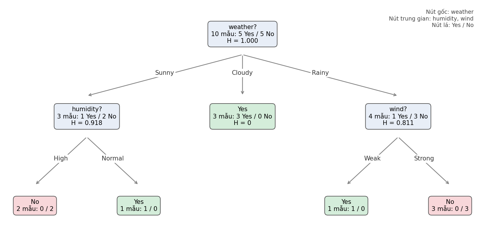
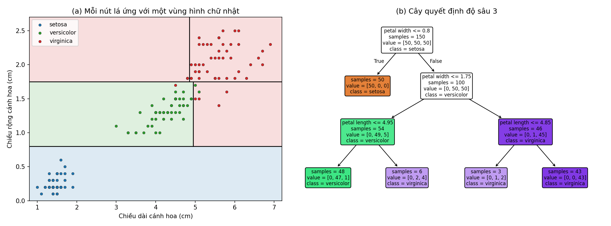
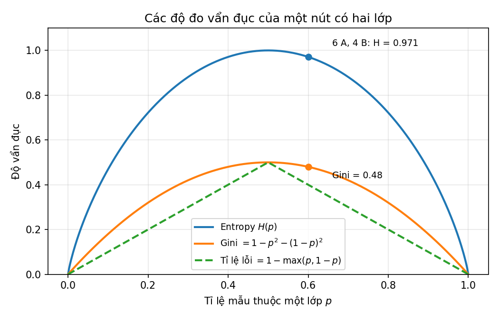
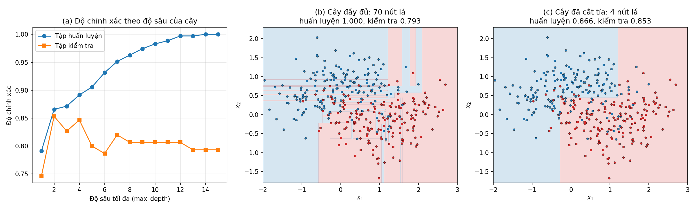
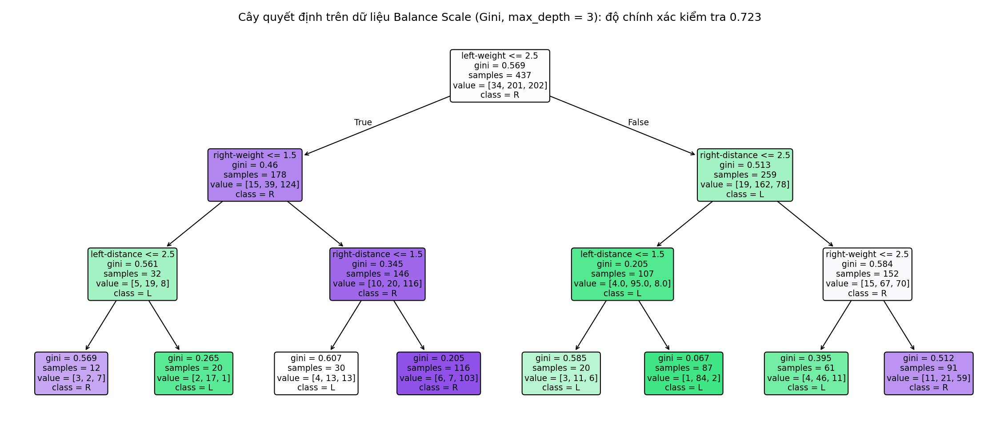

<style>
pre, pre code { font-size: 16px !important; line-height: 1.5 !important; }
</style>

# Bài 6. Cây quyết định

> Tài liệu tham khảo: *Giáo trình Machine Learning 2026*, Chương 8 – Cây quyết định. Thuật toán C4.5 (Gain Ratio, thuộc tính liên tục) không được trình bày trong giáo trình, tham khảo J. R. Quinlan, *C4.5: Programs for Machine Learning*, Morgan Kaufmann, 1993; cắt tỉa theo độ phức tạp chi phí tham khảo L. Breiman và cộng sự, *Classification and Regression Trees*, 1984 và tài liệu scikit-learn (*Decision Trees*). Bộ dữ liệu Balance Scale lấy từ UCI Machine Learning Repository.
>
> Mã nguồn demo: thư mục [codes/](codes/), các file đánh số theo thứ tự trình bày trong bài, mỗi notebook chạy độc lập từ đầu đến cuối (mở bằng Jupyter, thư mục hiện hành là `codes/`).

- [6.1. Cây quyết định](#61-cây-quyết-định)
- [6.2. Thực hành: phân loại dữ liệu bằng cây quyết định](#62-thực-hành-phân-loại-dữ-liệu-bằng-cây-quyết-định)
- [6.3. Kết luận](#63-kết-luận)
- [6.4. Câu hỏi ôn tập](#64-câu-hỏi-ôn-tập)

---

## 6.1. Cây quyết định

Các mô hình ở Bài 3, Bài 4 (hồi quy tuyến tính, hồi quy Logistic, Perceptron) đều dựa trên tổ hợp tuyến tính $\mathbf{w}^T\mathbf{x}$ của các đặc trưng. Trong nhiều bài toán thực tế, quan hệ giữa đặc trưng và nhãn không tuyến tính, và người dùng còn muốn biết **vì sao** mô hình đưa ra quyết định. **Cây quyết định** (Decision Tree) đáp ứng cả hai yêu cầu: mô hình là một chuỗi câu hỏi đơn giản trên từng thuộc tính, giống cách con người ra quyết định, và có thể đọc trực tiếp thành các luật *if–then*.

### 6.1.1. Khái niệm và cấu trúc cây quyết định

#### a) Các thành phần của cây

Cây quyết định là mô hình có cấu trúc cây phân cấp, dùng được cho cả phân loại và hồi quy. Bài này tập trung vào **phân loại**.



*Hình 6.1: Cây quyết định dự đoán có chơi thể thao hay không (`play`) từ dữ liệu thời tiết ở mục 6.1.2. Mã nguồn vẽ hình: [images/plot_weather_tree.py](images/plot_weather_tree.py).*

| Thành phần | Ý nghĩa | Trong Hình 6.1 |
|---|---|---|
| **Nút gốc** (root node) | Nút trên cùng, chứa toàn bộ tập huấn luyện, thực hiện phép kiểm tra đầu tiên | `weather?` |
| **Nút trung gian** (internal node, decision node) | Thực hiện một phép kiểm tra trên một thuộc tính | `humidity?`, `wind?` |
| **Nhánh** (branch) | Một kết quả của phép kiểm tra, nối nút cha với nút con | `Sunny`, `Cloudy`, `Rainy`, `High`, … |
| **Nút lá** (leaf node) | Nút cuối, không chia nữa, mang nhãn dự đoán | `Yes`, `No` |

Một số thuật ngữ khác:
- **Độ sâu** (depth) của cây: số cạnh trên đường đi dài nhất từ nút gốc tới một nút lá. Cây trong Hình 6.1 có độ sâu 2.
- Mỗi nút ứng với một **tập con** của dữ liệu huấn luyện: các mẫu thỏa mọi phép kiểm tra trên đường đi từ gốc tới nút đó. Nhãn của nút lá là **lớp chiếm đa số** trong tập con này.

#### b) Dự đoán bằng cây: các luật if–then

Để dự đoán nhãn của một mẫu mới, ta bắt đầu từ nút gốc, trả lời câu hỏi tại mỗi nút để đi theo nhánh tương ứng cho tới khi gặp nút lá. Mỗi đường đi từ gốc tới lá là một **luật** (rule). Cây trong Hình 6.1 tương đương với 5 luật:

```text
NẾU weather = Cloudy                     THÌ play = Yes
NẾU weather = Sunny  VÀ humidity = High   THÌ play = No
NẾU weather = Sunny  VÀ humidity = Normal THÌ play = Yes
NẾU weather = Rainy  VÀ wind = Weak       THÌ play = Yes
NẾU weather = Rainy  VÀ wind = Strong     THÌ play = No
```

Viết bằng Python:

```python
def predict_play(weather, humidity, wind):
    """Cây quyết định dưới dạng các luật if–then."""
    if weather == 'Cloudy':           # nhánh Cloudy -> nút lá
        return 'Yes'
    if weather == 'Sunny':            # nút trung gian: kiểm tra độ ẩm
        return 'No' if humidity == 'High' else 'Yes'
    # weather == 'Rainy'              # nút trung gian: kiểm tra gió
    return 'Yes' if wind == 'Weak' else 'No'

print(predict_play('Sunny', 'Normal', 'Strong'))   # Yes
```

Ngày (Sunny, Normal, Strong) đi theo đường `weather = Sunny` → `humidity = Normal` → lá `Yes`. Thuộc tính `wind` không được dùng trên đường đi này: cây chỉ hỏi những gì cần thiết.

#### c) Cách nhìn hình học: chia không gian thành các hình chữ nhật

Với thuộc tính số, mỗi nút kiểm tra dạng $x_j \le t$ (so sánh **một** đặc trưng với một ngưỡng). Mỗi phép kiểm tra cắt vùng đang xét bằng một đường thẳng (siêu phẳng) **song song với trục tọa độ**, nên cây chia không gian đặc trưng thành các hình hộp chữ nhật, mỗi nút lá ứng với một hình hộp.



*Hình 6.2: Cây độ sâu 3 trên dữ liệu Iris với hai đặc trưng của cánh hoa. (a) Năm nút lá ứng với năm vùng hình chữ nhật; (b) cây tương ứng (`value` là số mẫu mỗi lớp trong nút). Mã nguồn vẽ hình: [images/plot_tree_regions.py](images/plot_tree_regions.py).*

Nút gốc `petal width <= 0.8` tách riêng toàn bộ 50 bông setosa (vùng dưới cùng). Các nút tiếp theo tách versicolor và virginica, độ chính xác trên tập huấn luyện là 97.3%. Nhờ ghép nhiều vùng chữ nhật, cây biểu diễn được ranh giới quyết định **phi tuyến** mà các mô hình tuyến tính không làm được.

#### d) Cây quyết định với scikit-learn

Lớp `DecisionTreeClassifier` cài đặt thuật toán CART (mục 6.1.3): chỉ nhận đặc trưng dạng số và luôn tạo cây **nhị phân**. Thuộc tính rời rạc cần mã hóa one-hot (Bài 2), mỗi phép kiểm tra trở thành câu hỏi "thuộc tính = giá trị?" (giá trị 0/1 so với ngưỡng 0.5).

```python
import pandas as pd
from sklearn.tree import DecisionTreeClassifier, export_text

df = pd.read_csv(DATA / 'weather.csv')
X = pd.get_dummies(df[['weather', 'temperature', 'humidity', 'wind']], dtype=int)
y = df['play']

tree = DecisionTreeClassifier(criterion='entropy', random_state=0)
tree.fit(X, y)
print(export_text(tree, feature_names=list(X.columns)))
print('Độ sâu:', tree.get_depth(), ' số nút lá:', tree.get_n_leaves())
```

**Kết quả:**

```text
|--- weather_Cloudy <= 0.50
|   |--- temperature_Mild <= 0.50
|   |   |--- class: No
|   |--- temperature_Mild >  0.50
|   |   |--- humidity_High <= 0.50
|   |   |   |--- class: Yes
|   |   |--- humidity_High >  0.50
|   |   |   |--- wind_Strong <= 0.50
|   |   |   |   |--- class: Yes
|   |   |   |--- wind_Strong >  0.50
|   |   |   |   |--- class: No
|--- weather_Cloudy >  0.50
|   |--- class: Yes
Độ sâu: 4  số nút lá: 5
```

Cây nhị phân này khác cây nhiều nhánh ở Hình 6.1 (do mỗi nút chỉ được chia làm hai) nhưng cũng phân loại đúng cả 10 mẫu huấn luyện. Notebook còn minh họa `plot_tree` để vẽ cây và `decision_path` để in đường đi của một mẫu từ gốc tới lá.

*Mã nguồn: [codes/01_tree_structure.ipynb](codes/01_tree_structure.ipynb).*

---

### 6.1.2. Xây dựng cây theo tiêu chí chia: Entropy và Information Gain

#### a) Ý tưởng: chia để các nút con tinh khiết hơn

Cây được xây dựng **từ trên xuống** (top-down): bắt đầu với toàn bộ dữ liệu ở nút gốc, chọn một thuộc tính để chia thành các tập con, rồi lặp lại trên từng tập con. Câu hỏi then chốt: **tại mỗi nút, chọn thuộc tính nào để chia?**

Ta muốn sau mỗi lần chia, các mẫu trong cùng một nút con có xu hướng thuộc **cùng một lớp**:
- Nút **tinh khiết** (pure): mọi mẫu cùng một lớp, không cần chia thêm.
- Nút **vẩn đục** (impure): chứa lẫn nhiều lớp.

Thuộc tính tốt là thuộc tính làm **giảm độ vẩn đục nhiều nhất**. Cần một con số đo độ vẩn đục: Entropy (dùng trong ID3, C4.5) hoặc Gini (dùng trong CART, mục 6.1.3).

#### b) Entropy

**Entropy** xuất phát từ lý thuyết thông tin (C. Shannon, 1948), đo **mức độ không chắc chắn**. Xét tập mẫu $S$ có $K$ lớp, $p_i$ là tỉ lệ mẫu thuộc lớp $i$:

$$
H(S) = -\sum_{i=1}^{K} p_i \log_2 p_i
$$

với quy ước $0 \log_2 0 = 0$. Đơn vị là **bit**.

**Tính chất:**
- $H(S) \ge 0$; $H(S) = 0$ khi và chỉ khi $S$ tinh khiết (một lớp có $p_i = 1$).
- $H(S)$ lớn nhất khi các lớp chia đều: $p_i = 1/K$, khi đó $H(S) = \log_2 K$. Với hai lớp, giá trị lớn nhất là 1.

**Ví dụ** (giáo trình). Một nút có 10 mẫu: 6 lớp A, 4 lớp B, $p_A = 0.6$, $p_B = 0.4$:

$$
H(S) = -(0.6\log_2 0.6 + 0.4\log_2 0.4) = -(0.6 \times (-0.737) + 0.4 \times (-1.322)) \approx 0.971
$$

| Nút | $p_A$ | $H(S)$ | Nhận xét |
|---|---|---|---|
| 5 A, 5 B | 0.5 | 1.000 | Chia đều, không chắc chắn nhất |
| 6 A, 4 B | 0.6 | 0.971 | Còn rất hỗn hợp |
| 9 A, 1 B | 0.9 | 0.469 | Gần tinh khiết |
| 10 A, 0 B | 1.0 | 0 | Tinh khiết |



*Hình 6.3: Entropy, chỉ số Gini (mục 6.1.3) và tỉ lệ lỗi phân loại của một nút hai lớp theo tỉ lệ $p$ của một lớp. Cả ba bằng 0 khi nút tinh khiết và lớn nhất khi $p = 0.5$. Mã nguồn vẽ hình: [images/plot_entropy_gini.py](images/plot_entropy_gini.py).*

#### c) Information Gain

Chia tập $S$ theo thuộc tính $A$ có các giá trị $v$, ta được các tập con $S_v$ (các mẫu có $A = v$). Độ vẩn đục sau khi chia là **trung bình có trọng số** entropy của các tập con, trọng số là tỉ lệ số mẫu. **Information Gain** (độ lợi thông tin) là mức giảm entropy:

$$
IG(S, A) = H(S) - \sum_{v \in \text{Values}(A)} \frac{|S_v|}{|S|}\, H(S_v)
$$

$IG(S, A) \ge 0$; IG càng lớn thì phép chia theo $A$ càng làm các nút con tinh khiết. **Tại mỗi nút, chọn thuộc tính có IG lớn nhất.**

```python
import numpy as np
import pandas as pd

def entropy(labels):
    """Entropy H(S) của một dãy nhãn (log cơ số 2)."""
    p = pd.Series(labels).value_counts(normalize=True).values   # tỉ lệ mỗi lớp p_i
    return 0.0 - np.sum(p * np.log2(p))

def information_gain(data, attribute, target='play'):
    """IG(S, A) = H(S) - tổng có trọng số entropy của các tập con S_v."""
    weighted = 0
    for value, subset in data.groupby(attribute):
        weighted += len(subset) / len(data) * entropy(subset[target])
    return entropy(data[target]) - weighted
```

#### d) Ví dụ: xây dựng cây cho dữ liệu thời tiết

Dữ liệu (giáo trình, [data/weather.csv](data/weather.csv)): 10 ngày, 4 thuộc tính rời rạc, nhãn `play` cho biết có chơi thể thao hay không.

| Ngày | Weather | Temperature | Humidity | Wind | Play |
|---|---|---|---|---|---|
| 1 | Sunny | Hot | High | Weak | No |
| 2 | Cloudy | Hot | High | Weak | Yes |
| 3 | Sunny | Mild | Normal | Strong | Yes |
| 4 | Cloudy | Mild | High | Strong | Yes |
| 5 | Rainy | Mild | High | Strong | No |
| 6 | Rainy | Cool | Normal | Strong | No |
| 7 | Rainy | Mild | High | Weak | Yes |
| 8 | Sunny | Hot | High | Strong | No |
| 9 | Cloudy | Hot | Normal | Weak | Yes |
| 10 | Rainy | Mild | High | Strong | No |

**Bước 1: entropy của tập ban đầu.** 5 Yes, 5 No nên $H(S) = -0.5\log_2 0.5 - 0.5\log_2 0.5 = 1$.

**Bước 2: IG của thuộc tính `weather`.**

| Giá trị | Số mẫu | Yes / No | Entropy |
|---|---|---|---|
| Sunny | 3 | 1 / 2 | $-\frac{1}{3}\log_2\frac{1}{3} - \frac{2}{3}\log_2\frac{2}{3} = 0.918$ |
| Cloudy | 3 | 3 / 0 | 0 |
| Rainy | 4 | 1 / 3 | $-\frac{1}{4}\log_2\frac{1}{4} - \frac{3}{4}\log_2\frac{3}{4} = 0.811$ |

$$
IG(S, \text{weather}) = 1 - \left(\frac{3}{10} \times 0.918 + \frac{3}{10} \times 0 + \frac{4}{10} \times 0.811\right) = 1 - 0.600 = 0.400
$$

**Bước 3: so sánh với các thuộc tính khác** (tính tương tự, xem notebook):

| Thuộc tính | $IG(S, A)$ |
|---|---|
| weather | **0.400** |
| wind | 0.125 |
| temperature | 0.115 |
| humidity | 0.035 |

`weather` có IG lớn nhất nên được chọn làm **nút gốc**, tạo ba nhánh Sunny, Cloudy, Rainy.

**Bước 4: chia tiếp các nhánh.** Nhánh `Cloudy` có 3 mẫu đều Yes, tinh khiết, thành nút lá `Yes`. Hai nhánh còn lại lặp lại quy trình trên tập con, với các thuộc tính chưa dùng:

| Nhánh | Tập con | $H$ | IG(temperature) | IG(humidity) | IG(wind) | Chọn |
|---|---|---|---|---|---|---|
| Sunny | ngày 1, 3, 8 | 0.918 | 0.918 | 0.918 | 0.252 | humidity |
| Rainy | ngày 5, 6, 7, 10 | 0.811 | 0.123 | 0.123 | 0.811 | wind |

Ở nhánh Sunny, `temperature` và `humidity` cùng đạt IG lớn nhất (cả hai chia thành các nút tinh khiết); giáo trình chọn `humidity`. Sau bước này mọi nút đều tinh khiết, ta được cây ở Hình 6.1, phân loại đúng cả 10 ngày.

> **Ghi chú.** Giáo trình (Chương 8) nêu các giá trị "giả sử" IG(Humidity) = 0.29, IG(Wind) = 0.05, IG(Temperature) = 0.02. Tính đúng trên Bảng dữ liệu cho kết quả như bảng ở Bước 3; kết luận chọn `weather` làm nút gốc không đổi.

*Mã nguồn: [codes/02_entropy_information_gain.ipynb](codes/02_entropy_information_gain.ipynb).*

---

### 6.1.3. So sánh các thuật toán ID3, C4.5, CART

Ba thuật toán kinh điển cùng dựng cây từ trên xuống theo chiến lược **tham lam** (greedy): tại mỗi nút chọn phép chia tốt nhất **lúc đó**, không quay lại sửa các lựa chọn trước. Chúng khác nhau ở tiêu chí chia, dạng phép chia, loại thuộc tính xử lý được và cách chống quá khớp.

#### a) ID3

**ID3** (Iterative Dichotomiser 3, J. R. Quinlan, 1986) là thuật toán đã dùng ở mục 6.1.2:
- Tiêu chí chia: **Information Gain**.
- Chỉ xử lý thuộc tính **rời rạc**; mỗi nút tạo **một nhánh cho mỗi giá trị** của thuộc tính (cây nhiều nhánh). Mỗi thuộc tính dùng tối đa một lần trên một đường đi.
- Không cắt tỉa.

> **Thuật toán ID3(S, A)** — $S$: tập mẫu, $A$: tập thuộc tính chưa dùng
> 1. Nếu mọi mẫu trong $S$ cùng một lớp: trả về nút lá với lớp đó.
> 2. Nếu $A$ rỗng: trả về nút lá với lớp chiếm đa số trong $S$.
> 3. Chọn $a^* = \arg\max_{a \in A} IG(S, a)$, tạo nút quyết định kiểm tra $a^*$.
> 4. Với mỗi giá trị $v$ của $a^*$: tạo nhánh $a^* = v$ và tập con $S_v$. Nếu $S_v$ rỗng: gắn nút lá với lớp đa số của $S$; ngược lại gắn cây con ID3($S_v$, $A \setminus \{a^*\}$).
> 5. Trả về cây.

Cài đặt đệ quy bằng Python, cây biểu diễn bằng từ điển lồng nhau:

```python
def id3(data, attributes, target='play'):
    labels = data[target]
    if labels.nunique() == 1:                 # bước 1: nút tinh khiết
        return labels.iloc[0]
    if not attributes:                        # bước 2: hết thuộc tính
        return labels.mode()[0]
    gains = {a: information_gain(data, a, target) for a in attributes}
    best = max(gains, key=gains.get)          # bước 3: IG lớn nhất
    remaining = [a for a in attributes if a != best]
    tree = {best: {}}
    for value, subset in data.groupby(best):  # bước 4: một nhánh cho mỗi giá trị
        tree[best][value] = id3(subset, remaining, target)
    return tree

tree = id3(df, ['weather', 'humidity', 'temperature', 'wind'])
```

**Kết quả** (in dạng thụt lề):

```text
weather = Cloudy
    -> Yes
weather = Rainy
    wind = Strong
        -> No
    wind = Weak
        -> Yes
weather = Sunny
    humidity = High
        -> No
    humidity = Normal
        -> Yes
```

*Mã nguồn: [codes/03_id3_from_scratch.ipynb](codes/03_id3_from_scratch.ipynb).*

#### b) C4.5

**C4.5** (Quinlan, 1993) là bản cải tiến của ID3, khắc phục các hạn chế sau.

**Nhược điểm của Information Gain:** IG ưu tiên thuộc tính có **nhiều giá trị**. Trường hợp cực đoan: cột `day` (số thứ tự ngày) có 10 giá trị, chia thành 10 tập con một mẫu, đều tinh khiết, nên $IG = H(S) = 1$, lớn nhất trong mọi thuộc tính, dù vô nghĩa khi dự đoán ngày mới.

**Gain Ratio.** C4.5 chia IG cho **SplitInfo**, chính là entropy của phân bố các giá trị của thuộc tính:

$$
\text{SplitInfo}(S, A) = -\sum_{v} \frac{|S_v|}{|S|}\log_2\frac{|S_v|}{|S|}, \qquad
\text{GainRatio}(S, A) = \frac{IG(S, A)}{\text{SplitInfo}(S, A)}
$$

Thuộc tính chia càng vụn (nhiều giá trị, mỗi giá trị ít mẫu) thì SplitInfo càng lớn, Gain Ratio càng bị phạt. Ví dụ với `weather`: $\text{SplitInfo} = -2 \times 0.3\log_2 0.3 - 0.4\log_2 0.4 = 1.571$, $\text{GainRatio} = 0.400 / 1.571 = 0.255$.

| Thuộc tính | Số giá trị | IG | SplitInfo | GainRatio |
|---|---|---|---|---|
| day | 10 | 1.000 | 3.322 | 0.301 |
| weather | 3 | 0.400 | 1.571 | 0.255 |
| temperature | 3 | 0.115 | 1.361 | 0.084 |
| humidity | 2 | 0.035 | 0.881 | 0.040 |
| wind | 2 | 0.125 | 0.971 | 0.128 |

IG của `day` gấp 2.5 lần IG của `weather`, nhưng Gain Ratio chỉ còn gấp khoảng 1.2 lần. Với 10 mẫu, mức phạt chưa đủ để đảo ngược thứ tự: trong thực tế vẫn phải loại các cột định danh (mã, số thứ tự) từ bước tiền xử lý (Bài 2).

**Các cải tiến khác của C4.5:**
- **Thuộc tính liên tục:** sắp xếp các giá trị, xét các ngưỡng ứng viên $t$ là trung điểm giữa hai giá trị liên tiếp, chọn phép chia nhị phân $x \le t$ / $x > t$ tốt nhất. Ví dụ nếu đo nhiệt độ (°C) của 10 ngày là 30, 31, 24, 22, 21, 15, 23, 32, 29, 20 thì ngưỡng tốt nhất là $21.5$ với $IG = 0.396$.
- **Giá trị thiếu:** mẫu thiếu giá trị được phân bổ vào các nhánh theo tỉ lệ.
- **Cắt tỉa sau** khi dựng cây (mục 6.1.4).

#### c) CART

**CART** (Classification and Regression Trees, L. Breiman và cộng sự, 1984) dùng được cho cả phân loại và hồi quy. scikit-learn cài đặt một phiên bản tối ưu của CART.

**Chỉ số Gini** đo xác suất hai mẫu chọn ngẫu nhiên (có hoàn lại) từ nút thuộc hai lớp khác nhau:

$$
\text{Gini}(S) = 1 - \sum_{i=1}^{K} p_i^2
$$

Gini bằng 0 khi nút tinh khiết, lớn nhất bằng $1 - 1/K$ khi các lớp chia đều (0.5 với hai lớp). Ví dụ 6 A, 4 B: $\text{Gini} = 1 - (0.6^2 + 0.4^2) = 0.48$. Gini có hình dạng gần giống entropy (Hình 6.3) nhưng không cần tính logarit nên nhanh hơn.

**Phép chia luôn nhị phân.** Mỗi nút chỉ có hai con. Thuộc tính số: kiểm tra $x_j \le t$; thuộc tính rời rạc: chia tập giá trị thành hai nhóm. Chọn phép chia làm **độ giảm Gini** lớn nhất:

$$
\Delta\text{Gini} = \text{Gini}(S) - \frac{|S_L|}{|S|}\text{Gini}(S_L) - \frac{|S_R|}{|S|}\text{Gini}(S_R)
$$

*Ví dụ* trên dữ liệu thời tiết, $\text{Gini}(S) = 0.5$. Phép chia {Cloudy} | {Sunny, Rainy}: nút trái 3 Yes, $\text{Gini} = 0$; nút phải 2 Yes, 5 No, $\text{Gini} = 1 - (2/7)^2 - (5/7)^2 = 0.408$. Gini sau chia $= 0.7 \times 0.408 = 0.286$, độ giảm $0.214$, lớn nhất trong các phép chia:

| Phép chia | Gini sau chia | Độ giảm Gini |
|---|---|---|
| weather: {Cloudy} \| còn lại | 0.286 | **0.214** |
| weather: {Rainy} \| còn lại | 0.417 | 0.083 |
| wind: {Strong} \| {Weak} | 0.417 | 0.083 |
| temperature: {Cool} \| còn lại | 0.444 | 0.056 |
| humidity: {High} \| {Normal} | 0.476 | 0.024 |

Đây chính là phép kiểm tra `weather_Cloudy <= 0.5` ở nút gốc của cây scikit-learn trong mục 6.1.1 d).

**Cây hồi quy.** Khi nhãn là số thực, nút lá dự đoán **trung bình** nhãn của các mẫu trong nút, tiêu chí chia là giảm **MSE** (phương sai) của nhãn (`DecisionTreeRegressor`).

**Chống quá khớp:** cắt tỉa theo độ phức tạp chi phí (mục 6.1.4).

```python
from sklearn.tree import DecisionTreeClassifier

tree_gini = DecisionTreeClassifier(criterion='gini')        # CART, mặc định
tree_entropy = DecisionTreeClassifier(criterion='entropy')  # chia nhị phân theo IG
```

Trong thực tế, chọn `gini` hay `entropy` thường cho cây rất giống nhau (trên dữ liệu thời tiết cho cùng một cây); khác biệt về độ chính xác hiếm khi đáng kể.

*Mã nguồn: [codes/04_split_criteria.ipynb](codes/04_split_criteria.ipynb).*

#### d) Bảng so sánh

| | ID3 | C4.5 | CART |
|---|---|---|---|
| Tác giả, năm | Quinlan, 1986 | Quinlan, 1993 | Breiman và cộng sự, 1984 |
| Tiêu chí chia | Information Gain | Gain Ratio | Gini (phân loại), MSE (hồi quy) |
| Dạng phép chia | Nhiều nhánh (mỗi giá trị một nhánh) | Nhiều nhánh (rời rạc), nhị phân (liên tục) | Luôn nhị phân |
| Thuộc tính liên tục | Không | Có (tìm ngưỡng) | Có (tìm ngưỡng) |
| Giá trị thiếu | Không | Có | Có (phép chia thay thế) |
| Bài toán | Phân loại | Phân loại | Phân loại và hồi quy |
| Cắt tỉa | Không | Cắt tỉa sau (dựa trên ước lượng lỗi) | Cắt tỉa theo độ phức tạp chi phí |
| Nhược điểm chính | Thiên vị thuộc tính nhiều giá trị, dễ quá khớp | Tính toán phức tạp hơn | Cây nhị phân có thể sâu hơn |

---

### 6.1.4. Quá khớp (overfitting) và kỹ thuật cắt tỉa (pruning)

#### a) Vì sao cây quyết định dễ quá khớp

Nếu không giới hạn, thuật toán tiếp tục chia cho tới khi **mọi nút lá đều tinh khiết**; trường hợp xấu nhất mỗi nút lá chỉ chứa một mẫu. Cây khi đó "học thuộc" cả nhiễu và ngoại lai của tập huấn luyện: độ chính xác huấn luyện đạt 100% nhưng dự đoán kém trên dữ liệu mới (quá khớp, Bài 2). Theo ngôn ngữ thiên lệch – phương sai, cây sâu có **thiên lệch thấp** nhưng **phương sai cao**: chỉ cần thay đổi vài mẫu huấn luyện, cây có thể thay đổi hoàn toàn.

Thí nghiệm: 500 điểm hai chiều hình hai nửa vầng trăng có nhiễu (`make_moons`, `noise=0.4`), hai lớp chồng lấn một phần; 350 điểm huấn luyện, 150 điểm kiểm tra.

```python
from sklearn.datasets import make_moons
from sklearn.model_selection import train_test_split
from sklearn.tree import DecisionTreeClassifier

X, y = make_moons(n_samples=500, noise=0.4, random_state=3)
X_train, X_test, y_train, y_test = train_test_split(X, y, test_size=0.3, random_state=3)

full_tree = DecisionTreeClassifier(random_state=0).fit(X_train, y_train)
print(full_tree.get_depth(), full_tree.get_n_leaves())    # 14, 70
print(full_tree.score(X_train, y_train))                  # 1.000
print(full_tree.score(X_test, y_test))                    # 0.793

for d in range(1, 16):
    tree = DecisionTreeClassifier(max_depth=d, random_state=0).fit(X_train, y_train)
    print(d, tree.score(X_train, y_train), tree.score(X_test, y_test))
```



*Hình 6.4: (a) Độ chính xác theo độ sâu tối đa của cây. (b) Cây đầy đủ 70 nút lá tạo nhiều vùng nhỏ bao quanh các điểm nhiễu. (c) Cây đã cắt tỉa còn 4 nút lá, ranh giới đơn giản và tổng quát tốt hơn. Mã nguồn vẽ hình: [images/plot_tree_overfitting.py](images/plot_tree_overfitting.py).*

| max_depth | 1 | 2 | 4 | 6 | 8 | 10 | 14 (đầy đủ) |
|---|---|---|---|---|---|---|---|
| Độ chính xác huấn luyện | 0.791 | 0.866 | 0.891 | 0.931 | 0.963 | 0.983 | 1.000 |
| Độ chính xác kiểm tra | 0.747 | **0.853** | 0.847 | 0.787 | 0.807 | 0.807 | 0.793 |

Cây độ sâu 1 **chưa khớp** (sai nhiều trên cả hai tập). Khi tăng độ sâu, độ chính xác huấn luyện tăng đều tới 1, còn độ chính xác kiểm tra đạt cao nhất ở độ sâu 2 rồi giảm: khoảng cách giữa hai đường càng lớn, quá khớp càng nặng.

Có hai nhóm kỹ thuật hạn chế quá khớp: **cắt tỉa trước** và **cắt tỉa sau**.

#### b) Cắt tỉa trước (pre-pruning): điều kiện dừng

Dừng phát triển một nhánh sớm, trước khi nút tinh khiết, khi thỏa một trong các điều kiện dừng (giáo trình, Chương 8):

| Điều kiện dừng | Tham số trong scikit-learn |
|---|---|
| Độ sâu của cây đạt giá trị tối đa | `max_depth` |
| Số mẫu trong nút nhỏ hơn ngưỡng thì không chia nữa | `min_samples_split` |
| Mỗi nút lá phải có ít nhất một số mẫu | `min_samples_leaf` |
| Độ giảm độ vẩn đục sau khi chia quá nhỏ | `min_impurity_decrease` |
| Giới hạn tổng số nút lá | `max_leaf_nodes` |

Các tham số này là **siêu tham số**, chọn bằng kiểm định chéo trên tập huấn luyện (Bài 2), không dùng tập kiểm tra:

```python
from sklearn.model_selection import GridSearchCV

param_grid = {'max_depth': [2, 3, 4, 5, 6, 8, 10, None],
              'min_samples_leaf': [1, 5, 10, 20]}
search = GridSearchCV(DecisionTreeClassifier(random_state=0), param_grid, cv=5)
search.fit(X_train, y_train)
print(search.best_params_)                             # {'max_depth': 2, 'min_samples_leaf': 1}
print(search.best_estimator_.score(X_test, y_test))    # 0.853
```

Ưu điểm: nhanh, cây nhỏ ngay từ đầu. Nhược điểm: có thể dừng **quá sớm**, vì một phép chia có vẻ kém lúc này đôi khi mở đường cho các phép chia rất tốt ở bên dưới (hiệu ứng "chân trời").

#### c) Cắt tỉa sau (post-pruning)

Dựng cây **đầy đủ** trước, sau đó cắt bỏ dần các nhánh không cần thiết ở phía dưới: thay một cây con bằng một nút lá mang nhãn đa số.

**Cắt tỉa giảm lỗi** (reduced error pruning). Tách riêng một **tập kiểm định** (validation set). Xét từng nút trung gian từ dưới lên: nếu thay cây con của nút đó bằng một nút lá mà độ chính xác trên tập kiểm định **không giảm**, thì cắt. Lặp lại tới khi không cắt được nữa. Nhược điểm: phải dành riêng một phần dữ liệu cho tập kiểm định.

**Cắt tỉa theo độ phức tạp chi phí** (cost-complexity pruning, dùng trong CART). Giả sử cây $T$ có $|T|$ nút lá $S_1, \dots, S_{|T|}$. Định nghĩa hàm chi phí (giáo trình, Chương 8):

$$
R_\alpha(T) = \sum_{k=1}^{|T|} \frac{|S_k|}{N}\, H(S_k) + \alpha\,|T|
$$

trong đó $N$ là số mẫu huấn luyện, $H(S_k)$ là độ vẩn đục (Entropy hoặc Gini) của nút lá $S_k$, và $\alpha \ge 0$ là hệ số phạt số nút lá. Số hạng thứ nhất đo mức độ khớp dữ liệu, số hạng thứ hai đo độ phức tạp, giống ý tưởng **điều chuẩn** ở Bài 3:
- $\alpha = 0$: không phạt, giữ cây đầy đủ.
- $\alpha$ tăng: cắt dần các nhánh mà phần giảm độ vẩn đục không bù được chi phí $\alpha$ cho mỗi nút lá.
- $\alpha$ rất lớn: chỉ còn nút gốc.

Quá trình cắt tỉa tạo ra một dãy cây lồng nhau từ lớn tới nhỏ; giá trị $\alpha$ tốt nhất chọn bằng kiểm định chéo. Trong scikit-learn, `cost_complexity_pruning_path` trả về dãy $\alpha$ mà tại đó một nhánh bị cắt, tham số `ccp_alpha` chỉ định mức cắt tỉa:

```python
path = full_tree.cost_complexity_pruning_path(X_train, y_train)
alphas = path.ccp_alphas[:-1]          # bỏ giá trị cuối (cây chỉ còn nút gốc)

search = GridSearchCV(DecisionTreeClassifier(random_state=0), {'ccp_alpha': alphas}, cv=5)
search.fit(X_train, y_train)
pruned_tree = search.best_estimator_
print(search.best_params_)                                     # {'ccp_alpha': 0.0087}
print(full_tree.get_n_leaves(), '->', pruned_tree.get_n_leaves())   # 70 -> 4
print(pruned_tree.score(X_test, y_test))                       # 0.853 (cây đầy đủ: 0.793)
```

Cây sau cắt tỉa chỉ còn 4 nút lá (giảm 17 lần) nhưng độ chính xác kiểm tra tăng từ 0.793 lên 0.853 (Hình 6.4c).

*Mã nguồn: [codes/05_overfitting_pruning.ipynb](codes/05_overfitting_pruning.ipynb).*

#### d) Ưu điểm và nhược điểm của cây quyết định

| Ưu điểm | Nhược điểm |
|---|---|
| Dễ hiểu, dễ giải thích: đọc được thành luật if–then, phù hợp với lĩnh vực cần giải thích quyết định (y tế, tín dụng) | Dễ quá khớp nếu không cắt tỉa |
| Xử lý được cả thuộc tính số và rời rạc, ít cần tiền xử lý (không cần chuẩn hóa đặc trưng) | Không ổn định: thay đổi nhỏ trong dữ liệu có thể cho cây rất khác (phương sai cao) |
| Biểu diễn được quan hệ phi tuyến và tương tác giữa các đặc trưng | Ranh giới song song trục: khó biểu diễn ranh giới chéo hoặc quan hệ kiểu tích, tổng nhiều đặc trưng (ví dụ ở mục 6.2) |
| Dự đoán rất nhanh (chỉ đi một đường từ gốc tới lá); cho biết độ quan trọng của đặc trưng | Thuật toán tham lam không đảm bảo tìm được cây tối ưu toàn cục |
| | Thiên vị lớp chiếm đa số khi dữ liệu mất cân bằng |

Nhược điểm "phương sai cao" được khắc phục hiệu quả bằng cách kết hợp nhiều cây: **Random Forest**, **Gradient Boosting** (Bài 9).

---

## 6.2. Thực hành: phân loại dữ liệu bằng cây quyết định

### 6.2.1. Xây dựng cây quyết định trên bộ dữ liệu có sẵn

Theo giáo trình, ta xây dựng cây quyết định trên bộ dữ liệu **Balance Scale** (UCI Machine Learning Repository, [data/balance_scale.csv](data/balance_scale.csv)).

#### Bước 1: Đọc và khám phá dữ liệu

Bộ dữ liệu mô tả 625 trạng thái của một chiếc cân đĩa. Bốn thuộc tính nhận giá trị nguyên từ 1 đến 5: `left-weight`, `left-distance` (khối lượng vật và khoảng cách tới trục ở đĩa trái), `right-weight`, `right-distance` (tương tự ở đĩa phải). Nhãn `class`: `L` (lệch trái), `B` (cân bằng), `R` (lệch phải).

```python
import pandas as pd
from pathlib import Path

DATA = Path('..') / 'data'   # notebook chạy trong codes/
data = pd.read_csv(DATA / 'balance_scale.csv')
print(data.shape)                    # (625, 5)
print(data['class'].value_counts())  # R 288, L 288, B 49
```

Không có giá trị thiếu. Lớp `B` chỉ chiếm khoảng 8% dữ liệu: dữ liệu **mất cân bằng**, cần chú ý Recall của lớp này (Bài 4).

#### Bước 2: Chia tập huấn luyện và kiểm tra

Như giáo trình: 70% huấn luyện, 30% kiểm tra, `random_state=100`; thêm `stratify=y` để tỉ lệ các lớp ở hai tập như nhau.

```python
from sklearn.model_selection import train_test_split

feature_names = ['left-weight', 'left-distance', 'right-weight', 'right-distance']
X = data[feature_names].to_numpy()
y = data['class'].to_numpy()
X_train, X_test, y_train, y_test = train_test_split(X, y, test_size=0.3, random_state=100, stratify=y)
```

#### Bước 3: Huấn luyện cây với tiêu chí Gini và Entropy

Dùng tham số cắt tỉa trước như giáo trình: `max_depth=3`, `min_samples_leaf=5`.

```python
from sklearn.tree import DecisionTreeClassifier
from sklearn.metrics import accuracy_score, confusion_matrix, classification_report

for criterion in ['gini', 'entropy']:
    model = DecisionTreeClassifier(criterion=criterion, max_depth=3, min_samples_leaf=5, random_state=100)
    model.fit(X_train, y_train)
    y_pred = model.predict(X_test)
    print(confusion_matrix(y_test, y_pred, labels=model.classes_))
    print('Accuracy:', accuracy_score(y_test, y_pred))
    print(classification_report(y_test, y_pred, zero_division=0))
```

**Kết quả** (hai tiêu chí cho cùng kết quả):

```text
[[ 0  8  7]       <- thực tế B
 [ 0 67 20]       <- thực tế L
 [ 0 17 69]]      <- thực tế R
Accuracy: 0.7234
              precision    recall  f1-score   support
           B       0.00      0.00      0.00        15
           L       0.73      0.77      0.75        87
           R       0.72      0.80      0.76        86
```



*Hình 6.5: Cây quyết định (Gini, `max_depth=3`, `min_samples_leaf=5`) trên dữ liệu Balance Scale. Mã nguồn vẽ hình: [images/plot_balance_scale_tree.py](images/plot_balance_scale_tree.py).*

Độ chính xác 72%, và cây **không dự đoán được lớp `B`** (Recall = 0): với độ sâu 3, mỗi nút lá vẫn chứa nhiều mẫu L, R lẫn lộn nên lớp thiểu số B không bao giờ chiếm đa số. Đây là ví dụ cho thấy chỉ nhìn Accuracy là chưa đủ.

#### Bước 4: Chọn siêu tham số bằng kiểm định chéo

```python
from sklearn.model_selection import GridSearchCV

param_grid = {'criterion': ['gini', 'entropy'],
              'max_depth': [3, 4, 5, 6, 8, 10, None],
              'min_samples_leaf': [1, 2, 5, 10]}
search = GridSearchCV(DecisionTreeClassifier(random_state=100), param_grid, cv=5)
search.fit(X_train, y_train)
print(search.best_params_)   # {'criterion': 'entropy', 'max_depth': 8, 'min_samples_leaf': 5}
best = search.best_estimator_
print(best.score(X_test, y_test))   # 0.7819
```

Cây tốt nhất sâu 8, có 41 nút lá, độ chính xác kiểm tra tăng lên 78.2%, Recall lớp B mới đạt 0.13. Độ quan trọng của bốn đặc trưng (`feature_importances_`) xấp xỉ nhau (0.22 – 0.29): cả bốn đều cần thiết.

#### Bước 5: Thiết kế đặc trưng phù hợp với cây

Vì sao cây phải sâu như vậy mà vẫn chưa tốt? Theo vật lý, cân lệch về phía có **mô-men lực** (khối lượng × khoảng cách) lớn hơn. Nhãn phụ thuộc vào **tích** của hai thuộc tính, trong khi cây chỉ so sánh **từng** thuộc tính với một ngưỡng (ranh giới song song trục), nên phải ghép rất nhiều hình chữ nhật để xấp xỉ. Thêm một đặc trưng mới (Bài 2: thiết kế đặc trưng):

```python
import numpy as np

def add_moment(X):
    left_moment = X[:, 0] * X[:, 1]      # mô-men lực đĩa trái
    right_moment = X[:, 2] * X[:, 3]     # mô-men lực đĩa phải
    return np.column_stack([X, left_moment - right_moment])

tree = DecisionTreeClassifier(random_state=100).fit(add_moment(X_train), y_train)
print(tree.score(add_moment(X_test), y_test))   # 1.0
```

**Kết quả:** cây chỉ còn độ sâu 2, 3 nút lá, đạt độ chính xác **100%** trên tập kiểm tra, kể cả lớp B:

```text
|--- moment_difference <= -0.50
|   |--- class: R
|--- moment_difference >  -0.50
|   |--- moment_difference <= 0.50
|   |   |--- class: B
|   |--- moment_difference >  0.50
|   |   |--- class: L
```

Cây học lại đúng định luật đòn bẩy. Bài học: hiểu bài toán để tạo đặc trưng tốt thường hiệu quả hơn nhiều so với tinh chỉnh siêu tham số.

*Mã nguồn: [codes/06_balance_scale_decision_tree.ipynb](codes/06_balance_scale_decision_tree.ipynb).*

---

## 6.3. Kết luận

- **Cây quyết định** gồm nút gốc, nút trung gian (phép kiểm tra trên một thuộc tính), nhánh (kết quả kiểm tra) và nút lá (nhãn dự đoán). Mỗi đường đi từ gốc tới lá là một luật if–then; về hình học, cây chia không gian đặc trưng thành các hình hộp chữ nhật.
- Cây được dựng từ trên xuống theo chiến lược tham lam: tại mỗi nút chọn phép chia làm **giảm độ vẩn đục** nhiều nhất.
  - Entropy: $H(S) = -\sum_i p_i\log_2 p_i$; Information Gain: $IG(S, A) = H(S) - \sum_v \frac{|S_v|}{|S|}H(S_v)$.
  - Gini: $\text{Gini}(S) = 1 - \sum_i p_i^2$.
- **ID3** dùng Information Gain, cây nhiều nhánh, chỉ thuộc tính rời rạc. **C4.5** dùng Gain Ratio để bớt thiên vị thuộc tính nhiều giá trị, xử lý thuộc tính liên tục, giá trị thiếu và có cắt tỉa. **CART** dùng Gini (hoặc MSE cho hồi quy), cây nhị phân, là thuật toán của scikit-learn.
- Cây không giới hạn dễ **quá khớp**. Khắc phục bằng **cắt tỉa trước** (`max_depth`, `min_samples_leaf`, …) hoặc **cắt tỉa sau** (cắt tỉa giảm lỗi, cắt tỉa theo độ phức tạp chi phí $R_\alpha(T) = R(T) + \alpha|T|$); siêu tham số chọn bằng kiểm định chéo.
- Cây quyết định dễ giải thích, không cần chuẩn hóa dữ liệu, nhưng không ổn định và khó biểu diễn ranh giới chéo; thiết kế đặc trưng phù hợp có thể cải thiện rất lớn.

---

## 6.4. Câu hỏi ôn tập

### Câu hỏi lý thuyết

1. Trình bày cấu trúc của một cây quyết định. Phân biệt nút gốc, nút trung gian, nút lá và nhánh. Làm thế nào để dự đoán nhãn cho một mẫu mới?
2. Giải thích khái niệm độ tinh khiết và độ vẩn đục. Vì sao cần các khái niệm này khi xây dựng cây?
3. Viết công thức Entropy. Entropy đạt giá trị nhỏ nhất và lớn nhất khi nào? Giá trị lớn nhất với bài toán $K$ lớp là bao nhiêu?
4. Information Gain là gì? Vì sao thuộc tính có IG lớn nhất được chọn để chia?
5. Vì sao Information Gain thiên vị các thuộc tính có nhiều giá trị? C4.5 khắc phục bằng cách nào?
6. So sánh Entropy và chỉ số Gini: điểm giống và khác nhau.
7. Lập bảng so sánh ID3, C4.5 và CART về tiêu chí chia, dạng phép chia, loại thuộc tính và cắt tỉa.
8. Vì sao cây quyết định dễ bị quá khớp? Phân biệt cắt tỉa trước và cắt tỉa sau, nêu ưu nhược điểm của mỗi cách.
9. Giải thích ý nghĩa của từng thành phần trong hàm chi phí $R_\alpha(T) = \sum_k \frac{|S_k|}{N}H(S_k) + \alpha|T|$. Điều gì xảy ra khi $\alpha = 0$ và khi $\alpha$ rất lớn?
10. Nêu ưu điểm và nhược điểm của cây quyết định so với hồi quy Logistic.

### Bài tập

11. Một nút có 8 mẫu lớp A, 4 mẫu lớp B, 4 mẫu lớp C. Tính Entropy và Gini của nút. *(Đáp số: $H = 1.5$, $\text{Gini} = 0.625$.)*
12. (Giáo trình) Xét dữ liệu quyết định đi dã ngoại của sinh viên:

    | Weather | Wind | Humidity | Picnic |
    |---|---|---|---|
    | Sunny | Weak | High | No |
    | Sunny | Strong | High | No |
    | Cloudy | Weak | High | Yes |
    | Rainy | Weak | Normal | Yes |
    | Rainy | Strong | Normal | No |
    | Cloudy | Strong | High | Yes |

    - a. Tính entropy của tập dữ liệu ban đầu.
    - b. Tính Information Gain của các thuộc tính Weather, Wind và Humidity. Thuộc tính nào được chọn làm nút gốc?
    - c. Xây dựng cây quyết định hoàn chỉnh bằng ID3 và viết các luật if–then.
    - d. Tính Gain Ratio của ba thuộc tính. Kết luận chọn nút gốc có thay đổi không?
13. Với dữ liệu thời tiết ở mục 6.1.2, tính độ giảm Gini của phép chia {Sunny} | {Cloudy, Rainy} và {Rainy} | {Sunny, Cloudy}. Kiểm tra lại với bảng ở mục 6.1.3.
14. Thuộc tính số `age` của 8 khách hàng là 22, 25, 30, 35, 40, 45, 50, 60 với nhãn mua hàng tương ứng No, No, Yes, Yes, Yes, No, No, No. Liệt kê các ngưỡng ứng viên và tìm ngưỡng có Information Gain lớn nhất.

### Bài tập thực hành

15. Dùng hàm `id3` trong notebook để xây dựng cây cho dữ liệu dã ngoại ở bài 12, so sánh với kết quả tính tay.
16. Huấn luyện `DecisionTreeClassifier` trên dữ liệu Iris (4 đặc trưng, chia 70/30):
    - a. Vẽ đồ thị độ chính xác huấn luyện và kiểm tra theo `max_depth` từ 1 đến 10.
    - b. Dùng `cost_complexity_pruning_path` và kiểm định chéo để chọn `ccp_alpha`. Vẽ cây sau cắt tỉa và viết các luật if–then.
    - c. Đặc trưng nào quan trọng nhất theo `feature_importances_`?
17. Với dữ liệu Balance Scale, thử thêm tham số `class_weight='balanced'` cho cây `max_depth=3`. Recall của lớp B thay đổi thế nào? Giải thích.
18. Dùng `DecisionTreeRegressor` dự đoán giá nhà ở Bài 3 ([../Bai 03/data/house_prices.csv](../Bai%2003/data/house_prices.csv)). So sánh RMSE, $R^2$ trên tập kiểm tra với hồi quy tuyến tính khi `max_depth` thay đổi.
