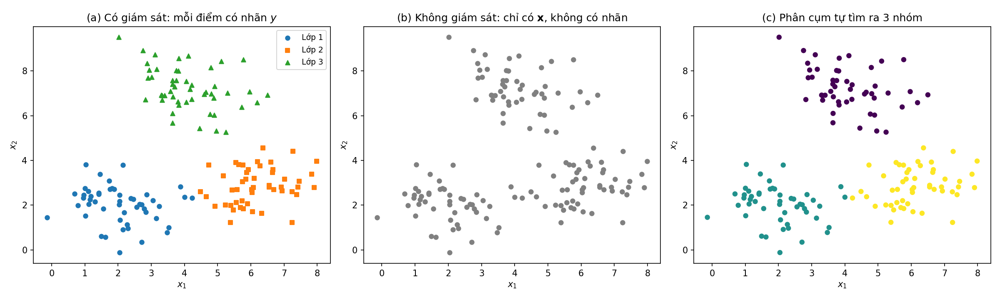
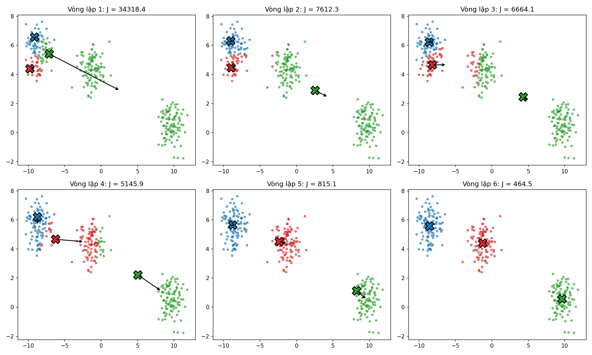
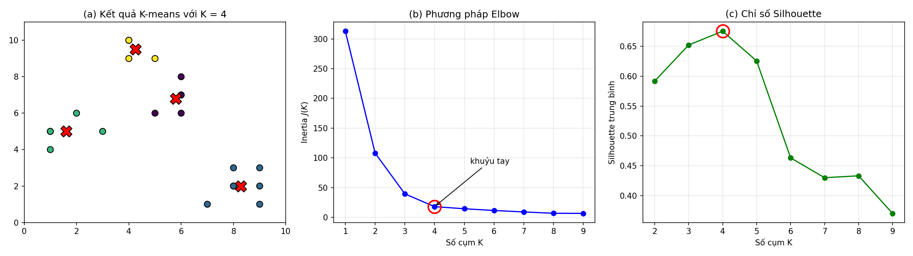
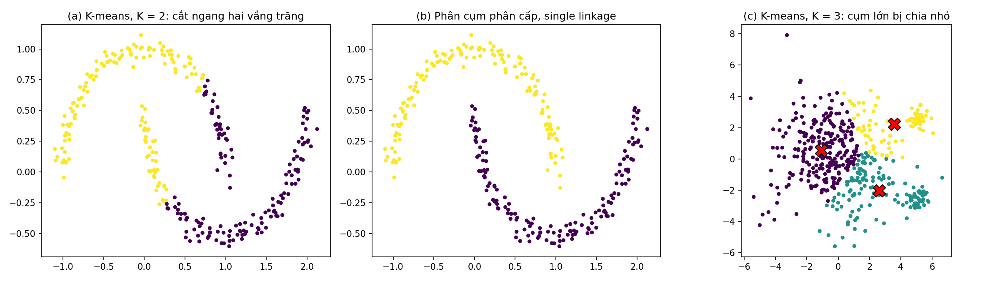
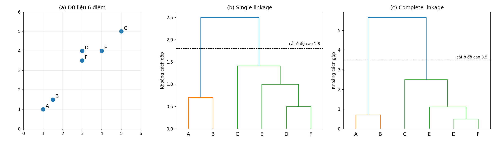
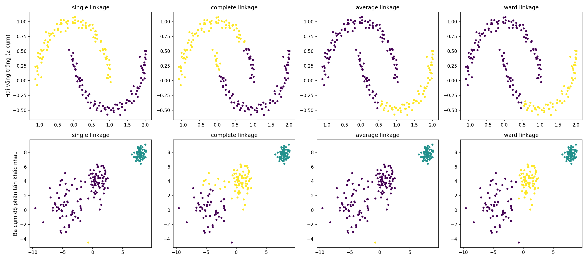
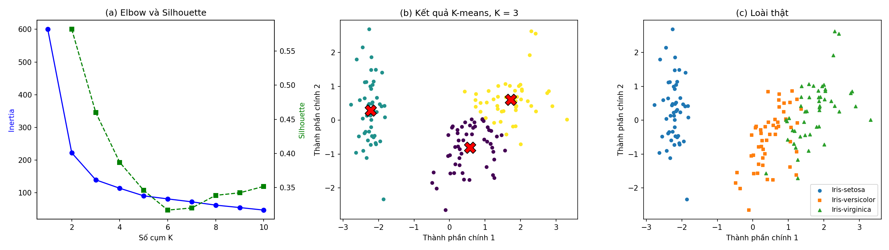

<style>
pre, pre code { font-size: 16px !important; line-height: 1.5 !important; }
</style>

# Bài 8. Học không giám sát và Phân cụm

> Tài liệu tham khảo: *Giáo trình Machine Learning 2026*, Chương 1 – Phân nhóm các thuật toán học máy; Chương 11 – Phân cụm K-means; Chương 12 – Phân cụm phân cấp. Khởi tạo k-means++ tham khảo D. Arthur, S. Vassilvitskii, *k-means++: The advantages of careful seeding*, SODA 2007; liên kết Ward và chỉ số Adjusted Rand tham khảo tài liệu scikit-learn (*Clustering*). Bộ dữ liệu Iris lấy từ UCI Machine Learning Repository.
>
> Mã nguồn demo: thư mục [codes/](codes/), các file đánh số theo thứ tự trình bày trong bài, mỗi notebook chạy độc lập từ đầu đến cuối (mở bằng Jupyter, thư mục hiện hành là `codes/`).

- [8.1. Học không giám sát và bài toán phân cụm](#81-học-không-giám-sát-và-bài-toán-phân-cụm)
- [8.2. Thực hành: phân cụm dữ liệu hoa Iris bằng K-means](#82-thực-hành-phân-cụm-dữ-liệu-hoa-iris-bằng-k-means)
- [8.3. Kết luận](#83-kết-luận)
- [8.4. Câu hỏi ôn tập](#84-câu-hỏi-ôn-tập)

---

## 8.1. Học không giám sát và bài toán phân cụm

### 8.1.1. Khái niệm học không giám sát

#### a) Định nghĩa

Các bài từ Bài 3 đến Bài 7 đều thuộc **học có giám sát**: tập huấn luyện gồm các cặp $(\mathbf{x}_i, y_i)$, mô hình học ánh xạ từ $\mathbf{x}$ tới nhãn $y$ đã biết. Trong **học không giám sát** (unsupervised learning), dữ liệu huấn luyện **chỉ gồm các đầu vào**, không có nhãn:

$$
\mathcal{X} = \{\mathbf{x}_1, \mathbf{x}_2, \dots, \mathbf{x}_N\}, \quad \mathbf{x}_i \in \mathbb{R}^d
$$

Mô hình phải tự khám phá **cấu trúc ẩn** trong dữ liệu: các nhóm điểm tương tự nhau, một cách biểu diễn gọn hơn, hay các điểm bất thường. Không có "đáp án" để so sánh, nên gọi là không có sự "giám sát" từ nhãn.



*Hình 8.1: (a) Học có giám sát: mỗi điểm có nhãn. (b) Học không giám sát: chỉ có tọa độ các điểm. (c) Thuật toán phân cụm tự tìm ra ba nhóm. Mã nguồn vẽ hình: [images/plot_supervised_unsupervised.py](images/plot_supervised_unsupervised.py).*

*Ví dụ* (giáo trình): thu thập dữ liệu sinh viên ICTU gồm số giờ tự học mỗi tuần, số buổi đi học và số lần truy cập hệ thống học trực tuyến, mỗi sinh viên là một vector $\mathbf{x} = (x_1, x_2, x_3)$. Không ai gán sẵn nhãn "chăm học" hay "ít tham gia". Thuật toán học không giám sát tự chia sinh viên thành các nhóm, chẳng hạn một nhóm tự học nhiều và đi học đầy đủ, một nhóm tham gia trung bình, một nhóm ít tham gia. Ý nghĩa của mỗi nhóm do con người diễn giải sau.

#### b) So sánh học có giám sát và học không giám sát

| | Học có giám sát | Học không giám sát |
|---|---|---|
| Dữ liệu huấn luyện | $(\mathbf{x}_i, y_i)$: có nhãn | Chỉ $\mathbf{x}_i$: không nhãn |
| Mục tiêu | Dự đoán nhãn $y$ cho $\mathbf{x}$ mới | Khám phá cấu trúc, nhóm, quy luật ẩn trong dữ liệu |
| Bài toán tiêu biểu | Hồi quy, phân loại | Phân cụm, giảm số chiều, phát hiện bất thường, luật kết hợp |
| Thuật toán (trong học phần) | Hồi quy tuyến tính, Logistic, cây quyết định, SVM, mạng nơ-ron | K-means, phân cụm phân cấp |
| Đánh giá | Rõ ràng: so dự đoán với nhãn thật (MSE, Accuracy, F1, …) | Khó: không có đáp án, dùng chỉ số nội tại (inertia, Silhouette) hoặc đánh giá của chuyên gia |
| Chi phí dữ liệu | Gán nhãn tốn thời gian, tiền bạc, cần chuyên gia | Dữ liệu không nhãn rẻ và dồi dào |

#### c) Các bài toán học không giám sát chính

- **Phân cụm** (clustering): chia dữ liệu thành các nhóm sao cho điểm trong cùng nhóm giống nhau. Ví dụ phân khúc khách hàng, nhóm tài liệu theo chủ đề. Đây là nội dung chính của bài.
- **Giảm số chiều** (dimensionality reduction): biểu diễn dữ liệu nhiều chiều bằng ít chiều hơn mà giữ được phần lớn thông tin, ví dụ PCA (dùng để vẽ dữ liệu Iris 4 chiều trên mặt phẳng ở mục 8.2).
- **Phát hiện bất thường** (anomaly detection): tìm các điểm khác biệt với phần lớn dữ liệu, ví dụ giao dịch gian lận, lỗi thiết bị.
- **Khai phá luật kết hợp** (association rules): tìm các mục thường xuất hiện cùng nhau, ví dụ "khách mua bánh mì thường mua sữa".

Học không giám sát còn thường là bước **tiền xử lý** cho học có giám sát: giảm số chiều trước khi phân loại, dùng chỉ số cụm làm đặc trưng mới.

---

### 8.1.2. Bài toán phân cụm

#### a) Phát biểu bài toán

Cho tập điểm $\{\mathbf{x}_1, \dots, \mathbf{x}_N\}$ không nhãn, **phân cụm** là chia tập điểm thành các nhóm (cụm, cluster) $C_1, C_2, \dots, C_K$ sao cho:
- các điểm trong cùng một cụm **giống nhau** (gần nhau);
- các điểm thuộc các cụm khác nhau **khác nhau** (xa nhau).

Trong phân cụm cứng (hard clustering), mỗi điểm thuộc đúng một cụm. Kết quả phân cụm có thể biểu diễn bằng vector chỉ số cụm $\mathbf{c} = (c_1, \dots, c_N)$ với $c_i \in \{1, \dots, K\}$, hoặc ma trận one-hot $\mathbf{Y}$ với $y_{ik} = 1$ nếu $\mathbf{x}_i$ thuộc cụm $k$ (giáo trình, Chương 11).

Lưu ý: chỉ số cụm chỉ là tên gọi, **không có ý nghĩa thứ tự** (cụm 1 không "lớn hơn" cụm 0), và đổi tên các cụm cho nhau vẫn là cùng một cách phân cụm.

#### b) Đo độ tương tự: khoảng cách

"Giống nhau" được đo bằng **khoảng cách**; khoảng cách càng nhỏ, hai điểm càng giống nhau. Phổ biến nhất là **khoảng cách Euclid**:

$$
d(\mathbf{x}, \mathbf{z}) = \|\mathbf{x} - \mathbf{z}\|_2 = \sqrt{\sum_{j=1}^{d}(x_j - z_j)^2}
$$

Ngoài ra có khoảng cách Manhattan $\sum_j |x_j - z_j|$, khoảng cách cosine (thường dùng cho văn bản), … Vì khoảng cách cộng dồn trên mọi đặc trưng, đặc trưng có thang đo lớn sẽ chi phối kết quả: ví dụ thu nhập (hàng triệu đồng) lấn át tuổi (vài chục năm). Do đó thường phải **chuẩn hóa đặc trưng** (Bài 2) trước khi phân cụm.

#### c) Ứng dụng

- **Phân khúc khách hàng** (giáo trình): một cửa hàng có dữ liệu tổng số tiền chi tiêu trong năm và số lần mua hàng của mỗi khách. Phân cụm với $K = 3$ có thể cho ba nhóm: chi tiêu cao và mua thường xuyên, chi tiêu trung bình, chi tiêu thấp và ít mua; mỗi nhóm có chương trình khuyến mãi riêng.
- **Phân vùng ảnh** (image segmentation): mỗi pixel là một điểm trong không gian màu RGB 3 chiều; phân cụm nhóm các pixel cùng màu thành vùng. Thay mỗi pixel bằng màu của tâm cụm, ảnh chỉ còn $K$ màu (lượng tử hóa màu, dùng để nén ảnh). Ảnh mẫu trong notebook có 96 615 màu khác nhau, chỉ với 8 màu vẫn giữ được hầu hết cấu trúc.
- Các ứng dụng khác: nhóm tài liệu, tin tức theo chủ đề; phân tích gen; phát hiện cộng đồng trong mạng xã hội; nén dữ liệu.

*Mã nguồn: [codes/03_image_segmentation.ipynb](codes/03_image_segmentation.ipynb).*

#### d) Các nhóm phương pháp phân cụm

| Nhóm | Ý tưởng | Ví dụ |
|---|---|---|
| Phân hoạch (partitioning) | Chia trực tiếp thành $K$ cụm, tối ưu một hàm mục tiêu | **K-means** (mục 8.1.3) |
| Phân cấp (hierarchical) | Xây cây phân cấp các cụm lồng nhau, không cần biết trước $K$ | **Agglomerative**, Divisive (mục 8.1.4) |
| Dựa trên mật độ (density-based) | Cụm là vùng có mật độ điểm cao, ngăn cách bởi vùng thưa | DBSCAN |
| Dựa trên mô hình xác suất | Dữ liệu sinh từ hỗn hợp các phân phối | Gaussian Mixture Model |

---

### 8.1.3. Phương pháp phân cụm K-means

#### a) Ý tưởng và hàm mất mát

**K-means** biểu diễn mỗi cụm bằng một điểm **tâm cụm** (centroid) $\boldsymbol{\mu}_k \in \mathbb{R}^d$, $k = 1, \dots, K$. Mỗi điểm thuộc cụm có tâm gần nó nhất. Chất lượng phân cụm đo bằng tổng bình phương khoảng cách từ mỗi điểm tới tâm cụm của nó:

$$
J(\mathbf{c}, \boldsymbol{\mu}) = \sum_{i=1}^{N}\|\mathbf{x}_i - \boldsymbol{\mu}_{c_i}\|_2^2
$$

$J$ còn gọi là **inertia** hay **WSS** (within-cluster sum of squares). Bài toán K-means: tìm cách gán $\mathbf{c}$ và các tâm $\boldsymbol{\mu}$ làm $J$ nhỏ nhất. Đây là bài toán khó (biến $c_i$ rời rạc, số cách chia cực lớn), nên không tìm nghiệm tối ưu toàn cục mà dùng chiến lược **tối ưu xen kẽ** hai nhóm biến.

**Cố định tâm, tối ưu cách gán.** $J$ là tổng các số hạng độc lập theo từng điểm, nên mỗi điểm chọn tâm gần nhất:

$$
c_i = \arg\min_{k}\|\mathbf{x}_i - \boldsymbol{\mu}_k\|_2^2
$$

**Cố định cách gán, tối ưu tâm.** Với cụm $k$ gồm $N_k$ điểm, cần cực tiểu $\sum_{i: c_i = k}\|\mathbf{x}_i - \boldsymbol{\mu}_k\|^2$. Đạo hàm theo $\boldsymbol{\mu}_k$ bằng $-2\sum_{i: c_i = k}(\mathbf{x}_i - \boldsymbol{\mu}_k)$, cho bằng 0:

$$
\boldsymbol{\mu}_k = \frac{1}{N_k}\sum_{i: c_i = k}\mathbf{x}_i
$$

Tâm tối ưu là **trung bình cộng** (mean) các điểm trong cụm, đó là lý do thuật toán có tên K-means.

#### b) Thuật toán

> **Thuật toán K-means** (thuật toán Lloyd)
> 1. **Khởi tạo** $K$ tâm cụm $\boldsymbol{\mu}_1, \dots, \boldsymbol{\mu}_K$ (ví dụ chọn ngẫu nhiên $K$ điểm dữ liệu).
> 2. Lặp cho tới khi hội tụ:
>    - **Bước gán:** gán mỗi điểm vào cụm có tâm gần nhất, $c_i = \arg\min_k \|\mathbf{x}_i - \boldsymbol{\mu}_k\|^2$.
>    - **Bước cập nhật:** đặt lại mỗi tâm bằng trung bình các điểm trong cụm, $\boldsymbol{\mu}_k = \frac{1}{N_k}\sum_{i: c_i = k}\mathbf{x}_i$.
> 3. Dừng khi các tâm (hoặc cách gán) không đổi giữa hai vòng lặp, hoặc đạt số vòng lặp tối đa.

```python
import numpy as np

def assign(X, centers):
    """Bước gán: chỉ số tâm gần nhất của mỗi điểm."""
    distances = np.linalg.norm(X[:, None, :] - centers[None, :, :], axis=2)   # ma trận N x K
    return distances.argmin(axis=1)

def update(X, labels, centers):
    """Bước cập nhật: tâm mới = trung bình các điểm trong cụm (cụm rỗng thì giữ tâm cũ)."""
    return np.array([X[labels == k].mean(axis=0) if np.any(labels == k) else centers[k]
                     for k in range(len(centers))])

def kmeans(X, K, max_iter=100, seed=0):
    rng = np.random.default_rng(seed)
    centers = X[rng.choice(len(X), K, replace=False)]      # khởi tạo ngẫu nhiên
    for _ in range(max_iter):
        labels = assign(X, centers)
        new_centers = update(X, labels, centers)
        if np.allclose(new_centers, centers):              # tâm không đổi -> dừng
            break
        centers = new_centers
    return assign(X, centers), centers
```

**Tính hội tụ.** Mỗi bước gán và mỗi bước cập nhật đều không làm tăng $J$ (mỗi bước là nghiệm tối ưu của một bài toán con), và số cách gán là hữu hạn, nên thuật toán luôn **dừng sau hữu hạn bước**. Tuy nhiên kết quả chỉ là một **cực tiểu địa phương**.



*Hình 8.2: Sáu vòng lặp K-means với khởi tạo kém (ba tâm lấy từ cùng một cụm thật). Dấu X là tâm hiện tại, màu điểm là cụm được gán, mũi tên chỉ vị trí tâm sau bước cập nhật. $J$ giảm dần từ 34 318 xuống 464.5. Mã nguồn vẽ hình: [images/plot_kmeans_steps.py](images/plot_kmeans_steps.py).*

#### c) Ví dụ tính tay

Bảy điểm A(1, 1), B(1.5, 2), C(3, 4), D(5, 7), E(3.5, 5), F(4.5, 5), G(3.5, 4.5); $K = 2$; khởi tạo tâm $\boldsymbol{\mu}_1 = B$, $\boldsymbol{\mu}_2 = D$.

**Vòng lặp 1 – bước gán:**

| Điểm | A | B | C | D | E | F | G |
|---|---|---|---|---|---|---|---|
| Khoảng cách tới $\boldsymbol{\mu}_1 = (1.5, 2)$ | 1.118 | 0 | **2.500** | 6.103 | 3.606 | 4.243 | 3.202 |
| Khoảng cách tới $\boldsymbol{\mu}_2 = (5, 7)$ | 7.211 | 6.103 | 3.606 | 0 | **2.500** | 2.062 | 2.915 |
| Cụm | 1 | 1 | 1 | 2 | 2 | 2 | 2 |

**Bước cập nhật:** $\boldsymbol{\mu}_1 = \frac{1}{3}[(1, 1) + (1.5, 2) + (3, 4)] = (1.833, 2.333)$; $\boldsymbol{\mu}_2 = \frac{1}{4}[(5, 7) + (3.5, 5) + (4.5, 5) + (3.5, 4.5)] = (4.125, 5.375)$. $J = 12.208$.

**Vòng lặp 2:** điểm C có khoảng cách tới $\boldsymbol{\mu}_1$ là 2.034, tới $\boldsymbol{\mu}_2$ là 1.777, nên **chuyển sang cụm 2**; các điểm khác giữ nguyên. Cập nhật: $\boldsymbol{\mu}_1 = (1.25, 1.5)$, $\boldsymbol{\mu}_2 = (3.9, 5.1)$, $J = 8.525$.

**Vòng lặp 3:** cách gán không đổi, tâm không đổi: **hội tụ**. Kết quả: cụm 1 = {A, B}, cụm 2 = {C, D, E, F, G}.

#### d) Khởi tạo và k-means++

Vì chỉ tìm được cực tiểu địa phương, kết quả K-means phụ thuộc vào khởi tạo. Chạy cài đặt ở trên 8 lần trên cùng dữ liệu 300 điểm, 4 cụm:

| seed | 0 | 1 | 2 | 3 | 4 | 5 | 6 | 7 |
|---|---|---|---|---|---|---|---|---|
| $J$ | 394.87 | 722.88 | 394.87 | 394.87 | 394.87 | 723.88 | 394.87 | 723.50 |

Ba lần cho $J$ gần gấp đôi: hai tâm rơi vào cùng một cụm thật, một tâm phải "gánh" hai cụm (như Hình 8.2 nếu dừng sớm). Cách khắc phục:
- **Chạy nhiều lần** với khởi tạo khác nhau, giữ kết quả có $J$ nhỏ nhất (tham số `n_init` của scikit-learn).
- **k-means++**: chọn tâm đầu tiên ngẫu nhiên; mỗi tâm tiếp theo chọn ngẫu nhiên với xác suất tỉ lệ với bình phương khoảng cách từ điểm đó tới tâm gần nhất đã chọn. Các tâm ban đầu vì vậy nằm rải rác, ít khi trùng cụm. Đây là mặc định của scikit-learn.

```python
from sklearn.cluster import KMeans

model = KMeans(n_clusters=4, init='k-means++', n_init=10, random_state=0)
labels = model.fit_predict(X)
print(model.cluster_centers_)      # tọa độ các tâm cụm
print(model.inertia_)              # J = 394.87
print(model.predict([[0, 0]]))     # cụm của điểm mới
```

*Mã nguồn: [codes/01_kmeans_from_scratch.ipynb](codes/01_kmeans_from_scratch.ipynb).*

#### e) Chọn số cụm K

$K$ phải chọn trước. $K$ quá nhỏ gộp các nhóm khác biệt; $K$ quá lớn chia vụn dữ liệu thành các nhóm không có ý nghĩa. Lưu ý $J$ **luôn giảm** khi tăng $K$ (bằng 0 khi $K = N$, mỗi điểm một cụm), nên không thể chọn $K$ bằng cách cực tiểu $J$.

**Phương pháp Elbow (khuỷu tay).** Chạy K-means với $K = 1, 2, \dots$, vẽ $J(K)$ theo $K$. Ban đầu $J$ giảm nhanh (tách được các nhóm thật), sau một giá trị $K$ thì giảm chậm hẳn (chỉ còn chia nhỏ các nhóm thật). Điểm gãy trên đồ thị, giống khuỷu tay, là $K$ hợp lý.

**Chỉ số Silhouette.** Với mỗi điểm $\mathbf{x}_i$:
- $a(i)$: khoảng cách trung bình từ $\mathbf{x}_i$ tới các điểm **khác** trong cùng cụm (độ gắn kết);
- $b(i)$: khoảng cách trung bình nhỏ nhất từ $\mathbf{x}_i$ tới các điểm của **một cụm khác** (cụm láng giềng gần nhất);

$$
s(i) = \frac{b(i) - a(i)}{\max(a(i), b(i))} \in [-1, 1]
$$

$s(i)$ gần 1: điểm nằm sâu trong cụm của nó, xa các cụm khác; gần 0: điểm nằm gần ranh giới hai cụm; âm: điểm có thể bị gán sai cụm. Chỉ số Silhouette của cả tập là trung bình $S = \frac{1}{N}\sum_i s(i)$; chọn $K$ cho $S$ lớn nhất.

**Ví dụ** với dữ liệu 21 điểm của giáo trình:

```python
from sklearn.cluster import KMeans
from sklearn.metrics import silhouette_score

for k in range(1, 10):
    model = KMeans(n_clusters=k, n_init=10, random_state=42).fit(X)
    print(k, model.inertia_, silhouette_score(X, model.labels_) if k > 1 else None)
```

| $K$ | 1 | 2 | 3 | 4 | 5 | 6 | 7 | 8 |
|---|---|---|---|---|---|---|---|---|
| Inertia $J(K)$ | 312.95 | 108.07 | 39.52 | **17.98** | 14.45 | 11.52 | 9.08 | 6.83 |
| Mức giảm so với $K - 1$ | – | 204.88 | 68.55 | 21.54 | 3.53 | 2.93 | 2.43 | 2.25 |
| Silhouette | – | 0.592 | 0.652 | **0.675** | 0.625 | 0.463 | 0.430 | 0.433 |



*Hình 8.3: (a) Kết quả K-means với $K = 4$ trên dữ liệu 21 điểm của giáo trình. (b) Đồ thị Elbow: từ $K = 4$ trở đi $J$ gần như không giảm. (c) Silhouette lớn nhất tại $K = 4$. Mã nguồn vẽ hình: [images/plot_elbow_silhouette.py](images/plot_elbow_silhouette.py).*

Cả hai phương pháp đều chọn $K = 4$. **Tính tay** Silhouette cho điểm $(3, 5)$ với $K = 4$: $a = 1.913$ (trung bình khoảng cách tới 4 điểm cùng cụm), $b = 3.370$, $s = (3.370 - 1.913)/3.370 = 0.433$.

Trong thực tế, điểm khuỷu tay không phải lúc nào cũng rõ, Silhouette và Elbow có thể chọn $K$ khác nhau (ví dụ dữ liệu Iris ở mục 8.2). Khi đó kết hợp với hiểu biết về bài toán (ví dụ doanh nghiệp chỉ triển khai được 3 chương trình khuyến mãi).

*Mã nguồn: [codes/02_choose_k.ipynb](codes/02_choose_k.ipynb).*

#### f) Ưu điểm và hạn chế của K-means



*Hình 8.4: (a) K-means cắt ngang hai cụm hình vầng trăng. (b) Phân cụm phân cấp single linkage (mục 8.1.4) tách đúng. (c) Với một cụm lớn, phân tán và hai cụm nhỏ, K-means chia cụm lớn để cân bằng. Mã nguồn vẽ hình: [images/plot_kmeans_limitations.py](images/plot_kmeans_limitations.py).*

| Ưu điểm | Hạn chế |
|---|---|
| Đơn giản, dễ cài đặt, dễ hiểu | Phải chọn trước $K$ |
| Nhanh: mỗi vòng lặp $O(NKd)$, dùng được với dữ liệu lớn | Phụ thuộc khởi tạo, chỉ đạt cực tiểu địa phương |
| Kết quả dễ diễn giải qua tâm cụm | Giả định cụm có dạng "tròn" (lồi, đẳng hướng), kích thước tương đương; thất bại với cụm hình dạng phức tạp |
| Gán được điểm mới vào cụm (`predict`) | Nhạy cảm với ngoại lai (trung bình bị kéo lệch) và thang đo đặc trưng |

---

### 8.1.4. Phương pháp phân cụm phân cấp (hierarchical clustering)

#### a) Ý tưởng

**Phân cụm phân cấp** không chia dữ liệu thành đúng $K$ cụm mà xây dựng một **cây phân cấp** các cụm lồng nhau, gọi là **dendrogram**. Có hai chiến lược (giáo trình, Chương 12):
- **Gộp dần** (agglomerative, từ dưới lên – bottom-up): ban đầu mỗi điểm là một cụm; mỗi bước gộp hai cụm gần nhau nhất; dừng khi chỉ còn một cụm. Đây là cách phổ biến, là trọng tâm của mục này.
- **Chia dần** (divisive, từ trên xuống – top-down): ban đầu toàn bộ dữ liệu là một cụm; mỗi bước chia một cụm thành hai (ví dụ dùng K-means với $K = 2$); dừng khi mỗi điểm là một cụm. Chi phí tính toán cao hơn vì tìm cách chia tốt nhất là bài toán khó.

Ví dụ thực tế: cây phân loại sinh học biểu diễn quan hệ giữa các loài (chó, sói xám, chó sói đồng cỏ, … được gộp dần theo mức độ tương đồng di truyền); phân khúc khách hàng ở nhiều mức chi tiết khác nhau.

#### b) Thuật toán gộp dần

> **Thuật toán Agglomerative Clustering**
> 1. Khởi tạo $N$ cụm, mỗi cụm một điểm: $C_i = \{\mathbf{x}_i\}$. Tính ma trận khoảng cách giữa các cụm.
> 2. Lặp cho tới khi chỉ còn một cụm:
>    - Tìm hai cụm gần nhau nhất: $(C_p, C_q) = \arg\min_{i \ne j} d(C_i, C_j)$.
>    - Gộp thành cụm mới $C_p \cup C_q$ (số cụm giảm 1), ghi lại khoảng cách gộp.
>    - Cập nhật khoảng cách từ cụm mới tới các cụm còn lại.
> 3. Kết quả là dãy $N - 1$ lần gộp, biểu diễn bằng dendrogram.

#### c) Các tiêu chí liên kết (linkage)

Khi một cụm có nhiều điểm, cần định nghĩa **khoảng cách giữa hai cụm** $d(C_i, C_j)$ từ khoảng cách giữa các điểm:

| Tiêu chí | Công thức $d(C_i, C_j)$ | Đặc điểm |
|---|---|---|
| **Single** (liên kết đơn) | $\min_{\mathbf{x} \in C_i, \mathbf{z} \in C_j}\Vert \mathbf{x} - \mathbf{z}\Vert $: cặp điểm **gần nhất** | Tìm được cụm hình dạng kéo dài, không lồi; dễ bị **hiệu ứng chuỗi** (chaining): hai cụm khác nhau bị nối qua một dãy điểm |
| **Complete** (liên kết đầy đủ) | $\max_{\mathbf{x} \in C_i, \mathbf{z} \in C_j}\Vert \mathbf{x} - \mathbf{z}\Vert $: cặp điểm **xa nhất** | Cụm gọn, đường kính nhỏ, kích thước tương đối đều; nhạy cảm với ngoại lai |
| **Average** (liên kết trung bình) | $\frac{1}{\lvert C_i\rvert\,\lvert C_j\rvert}\sum_{\mathbf{x} \in C_i}\sum_{\mathbf{z} \in C_j}\Vert \mathbf{x} - \mathbf{z}\Vert $ | Cân bằng giữa single và complete |
| **Centroid** (liên kết tâm) | $\Vert \mathbf{m}_i - \mathbf{m}_j\Vert $ với $\mathbf{m}_i$ là tâm (trung bình) của $C_i$ | Tính đơn giản; nhạy cảm với ngoại lai |
| **Ward** | Gộp hai cụm làm **tổng bình phương sai số trong cụm** (WSS) tăng ít nhất | Cùng mục tiêu với K-means, cho cụm tròn, kích thước tương đương; mặc định của scikit-learn |

#### d) Ví dụ tính tay

Sáu điểm A(1, 1), B(1.5, 1.5), C(5, 5), D(3, 4), E(4, 4), F(3, 3.5). Ma trận khoảng cách Euclid:

| | A | B | C | D | E | F |
|---|---|---|---|---|---|---|
| **A** | 0 | 0.71 | 5.66 | 3.61 | 4.24 | 3.20 |
| **B** | 0.71 | 0 | 4.95 | 2.92 | 3.54 | 2.50 |
| **C** | 5.66 | 4.95 | 0 | 2.24 | 1.41 | 2.50 |
| **D** | 3.61 | 2.92 | 2.24 | 0 | 1.00 | **0.50** |
| **E** | 4.24 | 3.54 | 1.41 | 1.00 | 0 | 1.12 |
| **F** | 3.20 | 2.50 | 2.50 | 0.50 | 1.12 | 0 |

**Single linkage:**
1. Cặp gần nhất là D, F (0.50): gộp thành DF.
2. Khoảng cách từ DF tới các cụm khác lấy min, ví dụ $d(DF, E) = \min(1.00, 1.12) = 1.00$. Cặp gần nhất tiếp theo là A, B (0.71): gộp thành AB.
3. Gộp DF với E ở khoảng cách 1.00 → DEF.
4. $d(C, DEF) = \min(2.24, 1.41, 2.50) = 1.41$ → gộp thành CDEF.
5. $d(AB, CDEF) = \min$ khoảng cách giữa {A, B} và {C, D, E, F} $= d(B, F) = 2.50$ → một cụm duy nhất.

**Complete linkage** cho cùng thứ tự gộp nhưng khoảng cách gộp khác: DF (0.50), AB (0.71), DEF ($\max(1.00, 1.12) = 1.12$), CDEF ($\max(2.24, 1.41, 2.50) = 2.50$), cuối cùng $d(AB, CDEF) = d(A, C) = 5.66$.

```python
from scipy.cluster.hierarchy import dendrogram, fcluster, linkage

Z = linkage(X, method='single')     # mỗi hàng: [cụm 1, cụm 2, khoảng cách gộp, số điểm]
print(Z)
dendrogram(Z, labels=['A', 'B', 'C', 'D', 'E', 'F'])
```

**Kết quả** (cụm mới tạo ở bước $t$ có chỉ số $N + t - 1$, ví dụ DF là cụm 6):

```text
[[3.    5.    0.5   2.   ]       <- D + F
 [0.    1.    0.707 2.   ]       <- A + B
 [4.    6.    1.    3.   ]       <- E + DF
 [2.    8.    1.414 4.   ]       <- C + DEF
 [7.    9.    2.5   6.   ]]      <- AB + CDEF
```

#### e) Dendrogram và cách chọn số cụm



*Hình 8.5: (a) Dữ liệu 6 điểm. (b), (c) Dendrogram theo single linkage và complete linkage; đường nét đứt là vị trí cắt cây cho 2 cụm. Mã nguồn vẽ hình: [images/plot_dendrogram.py](images/plot_dendrogram.py).*

Cách đọc dendrogram:
- Mỗi **lá** (dưới cùng) là một điểm dữ liệu.
- Mỗi **nút gộp** (đường ngang) nối hai cụm con; **độ cao** của nó là khoảng cách giữa hai cụm khi gộp. Gộp ở độ cao thấp nghĩa là hai cụm rất giống nhau.
- **Cắt cây** bằng một đường ngang ở độ cao $h$: số nhánh bị cắt là số cụm, mỗi nhánh là một cụm. Một khoảng trống lớn theo chiều đứng giữa hai lần gộp liên tiếp gợi ý vị trí cắt tốt (như khoảng từ 2.50 tới 5.66 ở Hình 8.5c).

Như vậy phân cụm phân cấp **không cần chọn trước $K$**: dựng cây một lần, sau đó chọn số cụm bằng cách cắt ở độ cao phù hợp.

```python
Z = linkage(X, method='complete')
print(fcluster(Z, t=2.5, criterion='distance'))   # cắt ở độ cao 2.5: [1 1 2 2 2 2]
print(fcluster(Z, t=3, criterion='maxclust'))     # lấy đúng 3 cụm:   [1 1 3 2 2 2]
```

#### f) So sánh các tiêu chí liên kết



*Hình 8.6: Bốn tiêu chí liên kết trên dữ liệu hai vầng trăng (hàng trên) và ba cụm có độ phân tán khác nhau (hàng dưới). Mã nguồn vẽ hình: [images/plot_linkage_comparison.py](images/plot_linkage_comparison.py).*

Single linkage tách đúng hai vầng trăng nhờ "đi theo" các điểm liền kề, nhưng với ba cụm chồng lấn nó bị hiệu ứng chuỗi. Complete, average và Ward cho cụm gọn, phù hợp hơn với cụm dạng tròn.

#### g) Thực hành với scikit-learn

Theo giáo trình: 30 điểm từ 3 cụm (`make_blobs`). `AgglomerativeClustering` phân thành số cụm cho trước; để vẽ dendrogram, huấn luyện với `distance_threshold=0, n_clusters=None` để dựng toàn bộ cây rồi tạo ma trận liên kết từ `children_` và `distances_` (hàm `plot_dendrogram` trong notebook).

```python
from sklearn.cluster import AgglomerativeClustering

labels = AgglomerativeClustering(n_clusters=3, linkage='ward').fit_predict(X30)
model = AgglomerativeClustering(distance_threshold=0, n_clusters=None).fit(X30)   # dựng toàn bộ cây
```

*Mã nguồn: [codes/04_hierarchical_clustering.ipynb](codes/04_hierarchical_clustering.ipynb).*

#### h) So sánh K-means và phân cụm phân cấp

| | K-means | Phân cụm phân cấp (gộp dần) |
|---|---|---|
| Số cụm | Phải chọn trước $K$ | Không cần; chọn sau bằng cách cắt dendrogram |
| Kết quả | Một cách chia phẳng thành $K$ cụm | Cây phân cấp, thấy được quan hệ giữa các cụm ở nhiều mức |
| Tính tất định | Phụ thuộc khởi tạo ngẫu nhiên | Tất định (cùng dữ liệu, cùng linkage cho cùng kết quả) |
| Hình dạng cụm | Cụm tròn, kích thước tương đương | Tùy linkage; single tìm được cụm kéo dài |
| Độ phức tạp | Khoảng $O(NKd)$ mỗi vòng lặp: dữ liệu lớn | Bộ nhớ $O(N^2)$, thời gian $O(N^2)$ – $O(N^3)$: chỉ hợp với vài chục nghìn điểm |
| Điểm mới | Gán được (`predict`) | Phải chạy lại |
| Sửa sai | Điểm có thể đổi cụm qua các vòng lặp | Đã gộp thì không tách lại được |
| Phù hợp | Dữ liệu lớn, cụm gọn, biết khoảng $K$ | Dữ liệu nhỏ, cần hiểu cấu trúc phân cấp, chưa biết $K$ |

---

## 8.2. Thực hành: phân cụm dữ liệu hoa Iris bằng K-means

Bộ dữ liệu **Iris** (R. A. Fisher, 1936; UCI Machine Learning Repository) gồm 150 bông hoa thuộc 3 loài (setosa, versicolor, virginica), mỗi loài 50 bông, với 4 số đo (cm): chiều dài, chiều rộng đài hoa (sepal) và cánh hoa (petal). Ta **giả sử không biết loài**, dùng K-means để tìm các nhóm, rồi dùng nhãn loài để đánh giá kết quả.

### 8.2.1. Đọc và tiền xử lý dữ liệu

#### Bước 1: Đọc dữ liệu

File [data/iris.data](data/iris.data) là bản gốc từ UCI (mô tả trong [data/iris.names](data/iris.names)): mỗi dòng gồm 4 số đo và tên loài, phân cách bằng dấu phẩy, **không có dòng tiêu đề**. Đặt tên cột khi đọc:

```python
import pandas as pd
from pathlib import Path

DATA = Path('..') / 'data'   # notebook chạy trong codes/
columns = ['sepal_length', 'sepal_width', 'petal_length', 'petal_width', 'species']
df = pd.read_csv(DATA / 'iris.data', header=None, names=columns)
print(df.shape)              # (150, 5)
```

#### Bước 2: Kiểm tra dữ liệu

```python
df.info()
print(df.isnull().sum())            # không có giá trị thiếu
print(df.duplicated().sum())        # 1 dòng trùng lặp
print(df['species'].value_counts()) # mỗi loài 50 mẫu
```

Không có giá trị thiếu. Có một dòng trùng lặp (dòng 142 giống hệt dòng 101); hai bông hoa khác nhau hoàn toàn có thể có cùng số đo (đo tới 0.1 cm) nên ta **giữ lại**. Trong dữ liệu thực tế cần tìm hiểu nguyên nhân trước khi xóa (Bài 2).

#### Bước 3: Thống kê mô tả

| | sepal_length | sepal_width | petal_length | petal_width |
|---|---|---|---|---|
| Trung bình | 5.84 | 3.06 | 3.76 | 1.20 |
| Độ lệch chuẩn | 0.83 | 0.44 | 1.77 | 0.76 |
| Nhỏ nhất – lớn nhất | 4.3 – 7.9 | 2.0 – 4.4 | 1.0 – 6.9 | 0.1 – 2.5 |

Trung bình theo loài cho thấy hai đặc trưng cánh hoa khác biệt rõ giữa các loài (petal_length trung bình 1.46 / 4.26 / 5.55 cm cho setosa / versicolor / virginica). Vẽ phân tán hai đặc trưng cánh hoa: setosa tách hẳn, versicolor và virginica nằm sát nhau.

#### Bước 4: Bỏ nhãn và chuẩn hóa

Phân cụm không dùng nhãn: tách cột `species` ra, chỉ dùng để đánh giá sau. K-means dùng khoảng cách Euclid nên chuẩn hóa các đặc trưng về trung bình 0, độ lệch chuẩn 1:

```python
from sklearn.preprocessing import StandardScaler

features = columns[:4]
X = df[features].to_numpy()
species = df['species'].to_numpy()       # chỉ dùng để đánh giá
scaler = StandardScaler()
X_scaled = scaler.fit_transform(X)
```

*Mã nguồn: [codes/05_iris_preprocessing.ipynb](codes/05_iris_preprocessing.ipynb).*

### 8.2.2. Phân cụm dữ liệu hoa Iris bằng K-means

#### Bước 1: Chọn số cụm K

```python
from sklearn.cluster import KMeans
from sklearn.metrics import silhouette_score

for k in range(1, 11):
    model = KMeans(n_clusters=k, n_init=10, random_state=42).fit(X_scaled)
    print(k, model.inertia_, silhouette_score(X_scaled, model.labels_) if k > 1 else None)
```

| $K$ | 1 | 2 | 3 | 4 | 5 | 6 |
|---|---|---|---|---|---|---|
| Inertia | 600.00 | 222.36 | 139.82 | 114.09 | 90.93 | 81.54 |
| Silhouette | – | **0.582** | 0.460 | 0.387 | 0.346 | 0.317 |

Silhouette lớn nhất tại $K = 2$: setosa tách hẳn, còn versicolor và virginica chồng lấn nên về hình học trông như một cụm. Đồ thị Elbow có khuỷu tay ở khoảng $K = 2$ – $3$. Kết hợp hiểu biết rằng có 3 loài hoa, ta chọn $K = 3$. Đây là tình huống thường gặp: chỉ số định lượng chỉ là gợi ý, quyết định cuối cùng dựa vào mục đích phân tích.

#### Bước 2: Phân cụm với K = 3

```python
kmeans = KMeans(n_clusters=3, n_init=10, random_state=42)
labels = kmeans.fit_predict(X_scaled)
print(np.bincount(labels))                            # [53 50 47]
centers_cm = scaler.inverse_transform(kmeans.cluster_centers_)   # tâm cụm theo đơn vị cm
```

Tâm cụm (đổi về cm):

| Cụm | sepal_length | sepal_width | petal_length | petal_width |
|---|---|---|---|---|
| 0 | 5.80 | 2.67 | 4.37 | 1.41 |
| 1 | 5.01 | 3.43 | 1.46 | 0.25 |
| 2 | 6.78 | 3.10 | 5.51 | 1.97 |

Cụm 1 có cánh hoa rất nhỏ (giống setosa), cụm 2 có hoa lớn nhất (giống virginica), cụm 0 ở giữa (giống versicolor).

#### Bước 3: Đánh giá bằng nhãn thật

Bảng chéo giữa loài thật và cụm:

```python
pd.crosstab(species, labels, rownames=['Loài'], colnames=['Cụm'])
```

| Loài \ Cụm | 0 | 1 | 2 |
|---|---|---|---|
| Iris-setosa | 0 | **50** | 0 |
| Iris-versicolor | **39** | 0 | 11 |
| Iris-virginica | 14 | 0 | **36** |

Toàn bộ 50 bông setosa nằm trong cụm 1. Versicolor và virginica bị lẫn 25 bông. Gán mỗi cụm với loài chiếm đa số, tỉ lệ khớp là 83.3%. **Adjusted Rand Index** (ARI) đo mức giống nhau giữa hai cách chia, không phụ thuộc cách đánh số cụm (1: giống hệt, khoảng 0: như ngẫu nhiên):

```python
from sklearn.metrics import adjusted_rand_score
print(adjusted_rand_score(species, labels))   # 0.620
```

Lưu ý: trong bài toán thực tế không có nhãn để tính các chỉ số này; ở đây nhãn chỉ dùng để kiểm tra phương pháp.



*Hình 8.7: (a) Inertia và Silhouette theo $K$. (b) Kết quả K-means với $K = 3$ và (c) loài thật, chiếu xuống 2 chiều bằng PCA (giữ 95.8% phương sai). Mã nguồn vẽ hình: [images/plot_iris_kmeans.py](images/plot_iris_kmeans.py).*

#### Bước 4: Ảnh hưởng của chuẩn hóa và so sánh với phân cụm phân cấp

| Phương pháp | ARI |
|---|---|
| K-means, dữ liệu chưa chuẩn hóa | **0.730** |
| K-means, dữ liệu đã chuẩn hóa | 0.620 |
| Phân cụm phân cấp Ward (đã chuẩn hóa) | 0.615 |
| Phân cụm phân cấp complete | 0.573 |
| Phân cụm phân cấp average | 0.562 |
| Phân cụm phân cấp single | 0.558 |

Với Iris, dữ liệu **chưa chuẩn hóa** lại khớp nhãn tốt hơn: `petal_length` có phương sai lớn nhất và cũng là đặc trưng phân biệt loài tốt nhất, nên để nó chi phối khoảng cách lại có lợi. Chuẩn hóa là lựa chọn mặc định an toàn khi các đặc trưng khác đơn vị đo, nhưng không phải lúc nào cũng tốt hơn; cần thử và đánh giá. Single và average linkage cho các cụm rất lệch (ví dụ single: 100, 1, 49 điểm) do hiệu ứng chuỗi giữa versicolor và virginica; Ward cho kết quả gần K-means.

*Mã nguồn: [codes/06_iris_kmeans.ipynb](codes/06_iris_kmeans.ipynb).*

---

## 8.3. Kết luận

- **Học không giám sát** làm việc với dữ liệu không nhãn $\{\mathbf{x}_i\}$, nhằm khám phá cấu trúc ẩn. Các bài toán chính: phân cụm, giảm số chiều, phát hiện bất thường. Đánh giá khó hơn học có giám sát vì không có đáp án.
- **Phân cụm** chia dữ liệu thành các nhóm sao cho điểm trong nhóm giống nhau, khác nhóm khác nhau; độ giống nhau đo bằng khoảng cách (thường là Euclid), nên cần chú ý thang đo đặc trưng.
- **K-means** cực tiểu $J = \sum_i\|\mathbf{x}_i - \boldsymbol{\mu}_{c_i}\|^2$ bằng cách lặp hai bước: gán điểm vào tâm gần nhất và cập nhật tâm bằng trung bình cụm. Thuật toán luôn hội tụ nhưng chỉ tới cực tiểu địa phương; dùng k-means++ và nhiều lần khởi tạo. Chọn $K$ bằng phương pháp Elbow, chỉ số Silhouette $s(i) = \frac{b(i) - a(i)}{\max(a(i), b(i))}$ và hiểu biết về bài toán.
- **Phân cụm phân cấp gộp dần** bắt đầu từ $N$ cụm đơn điểm, mỗi bước gộp hai cụm gần nhất theo một tiêu chí liên kết (single, complete, average, centroid, Ward), kết quả là **dendrogram**; cắt cây ở độ cao phù hợp để lấy số cụm mong muốn.
- K-means nhanh, hợp với dữ liệu lớn và cụm tròn; phân cụm phân cấp không cần chọn trước $K$, cho thấy cấu trúc phân cấp nhưng tốn bộ nhớ $O(N^2)$.

---

## 8.4. Câu hỏi ôn tập

### Câu hỏi lý thuyết

1. Phân biệt học có giám sát và học không giám sát về dữ liệu, mục tiêu, cách đánh giá. Cho hai ví dụ ứng dụng của học không giám sát.
2. Phát biểu bài toán phân cụm. Vì sao cần chuẩn hóa dữ liệu trước khi phân cụm dựa trên khoảng cách?
3. Viết hàm mất mát của K-means. Chứng minh rằng khi cố định cách gán, tâm cụm tối ưu là trung bình các điểm trong cụm.
4. Trình bày các bước của thuật toán K-means. Vì sao thuật toán luôn hội tụ? Vì sao kết quả phụ thuộc vào khởi tạo?
5. Trình bày ý tưởng của k-means++.
6. Trình bày phương pháp Elbow và chỉ số Silhouette. Ý nghĩa của $s(i)$ gần 1, gần 0, âm?
7. Nêu các hạn chế của K-means và cho ví dụ dữ liệu mà K-means cho kết quả kém.
8. Phân biệt chiến lược gộp dần (agglomerative) và chia dần (divisive) trong phân cụm phân cấp.
9. Viết công thức và nêu đặc điểm của các tiêu chí liên kết single, complete, average, centroid.
10. Dendrogram là gì? Làm thế nào để xác định số cụm từ dendrogram?
11. Lập bảng so sánh ưu nhược điểm của K-means và phân cụm phân cấp. Khi nào nên dùng mỗi phương pháp?

### Bài tập

12. Cho 6 điểm một chiều: 1, 2, 3, 8, 9, 12. Chạy tay K-means với $K = 2$, khởi tạo tâm là 1 và 2. Ghi rõ cách gán, tâm và $J$ sau mỗi vòng lặp. Lặp lại với khởi tạo 8 và 12. *(Đáp số: hội tụ tới tâm 2 và 9.67, $J = 2 + 8.67 = 10.67$.)*
13. Với 7 điểm A – G ở mục 8.1.3 c), chạy tay K-means với $K = 2$, khởi tạo $\boldsymbol{\mu}_1 = A$, $\boldsymbol{\mu}_2 = C$. Kết quả có giống ví dụ trong bài không?
14. Với kết quả phân cụm {A, B}, {C, D, E, F, G} ở mục 8.1.3 c), tính chỉ số Silhouette của điểm C.
15. Với 6 điểm A – F ở mục 8.1.4 d), thực hiện tay phân cụm phân cấp với average linkage, vẽ dendrogram. So sánh với single và complete linkage.

### Bài tập thực hành

16. (Giáo trình) Tạo bộ dữ liệu hai chiều bằng `make_blobs`, thực hiện Agglomerative Clustering, trực quan hóa kết quả và vẽ dendrogram. Thử các tiêu chí liên kết khác nhau.
17. Phân cụm phân cấp dữ liệu Iris: vẽ dendrogram với Ward linkage, cắt cây thành 2 và 3 cụm, so sánh với K-means bằng bảng chéo và ARI.
18. Cài đặt phân cụm chia dần (divisive): bắt đầu từ một cụm, mỗi bước chọn cụm có WSS lớn nhất và chia bằng K-means $K = 2$. Áp dụng cho dữ liệu Iris với 3 cụm.
19. Dữ liệu khách hàng: tải bộ *Mall Customer Segmentation* (Kaggle), dùng hai đặc trưng `Annual Income` và `Spending Score`. Chọn $K$ bằng Elbow và Silhouette, phân cụm bằng K-means, mô tả đặc điểm từng nhóm khách hàng và đề xuất chiến lược marketing cho mỗi nhóm.
20. Phân vùng ảnh: dùng K-means nén một ảnh màu của bạn với $K \in \{2, 4, 8, 16\}$. Tính tỉ lệ nén (số bit lưu ảnh) và nhận xét chất lượng ảnh.
