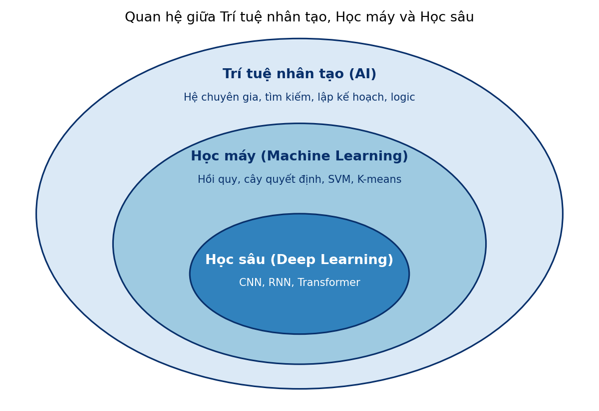

<style>
pre, pre code { font-size: 16px !important; line-height: 1.5 !important; }
</style>

# Bài 1. Tổng quan về Học máy

> Tài liệu tham khảo: *Giáo trình Machine Learning 2026*, Lời nói đầu; Chương 1 – Các khái niệm cơ bản; Chương 13 – Mạng nơ-ron nhân tạo. Phần 1.2 (môi trường lập trình) không có trong giáo trình, tham khảo tài liệu chính thức của Anaconda, NumPy, Pandas, Matplotlib, scikit-learn và Jupyter.
>
> Mã nguồn demo: thư mục [codes/](codes/), các notebook đánh số theo thứ tự trình bày trong bài, mỗi notebook chạy độc lập từ đầu đến cuối (mở bằng Jupyter, thư mục hiện hành là `codes/`).

- [1.1. Tổng quan về Học máy](#11-tổng-quan-về-học-máy)
- [1.2. Cài đặt môi trường Anaconda](#12-cài-đặt-môi-trường-anaconda)
- [1.3. Kết luận](#13-kết-luận)
- [1.4. Câu hỏi ôn tập](#14-câu-hỏi-ôn-tập)

---

## 1.1. Tổng quan về Học máy

### 1.1.1. Khái niệm, mục tiêu và vai trò của Học máy trong AI

#### a) Khái niệm

**Học máy** (Machine Learning – ML) là lĩnh vực nghiên cứu việc thiết kế và phát triển các hệ thống máy tính có khả năng **học từ dữ liệu**. Thay vì lập trình tường minh toàn bộ các quy tắc xử lý, hệ thống tự động phát hiện quy luật và xây dựng mô hình dựa trên dữ liệu quan sát được.

Giáo trình nêu ba cách phát biểu, từ trực quan đến chặt chẽ:

| | Phát biểu | Nhấn mạnh |
|---|---|---|
| Khái niệm 1 | Học máy trang bị cho máy tính khả năng học từ dữ liệu **mà không cần được lập trình tường minh** cho từng nhiệm vụ cụ thể (A. Samuel, 1959). | Không viết luật bằng tay |
| Khái niệm 2 | Học máy là quá trình xây dựng các hệ thống **tự động cải thiện hiệu năng** thông qua tích lũy và khai thác kinh nghiệm từ dữ liệu theo thời gian. | Hiệu năng tăng dần theo dữ liệu |
| Khái niệm 3 | Một chương trình được gọi là **học** từ kinh nghiệm **E** đối với nhiệm vụ **T** và phép đánh giá **P** nếu hiệu quả thực hiện **T**, đo bằng **P**, được cải thiện nhờ **E** (T. Mitchell, 1997). | Ba thành phần T, E, P |

Khái niệm 3 cho một "khung" để mô tả **bất kỳ** bài toán học máy nào. Xây dựng một hệ thống học máy trước hết là trả lời ba câu hỏi: máy phải làm gì (T), làm tốt đến đâu thì đo bằng gì (P), và học từ dữ liệu nào (E).

| Bài toán | Nhiệm vụ T | Kinh nghiệm E | Phép đánh giá P |
|---|---|---|---|
| Lọc thư rác | Phân loại email mới là *rác* hay *không rác* | Tập email đã được gán nhãn rác / không rác | Tỉ lệ email phân loại đúng trên tập kiểm tra |
| Dự đoán giá nhà | Ước lượng giá bán của một căn nhà | Thông tin và giá bán của các căn nhà đã giao dịch | Sai số trung bình giữa giá dự đoán và giá thật |
| Chơi cờ | Chọn nước đi trong một ván cờ | Các ván cờ máy tự chơi với chính nó | Tỉ lệ thắng |

#### b) Lập trình truyền thống và học máy

Trong **lập trình truyền thống**, lập trình viên tự viết các quy tắc; máy tính áp dụng quy tắc lên dữ liệu để cho ra kết quả. Trong **học máy**, ta đưa cho máy dữ liệu **cùng với kết quả mong muốn**; máy tự tìm ra quy tắc (gọi là **mô hình**), rồi dùng mô hình đó cho dữ liệu mới.

```
Lập trình truyền thống:   Dữ liệu + Quy tắc (người viết)  ──►  Kết quả

Học máy (huấn luyện):     Dữ liệu + Kết quả đã biết       ──►  Mô hình (quy tắc máy học được)
Học máy (sử dụng):        Dữ liệu mới + Mô hình           ──►  Kết quả dự đoán
```

*Ví dụ lọc thư rác.* Cách truyền thống: viết luật "nếu tiêu đề chứa *trúng thưởng* hoặc *khuyến mãi 90%* thì là thư rác". Người gửi thư rác chỉ cần đổi cách viết (*tr.ú.n.g th.ư.ở.n.g*) là luật mất tác dụng, và danh sách luật phình ra không kiểm soát được. Cách học máy: thu thập hàng nghìn email đã được người dùng đánh dấu rác / không rác, để thuật toán tự học từ, cụm từ, người gửi nào thường gắn với thư rác. Khi xuất hiện kiểu thư rác mới, chỉ cần bổ sung dữ liệu và huấn luyện lại.

Học máy phù hợp khi:
- Quy luật quá phức tạp để viết thành luật (nhận dạng khuôn mặt, hiểu giọng nói).
- Quy luật thay đổi theo thời gian (thư rác, gian lận thẻ tín dụng, thị hiếu khách hàng).
- Có đủ dữ liệu phản ánh quy luật cần học.

Ngược lại, nếu bài toán có lời giải chính xác bằng công thức hoặc quy tắc rõ ràng (tính lương theo bảng hệ số, sắp xếp danh sách), không cần đến học máy.

#### c) Bản chất toán học: học là tối ưu

Về bản chất, học máy là quá trình tìm một **hàm ánh xạ** từ không gian đầu vào $\mathcal{X}$ sang không gian đầu ra $\mathcal{Y}$:

$$
f_\theta : \mathcal{X} \to \mathcal{Y}
$$

trong đó $\theta$ là tập **tham số** của mô hình. Với tập dữ liệu huấn luyện $\mathcal{D} = \{(\mathbf{x}_i, y_i)\}_{i=1}^{n}$, việc học được phát biểu thành **bài toán tối ưu**:

$$
\theta^* = \arg\min_{\theta} \frac{1}{n}\sum_{i=1}^{n} L\big(y_i, f_\theta(\mathbf{x}_i)\big)
$$

trong đó $L$ là **hàm mất mát** (loss function), đo mức độ sai lệch giữa giá trị dự đoán $f_\theta(\mathbf{x}_i)$ và giá trị thật $y_i$. Huấn luyện mô hình là điều chỉnh $\theta$ để sai lệch trung bình nhỏ nhất.

*Ví dụ (giáo trình):* dự đoán doanh thu của một cửa hàng từ số lượng khách và chi phí quảng cáo mỗi ngày. Mỗi ngày là một cặp $(\mathbf{x}_i, y_i)$, với $\mathbf{x}_i$ = (số khách, chi phí quảng cáo), $y_i$ = doanh thu thực tế. Ban đầu mô hình dự đoán sai lệch nhiều; điều chỉnh dần $\theta$ để giảm sai số trung bình, ta thu được mô hình phù hợp nhất với dữ liệu đã quan sát.

Từ công thức trên, mọi hệ thống học máy gồm bốn thành phần:

| Thành phần | Ý nghĩa | Học ở |
|---|---|---|
| **Dữ liệu** | Mỗi điểm dữ liệu được biểu diễn bằng **vector đặc trưng** $\mathbf{x} = (x_1, \dots, x_d)^T \in \mathbb{R}^d$ (ảnh, âm thanh, văn bản đều phải chuyển thành số) | Bài 2 |
| **Mô hình** $f_\theta$ | Dạng hàm dùng để dự đoán: đường thẳng, cây quyết định, mạng nơ-ron, … | Bài 3, 4, 6, 7, 9 |
| **Hàm mất mát** $L$ | Đo mức độ sai của mô hình | Bài 3, 4 |
| **Thuật toán tối ưu** | Cách tìm $\theta^*$, phổ biến nhất là Gradient Descent | Bài 5 |

**Dữ liệu huấn luyện, xác thực và kiểm tra.** Để đánh giá khách quan, dữ liệu thường được chia thành ba tập không giao nhau:

| Tập | Dùng để |
|---|---|
| **Huấn luyện** (training set) | Ước lượng tham số $\theta$ bằng cách cực tiểu hàm mất mát |
| **Xác thực** (validation set) | Chọn mô hình, chỉnh các **siêu tham số** (tốc độ học, độ phức tạp, …) |
| **Kiểm tra** (test set) | Đánh giá **một lần duy nhất** ở cuối, ước lượng chất lượng trên dữ liệu chưa từng thấy |

Mô hình tốt không phải là mô hình "thuộc lòng" dữ liệu huấn luyện, mà là mô hình dự đoán đúng trên **dữ liệu mới**. Khả năng này gọi là **khả năng tổng quát hóa** (generalization), mục tiêu cốt lõi của học máy.

#### d) Mục tiêu của học máy trong phân tích dữ liệu

Trong kỷ nguyên dữ liệu lớn, lượng dữ liệu tạo ra mỗi ngày vượt xa khả năng phân tích thủ công. Học máy giúp **tự động** rút ra tri thức từ dữ liệu, phục vụ các mục tiêu:

| Mục tiêu | Câu hỏi trả lời | Ví dụ |
|---|---|---|
| **Dự đoán** giá trị | "Bao nhiêu?" | Dự báo doanh thu tháng sau, giá nhà, nhu cầu điện |
| **Phân loại** | "Thuộc loại nào?" | Email rác hay không; khách hàng có rời bỏ dịch vụ không |
| **Khám phá cấu trúc** | "Dữ liệu có những nhóm nào?" | Phân nhóm khách hàng theo hành vi mua sắm |
| **Phát hiện bất thường** | "Điểm nào khác thường?" | Giao dịch thẻ gian lận, thiết bị sắp hỏng |
| **Khuyến nghị** | "Người này sẽ thích gì?" | Gợi ý phim, sản phẩm, bài học tiếp theo |
| **Ra quyết định tự động** | "Nên làm gì tiếp theo?" | Điều khiển robot, xe tự lái, chiến lược chơi cờ |

Ngoài dự đoán, nhiều mô hình học máy còn giúp **giải thích** dữ liệu: yếu tố nào ảnh hưởng mạnh đến kết quả và theo chiều nào (ví dụ hệ số của hồi quy tuyến tính ở Bài 3). Học máy vì vậy hình thành **tư duy phân tích dựa trên dữ liệu** (data-driven): ra quyết định dựa trên bằng chứng từ dữ liệu thay vì cảm tính.

#### e) Vai trò của học máy trong Trí tuệ nhân tạo

**Trí tuệ nhân tạo** (Artificial Intelligence – AI) là lĩnh vực rộng, nghiên cứu cách làm cho máy tính thực hiện được những việc đòi hỏi trí thông minh của con người: suy luận, lập kế hoạch, nhận thức, hiểu ngôn ngữ, ra quyết định. Có nhiều cách tiếp cận AI:

- **AI dựa trên luật** (rule-based): tri thức do chuyên gia viết thành luật, ví dụ các *hệ chuyên gia* chẩn đoán bệnh những năm 1970–1980, chương trình tìm đường đi ngắn nhất, chương trình chơi cờ dựa trên tìm kiếm. Hạn chế: tốn công xây dựng, khó bao quát hết các tình huống, không tự cải thiện.
- **AI dựa trên học** (học máy): tri thức được học tự động từ dữ liệu.

Học máy là **một nhánh của AI** và hiện là **cách tiếp cận chủ đạo**: hầu hết các hệ thống AI hiện đại (nhận dạng giọng nói, dịch máy, xe tự lái, trợ lý ảo, AI tạo sinh) đều được xây dựng trên nền tảng học máy. Quan hệ chi tiết giữa AI, học máy và học sâu được trình bày ở mục 1.1.4.

---

### 1.1.2. Tổng quan về các phương thức học máy

Dựa theo **mức độ giám sát**, tức dữ liệu huấn luyện có đáp án hay không, các thuật toán học máy chia thành các phương thức chính sau.

#### a) Học có giám sát (Supervised Learning)

Thuật toán được gọi là **học có giám sát** nếu mô hình được xây dựng từ các cặp **(đầu vào, đầu ra) đã biết trước**. Mỗi điểm dữ liệu huấn luyện đều có **nhãn**:

$$
\mathcal{D} = \{(\mathbf{x}_1, y_1), (\mathbf{x}_2, y_2), \dots, (\mathbf{x}_N, y_N)\}
$$

Mục tiêu là học hàm $y = f(\mathbf{x})$ sao cho $f(\mathbf{x}_i)$ gần $y_i$ nhất có thể, và quan trọng hơn, dự đoán đúng cho dữ liệu **mới**.

*Ví dụ trực quan (giáo trình): dạy em bé nhận biết chữ cái.* Ta cho bé xem hình chữ "A" và nói "đây là chữ A", tương tự với "B", "C", … Bé nhìn chữ, đoán tên; nếu đoán sai, người lớn sửa lại. Việc **sửa sai dựa trên đáp án đúng** chính là cơ chế "giám sát". Sau nhiều lần học, gặp một chữ viết theo kiểu chưa từng thấy, bé vẫn nhận ra: đó là **khả năng tổng quát hóa**. Trong học máy, mỗi hình ảnh là đầu vào $\mathbf{x}$, chữ cái tương ứng là nhãn $y$.

*Ví dụ thực tế:* dự đoán kết quả "Đạt" / "Không đạt" học phần của sinh viên ICTU dựa trên số buổi đi học $x_1$ và điểm giữa kỳ $x_2$. Dữ liệu huấn luyện là thông tin của sinh viên các khóa trước, **đã biết** kết quả cuối cùng.

Tùy theo kiểu của nhãn $y$, có hai dạng bài toán chính:

| | **Phân lớp** (Classification) | **Hồi quy** (Regression) |
|---|---|---|
| Nhãn $y$ | Rời rạc, thuộc tập $\{1, 2, \dots, C\}$ | Liên tục, $y \in \mathbb{R}$ |
| Hàm cần học | $f: \mathbb{R}^d \to \{1, \dots, C\}$ | $f: \mathbb{R}^d \to \mathbb{R}$ |
| Câu hỏi | "Thuộc loại nào?" | "Bao nhiêu?" |
| Ví dụ | Email rác / không rác ($C = 2$), nhận dạng chữ số 0–9 ($C = 10$), chẩn đoán bệnh | Giá nhà theo diện tích, số phòng, khoảng cách; nhiệt độ ngày mai |
| Học ở | Bài 4, 6, 7 | Bài 3 |

Trong phân lớp, mô hình thường không đưa ra nhãn trực tiếp mà đưa ra **vector xác suất** $(p_1, \dots, p_C)$, với $p_c = P(y = c \mid \mathbf{x})$ và $\sum_c p_c = 1$; nhãn dự đoán là lớp có xác suất lớn nhất, $\hat{y} = \arg\max_c p_c$. Xác suất lớn nhất càng vượt trội thì mô hình càng chắc chắn.

**Máy dịch** cũng là học có giám sát: dữ liệu huấn luyện là các cặp (câu gốc, bản dịch), ví dụ ("Sinh viên ICTU nộp học phí trước ngày 15/09.", "ICTU students must pay tuition before September 15."). Điểm khác là đầu ra là **một chuỗi** có độ dài thay đổi chứ không phải một nhãn hay một số.

#### b) Học không giám sát (Unsupervised Learning)

Dữ liệu huấn luyện **không có nhãn**, chỉ gồm các đầu vào:

$$
\mathcal{X} = \{\mathbf{x}_1, \mathbf{x}_2, \dots, \mathbf{x}_N\}
$$

Mô hình phải **tự khám phá cấu trúc ẩn** trong dữ liệu. Không có "đáp án đúng" để so sánh.

Các bài toán điển hình:

- **Phân cụm** (clustering): chia dữ liệu thành $K$ nhóm sao cho các điểm trong cùng nhóm giống nhau hơn so với điểm ở nhóm khác. *Ví dụ:* một trang thương mại điện tử theo dõi số lần xem sản phẩm, loại sản phẩm quan tâm, giá trị đơn hàng trung bình của người dùng; thuật toán phân cụm có thể tách ra nhóm "hay mua đồ công nghệ", nhóm "quan tâm thời trang, mỹ phẩm", nhóm "chỉ mua khi có khuyến mãi", mà không ai gán nhãn trước. *Ví dụ khác:* phân nhóm sinh viên theo số giờ tự học, số buổi đi học, số lần truy cập hệ thống học trực tuyến.
- **Giảm chiều dữ liệu**: nén dữ liệu nhiều đặc trưng về ít đặc trưng hơn mà vẫn giữ thông tin chính, phục vụ trực quan hóa hoặc tăng tốc các thuật toán khác.
- **Phát hiện bất thường**: tìm các điểm khác hẳn phần lớn dữ liệu (giao dịch gian lận, lỗi thiết bị).

Phân cụm được học ở Bài 8.

#### c) Học tăng cường (Reinforcement Learning)

Học tăng cường (còn gọi là **học củng cố**) **không có tập dữ liệu huấn luyện cố định**. Một **tác nhân** (agent) học cách ra quyết định bằng cách **tương tác** với **môi trường** (environment):

```
            hành động a_t
  ┌───────┐ ─────────────────►  ┌────────────┐
  │ Tác   │                     │ Môi trường │
  │ nhân  │ ◄─────────────────  │            │
  └───────┘  trạng thái s_{t+1}  └────────────┘
             điểm thưởng r_{t+1}
```

Tại mỗi thời điểm $t$, tác nhân quan sát **trạng thái** $s_t$, chọn **hành động** $a_t$; môi trường trả về **điểm thưởng** $r_t$ và chuyển sang trạng thái mới. Mục tiêu là tìm **chính sách** $\pi$ (quy tắc chọn hành động theo trạng thái) sao cho **tổng điểm thưởng tích lũy** là lớn nhất:

$$
G = \sum_{t=0}^{T} r_t, \qquad \pi^* = \arg\max_{\pi} \mathbb{E}[G]
$$

Khác với học có giám sát, **không ai cho biết hành động đúng** ở từng bước; tác nhân chỉ biết hành động tốt hay xấu qua điểm thưởng nhận được (có thể đến muộn), và học bằng cách **thử và sai**.

*Ví dụ (giáo trình): trò chơi Mario.* Mario là tác nhân, thế giới trò chơi là môi trường. Mario quan sát vị trí của mình, ống nước, kẻ địch, hố sâu phía trước, rồi chọn nhảy, đi trái, đi phải hoặc đứng yên. Nhảy qua hố an toàn được cộng điểm; rơi xuống hố hay va phải kẻ địch bị điểm thấp hoặc âm. Không ai nói cho Mario "bây giờ phải nhảy"; qua hàng nghìn, hàng triệu lần chơi, mô hình tự học được: thấy hố thì nhảy, thấy kẻ địch thì tránh.

Các ứng dụng khác: chương trình chơi cờ, cờ vây (AlphaGo đánh bại kỳ thủ hàng đầu thế giới năm 2016); xe tự lái (đi an toàn, đúng lộ trình được thưởng, va chạm bị phạt); điều khiển robot; tối ưu hệ thống điều hòa, đèn giao thông.

#### d) Học bán giám sát (Semi-supervised Learning)

Giữa học có giám sát và không giám sát còn có **học bán giám sát**: tập huấn luyện gồm **một ít dữ liệu có nhãn** và **nhiều dữ liệu không có nhãn**. Cách làm phổ biến: huấn luyện mô hình trên phần có nhãn, dùng mô hình đó gán **nhãn tạm** (pseudo-label) cho phần chưa có nhãn, rồi huấn luyện lại trên cả hai. Phương thức này hữu ích khi gán nhãn đắt đỏ, ví dụ bệnh viện có hàng nghìn ảnh X-quang nhưng bác sĩ chỉ kịp gán nhãn "bình thường" / "có dấu hiệu bệnh" cho một phần nhỏ.

#### e) So sánh các phương thức học

| | Học có giám sát | Học không giám sát | Học tăng cường |
|---|---|---|---|
| Dữ liệu | Cặp $(\mathbf{x}, y)$ có nhãn | Chỉ có $\mathbf{x}$ | Không có tập dữ liệu cố định; sinh ra qua tương tác |
| Tín hiệu học | Nhãn đúng của từng mẫu | Không có; dựa vào độ tương đồng, cấu trúc dữ liệu | Điểm thưởng, thường đến muộn |
| Mục tiêu | Dự đoán nhãn cho dữ liệu mới | Tìm nhóm, cấu trúc, biểu diễn mới | Tìm chính sách tối đa tổng điểm thưởng |
| Bài toán điển hình | Phân lớp, hồi quy | Phân cụm, giảm chiều, phát hiện bất thường | Điều khiển, chơi trò chơi, ra quyết định tuần tự |
| Ví dụ | Lọc thư rác, dự đoán giá nhà | Phân nhóm khách hàng | Chơi cờ, xe tự lái |
| Trong học phần | Bài 3, 4, 6, 7, 9 | Bài 8 | (giới thiệu) |

Để chọn phương thức, chỉ cần hỏi: *dữ liệu có nhãn không?* Có nhãn → học có giám sát; không có nhãn → học không giám sát; không có dữ liệu sẵn mà phải học qua tương tác và phần thưởng → học tăng cường.

---

### 1.1.3. Một số ví dụ về Học máy trong đời sống và ứng dụng

#### a) Ứng dụng theo lĩnh vực

| Lĩnh vực | Ứng dụng | Đầu vào | Đầu ra | Phương thức / bài toán |
|---|---|---|---|---|
| **Y tế** | Chẩn đoán bệnh từ ảnh X-quang, CT | Ảnh y khoa | Có / không có dấu hiệu bệnh | Có giám sát – phân lớp |
| | Dự đoán nguy cơ mắc bệnh (tiểu đường, ung thư phổi) | Tuổi, chỉ số xét nghiệm, thói quen sinh hoạt | Xác suất mắc bệnh | Có giám sát – phân lớp (Bài 4) |
| | Phân nhóm bệnh nhân để chọn phác đồ phù hợp | Hồ sơ bệnh án | Các nhóm bệnh nhân | Không giám sát – phân cụm |
| **Tài chính, ngân hàng** | Phát hiện giao dịch thẻ gian lận | Số tiền, thời gian, địa điểm giao dịch | Gian lận / hợp lệ | Có giám sát – phân lớp; phát hiện bất thường |
| | Chấm điểm tín dụng khi cho vay | Thu nhập, lịch sử trả nợ | Khả năng trả nợ | Có giám sát – phân lớp |
| | Dự báo giá, rủi ro danh mục đầu tư | Dữ liệu thị trường | Giá trị dự báo | Có giám sát – hồi quy |
| **Giao thông** | Dự báo thời gian di chuyển, tình trạng tắc đường (bản đồ số) | Vị trí GPS, lịch sử lưu lượng | Thời gian dự kiến | Có giám sát – hồi quy |
| | Nhận dạng biển số xe, phát hiện vi phạm từ camera | Ảnh, video | Chuỗi ký tự biển số, loại vi phạm | Có giám sát – phân lớp (thị giác máy tính) |
| | Xe tự lái; điều khiển đèn tín hiệu thích ứng | Camera, cảm biến, lưu lượng xe | Hành động lái, chu kỳ đèn | Tăng cường (kết hợp có giám sát) |
| **Giáo dục** | Cảnh báo sớm sinh viên có nguy cơ không đạt, bỏ học | Điểm danh, điểm quá trình, lịch sử học tập | Có / không có nguy cơ | Có giám sát – phân lớp |
| | Dự đoán điểm thi | Số giờ học, điểm giữa kỳ | Điểm dự đoán | Có giám sát – hồi quy |
| | Gợi ý bài học, học liệu phù hợp từng người học | Lịch sử học, kết quả bài kiểm tra | Danh sách học liệu | Khuyến nghị; phân cụm người học |
| | Chấm bài tự động, trợ giảng ảo | Bài làm, câu hỏi của sinh viên | Điểm, câu trả lời | Có giám sát (xử lý ngôn ngữ tự nhiên) |
| **Thương mại điện tử** | Gợi ý sản phẩm, phân nhóm khách hàng | Lịch sử xem, mua hàng | Sản phẩm gợi ý, nhóm khách hàng | Khuyến nghị; không giám sát |
| **Nông nghiệp** | Phát hiện sâu bệnh qua ảnh lá cây; dự báo năng suất | Ảnh lá, thời tiết, đất | Loại bệnh, sản lượng | Có giám sát |
| **Ngôn ngữ** | Dịch máy, trợ lý ảo, chatbot | Văn bản, giọng nói | Văn bản, câu trả lời | Có giám sát (xử lý ngôn ngữ tự nhiên) |

#### b) Ví dụ chi tiết: hệ thống khuyến nghị

Hệ thống khuyến nghị (gợi ý phim trên Netflix, sản phẩm trên Shopee, video trên YouTube) là dạng bài toán **hoàn thiện dữ liệu**: dự đoán các giá trị còn thiếu. Xét 3 người dùng đánh giá 3 bộ phim (thang 5 sao), dấu "?" là phim người dùng chưa xem:

$$
R = \begin{bmatrix} 5 & 4 & ? \\ 4 & ? & 2 \\ ? & 3 & 1 \end{bmatrix}
$$

Nếu hai người dùng thường đánh giá giống nhau ở nhiều phim, có thể ước lượng họ cũng đánh giá giống nhau ở phim còn lại. Giá trị thiếu được ước lượng bằng trung bình có trọng số đánh giá của những người dùng tương tự:

$$
\hat{R}_{ij} = \frac{\sum_{k \in N(i)} w_{ik} R_{kj}}{\sum_{k \in N(i)} w_{ik}}
$$

trong đó $N(i)$ là tập người dùng tương tự người dùng $i$, $w_{ik}$ là độ tương tự giữa người dùng $i$ và $k$. Phim nào có $\hat{R}_{ij}$ cao sẽ được gợi ý cho người dùng $i$.

#### c) Ví dụ chi tiết: dịch máy

Trường muốn tự động dịch thông báo từ tiếng Việt sang tiếng Anh cho sinh viên quốc tế. Dữ liệu huấn luyện là các cặp thông báo song ngữ đã có. Sau khi huấn luyện, với thông báo mới "Lịch thi học kỳ sẽ được công bố vào tuần tới.", hệ thống dịch thành "The semester exam schedule will be announced next week." Để làm được, mô hình phải học cấu trúc câu, ngữ cảnh và thuật ngữ, không chỉ dịch từng từ. Các hệ thống như Google Translate dựa trên học sâu (mục 1.1.4).

> **Lưu ý khi ứng dụng học máy.** Mô hình học từ dữ liệu nên cũng **thừa hưởng sai lệch** của dữ liệu: dữ liệu tuyển dụng trong quá khứ thiên vị một nhóm người thì mô hình cũng thiên vị theo. Với các lĩnh vực nhạy cảm như y tế, tín dụng, giáo dục, kết quả của mô hình là **công cụ hỗ trợ**, quyết định cuối cùng cần có con người chịu trách nhiệm; dữ liệu cá nhân phải được thu thập và sử dụng đúng quy định.

---

### 1.1.4. Phân biệt Học máy và Học sâu

#### a) Quan hệ giữa AI, Học máy và Học sâu



*Hình 1.1: Học sâu là một nhánh của học máy, học máy là một nhánh của trí tuệ nhân tạo. Mã nguồn vẽ hình: [images/plot_ai_ml_dl.py](images/plot_ai_ml_dl.py).*

| | Trí tuệ nhân tạo (AI) | Học máy (ML) | Học sâu (DL) |
|---|---|---|---|
| Khái niệm | Lĩnh vực làm cho máy thực hiện các việc đòi hỏi trí thông minh | Nhánh của AI: máy **học quy luật từ dữ liệu** thay vì được lập trình tường minh | Nhánh của ML: dùng **mạng nơ-ron nhiều tầng** để học trực tiếp từ dữ liệu thô |
| Cách đạt được "trí thông minh" | Luật do con người viết, tìm kiếm, suy diễn logic, hoặc học từ dữ liệu | Thuật toán học thống kê trên đặc trưng đã chuẩn bị | Mạng nơ-ron tự học các tầng đặc trưng |
| Phạm vi ứng dụng | Rộng nhất: hệ chuyên gia, lập kế hoạch, robot, trò chơi, mọi ứng dụng ML/DL | Dự đoán, phân loại, phân cụm trên dữ liệu có cấu trúc (bảng): tài chính, kinh doanh, y tế, giáo dục | Dữ liệu phi cấu trúc khối lượng lớn: ảnh, video, âm thanh, văn bản; AI tạo sinh |
| Ví dụ | Chương trình tìm đường đi ngắn nhất, hệ chuyên gia chẩn đoán | Lọc thư rác, dự đoán giá nhà, chấm điểm tín dụng | Nhận dạng khuôn mặt, dịch máy, ChatGPT |

Mọi hệ thống học sâu đều là học máy, mọi hệ thống học máy đều là AI, nhưng điều ngược lại không đúng.

#### b) Khác biệt cốt lõi: ai là người thiết kế đặc trưng?

**Học sâu** dùng **mạng nơ-ron nhân tạo** (Artificial Neural Network) gồm nhiều **tầng** (layer) nơ-ron xếp chồng lên nhau, lấy cảm hứng từ hệ thần kinh sinh học. Chữ "sâu" chỉ **số tầng lớn** (từ vài tầng đến hàng trăm tầng). Đặc điểm quan trọng nhất của mạng nơ-ron hiện đại là khả năng tạo ra các **biểu diễn trung gian** qua các tầng ẩn: mô hình **tự học các đặc trưng hữu ích** từ dữ liệu.

Xét bài toán nhận dạng ảnh mèo và chó:

```
Học máy truyền thống:
  Ảnh ──► [Con người thiết kế đặc trưng: màu sắc, cạnh, hình dạng tai, …] ──► Mô hình (SVM, cây quyết định, …) ──► Mèo / Chó
              (feature engineering, Bài 2)

Học sâu:
  Ảnh ──► [ Mạng nơ-ron nhiều tầng: tự học đặc trưng và phân loại trong cùng một mô hình ] ──► Mèo / Chó
            tầng đầu: cạnh, góc → tầng giữa: mắt, tai, mũi → tầng cuối: khuôn mặt mèo / chó
```

Với học máy truyền thống, chất lượng mô hình phụ thuộc nhiều vào việc **con người chọn đặc trưng tốt** hay không. Với học sâu, mạng tự học đặc trưng từ dữ liệu thô (điểm ảnh, ký tự, sóng âm), đổi lại cần **rất nhiều dữ liệu** và **sức mạnh tính toán** lớn.

#### c) So sánh chi tiết

| Tiêu chí | Học máy truyền thống | Học sâu |
|---|---|---|
| Đặc trưng | Con người thiết kế (cần hiểu biết chuyên môn) | Mô hình tự học từ dữ liệu thô |
| Lượng dữ liệu cần | Vừa phải (hàng trăm đến hàng chục nghìn mẫu) | Rất lớn (hàng trăm nghìn đến hàng tỉ mẫu) |
| Dữ liệu phù hợp | Dữ liệu dạng bảng, có cấu trúc | Ảnh, âm thanh, văn bản, video |
| Phần cứng | CPU thông thường | Thường cần GPU/TPU |
| Thời gian huấn luyện | Giây đến vài giờ | Hàng giờ đến hàng tuần |
| Số tham số | Ít (vài đến vài nghìn) | Rất nhiều (hàng triệu đến hàng trăm tỉ) |
| Khả năng diễn giải | Thường dễ giải thích (hệ số hồi quy, luật của cây quyết định) | Khó giải thích, giống "hộp đen" |
| Hiệu quả khi dữ liệu nhỏ | Tốt | Dễ quá khớp, thường kém hơn |
| Mô hình tiêu biểu | Hồi quy tuyến tính, hồi quy Logistic, cây quyết định, SVM, K-means | Mạng tích chập (CNN), mạng hồi quy (RNN), Transformer |

**Khi nào dùng loại nào?** Với dữ liệu dạng bảng, kích thước vừa phải, cần giải thích được (dự đoán giá nhà, chấm điểm tín dụng, cảnh báo sinh viên), học máy truyền thống thường là lựa chọn đầu tiên: nhanh, rẻ, dễ diễn giải, thường cho kết quả ngang hoặc tốt hơn học sâu. Với ảnh, âm thanh, văn bản và lượng dữ liệu lớn, học sâu vượt trội.

Học sâu **không thay thế** học máy mà **xây dựng trên** học máy: một nơ-ron nhân tạo chính là mô hình Perceptron (Bài 4), mạng nơ-ron được huấn luyện bằng Gradient Descent (Bài 5) để cực tiểu hàm mất mát cross-entropy hoặc MSE (Bài 3, 4), và cũng gặp các vấn đề quá khớp, điều chuẩn như mọi mô hình học máy khác. Mạng nơ-ron nhân tạo được học ở Bài 9.

---

### 1.1.5. Học máy – nền tảng của Xử lý ngôn ngữ tự nhiên và Thị giác máy tính

**Xử lý ngôn ngữ tự nhiên** (Natural Language Processing – NLP) nghiên cứu cách để máy tính hiểu và tạo ra ngôn ngữ của con người. **Thị giác máy tính** (Computer Vision – CV) nghiên cứu cách để máy tính "nhìn" và hiểu nội dung ảnh, video. Cả hai lĩnh vực đều đã chuyển từ cách tiếp cận dựa trên luật sang dựa trên học máy, và hiện nay chủ yếu là học sâu.

#### a) Bước đầu tiên: biến dữ liệu thành vector

Mô hình học máy chỉ làm việc với số. Vì vậy, bước đầu tiên của cả NLP và CV là **biểu diễn dữ liệu thành vector đặc trưng** (chi tiết ở Bài 2):

- **Ảnh** là một ma trận các điểm ảnh. Ảnh xám kích thước $20 \times 20$ là ma trận $20 \times 20$, mỗi phần tử là độ sáng từ 0 (đen) đến 255 (trắng); duỗi các hàng nối tiếp nhau được vector 400 chiều. Ảnh màu có 3 kênh đỏ, lục, lam.
- **Văn bản** được biểu diễn bằng cách đếm số lần xuất hiện của từng từ (túi từ – bag of words), bằng trọng số TF-IDF, hoặc bằng vector nhúng (embedding) học được từ dữ liệu.

```
Ảnh xám 20 x 20     ──►  ma trận 20 x 20 số   ──►  vector 400 chiều  ──►  Mô hình học máy
"tôi thích học máy" ──►  đếm từ trong từ điển ──►  vector [1, 1, 1, 0, 1, …] ──►  Mô hình học máy
```

#### b) Các khái niệm học máy được dùng trực tiếp trong NLP và CV

| Khái niệm học máy | Bài | Vai trò trong NLP và CV |
|---|---|---|
| Vector đặc trưng, chuẩn hóa dữ liệu | 2 | Biểu diễn ảnh (điểm ảnh), văn bản (túi từ, embedding) |
| Phân lớp, hồi quy Logistic, xác suất từng lớp | 4 | Phân loại ảnh (mèo/chó), phân loại văn bản (tích cực/tiêu cực); tầng cuối của mạng phân loại chính là hồi quy Logistic mở rộng cho nhiều lớp |
| Hàm mất mát cross-entropy | 4 | Hàm mất mát chuẩn để huấn luyện mô hình phân loại ảnh và các mô hình ngôn ngữ lớn (dự đoán từ tiếp theo là một bài toán phân lớp trên toàn bộ từ điển) |
| Gradient Descent và các biến thể (mini-batch) | 5 | Thuật toán huấn luyện mọi mạng nơ-ron trong CV và NLP |
| Quá khớp, điều chuẩn, tập huấn luyện / kiểm tra | 2, 3 | Vấn đề trung tâm khi huấn luyện các mô hình lớn |
| Ma trận nhầm lẫn, Precision, Recall, F1 | 4 | Đánh giá mô hình nhận dạng ảnh, phân loại văn bản |
| Phân cụm | 8 | Gom nhóm ảnh, văn bản tương tự; phân đoạn ảnh |
| Perceptron, mạng nơ-ron nhân tạo | 4, 9 | Viên gạch cơ bản của CNN (ảnh) và Transformer (ngôn ngữ) |

#### c) Bài toán tiêu biểu

| | Thị giác máy tính | Xử lý ngôn ngữ tự nhiên |
|---|---|---|
| Phân lớp | Phân loại ảnh, nhận dạng chữ viết tay, chẩn đoán qua ảnh y khoa | Lọc thư rác, phân tích cảm xúc bình luận, phân loại tin tức |
| Nhận dạng, trích xuất | Phát hiện và định vị đối tượng (người, xe), nhận dạng khuôn mặt, biển số | Nhận dạng thực thể (tên người, địa danh), trích xuất thông tin |
| Sinh dữ liệu | Tạo ảnh từ mô tả, tăng độ phân giải ảnh, tô màu ảnh đen trắng | Dịch máy, tóm tắt văn bản, chatbot, trả lời câu hỏi |
| Mô hình học máy truyền thống | Đặc trưng thủ công (HOG, SIFT) + SVM | Túi từ / TF-IDF + Naive Bayes, hồi quy Logistic |
| Mô hình học sâu | Mạng tích chập (CNN), Vision Transformer | Mạng hồi quy (RNN, LSTM), Transformer, mô hình ngôn ngữ lớn (LLM) |

Ngay cả các hệ thống **AI tạo sinh** hiện đại (ChatGPT, các mô hình sinh ảnh) cũng được xây dựng trên chính các nguyên lý của học phần này: biểu diễn dữ liệu thành vector, định nghĩa hàm mất mát, tối ưu bằng Gradient Descent trên dữ liệu rất lớn, và kiểm soát khả năng tổng quát hóa. Nắm vững học máy là điều kiện cần để học tiếp các môn chuyên sâu như Học sâu, Xử lý ngôn ngữ tự nhiên và Thị giác máy tính.

---

## 1.2. Cài đặt môi trường Anaconda

### 1.2.1. Cài đặt môi trường Anaconda

#### a) Anaconda là gì?

**Anaconda** là bộ phân phối Python dành cho khoa học dữ liệu và học máy, gồm:

| Thành phần | Chức năng |
|---|---|
| **Python** | Ngôn ngữ lập trình dùng trong toàn bộ học phần |
| **conda** | Trình quản lý **gói** (cài, gỡ, cập nhật thư viện) và **môi trường** (tách riêng các bộ thư viện cho từng dự án) |
| **Anaconda Navigator** | Giao diện đồ họa để quản lý môi trường và mở các công cụ |
| **Jupyter Notebook / JupyterLab** | Môi trường lập trình tương tác, dùng cho mọi bài thực hành (mục 1.2.3) |
| Các thư viện có sẵn | NumPy, Pandas, Matplotlib, Scikit-learn và hàng trăm gói khác |

Nếu máy có dung lượng ổ đĩa hạn chế, có thể dùng **Miniconda**: bản rút gọn chỉ gồm Python và conda, thư viện nào cần thì cài thêm. Các lệnh `conda` bên dưới dùng được cho cả hai.

**Môi trường** (environment) là một thư mục chứa một phiên bản Python và một bộ thư viện riêng. Mỗi dự án nên có môi trường riêng để tránh xung đột phiên bản thư viện giữa các dự án. Trong học phần này ta tạo một môi trường tên `ml`.

#### b) Cài đặt

1. Tải bộ cài tại <https://www.anaconda.com/download> (hoặc Miniconda tại <https://docs.anaconda.com/miniconda/>), chọn đúng hệ điều hành.
2. **Windows:** chạy file `.exe`, chọn *Just Me*, giữ thư mục cài mặc định. Đường dẫn cài đặt **không được chứa dấu tiếng Việt hoặc khoảng trắng** (ví dụ tên tài khoản Windows có dấu sẽ gây lỗi); khi đó hãy cài vào thư mục như `C:\anaconda3`. Giữ nguyên lựa chọn mặc định *không* thêm Anaconda vào biến `PATH`.
3. **macOS:** chạy file `.pkg`. **Linux:** chạy file cài đặt bằng lệnh `bash Anaconda3-<phiên bản>-Linux-x86_64.sh` và trả lời `yes` khi được hỏi có khởi tạo conda không.
4. Kiểm tra: trên Windows mở **Anaconda Prompt** (tìm trong menu Start); trên macOS/Linux mở Terminal. Chạy:

```
conda --version
python --version
```

Nếu hai lệnh in ra số phiên bản (ví dụ `conda 24.x`, `Python 3.12.x`) là cài đặt thành công.

> Đọc điều khoản sử dụng của Anaconda khi tải về; nếu dùng trong tổ chức có yêu cầu về giấy phép, có thể thay bằng Miniconda kết hợp kênh cộng đồng `conda-forge`.

#### c) Tạo môi trường cho học phần

Trong Anaconda Prompt (hoặc Terminal):

```
conda create -n ml python=3.11
conda activate ml
conda install numpy pandas matplotlib scikit-learn jupyter
```

| Lệnh | Ý nghĩa |
|---|---|
| `conda create -n ml python=3.11` | Tạo môi trường tên `ml` với Python 3.11 |
| `conda activate ml` | Kích hoạt môi trường; dấu nhắc lệnh đổi từ `(base)` thành `(ml)` |
| `conda install <tên gói>` | Cài gói vào môi trường đang kích hoạt |
| `pip install <tên gói>` | Cài gói không có trên conda (ví dụ `pip install streamlit` dùng ở Bài 3) |
| `conda env list` | Liệt kê các môi trường, dấu `*` là môi trường đang dùng |
| `conda list` | Liệt kê các gói trong môi trường hiện tại |
| `conda deactivate` | Thoát khỏi môi trường |
| `conda remove -n ml --all` | Xóa toàn bộ môi trường `ml` |

**Mỗi lần làm bài** cần `conda activate ml` trước khi mở Jupyter.

#### d) Kiểm tra môi trường

Mở notebook [codes/01_check_environment.ipynb](codes/01_check_environment.ipynb) (cách mở ở mục 1.2.3) và chạy:

```python
import sys
import numpy as np
import pandas as pd
import matplotlib
import sklearn

print('Phiên bản Python:', sys.version.split()[0])
print('Đường dẫn Python:', sys.executable)
libraries = {'NumPy': np, 'Pandas': pd, 'Matplotlib': matplotlib, 'Scikit-learn': sklearn}
for name, module in libraries.items():
    print(f'{name:<13}: {module.__version__}')
```

*Mã nguồn: [codes/01_check_environment.ipynb](codes/01_check_environment.ipynb).*

Nếu không có lỗi và mọi thư viện in ra phiên bản thì môi trường đã sẵn sàng. Đường dẫn Python phải nằm trong thư mục môi trường `ml` (ví dụ `...\anaconda3\envs\ml\python.exe`).

#### e) Các lỗi thường gặp

| Hiện tượng | Nguyên nhân | Cách xử lý |
|---|---|---|
| `'conda' is not recognized as an internal or external command` | Gõ lệnh trong Command Prompt / PowerShell thường | Dùng **Anaconda Prompt**, hoặc chạy `conda init` rồi mở lại cửa sổ lệnh |
| `ModuleNotFoundError: No module named 'sklearn'` | Chưa cài thư viện, hoặc notebook đang chạy bằng Python của môi trường khác | `conda activate ml` rồi cài thư viện; trong Jupyter kiểm tra `sys.executable` |
| Cài đặt lỗi, conda báo lỗi đường dẫn | Thư mục cài đặt có dấu tiếng Việt hoặc khoảng trắng | Gỡ ra, cài lại vào thư mục như `C:\anaconda3` |
| `FileNotFoundError` khi đọc dữ liệu | Thư mục hiện hành không phải thư mục chứa notebook | Mở Jupyter từ thư mục bài học; đọc dữ liệu theo đường dẫn tương đối (mục 1.2.3) |

---

### 1.2.2. Một số thư viện phổ biến: NumPy, Pandas, Matplotlib, Scikit-learn

| Thư viện | Cách import quen dùng | Chức năng chính | Dùng trong học phần |
|---|---|---|---|
| **NumPy** | `import numpy as np` | Mảng nhiều chiều, đại số tuyến tính, phép toán vector hóa | Biểu diễn vector, ma trận; tự cài đặt thuật toán (Bài 3, 4, 5) |
| **Pandas** | `import pandas as pd` | Đọc, làm sạch, khám phá dữ liệu dạng bảng (`DataFrame`) | Đọc file CSV, tiền xử lý dữ liệu (Bài 2, 3, 4) |
| **Matplotlib** | `import matplotlib.pyplot as plt` | Vẽ đồ thị, biểu đồ | Trực quan hóa dữ liệu và kết quả mô hình (mọi bài) |
| **Scikit-learn** | `from sklearn... import ...` | Các mô hình học máy, tiền xử lý, đánh giá | Xây dựng và đánh giá mô hình (mọi bài) |

#### a) NumPy

**NumPy** cung cấp kiểu **mảng** `ndarray`. Trong học máy, vector đặc trưng $\mathbf{x}$ là mảng 1 chiều, ma trận dữ liệu $\mathbf{X}$ (mỗi hàng là một mẫu) là mảng 2 chiều. Các phép toán được áp dụng cho **từng phần tử** mà không cần vòng lặp (**vector hóa**), vừa gọn vừa nhanh hơn nhiều lần so với vòng lặp Python.

```python
import numpy as np

x = np.array([170, 65, 22])        # vector đặc trưng: chiều cao, cân nặng, tuổi
X = np.array([[170, 65, 22],       # ma trận dữ liệu: mỗi hàng là một mẫu
              [158, 50, 20],
              [165, 58, 21]])
print(x.shape, X.shape)            # (3,) (3, 3)

print(X[0])                        # hàng 0 (mẫu đầu tiên): [170  65  22]
print(X[:, 0])                     # cột 0 (chiều cao):      [170 158 165]
print(X[X[:, 0] > 160])            # các mẫu cao trên 160 cm

height_m = X[:, 0] / 100           # đổi cm sang m cho cả cột
bmi = X[:, 1] / height_m**2        # BMI của 3 người: [22.5 20.  21.3]
print(X.mean(axis=0))              # trung bình từng cột: [164.33  57.67  21.  ]

w = np.array([0.5, 0.2, -0.1])     # vector trọng số w
print(X @ w)                       # nhân ma trận X w: [95.8 87.  92. ]
```

*Mã nguồn: [codes/02_numpy_basics.ipynb](codes/02_numpy_basics.ipynb).*

Phép nhân `X @ w` tính tổng có trọng số của từng hàng, chính là công thức dự đoán của mô hình tuyến tính $\hat{\mathbf{y}} = \mathbf{X}\mathbf{w}$ sẽ học ở Bài 3.

#### b) Pandas

**Pandas** cung cấp kiểu `DataFrame`: bảng dữ liệu có tên cột, tương tự một trang tính Excel. Ví dụ với dữ liệu [data/students.csv](data/students.csv) gồm 20 sinh viên:

| Cột | Ý nghĩa |
|---|---|
| `study_hours` | Số giờ tự học mỗi tuần |
| `attendance` | Số buổi đi học (trên 15 buổi) |
| `midterm` | Điểm giữa kỳ (thang 10) |
| `passed` | Kết quả học phần: 1 = đạt, 0 = không đạt |

```python
from pathlib import Path
import pandas as pd

DATA = Path('..') / 'data'                     # thư mục dữ liệu của bài
df = pd.read_csv(DATA / 'students.csv')

print(df.shape)                                # (20, 4)
df.head()                                      # 5 dòng đầu
df.info()                                      # kiểu dữ liệu, số giá trị khác rỗng
df.describe()                                  # thống kê mô tả: trung bình, độ lệch chuẩn, min, max, …

df['midterm'].mean()                           # một cột: 5.55
df[df['passed'] == 1]                          # lọc các sinh viên đạt
df.groupby('passed').mean()                    # trung bình từng cột theo nhóm

X = df[['study_hours', 'attendance', 'midterm']].values   # ma trận đặc trưng (mảng NumPy)
y = df['passed'].values                                 # vector nhãn
```

*Mã nguồn: [codes/03_pandas_basics.ipynb](codes/03_pandas_basics.ipynb).*

Kết quả `groupby` cho thấy sự khác biệt rõ giữa hai nhóm:

| `passed` | `study_hours` | `attendance` | `midterm` |
|---|---|---|---|
| 0 (không đạt, 9 người) | 2.78 | 8.00 | 4.00 |
| 1 (đạt, 11 người) | 6.27 | 13.09 | 6.82 |

Dòng cuối tách bảng thành ma trận đặc trưng `X` và vector nhãn `y`, đúng dạng mà các mô hình scikit-learn yêu cầu.

#### c) Matplotlib

**Matplotlib** dùng để vẽ đồ thị. Các bước cơ bản: gọi hàm vẽ (`plot`, `scatter`, `hist`, `bar`), đặt nhãn trục, tiêu đề, chú thích, rồi `plt.show()`.

```python
import matplotlib.pyplot as plt

passed = df[df['passed'] == 1]       # nhóm đạt
failed = df[df['passed'] == 0]       # nhóm không đạt

plt.scatter(passed['study_hours'], passed['midterm'], c='tab:blue', marker='o', label='Đạt')
plt.scatter(failed['study_hours'], failed['midterm'], c='tab:red', marker='x', label='Không đạt')
plt.xlabel('Số giờ tự học mỗi tuần')
plt.ylabel('Điểm giữa kỳ')
plt.title('Kết quả học phần theo giờ tự học và điểm giữa kỳ')
plt.legend()
plt.show()
```

*Mã nguồn: [codes/04_matplotlib_basics.ipynb](codes/04_matplotlib_basics.ipynb) (gồm cả đồ thị hàm số, histogram và cách vẽ nhiều hình con bằng `plt.subplots`).*

Trên biểu đồ phân tán, hai nhóm đạt và không đạt nằm ở hai vùng khá tách biệt: đây là dấu hiệu một mô hình phân loại có thể học được từ hai đặc trưng này. Vẽ dữ liệu luôn là bước đầu tiên trước khi xây dựng mô hình.

#### d) Scikit-learn

**Scikit-learn** cung cấp hầu hết các mô hình học máy truyền thống (hồi quy, phân lớp, phân cụm), các công cụ tiền xử lý và đánh giá. Điểm mạnh là **mọi mô hình dùng chung một cách gọi**:

| Bước | Lệnh |
|---|---|
| 1. Tạo mô hình | `model = TenMoHinh(tham_so)` |
| 2. Huấn luyện | `model.fit(X_train, y_train)` |
| 3. Dự đoán | `model.predict(X_new)` |
| 4. Đánh giá | `model.score(X_test, y_test)` |

Ví dụ với bộ dữ liệu hoa **Iris** có sẵn trong scikit-learn: 150 bông hoa thuộc 3 loài, mỗi bông có 4 số đo (chiều dài, chiều rộng của đài hoa và cánh hoa, đơn vị cm). Nhiệm vụ là dự đoán loài hoa từ 4 số đo, tức bài toán **phân lớp**:

```python
from sklearn.datasets import load_iris
from sklearn.model_selection import train_test_split
from sklearn.neighbors import KNeighborsClassifier

iris = load_iris()
X, y = iris.data, iris.target                   # X: 150 x 4, y: nhãn 0, 1, 2

# Giữ 30% dữ liệu làm tập kiểm tra
X_train, X_test, y_train, y_test = train_test_split(
    X, y, test_size=0.3, random_state=42, stratify=y)

model = KNeighborsClassifier(n_neighbors=5)     # 1. tạo mô hình k-NN với k = 5
model.fit(X_train, y_train)                     # 2. huấn luyện
y_pred = model.predict(X_test)                  # 3. dự đoán
print(model.score(X_test, y_test))              # 4. độ chính xác: 0.978

print(iris.target_names[model.predict([[5.0, 3.4, 1.5, 0.2]])[0]])   # setosa
```

*Mã nguồn: [codes/05_first_model_scikit_learn.ipynb](codes/05_first_model_scikit_learn.ipynb).*

Mô hình **k láng giềng gần nhất** (k-NN) dự đoán một bông hoa mới bằng cách tìm $k$ bông hoa gần nó nhất trong tập huấn luyện và chọn loài chiếm đa số. Mô hình dự đoán đúng 44/45 bông hoa của tập kiểm tra (độ chính xác 97.8%). Chỉ với vài dòng lệnh, ta đã đi đủ quy trình của học có giám sát: chia dữ liệu, huấn luyện, dự đoán, đánh giá. Các bài sau sẽ đi sâu vào **bên trong** từng mô hình.

---

### 1.2.3. Lập trình Python trên Jupyter Notebook

#### a) Jupyter Notebook là gì?

**Jupyter Notebook** là môi trường lập trình tương tác chạy trên trình duyệt. Một notebook (file đuôi `.ipynb`) gồm nhiều **ô** (cell) xếp nối tiếp:

- **Ô code**: chứa code Python, chạy từng ô và thấy kết quả (số liệu, bảng, đồ thị) ngay bên dưới.
- **Ô Markdown**: chứa văn bản giải thích, tiêu đề, danh sách, công thức toán viết bằng LaTeX (ví dụ `$\hat{y} = w_0 + w_1 x$` hiển thị thành $\hat{y} = w_0 + w_1 x$).

Nhờ kết hợp code, kết quả và giải thích trong cùng một tài liệu, notebook là công cụ chuẩn để khám phá dữ liệu, thử nghiệm mô hình và viết báo cáo thực hành. Toàn bộ code demo của học phần được viết dưới dạng notebook.

#### b) Khởi động

```
conda activate ml
cd "D:\HocMay\lesson_01"
jupyter notebook
```

Trình duyệt mở trang <http://localhost:8888> hiển thị cây thư mục; bấm vào file `.ipynb` để mở, hoặc chọn *New → Python 3* để tạo notebook mới. Có thể dùng `jupyter lab` cho giao diện JupyterLab đầy đủ hơn. Cửa sổ lệnh vừa chạy `jupyter notebook` phải **giữ mở** trong suốt quá trình làm việc.

Các cách khác để chạy notebook:
- **Visual Studio Code** cài tiện ích *Jupyter* và *Python*: mở file `.ipynb`, chọn kernel là môi trường `ml` (góc trên bên phải).
- **Google Colab** (<https://colab.research.google.com>): chạy trên trình duyệt, không cần cài đặt, có sẵn các thư viện; phù hợp khi máy cá nhân yếu. Dữ liệu cần tải lên Colab hoặc Google Drive.

#### c) Thao tác cơ bản

Notebook có hai chế độ: **chế độ lệnh** (viền ô màu xanh dương, thao tác trên ô) và **chế độ soạn thảo** (viền ô màu xanh lá, gõ nội dung vào ô). Nhấn `Enter` để vào chế độ soạn thảo, `Esc` để về chế độ lệnh.

| Phím tắt | Chế độ | Tác dụng |
|---|---|---|
| `Shift + Enter` | Cả hai | Chạy ô hiện tại và chuyển xuống ô dưới |
| `Ctrl + Enter` | Cả hai | Chạy ô hiện tại, đứng yên |
| `A` / `B` | Lệnh | Chèn ô mới phía trên / phía dưới |
| `D`, `D` (nhấn 2 lần) | Lệnh | Xóa ô |
| `M` / `Y` | Lệnh | Chuyển ô thành Markdown / Code |
| `Z` | Lệnh | Hoàn tác xóa ô |
| `Shift + Tab` | Soạn thảo | Xem hướng dẫn của hàm tại vị trí con trỏ |
| `Tab` | Soạn thảo | Gợi ý tên biến, tên hàm |

#### d) Kernel và thứ tự chạy ô

Code của notebook được chạy bởi một tiến trình Python gọi là **kernel**. Biến tạo ở một ô được giữ lại trong bộ nhớ kernel và dùng được ở các ô khác. Số trong ngoặc `[5]` bên trái mỗi ô cho biết **thứ tự đã chạy**, không phải vị trí của ô.

Lỗi hay gặp: chạy các ô không theo thứ tự từ trên xuống, sửa một ô phía trên nhưng không chạy lại, hoặc xóa một ô định nghĩa biến mà biến vẫn còn trong bộ nhớ. Notebook khi đó "chạy được" trên máy mình nhưng lỗi khi người khác chạy lại từ đầu. Quy tắc: **trước khi nộp bài hoặc chia sẻ, chọn *Kernel → Restart & Run All*** và kiểm tra notebook chạy hết từ đầu đến cuối không lỗi.

Một vài lệnh đặc biệt hữu ích:

```python
help(np.mean)                       # xem hướng dẫn của hàm
%timeit X.mean(axis=0)              # đo thời gian chạy một câu lệnh
!pip list                           # chạy lệnh hệ điều hành (dấu ! ở đầu)
```

#### e) Thư mục hiện hành và đường dẫn dữ liệu

Khi chạy, thư mục hiện hành của notebook là **thư mục chứa file notebook**. Mỗi bài học trong học phần có cấu trúc:

```
lesson_01/
├── 2_introduction_to_machine_learning.md   # nội dung lý thuyết
├── codes/                                  # các notebook demo
├── data/                                   # dữ liệu
└── images/                                 # hình minh họa
```

Notebook nằm trong `codes/` nên đọc dữ liệu ở thư mục `data/` cùng cấp bằng đường dẫn `..` (thư mục cha):

```python
from pathlib import Path

DATA = Path('..') / 'data'
df = pd.read_csv(DATA / 'students.csv')
```

Dùng đường dẫn tương đối như trên thay cho đường dẫn tuyệt đối (`D:\...`) để notebook chạy được trên mọi máy.

---

### 1.2.4. Bài tập thực hành

**Bài 1. Cài đặt môi trường.**
- a. Cài Anaconda (hoặc Miniconda), tạo môi trường `ml` và cài các thư viện như mục 1.2.1.
- b. Chạy [codes/01_check_environment.ipynb](codes/01_check_environment.ipynb). Chụp màn hình kết quả gồm phiên bản Python và bốn thư viện.
- c. Chạy `conda env list` và `conda list scikit-learn`, giải thích ý nghĩa kết quả.

**Bài 2. Làm quen với Jupyter Notebook.** Tạo notebook `bai_tap_01.ipynb` gồm:
- a. Một ô Markdown có tiêu đề, họ tên, mã sinh viên và công thức $\hat{y} = w_0 + w_1 x_1 + w_2 x_2$ viết bằng LaTeX.
- b. Một ô code in ra lời chào và ngày giờ hiện tại (dùng thư viện `datetime`).
- c. Thực hiện *Kernel → Restart & Run All* và đảm bảo notebook chạy không lỗi.

**Bài 3. NumPy.**
- a. Tạo ma trận $\mathbf{X}$ kích thước $5 \times 3$ gồm số nguyên ngẫu nhiên trong đoạn $[0, 10]$ (`np.random.randint`, đặt `np.random.seed(0)`).
- b. Tính trung bình, độ lệch chuẩn của từng cột; lấy các hàng có phần tử ở cột đầu lớn hơn 5.
- c. Chuẩn hóa mỗi cột về trung bình 0, độ lệch chuẩn 1: $z = (x - \mu)/\sigma$, chỉ dùng phép toán vector hóa, không dùng vòng lặp. Kiểm tra lại trung bình và độ lệch chuẩn sau chuẩn hóa.
- d. Cho $\mathbf{w} = [1, -2, 0.5]^T$, tính $\mathbf{X}\mathbf{w}$ và cho biết kích thước kết quả.
- e. Dùng `%timeit` so sánh thời gian tính tổng bình phương của 1 triệu số bằng vòng lặp `for` và bằng `np.sum(a**2)`.

**Bài 4. Pandas và Matplotlib** với dữ liệu [data/students.csv](data/students.csv).
- a. Đọc dữ liệu, cho biết số dòng, số cột, kiểu dữ liệu của từng cột và có giá trị thiếu không.
- b. Có bao nhiêu sinh viên đạt? Tính điểm giữa kỳ trung bình của nhóm đạt và nhóm không đạt.
- c. Thêm cột `attendance_rate` = số buổi đi học / 15. Liệt kê các sinh viên có tỉ lệ đi học dưới 70%; trong số đó bao nhiêu người đạt?
- d. Vẽ biểu đồ phân tán số buổi đi học (trục hoành) và điểm giữa kỳ (trục tung), tô màu theo kết quả đạt / không đạt. Đặt đầy đủ nhãn trục, tiêu đề, chú thích bằng tiếng Việt.
- e. Theo biểu đồ, đặc trưng nào (số giờ tự học, số buổi đi học, điểm giữa kỳ) giúp phân biệt hai nhóm tốt nhất?

**Bài 5. Scikit-learn.**
- a. Chạy lại [codes/05_first_model_scikit_learn.ipynb](codes/05_first_model_scikit_learn.ipynb) với $k \in \{1, 3, 5, 15, 51\}$, ghi lại độ chính xác trên tập kiểm tra, nhận xét.
- b. Thay `KNeighborsClassifier` bằng `DecisionTreeClassifier` (thư viện `sklearn.tree`). Cách gọi `fit`, `predict`, `score` có thay đổi không?
- c. Dùng mô hình k-NN để dự đoán kết quả của sinh viên trong [data/students.csv](data/students.csv) từ ba đặc trưng `study_hours`, `attendance`, `midterm`: chia 70/30, huấn luyện với $k = 3$, tính độ chính xác, và dự đoán kết quả cho một sinh viên học 5 giờ/tuần, đi học 11 buổi, điểm giữa kỳ 5.5.

---

## 1.3. Kết luận

- **Học máy** là lĩnh vực nghiên cứu cách để máy tính **học quy luật từ dữ liệu** thay vì được lập trình tường minh. Theo Mitchell, một chương trình học từ kinh nghiệm **E** cho nhiệm vụ **T** với phép đánh giá **P** nếu hiệu quả trên T (đo bằng P) cải thiện nhờ E.
- Về toán học, học máy là bài toán **tối ưu**: tìm tham số $\theta^*$ làm cực tiểu hàm mất mát trung bình trên tập huấn luyện. Mục tiêu cuối cùng là **khả năng tổng quát hóa** trên dữ liệu mới, được đánh giá trên tập kiểm tra.
- Mục tiêu của học máy trong phân tích dữ liệu: dự đoán, phân loại, khám phá cấu trúc, phát hiện bất thường, khuyến nghị, ra quyết định tự động.
- Ba phương thức học chính: **có giám sát** (dữ liệu có nhãn; phân lớp và hồi quy), **không giám sát** (không có nhãn; phân cụm), **tăng cường** (học qua tương tác với môi trường và điểm thưởng).
- Học máy được ứng dụng rộng rãi trong y tế, tài chính, giao thông, giáo dục, thương mại điện tử, nông nghiệp; kết quả mô hình cần được dùng có trách nhiệm.
- **AI ⊃ Học máy ⊃ Học sâu.** Học sâu dùng mạng nơ-ron nhiều tầng tự học đặc trưng, phù hợp với ảnh, âm thanh, văn bản và dữ liệu lớn; học máy truyền thống phù hợp với dữ liệu dạng bảng, dữ liệu vừa phải, cần diễn giải.
- Các khái niệm của học máy (vector đặc trưng, hàm mất mát, Gradient Descent, quá khớp, đánh giá mô hình) là **nền tảng trực tiếp** của Xử lý ngôn ngữ tự nhiên và Thị giác máy tính.
- Môi trường thực hành: **Anaconda** (conda quản lý gói và môi trường), các thư viện **NumPy** (mảng), **Pandas** (bảng dữ liệu), **Matplotlib** (đồ thị), **Scikit-learn** (mô hình theo quy trình `fit` → `predict` → `score`), lập trình trên **Jupyter Notebook**.

---

## 1.4. Câu hỏi ôn tập

### Câu hỏi lý thuyết

1. Trình bày khái niệm học máy. Phân tích ba thành phần T, E, P trong định nghĩa của Mitchell và áp dụng cho bài toán dự đoán sinh viên có đạt học phần hay không.
2. So sánh lập trình truyền thống và học máy. Cho một ví dụ bài toán nên dùng học máy và một ví dụ không cần dùng học máy, giải thích.
3. Vì sao nói "học máy về bản chất là một bài toán tối ưu"? Giải thích ý nghĩa của các thành phần trong công thức $\theta^* = \arg\min_{\theta} \frac{1}{n}\sum_{i=1}^{n} L\big(y_i, f_\theta(\mathbf{x}_i)\big)$.
4. Nêu vai trò của tập huấn luyện, tập xác thực và tập kiểm tra. Vì sao không được dùng tập kiểm tra để chọn mô hình? Khả năng tổng quát hóa là gì?
5. Nêu các mục tiêu chính của việc sử dụng học máy trong phân tích dữ liệu, mỗi mục tiêu cho một ví dụ.
6. Phân biệt Trí tuệ nhân tạo, Học máy và Học sâu về khái niệm và phạm vi ứng dụng. Vẽ sơ đồ thể hiện quan hệ giữa ba lĩnh vực.
7. Mô tả học có giám sát, học không giám sát và học tăng cường. Lập bảng so sánh về dữ liệu, tín hiệu học, mục tiêu và ví dụ.
8. Phân biệt bài toán phân lớp và bài toán hồi quy. Với mỗi bài toán sau, cho biết thuộc phương thức học nào và dạng bài toán nào:
   - a. Dự đoán lượng điện tiêu thụ của một thành phố ngày mai.
   - b. Chia 10.000 khách hàng thành các nhóm có hành vi mua sắm giống nhau.
   - c. Nhận dạng chữ số viết tay trên phiếu thi trắc nghiệm.
   - d. Dạy robot tự đi trong mê cung, được thưởng khi tìm thấy lối ra.
   - e. Phát hiện bình luận tiêu cực về sản phẩm.
   - f. Ước lượng thời gian giao hàng của một đơn hàng.
9. Trình bày học tăng cường qua ví dụ trò chơi Mario: chỉ ra tác nhân, môi trường, trạng thái, hành động, điểm thưởng và chính sách. Vì sao học tăng cường không cần dữ liệu có nhãn?
10. Liệt kê và minh họa ít nhất hai ứng dụng của học máy trong mỗi lĩnh vực: y tế, tài chính, giao thông, giáo dục. Với mỗi ứng dụng nêu đầu vào, đầu ra và phương thức học.
11. Học sâu khác học máy truyền thống ở điểm cốt lõi nào? Khi nào nên dùng học máy truyền thống thay vì học sâu?
12. Giải thích vì sao học máy là nền tảng của Xử lý ngôn ngữ tự nhiên và Thị giác máy tính. Một ảnh xám $28 \times 28$ được biểu diễn thành vector bao nhiêu chiều? Nêu một cách biểu diễn văn bản thành vector.

### Câu hỏi về môi trường thực hành

13. Anaconda gồm những thành phần nào? Môi trường (environment) của conda là gì và vì sao mỗi dự án nên có môi trường riêng?
14. Viết các lệnh để: tạo môi trường `ds` với Python 3.11, kích hoạt môi trường, cài `numpy` và `pandas`, liệt kê các môi trường đang có.
15. Nêu chức năng chính của NumPy, Pandas, Matplotlib và Scikit-learn trong một dự án học máy.
16. Bốn bước chung khi dùng một mô hình trong scikit-learn là gì? Viết lệnh tương ứng.
17. Trong Jupyter Notebook, số `[3]` bên trái một ô có ý nghĩa gì? Vì sao nên chạy *Restart & Run All* trước khi nộp bài?
