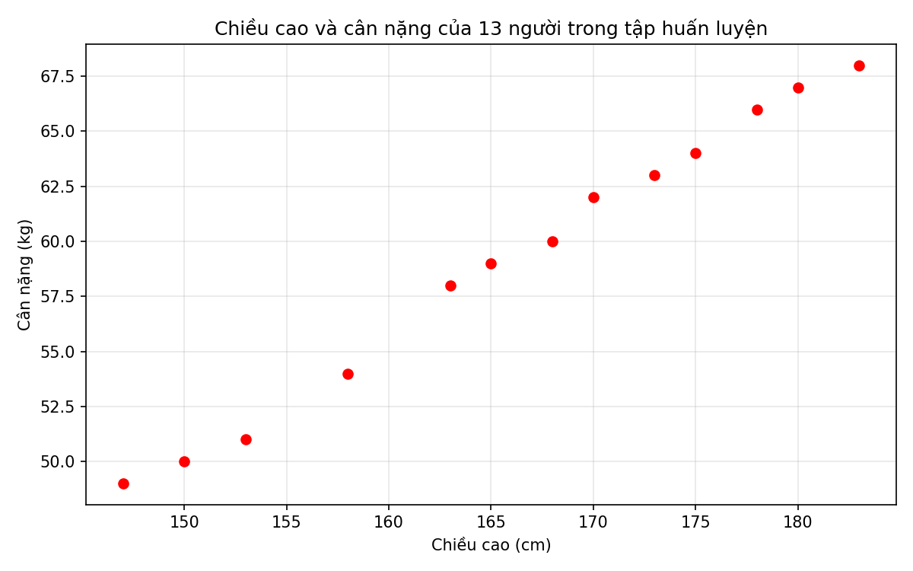
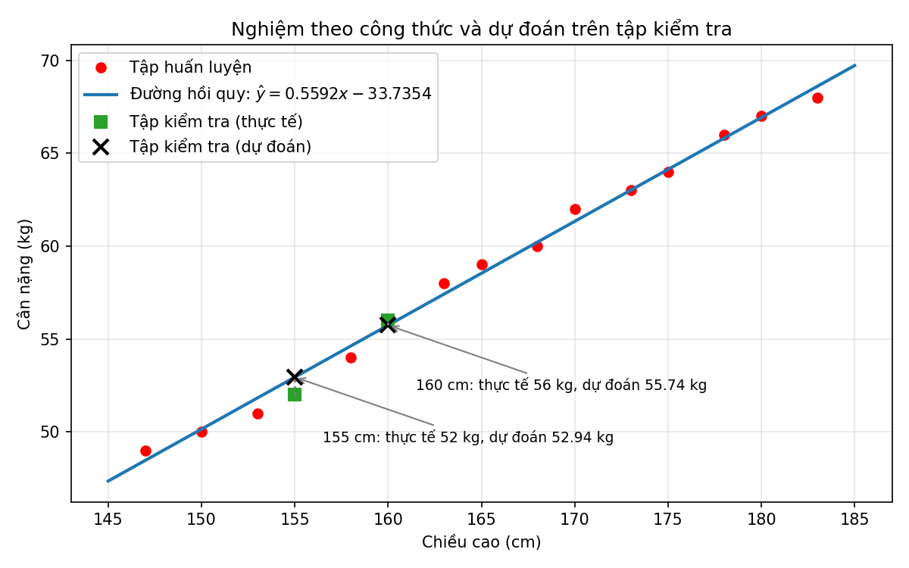
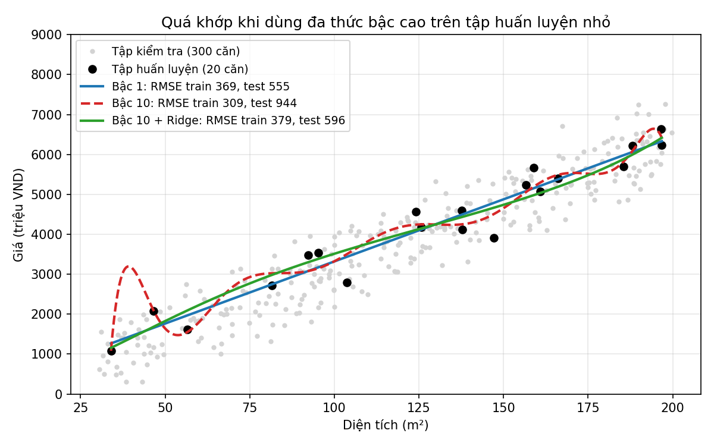
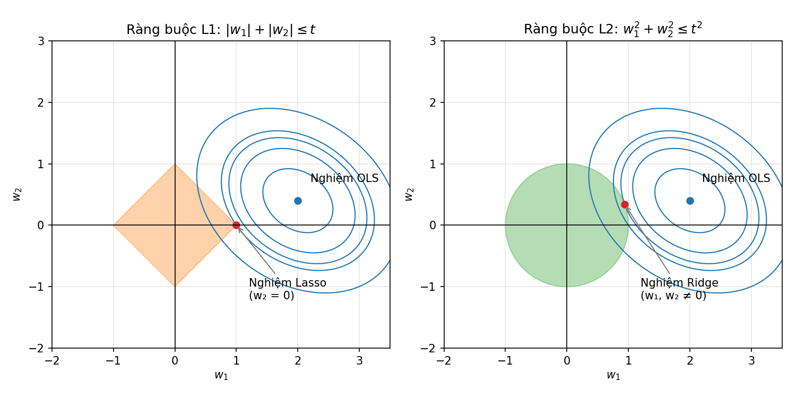

<style>
pre, pre code { font-size: 16px !important; line-height: 1.5 !important; }
</style>

# Bài 3. Học có giám sát và Hồi quy tuyến tính

> Tài liệu tham khảo: *Giáo trình Machine Learning 2026*, Chương 1 – Các khái niệm cơ bản; Chương 4 – Hồi quy tuyến tính. Elastic Net, các độ đo MAE, $R^2$ và kiểm định chéo không có trong giáo trình, tham khảo tài liệu scikit-learn.
>
> Mã nguồn demo: thư mục [codes/](codes/), các notebook đánh số theo thứ tự trình bày trong bài, mỗi notebook chạy độc lập từ đầu đến cuối (mở bằng Jupyter, thư mục hiện hành là `codes/`).
>
> Danh sách thư viện và phiên bản đã dùng: [requirements.txt](../requirements.txt).

- [3.1. Học có giám sát và mô hình hồi quy tuyến tính](#31-học-có-giám-sát-và-mô-hình-hồi-quy-tuyến-tính)
- [3.2. Tinh chỉnh mô hình hồi quy tuyến tính](#32-tinh-chỉnh-mô-hình-hồi-quy-tuyến-tính)
- [3.3. Thực hành hồi quy tuyến tính với dữ liệu giá nhà](#33-thực-hành-hồi-quy-tuyến-tính-với-dữ-liệu-giá-nhà)
- [3.4. Kết luận](#34-kết-luận)
- [3.5. Câu hỏi ôn tập](#35-câu-hỏi-ôn-tập)

---

## 3.1. Học có giám sát và mô hình hồi quy tuyến tính

### 3.1.1. Khái niệm học có giám sát và các dạng bài toán phổ biến

#### a) Khái niệm

**Học có giám sát (Supervised Learning)** là phương pháp học máy trong đó mô hình được huấn luyện trên tập dữ liệu **đã có nhãn**: mỗi mẫu gồm đầu vào $\mathbf{x}_i$ và **đáp án đúng** $y_i$ do con người (hoặc hệ thống) cung cấp. Nhãn đóng vai trò "người giám sát", cho mô hình biết dự đoán của nó đúng hay sai.

$$
\mathcal{D} = \{(\mathbf{x}_1, y_1), (\mathbf{x}_2, y_2), \dots, (\mathbf{x}_N, y_N)\}
$$

Mục tiêu là học một hàm $f$ sao cho $f(\mathbf{x}) \approx y$, không chỉ trên dữ liệu huấn luyện mà cả trên **dữ liệu mới chưa từng thấy**.

Theo định nghĩa của Tom Mitchell (1997), một chương trình *học* từ kinh nghiệm **E** đối với nhiệm vụ **T** và độ đo **P** nếu hiệu năng trên **T**, đo bằng **P**, được cải thiện nhờ **E**. Với học có giám sát, ví dụ lọc thư rác:
- **T**: phân loại email là *rác* hay *không rác*
- **E**: tập email đã được gán nhãn
- **P**: tỉ lệ email được phân loại đúng

#### b) Đặc điểm của học có giám sát

| Đặc điểm | Mô tả |
|---|---|
| Dữ liệu có nhãn | Mỗi mẫu huấn luyện có đáp án $y_i$. Gán nhãn thường tốn kém (cần chuyên gia, thời gian). |
| Hai giai đoạn | **Huấn luyện**: tìm tham số mô hình từ $\mathcal{D}$. **Dự đoán**: áp dụng $f$ cho đầu vào mới. |
| Đo được sai số | Vì biết đáp án, có thể tính sai số giữa $\hat{y}$ và $y$ để tối ưu và đánh giá mô hình. |
| Mục tiêu là tổng quát hóa | Mô hình tốt là mô hình dự đoán đúng trên **tập kiểm tra** (dữ liệu không dùng để huấn luyện). |

So với các phương thức học khác (đã giới thiệu ở Bài 1): **học không giám sát** chỉ có $\mathbf{x}_i$, không có nhãn, mục tiêu là tìm cấu trúc ẩn (ví dụ phân cụm); **học tăng cường** không có nhãn cho từng mẫu mà chỉ nhận **phần thưởng** sau khi tương tác với môi trường.

#### c) Hai dạng bài toán phổ biến

Tùy theo kiểu của nhãn $y$, học có giám sát chia thành hai dạng chính:

| | Hồi quy (Regression) | Phân lớp (Classification) |
|---|---|---|
| Nhãn $y$ | Giá trị **liên tục** (số thực) | Giá trị **rời rạc** (nhãn lớp) |
| Câu hỏi | "Bao nhiêu?" | "Thuộc loại nào?" |
| Ví dụ | Dự đoán giá nhà, nhiệt độ, doanh thu, cân nặng | Email rác / không rác, nhận dạng chữ số 0–9, chẩn đoán bệnh |
| Thuật toán | Hồi quy tuyến tính, Ridge, Lasso, cây hồi quy | Hồi quy Logistic, k-NN, cây quyết định, SVM |
| Độ đo | MAE, MSE, RMSE, $R^2$ | Accuracy, Precision, Recall, F1-score |

```
Dữ liệu có nhãn y?
├── Có  → HỌC CÓ GIÁM SÁT
│   ├── y liên tục   → HỒI QUY      (bài này)
│   └── y rời rạc    → PHÂN LỚP     (Bài 4, 6, 7)
└── Không → HỌC KHÔNG GIÁM SÁT      (Bài 8)
```

Bài này tập trung vào bài toán **hồi quy** với mô hình đơn giản và nền tảng nhất: **hồi quy tuyến tính**.

---

### 3.1.2. Mô hình hồi quy tuyến tính và công thức dự đoán

**Hồi quy tuyến tính** là phương pháp học có giám sát cho bài toán hồi quy, trong đó mối quan hệ giữa đầu vào và đầu ra được mô hình hóa bằng một **hàm tuyến tính**. Đây là một trong những mô hình cơ bản nhất của học máy và là nền tảng cho nhiều phương pháp phức tạp hơn.

#### a) Phát biểu bài toán

Xét bài toán **dự đoán giá nhà**. Mỗi căn nhà được mô tả bởi ba đặc trưng:

| Ký hiệu | Đặc trưng | Đơn vị |
|---|---|---|
| $x_1$ | Diện tích | m² |
| $x_2$ | Số phòng ngủ | phòng |
| $x_3$ | Khoảng cách tới trung tâm | km |

Cho tập dữ liệu gồm 10.000 căn nhà đã biết giá bán. Với một căn nhà mới, ta cần xây dựng hàm dự đoán:

$$
y = f(\mathbf{x}), \qquad \mathbf{x} = [x_1, x_2, x_3]^T
$$

Thực tế cho thấy giá nhà **tăng** khi diện tích lớn hơn, số phòng nhiều hơn, và **giảm** khi xa trung tâm hơn. Do đó, một giả thiết hợp lý là giá nhà được xấp xỉ bởi một **hàm tuyến tính**:

$$
y \approx \hat{y} = f(\mathbf{x}) = w_0 + w_1 x_1 + w_2 x_2 + w_3 x_3
$$

trong đó:
- $w_0$: **hệ số chệch** (bias)
- $\mathbf{w} = [w_1, w_2, w_3]^T$: **vector trọng số** cần ước lượng từ dữ liệu

#### b) Công thức dự đoán tổng quát

Với dữ liệu có $d$ đặc trưng, $\mathbf{x} \in \mathbb{R}^d$:

$$
\hat{y} = w_0 + w_1 x_1 + w_2 x_2 + \dots + w_d x_d = w_0 + \mathbf{x}^T \mathbf{w}
$$

**Ý nghĩa của hệ số:** $w_j$ cho biết khi $x_j$ tăng 1 đơn vị (các đặc trưng khác giữ nguyên) thì $\hat{y}$ thay đổi trung bình $w_j$ đơn vị. Dấu của $w_j$ cho biết chiều ảnh hưởng: $w_j > 0$ là ảnh hưởng thuận, $w_j < 0$ là ảnh hưởng nghịch.

#### c) Viết gọn bằng vector mở rộng

Thêm phần tử $1$ vào đầu vector đặc trưng:

$$
\bar{\mathbf{x}} = [1, x_1, \dots, x_d]^T, \qquad \bar{\mathbf{w}} = [w_0, w_1, \dots, w_d]^T
$$

Khi đó công thức dự đoán viết gọn thành:

$$
\hat{y} = \bar{\mathbf{x}}^T \bar{\mathbf{w}}
$$

*Vector cột và phép chuyển vị trong NumPy: [codes/02_vector_transpose.ipynb](codes/02_vector_transpose.ipynb).*

> **Vì sao cần hệ số chệch $w_0$?**
> Nếu không có $w_0$, đường hồi quy buộc phải đi qua gốc tọa độ (khi $\mathbf{x} = \mathbf{0}$ thì $\hat{y} = 0$). Điều này thường không hợp lý trong thực tế. Hệ số chệch cho phép đường hồi quy dịch chuyển song song với trục tung, giúp mô tả dữ liệu tốt hơn.


*Hình 3.1: Mô phỏng 40 căn nhà với giá thực $y \approx 800 + 15x$. Đường **có** $w_0$ (xanh) bám sát dữ liệu. Đường **không có** $w_0$ (đỏ, nét đứt) bị buộc đi qua gốc tọa độ nên phải "dốc" hơn để bù: nó dự đoán thấp với nhà nhỏ và cao với nhà lớn. Mã nguồn vẽ hình: [images/plot_bias_term.ipynb](images/plot_bias_term.ipynb).*

---

### 3.1.3. Hàm mất mát MSE và tối ưu

#### a) Sai số dự đoán

Sai số giữa giá trị thực và giá trị dự đoán:

$$
e = y - \hat{y}
$$

Dùng **sai số bình phương**:

$$
\frac{1}{2} e^2 = \frac{1}{2}(y - \hat{y})^2 = \frac{1}{2}(y - \mathbf{x}^T \mathbf{w})^2
$$

**Tại sao dùng bình phương?**

1. Sai số $e$ có thể âm hoặc dương. Nếu cộng trực tiếp, các sai số sẽ **triệt tiêu lẫn nhau**. Bình phương đảm bảo mọi sai số đều không âm.
2. Có thể dùng trị tuyệt đối $|e|$, nhưng hàm này **không khả vi tại $e = 0$**, gây khó khăn cho các thuật toán tối ưu dựa trên đạo hàm.
3. Hệ số $\frac{1}{2}$ chỉ để thuận tiện: khi lấy đạo hàm, nó triệt tiêu với số $2$ sinh ra từ bình phương.

#### b) Hàm mất mát MSE

Với tập huấn luyện gồm $N$ mẫu $(\mathbf{x}_i, y_i)$, hàm mất mát là **trung bình sai số bình phương** (Mean Squared Error):

$$
\mathcal{L}(\mathbf{w}) = \frac{1}{2N} \sum_{i=1}^{N} (y_i - \mathbf{x}_i^T \mathbf{w})^2
$$

Huấn luyện mô hình chính là giải bài toán tối ưu:

$$
\mathbf{w}^* = \arg\min_{\mathbf{w}} \mathcal{L}(\mathbf{w})
$$

*Ví dụ về min, max, argmin, argmax: [codes/01_argmin_argmax.ipynb](codes/01_argmin_argmax.ipynb).*

Phương pháp tìm $\mathbf{w}$ bằng cách cực tiểu tổng bình phương sai số được gọi là **phương pháp bình phương tối thiểu** (Ordinary Least Squares – **OLS**).

> **Vì sao chia cho $N$?**
> Nhân hàm mất mát với một hằng số dương **không làm thay đổi nghiệm tối ưu**. Tuy nhiên, lấy trung bình giúp giá trị hàm mất mát **không phụ thuộc vào kích thước tập dữ liệu**, nhờ đó có thể so sánh chất lượng mô hình giữa các tập dữ liệu khác nhau.

#### c) Dạng ma trận

Đặt ma trận dữ liệu $\mathbf{X} \in \mathbb{R}^{N \times d}$, **mỗi hàng là một mẫu** $\mathbf{x}_i^T$, và $\mathbf{y} = [y_1, y_2, \dots, y_N]^T$:

$$
\mathbf{X} =
\begin{bmatrix}
\mathbf{x}_1^T \\ \mathbf{x}_2^T \\ \vdots \\ \mathbf{x}_N^T
\end{bmatrix}
\quad\Rightarrow\quad
\mathcal{L}(\mathbf{w}) = \frac{1}{2N} \left\| \mathbf{y} - \mathbf{X}\mathbf{w} \right\|_2^2
$$

Như vậy hàm mất mát là bình phương **chuẩn $\ell_2$** của vector sai số. (Để gộp hệ số chệch, ta dùng ma trận mở rộng $\bar{\mathbf{X}}$ có thêm cột toàn số 1; từ đây viết $\mathbf{X}$ cho gọn.)

#### d) Nghiệm OLS (phương trình chuẩn – Normal Equation)

Hàm mất mát là hàm **lồi** và khả vi với mọi $\mathbf{w}$, nên nghiệm tối ưu thỏa mãn gradient bằng $0$:

$$
\nabla_{\mathbf{w}} \mathcal{L}(\mathbf{w}) = \frac{1}{N} \mathbf{X}^T (\mathbf{X}\mathbf{w} - \mathbf{y}) = \mathbf{0}
\quad\Leftrightarrow\quad
\mathbf{X}^T \mathbf{X}\, \mathbf{w} = \mathbf{X}^T \mathbf{y}
$$

**Trường hợp 1:** $\mathbf{X}^T\mathbf{X}$ khả nghịch → nghiệm duy nhất:

$$
\mathbf{w} = (\mathbf{X}^T \mathbf{X})^{-1} \mathbf{X}^T \mathbf{y}
$$

**Trường hợp 2:** $\mathbf{X}^T\mathbf{X}$ không khả nghịch → dùng **giả nghịch đảo** (pseudo-inverse) $(\cdot)^\dagger$:

$$
\mathbf{w} = (\mathbf{X}^T \mathbf{X})^{\dagger} \mathbf{X}^T \mathbf{y}
$$

Giả nghịch đảo **luôn tồn tại**, kể cả khi ma trận không vuông hoặc không khả nghịch. Nghiệm này là vector $\mathbf{w}$ có **chuẩn $\ell_2$ nhỏ nhất** trong số các nghiệm làm cực tiểu sai số bình phương. Khi ma trận vuông và khả nghịch, giả nghịch đảo trùng với nghịch đảo thông thường.

Vì vậy, **nghiệm tổng quát** là:

$$
\boxed{\mathbf{w} = (\mathbf{X}^T \mathbf{X})^{\dagger} \mathbf{X}^T \mathbf{y}}
$$

Trong Python, giả nghịch đảo được tính bằng `numpy.linalg.pinv()`. Công thức phương trình chuẩn giúp hiểu toán học; khi tính thực tế nên giải trực tiếp `np.linalg.lstsq(X, y, rcond=None)[0]` hoặc `np.linalg.pinv(X) @ y`, vì lập $X^T X$ có thể làm bình phương số điều kiện và khuếch đại sai số số học. Ví dụ giá nhà trong notebook dùng `lstsq`; ví dụ tính tay vẫn giữ phương trình chuẩn để minh họa.

> **Ghi chú:** Giáo trình viết $\mathbf{X} = [\mathbf{x}_1, \dots, \mathbf{x}_N]$ (mỗi **cột** là một mẫu), khi đó công thức có dạng $\mathbf{w} = (\mathbf{X}\mathbf{X}^T)^\dagger \mathbf{X}\mathbf{y}$. Tài liệu này dùng quy ước **mỗi hàng là một mẫu** để khớp với NumPy và scikit-learn. Hai cách viết là tương đương.

#### e) Tối ưu bằng Gradient Descent

Ngoài nghiệm giải tích, có thể tìm $\mathbf{w}$ bằng **Gradient Descent** (học chi tiết ở Bài 5), lặp lại cập nhật:

$$
\mathbf{w} \leftarrow \mathbf{w} - \eta \, \nabla_{\mathbf{w}} \mathcal{L}(\mathbf{w}) = \mathbf{w} - \frac{\eta}{N} \mathbf{X}^T (\mathbf{X}\mathbf{w} - \mathbf{y})
$$

với $\eta$ là tốc độ học (learning rate). Cách này phù hợp khi dữ liệu lớn hoặc có nhiều đặc trưng, vì việc tính nghịch đảo ma trận $d \times d$ trở nên tốn kém.

#### f) Ví dụ: Dự đoán cân nặng theo chiều cao

##### Bài toán

Cho dữ liệu chiều cao và cân nặng của 15 người. Hai người có chiều cao **155 cm** và **160 cm** được tách ra làm **tập kiểm tra**, 13 người còn lại là **tập huấn luyện**.

<table width="100%" style="width: 100%;">
  <thead>
    <tr><th>STT</th><th>Chiều cao (cm)</th><th>Cân nặng (kg)</th><th>Tập dữ liệu</th></tr>
  </thead>
  <tbody>
    <tr><td>1</td><td>147</td><td>49</td><td>Huấn luyện</td></tr>
    <tr><td>2</td><td>150</td><td>50</td><td>Huấn luyện</td></tr>
    <tr><td>3</td><td>153</td><td>51</td><td>Huấn luyện</td></tr>
    <tr><td>4</td><td>158</td><td>54</td><td>Huấn luyện</td></tr>
    <tr><td>5</td><td>163</td><td>58</td><td>Huấn luyện</td></tr>
    <tr><td>6</td><td>165</td><td>59</td><td>Huấn luyện</td></tr>
    <tr><td>7</td><td>168</td><td>60</td><td>Huấn luyện</td></tr>
    <tr><td>8</td><td>170</td><td>62</td><td>Huấn luyện</td></tr>
    <tr><td>9</td><td>173</td><td>63</td><td>Huấn luyện</td></tr>
    <tr><td>10</td><td>175</td><td>64</td><td>Huấn luyện</td></tr>
    <tr><td>11</td><td>178</td><td>66</td><td>Huấn luyện</td></tr>
    <tr><td>12</td><td>180</td><td>67</td><td>Huấn luyện</td></tr>
    <tr><td>13</td><td>183</td><td>68</td><td>Huấn luyện</td></tr>
    <tr><td><b>14</b></td><td><b>155</b></td><td><b>52</b></td><td><b>Kiểm tra</b></td></tr>
    <tr><td><b>15</b></td><td><b>160</b></td><td><b>56</b></td><td><b>Kiểm tra</b></td></tr>
  </tbody>
</table>

*(Các dòng in đậm là tập kiểm tra.)*


Giữa chiều cao và cân nặng có mối quan hệ **thuận chiều** (người cao hơn thường nặng hơn), nên dùng mô hình:

$$
\text{(cân nặng)} = w_1 \cdot \text{(chiều cao)} + w_0
$$

##### Khai báo và hiển thị dữ liệu

```python
import numpy as np
import matplotlib.pyplot as plt

# Chiều cao (cm) – mỗi hàng là một mẫu dữ liệu
X = np.array([[147, 150, 153, 158, 163, 165, 168, 170, 173, 175, 178, 180, 183]]).T

# Cân nặng tương ứng (kg) – biến mục tiêu
y = np.array([49, 50, 51, 54, 58, 59, 60, 62, 63, 64, 66, 67, 68])

plt.plot(X, y, 'ro')
plt.xlabel('Chiều cao (cm)')
plt.ylabel('Cân nặng (kg)')
plt.show()
```



*Hình 3.2: Chiều cao và cân nặng của 13 người trong tập huấn luyện. Mã nguồn vẽ hình: [images/plot_height_weight.ipynb](images/plot_height_weight.ipynb).*

Các điểm dữ liệu nằm **gần như trên một đường thẳng**, vì vậy hồi quy tuyến tính có khả năng cho kết quả tốt.

##### Nghiệm theo công thức OLS

```python
# Bước 1: Tạo ma trận Xbar (thêm cột 1 vào trước ma trận X)
# X.shape[0] = 13 là số mẫu -> ones là vector cột gồm 13 số 1, kích thước 13 x 1
ones = np.ones((X.shape[0], 1))
# Ghép theo chiều ngang (axis=1): cột 1 là số 1, cột 2 là chiều cao
# Xbar kích thước 13 x 2, mỗi hàng là [1, x_i] => [1, x_i] . [w_0, w_1] = w_0 + w_1 * x_i
Xbar = np.concatenate((ones, X), axis=1)

# Tính w = (Xbar^T Xbar)^+ Xbar^T y
# Bước 2: A = Xbar^T Xbar, kích thước (2 x 13)(13 x 2) = 2 x 2
#         A = [[N, tổng x_i], [tổng x_i, tổng x_i^2]] = [[13, 2163], [2163, 361527]]
A = np.dot(Xbar.T, Xbar)
# Bước 3: b = Xbar^T y, kích thước (2 x 13)(13) = 2
#         b = [tổng y_i, tổng x_i*y_i] = [771, 129198]
b = np.dot(Xbar.T, y)
# Bước 4: Giải hệ phương trình chuẩn A w = b bằng giả nghịch đảo: w = A^+ b
#         pinv vẫn cho nghiệm khi A không khả nghịch (inv sẽ báo lỗi)
w = np.dot(np.linalg.pinv(A), b)

# w là mảng 1 chiều: w[0] là hệ số chệch w_0, w[1] là hệ số góc w_1
w_0, w_1 = w[0], w[1]
print('w_0 =', w_0)
print('w_1 =', w_1)

# Vẽ đường hồi quy qua hai điểm đầu mút
x_line = np.linspace(145, 185, 2)
y_line = w_0 + w_1 * x_line
plt.plot(X, y, 'ro')
plt.plot(x_line, y_line)
plt.xlabel('Chiều cao (cm)')
plt.ylabel('Cân nặng (kg)')
plt.show()

# Dự đoán trên tập kiểm tra
pred_155 = w_1 * 155 + w_0   # cân nặng dự đoán của người cao 155 cm
pred_160 = w_1 * 160 + w_0   # cân nặng dự đoán của người cao 160 cm
print('Chiều cao 155 cm, cân nặng thực tế 52 kg, dự đoán %.2f kg' % pred_155)
print('Chiều cao 160 cm, cân nặng thực tế 56 kg, dự đoán %.2f kg' % pred_160)
```

*Mã nguồn: [codes/03_height_weight_regression.ipynb](codes/03_height_weight_regression.ipynb).*

##### Giải thích chi tiết phần tính nghiệm

Phần tính nghiệm gồm 4 bước, ứng với công thức ở mục d):

$$
\bar{\mathbf{w}} = (\bar{\mathbf{X}}^T \bar{\mathbf{X}})^{\dagger} \bar{\mathbf{X}}^T \mathbf{y}
$$

| Bước | Code | Công thức | Kích thước |
| --- | --- | --- | --- |
| 1 | `Xbar = np.concatenate((ones, X), axis=1)` | $\bar{\mathbf{X}}$ | $13 \times 2$ |
| 2 | `A = np.dot(Xbar.T, Xbar)` | $\mathbf{A} = \bar{\mathbf{X}}^T \bar{\mathbf{X}}$ | $(2 \times 13)(13 \times 2) = 2 \times 2$ |
| 3 | `b = np.dot(Xbar.T, y)` | $\mathbf{b} = \bar{\mathbf{X}}^T \mathbf{y}$ | $(2 \times 13)(13) = 2$ |
| 4 | `w = np.dot(np.linalg.pinv(A), b)` | $\bar{\mathbf{w}} = \mathbf{A}^{\dagger} \mathbf{b}$ | $(2 \times 2)(2) = 2$ |

**Bước 1: Thêm cột toàn số 1 vào trước $\mathbf{X}$**

```python
ones = np.ones((X.shape[0], 1))
Xbar = np.concatenate((ones, X), axis=1)
```

- `X.shape[0]` là số mẫu (13), nên `ones` là vector cột gồm 13 số 1, kích thước $13 \times 1$.
- `np.concatenate(..., axis=1)` ghép **theo chiều ngang** (thêm cột): cột 1 là `ones`, cột 2 là chiều cao. Nếu dùng `axis=0` thì hai mảng bị xếp chồng theo chiều dọc, sai ý đồ.

$$
\mathbf{X} = \begin{bmatrix} 147 \\ 150 \\ \vdots \\ 183 \end{bmatrix}
\quad \longrightarrow \quad
\bar{\mathbf{X}} = \begin{bmatrix} 1 & 147 \\ 1 & 150 \\ \vdots & \vdots \\ 1 & 183 \end{bmatrix}
$$

Lý do thêm cột 1: mỗi hàng của $\bar{\mathbf{X}}$ là $\bar{\mathbf{x}}^T = [1, x]$, nên

$$
\bar{\mathbf{x}}^T \bar{\mathbf{w}} = 1 \cdot w_0 + x \cdot w_1 = w_0 + w_1 x
$$

Nhờ cột 1, hệ số chệch $w_0$ được gộp vào vector $\bar{\mathbf{w}}$ và tính cùng lúc với $w_1$ bằng một công thức duy nhất.

**Bước 2: Tính $\mathbf{A} = \bar{\mathbf{X}}^T \bar{\mathbf{X}}$**

```python
A = np.dot(Xbar.T, Xbar)
```

`Xbar.T` là ma trận chuyển vị, kích thước $2 \times 13$. Nhân với `Xbar` ($13 \times 2$) được ma trận vuông $2 \times 2$:

$$
\mathbf{A} = \begin{bmatrix} N & \sum x_i \\ \sum x_i & \sum x_i^2 \end{bmatrix}
= \begin{bmatrix} 13 & 2163 \\ 2163 & 361527 \end{bmatrix}
$$

- $N = 13$: tổng các tích $1 \cdot 1$, tức số mẫu.
- $\sum x_i = 2163$: tổng chiều cao.
- $\sum x_i^2 = 361527$: tổng bình phương chiều cao.

**Bước 3: Tính $\mathbf{b} = \bar{\mathbf{X}}^T \mathbf{y}$**

```python
b = np.dot(Xbar.T, y)
```

`Xbar.T` ($2 \times 13$) nhân với `y` (13 phần tử) được vector 2 phần tử:

$$
\mathbf{b} = \begin{bmatrix} \sum y_i \\ \sum x_i y_i \end{bmatrix}
= \begin{bmatrix} 771 \\ 129198 \end{bmatrix}
$$

- $\sum y_i = 771$: tổng cân nặng.
- $\sum x_i y_i = 129198$: tổng các tích chiều cao × cân nặng.

**Bước 4: Tính $\bar{\mathbf{w}} = \mathbf{A}^{\dagger} \mathbf{b}$**

```python
w = np.dot(np.linalg.pinv(A), b)
```

Bước 2 và 3 thực chất là lập **hệ phương trình chuẩn** $\mathbf{A}\bar{\mathbf{w}} = \mathbf{b}$ (mục d). Viết tường minh:

$$
\begin{cases}
13\, w_0 + 2163\, w_1 = 771 \\
2163\, w_0 + 361527\, w_1 = 129198
\end{cases}
$$

Giải hệ 2 phương trình 2 ẩn này được $w_0 \approx -33.7354$ và $w_1 \approx 0.5592$. Code giải hệ bằng cách nhân $\mathbf{b}$ với giả nghịch đảo của $\mathbf{A}$:

$$
\mathbf{A}^{\dagger} \approx \begin{bmatrix} 16.98745 & -0.10164 \\ -0.10164 & 0.00061 \end{bmatrix},
\qquad
\bar{\mathbf{w}} = \mathbf{A}^{\dagger}\mathbf{b} \approx \begin{bmatrix} -33.7354 \\ 0.5592 \end{bmatrix}
$$

Vì sao dùng `pinv` (giả nghịch đảo) mà không dùng `inv` (nghịch đảo)?

- Ở ví dụ này, $\det(\mathbf{A}) = 13 \cdot 361527 - 2163^2 = 21282 \neq 0$, nên $\mathbf{A}$ khả nghịch và `pinv(A)` cho cùng kết quả với `inv(A)`.
- Khi $\mathbf{A}$ không khả nghịch (ví dụ có hai đặc trưng trùng nhau, hoặc số mẫu ít hơn số đặc trưng), `inv` báo lỗi, còn `pinv` vẫn cho nghiệm. Vì vậy `pinv` an toàn hơn.

**Ghi chú về NumPy**

- `np.dot(P, Q)` là phép nhân ma trận; có thể viết gọn là `P @ Q`. Cả 4 bước có thể viết thành một dòng: `w = np.linalg.pinv(Xbar.T @ Xbar) @ Xbar.T @ y`.
- `y` là mảng 1 chiều nên `b` và `w` cũng là mảng 1 chiều: `w[0]` là $w_0$, `w[1]` là $w_1$.

**Ý nghĩa của nghiệm**

- $w_1 \approx 0.5592$: cao thêm 1 cm thì cân nặng tăng trung bình khoảng 0.56 kg.
- $w_0 \approx -33.7354$: là điểm cắt trục tung, giúp đường thẳng nằm đúng vị trí. Giá trị này không có ý nghĩa thực tế (không ai cao 0 cm), vì mô hình chỉ đáng tin trong khoảng chiều cao của dữ liệu (147–183 cm).

**Kết quả:**

```
w_0 = -33.7354
w_1 = 0.5592
Chiều cao 155 cm, cân nặng thực tế 52 kg, dự đoán 52.94 kg
Chiều cao 160 cm, cân nặng thực tế 56 kg, dự đoán 55.74 kg
```



*Hình 3.3: Đường hồi quy $\hat{y} = 0.5592x - 33.7354$ tìm được bằng công thức (xanh dương) đi sát 13 điểm huấn luyện (đỏ). Với tập kiểm tra, ô vuông xanh lá là cân nặng thực tế, dấu × là giá trị dự đoán; đường chấm nối hai giá trị cho thấy sai số. Mã nguồn vẽ hình: [images/plot_normal_equation_fit.ipynb](images/plot_normal_equation_fit.ipynb).*

Kết quả dự đoán khá sát với giá trị thực tế.

##### Sử dụng thư viện scikit-learn

```python
from sklearn import linear_model

model = linear_model.LinearRegression()
model.fit(X, y)   # mỗi mẫu dữ liệu là một hàng

print("Kết quả từ scikit-learn:")
print("w1 =", model.coef_[0])     # hệ số góc
print("w0 =", model.intercept_)   # hệ số chệch

print("Kết quả tính toán thủ công:")
print("w1 =", w[1])
print("w0 =", w[0])
```

Hai kết quả **trùng nhau**: $w_1 \approx 0.5592$, $w_0 \approx -33.7354$.

*Mã nguồn: [codes/03_height_weight_regression.ipynb](codes/03_height_weight_regression.ipynb).*

---

### 3.1.4. Ứng dụng của hồi quy tuyến tính trong thực tế

#### a) Các lĩnh vực ứng dụng

| Lĩnh vực | Bài toán | Đặc trưng đầu vào (ví dụ) |
|---|---|---|
| Bất động sản | Dự đoán giá nhà, giá thuê | Diện tích, số phòng, vị trí, tuổi nhà |
| Kinh doanh | Dự báo doanh thu, nhu cầu hàng hóa | Chi phí quảng cáo, giá bán, mùa vụ |
| Tài chính | Ước lượng rủi ro, định giá tài sản | Lãi suất, chỉ số thị trường |
| Y tế | Dự đoán huyết áp, chỉ số đường huyết | Tuổi, cân nặng, chế độ ăn, vận động |
| Nông nghiệp | Dự báo năng suất cây trồng | Lượng mưa, nhiệt độ, lượng phân bón |
| Năng lượng | Dự báo phụ tải điện | Nhiệt độ, giờ trong ngày, ngày lễ |
| Giáo dục | Dự đoán điểm thi | Số giờ học, điểm quá trình, tỉ lệ đi học |

Ngoài dự đoán, hồi quy tuyến tính còn được dùng để **giải thích**: các hệ số $w_j$ cho biết đặc trưng nào ảnh hưởng mạnh và theo chiều nào. Đây là lý do mô hình này rất phổ biến trong kinh tế học và thống kê.

#### b) Ưu điểm

- **Đơn giản, dễ cài đặt**, huấn luyện nhanh (có nghiệm dạng đóng).
- **Dễ diễn giải**: mỗi hệ số có ý nghĩa rõ ràng.
- Thường là **mô hình cơ sở (baseline)** để so sánh với các mô hình phức tạp hơn.

#### c) Hạn chế

**Nhạy cảm với nhiễu và giá trị ngoại lai (outliers).** Giả sử dữ liệu chiều cao – cân nặng có thêm một điểm bất thường **(150 cm, 90 kg)**. Vì hồi quy tuyến tính tối thiểu hóa **sai số bình phương**, các sai số lớn bị **khuếch đại**, nên chỉ một vài điểm ngoại lai cũng có thể làm lệch đáng kể đường hồi quy. Cách khắc phục:
- Loại bỏ điểm nhiễu trước khi huấn luyện (khó áp dụng khi dữ liệu lớn hoặc nhiều chiều).
- Dùng **hàm mất mát kháng nhiễu**: *Huber loss* (như L2 khi sai số nhỏ, như L1 khi sai số lớn), *RANSAC*, *Theil–Sen*.

```python
from sklearn.linear_model import HuberRegressor, RANSACRegressor, TheilSenRegressor

huber = HuberRegressor().fit(X, y)
ransac = RANSACRegressor().fit(X, y)
theil = TheilSenRegressor().fit(X, y)
```

Với điểm ngoại lai (150 cm, 90 kg), hồi quy tuyến tính dự đoán người cao 155 cm nặng 59.07 kg (thực tế 52 kg), trong khi Huber, RANSAC, Theil–Sen dự đoán lần lượt 53.17, 52.94, 53.31 kg, gần với kết quả khi chưa có ngoại lai.

*Mã nguồn: [codes/03_height_weight_regression.ipynb](codes/03_height_weight_regression.ipynb) (mục Ảnh hưởng của điểm ngoại lai).*

**Chỉ biểu diễn được quan hệ tuyến tính.** Nhiều bài toán thực tế có quan hệ **phi tuyến**. Có thể khắc phục bằng cách thêm đặc trưng phi tuyến (mục 3.2.1), nhưng điều này dễ dẫn đến **quá khớp**.

**Đa cộng tuyến (multicollinearity).** Khi các đặc trưng tương quan cao (ví dụ diện tích và số phòng ngủ), ma trận $\mathbf{X}^T\mathbf{X}$ gần suy biến, các hệ số ước lượng trở nên **không ổn định** (thay đổi mạnh khi dữ liệu thay đổi ít).

Hai hạn chế sau được giải quyết bằng **điều chuẩn**, nội dung chính của phần 3.2.

---

## 3.2. Tinh chỉnh mô hình hồi quy tuyến tính

### 3.2.1. Hiện tượng quá khớp trong hồi quy tuyến tính

#### a) Hồi quy đa thức

Hồi quy tuyến tính **chỉ cần tuyến tính theo $\mathbf{w}$**, không nhất thiết tuyến tính theo $\mathbf{x}$. Ví dụ:

$$
y \approx w_0 + w_1 x_1 + w_2 x_2 + w_3 x_1^2 + w_4 \sin(x_2) + w_5 x_1 x_2
$$

không tuyến tính theo $\mathbf{x}$ nhưng vẫn tuyến tính theo $\mathbf{w}$. Ta chỉ cần tạo vector đặc trưng mới $\tilde{\mathbf{x}} = [x_1,\ x_2,\ x_1^2,\ \sin(x_2),\ x_1 x_2]^T$ rồi áp dụng hồi quy tuyến tính như bình thường.

Trường hợp hay dùng nhất là **hồi quy đa thức** bậc $p$, với vector đặc trưng $[x, x^2, \dots, x^p]^T$:

```python
from sklearn.preprocessing import PolynomialFeatures, StandardScaler
from sklearn.linear_model import LinearRegression
from sklearn.pipeline import make_pipeline

# Hồi quy đa thức bậc 3: chuẩn hóa x, tạo [x, x^2, x^3], chuẩn hóa lại, rồi hồi quy tuyến tính
poly_model = make_pipeline(StandardScaler(), PolynomialFeatures(degree=3, include_bias=False),
                           StandardScaler(), LinearRegression())
poly_model.fit(X, y)
```

Chuẩn hóa **trước khi lũy thừa** để tránh các giá trị quá lớn (diện tích 200 m² lũy thừa 10 là khoảng $10^{23}$): khi đó các cột đặc trưng gần như trùng nhau và nghiệm trở nên không ổn định về mặt số học.

*Mã nguồn: [codes/05_house_price_regression.ipynb](codes/05_house_price_regression.ipynb) (mục 9).*

Bậc $p$ càng cao, mô hình càng **linh hoạt**, nhưng cũng càng dễ **quá khớp**.

#### b) Quá khớp và chưa khớp

| | Chưa khớp (Underfitting) | Vừa khớp (Good fit) | Quá khớp (Overfitting) |
|---|---|---|---|
| Mô hình | Quá đơn giản | Phù hợp | Quá phức tạp |
| Sai số huấn luyện | Cao | Thấp | **Rất thấp** |
| Sai số kiểm tra | Cao | Thấp | **Cao** |
| Biểu hiện | Không nắm được quy luật | Nắm được quy luật chung | "Học thuộc" cả nhiễu trong dữ liệu huấn luyện |

**Quá khớp** xảy ra khi mô hình khớp rất tốt dữ liệu huấn luyện nhưng dự đoán kém trên dữ liệu mới, tức là **khả năng tổng quát hóa kém**.

#### c) Ví dụ minh họa

Chia dữ liệu giá nhà thành train/test trước, rồi lấy ngẫu nhiên **20 căn nhà chỉ từ tập train** làm tập huấn luyện nhỏ, dùng một đặc trưng là diện tích, và so sánh trên tập kiểm tra:



*Hình 3.4: Đa thức bậc 1 (xanh dương) nắm được xu hướng chung. Đa thức bậc 10 (đỏ, nét đứt) uốn lượn để đi qua các điểm huấn luyện: sai số huấn luyện giảm (RMSE 309) nhưng sai số kiểm tra tăng khoảng 1.7 lần (RMSE 944 so với 555 của bậc 1). Cùng đa thức bậc 10 nhưng có điều chuẩn Ridge (xanh lá) trở lại mượt và có RMSE kiểm tra 596. Mã nguồn vẽ hình: [images/plot_overfitting.ipynb](images/plot_overfitting.ipynb); tính lại trong [codes/05_house_price_regression.ipynb](codes/05_house_price_regression.ipynb) (mục 9).*

| Mô hình | RMSE huấn luyện | RMSE kiểm tra |
|---|---|---|
| Đa thức bậc 1 | 369 | 555 |
| Đa thức bậc 10 | **309** | **944** |
| Đa thức bậc 10 + Ridge ($\alpha = 1$) | 379 | 596 |

Một dấu hiệu quan trọng: ở mô hình bậc 10 không điều chuẩn, các hệ số $w_j$ có độ lớn **khổng lồ** (hàng trăm nghìn, trong khi mô hình bậc 1 và mô hình có Ridge chỉ cỡ $10^3$) và trái dấu nhau để triệt tiêu, khiến mô hình thay đổi rất mạnh khi $x$ thay đổi ít.

#### d) Nguyên nhân gây quá khớp

- Mô hình quá phức tạp so với dữ liệu: **nhiều đặc trưng** (hoặc bậc đa thức cao) nhưng **ít mẫu**. Khi số đặc trưng $d$ gần bằng hoặc lớn hơn số mẫu $N$, mô hình có thể khớp hoàn toàn dữ liệu huấn luyện.
- Dữ liệu có **nhiễu**, mô hình học luôn cả nhiễu.
- **Đa cộng tuyến** làm hệ số không ổn định.

Cách khắc phục: thu thập thêm dữ liệu, giảm số đặc trưng, chọn mô hình đơn giản hơn, hoặc **điều chuẩn**.

---

### 3.2.2. Khái niệm và vai trò của điều chuẩn (Regularization)

**Điều chuẩn** là kỹ thuật bổ sung một **thành phần phạt** vào hàm mất mát để hạn chế độ lớn của các tham số:

$$
\mathcal{L}(\mathbf{w}) = \underbrace{\sum_{i=1}^{N} (y_i - \hat{y}_i)^2}_{\text{khớp dữ liệu}} + \underbrace{\lambda \, R(\mathbf{w})}_{\text{phạt độ phức tạp}}
$$

- $R(\mathbf{w})$: **hàm phạt**, đo độ lớn của vector trọng số (L1 hoặc L2, mục 3.2.3).
- $\lambda \ge 0$: **hệ số điều chuẩn**, cân bằng giữa hai mục tiêu:
  - $\lambda = 0$: không điều chuẩn, quay về OLS (dễ quá khớp).
  - $\lambda$ rất lớn: các hệ số bị ép về gần $0$, mô hình quá đơn giản (chưa khớp).
  - $\lambda$ vừa phải: mô hình cân bằng, tổng quát hóa tốt.

**Vai trò của điều chuẩn:**
1. **Giảm quá khớp**: không cho hệ số phình to để khớp nhiễu (như ví dụ bậc 10 ở trên).
2. **Ổn định nghiệm** khi có đa cộng tuyến hoặc $\mathbf{X}^T\mathbf{X}$ suy biến.
3. **Lựa chọn đặc trưng** (với L1): loại bỏ các đặc trưng không quan trọng.

**Hai lưu ý khi dùng điều chuẩn:**
- **Không phạt hệ số chệch $w_0$**, vì $w_0$ chỉ dịch chuyển đường hồi quy, không làm mô hình phức tạp hơn. Tổng trong $R(\mathbf{w})$ chỉ chạy từ $j = 1$ đến $d$.
- **Phải chuẩn hóa dữ liệu** (ví dụ `StandardScaler`) trước khi điều chuẩn. Thành phần phạt so sánh trực tiếp độ lớn các $w_j$, mà độ lớn này phụ thuộc vào đơn vị đo (diện tích tính bằng m² hay cm² sẽ cho $w_j$ khác nhau hàng vạn lần).

$\lambda$ là một **siêu tham số** (hyperparameter): không học được từ hàm mất mát mà phải chọn bằng **kiểm định chéo** (mục 3.3.2).

---

### 3.2.3. Điều chuẩn L1, L2

#### a) Chuẩn của vector

Với $\mathbf{w} = [w_1, \dots, w_d]^T$:

| Chuẩn | Công thức | Ý nghĩa hình học (2 chiều) |
|---|---|---|
| L2 (Euclid) | $\lVert \mathbf{w} \rVert_2 = \sqrt{\sum_{j=1}^{d} w_j^2}$; bình phương chuẩn là $\lVert \mathbf{w} \rVert_2^2$ | Tập $\lVert \mathbf{w} \rVert_2 \le t$ là **hình tròn** |
| L1 (Manhattan) | $\lVert \mathbf{w} \rVert_1 = \sum_{j=1}^{d} \lvert w_j \rvert$ | Tập $\lVert \mathbf{w} \rVert_1 \le t$ là **hình thoi** |

- **Điều chuẩn L2**: $R(\mathbf{w}) = \lVert \mathbf{w} \rVert_2^2$. Phạt nặng các hệ số lớn (do bình phương), làm **co đều** mọi hệ số về gần 0 nhưng hiếm khi bằng 0. Còn gọi là *weight decay*.
- **Điều chuẩn L1**: $R(\mathbf{w}) = \lVert \mathbf{w} \rVert_1$. Phạt theo trị tuyệt đối, có xu hướng đưa **một số hệ số về đúng 0**, tạo ra **nghiệm thưa** (sparse).

#### b) Vì sao L1 tạo nghiệm thưa?

Bài toán điều chuẩn tương đương với bài toán: **cực tiểu MSE với ràng buộc** $R(\mathbf{w}) \le t$. Nghiệm là điểm mà **đường đồng mức** của MSE (các elip quanh nghiệm OLS) chạm lần đầu vào miền ràng buộc.



*Hình 3.5: Các elip xanh là đường đồng mức của hàm MSE, tâm là nghiệm OLS. Trái: miền ràng buộc L1 là hình thoi, có các **đỉnh nằm trên trục tọa độ**, nên elip thường chạm vào đỉnh, cho nghiệm có $w_2 = 0$. Phải: miền ràng buộc L2 là hình tròn, không có đỉnh, elip chạm tại điểm có cả $w_1, w_2 \neq 0$. Mã nguồn vẽ hình: [images/plot_l1_l2.ipynb](images/plot_l1_l2.ipynb).*

Trong không gian nhiều chiều, hình thoi L1 có rất nhiều đỉnh và cạnh nằm trên các mặt phẳng tọa độ, nên khả năng nghiệm có nhiều $w_j = 0$ càng cao.

---

### 3.2.4. Các biến thể Ridge, Lasso và Elastic Net

#### a) Hồi quy Ridge (điều chuẩn L2)

$$
\mathcal{L}_{\text{Ridge}}(\mathbf{w}) = \sum_{i=1}^{N} (y_i - \hat{y}_i)^2 + \lambda \sum_{j=1}^{d} w_j^2
$$

Ridge có **nghiệm dạng đóng**:

$$
\mathbf{w} = (\mathbf{X}^T\mathbf{X} + \lambda \mathbf{I})^{-1} \mathbf{X}^T \mathbf{y}
$$

với $\mathbf{I}$ là ma trận đơn vị. Công thức này phạt **mọi** hệ số, nên để không phạt $w_0$ (mục 3.2.2), nó được áp dụng cho dữ liệu đã **trừ trung bình** (mỗi cột của $\mathbf{X}$ và $\mathbf{y}$ có trung bình 0, không cần cột 1); khi đó $w_0 = \bar{y} - \bar{\mathbf{x}}^T\mathbf{w}$. scikit-learn tự làm việc này khi `fit_intercept=True`. Khi $\lambda > 0$, ma trận $\mathbf{X}^T\mathbf{X} + \lambda\mathbf{I}$ **luôn khả nghịch**, vì vậy Ridge giải quyết được trường hợp $\mathbf{X}^T\mathbf{X}$ suy biến và đa cộng tuyến.

#### b) Hồi quy Lasso (điều chuẩn L1)

**Lasso** = *Least Absolute Shrinkage and Selection Operator*.

$$
\mathcal{L}_{\text{Lasso}}(\mathbf{w}) = \sum_{i=1}^{N} (y_i - \hat{y}_i)^2 + \lambda \sum_{j=1}^{d} |w_j|
$$

Hàm $|w_j|$ không khả vi tại $0$ nên Lasso **không có nghiệm dạng đóng**, phải giải bằng phương pháp lặp (ví dụ *coordinate descent*). Đổi lại, Lasso có thể đưa **một số hệ số về đúng bằng 0**, tức là tự động **lựa chọn đặc trưng** (feature selection).

Hạn chế của Lasso: khi có một nhóm đặc trưng tương quan mạnh, Lasso thường chỉ giữ **ngẫu nhiên một** đặc trưng trong nhóm và loại bỏ các đặc trưng còn lại; khi $d > N$, Lasso chọn được tối đa $N$ đặc trưng.

#### c) Elastic Net (kết hợp L1 và L2)

**Elastic Net** kết hợp cả hai thành phần phạt để tận dụng ưu điểm của cả Ridge và Lasso:

$$
\mathcal{L}_{\text{EN}}(\mathbf{w}) = \sum_{i=1}^{N} (y_i - \hat{y}_i)^2 + \lambda_1 \sum_{j=1}^{d} |w_j| + \lambda_2 \sum_{j=1}^{d} w_j^2
$$

- Thành phần **L1** giúp lựa chọn đặc trưng (nghiệm thưa).
- Thành phần **L2** giúp ổn định nghiệm và giữ lại **cả nhóm** đặc trưng tương quan thay vì chỉ chọn một.
- Ridge ($\lambda_1 = 0$) và Lasso ($\lambda_2 = 0$) là các trường hợp riêng của Elastic Net.

Trong scikit-learn, Elastic Net được tham số hóa bằng **cường độ** `alpha` và **tỉ lệ L1** `l1_ratio` $= \rho \in [0, 1]$:

$$
\mathcal{L}(\mathbf{w}) = \frac{1}{2N}\lVert \mathbf{y} - \mathbf{X}\mathbf{w} \rVert_2^2 + \alpha\rho \lVert \mathbf{w} \rVert_1 + \frac{\alpha(1-\rho)}{2} \lVert \mathbf{w} \rVert_2^2
$$

`l1_ratio = 1` là Lasso, `l1_ratio` gần 0 là gần với Ridge.

> **Lưu ý về tham số trong scikit-learn:** `alpha` đóng vai trò $\lambda$, nhưng mỗi lớp chuẩn hóa hàm mất mát khác nhau: `Ridge` dùng tổng bình phương sai số $\lVert \mathbf{y} - \mathbf{X}\mathbf{w} \rVert_2^2$, còn `Lasso` và `ElasticNet` dùng $\frac{1}{2N}\lVert \mathbf{y} - \mathbf{X}\mathbf{w} \rVert_2^2$. Vì vậy **cùng một giá trị `alpha` không tương đương giữa các lớp**; luôn chọn `alpha` bằng kiểm định chéo.

#### d) Ví dụ: Lasso loại bỏ đặc trưng nhiễu

Lấy dữ liệu giá nhà, thêm **5 đặc trưng nhiễu** (số ngẫu nhiên, không liên quan đến giá), và chỉ dùng **30 căn nhà** để huấn luyện, tình huống dễ quá khớp:

```python
import numpy as np
import pandas as pd
from sklearn.model_selection import train_test_split
from sklearn.preprocessing import StandardScaler
from sklearn.pipeline import make_pipeline
from sklearn.linear_model import LinearRegression, Ridge, Lasso
from sklearn.metrics import mean_squared_error
from pathlib import Path

DATA = Path('..') / 'data'   # notebook chạy trong codes/
df = pd.read_csv(DATA / 'house_prices.csv')
rng = np.random.RandomState(42)
for k in range(1, 6):
    df[f'noise_{k}'] = rng.normal(size=len(df))   # đặc trưng nhiễu, không liên quan tới giá

columns = ['area', 'bedrooms', 'distance'] + [f'noise_{k}' for k in range(1, 6)]
X = df[columns].values
y = df['price'].values
X_train, X_test, y_train, y_test = train_test_split(X, y, train_size=30, random_state=0)

for name, model in [('OLS', LinearRegression()), ('Ridge', Ridge(alpha=1)), ('Lasso', Lasso(alpha=50))]:
    pipeline = make_pipeline(StandardScaler(), model).fit(X_train, y_train)   # chuẩn hóa rồi huấn luyện
    rmse = np.sqrt(mean_squared_error(y_test, pipeline.predict(X_test)))
    print(name, np.round(pipeline[-1].coef_, 1), 'RMSE kiểm tra = %.1f' % rmse)
```

*Mã nguồn: [codes/05_house_price_regression.ipynb](codes/05_house_price_regression.ipynb) (mục 10).*

**Kết quả** (hệ số trên dữ liệu đã chuẩn hóa):

| Mô hình | Diện tích | Số phòng | Khoảng cách | Nhiễu 1 | Nhiễu 2 | Nhiễu 3 | Nhiễu 4 | Nhiễu 5 | RMSE kiểm tra |
|---|---|---|---|---|---|---|---|---|---|
| OLS | 1386.9 | 224.2 | −484.5 | 16.9 | 92.6 | −23.7 | 94.7 | 34.2 | 348.6 |
| Ridge | 1272.3 | 309.0 | −482.2 | 21.3 | 101.6 | −14.6 | 85.2 | 36.3 | 366.9 |
| Lasso | 1390.5 | 178.2 | −406.2 | **0** | 26.7 | **0** | 54.8 | **0** | **338.4** |

Nhận xét:
- OLS gán hệ số khác 0 cho **tất cả** đặc trưng nhiễu: mô hình đang học cả nhiễu.
- Ridge chỉ làm co hệ số, **không loại bỏ** đặc trưng nào. Nó cũng làm co hệ số diện tích và chuyển một phần sang số phòng (hai đặc trưng tương quan 0.85).
- Lasso đưa **3/5 đặc trưng nhiễu về đúng 0**, thu nhỏ 2 đặc trưng còn lại và cho sai số kiểm tra **thấp nhất**. Tăng `alpha` sẽ loại thêm đặc trưng nhiễu, nhưng đến một mức nào đó sẽ bắt đầu làm hỏng các hệ số thật.

#### e) So sánh OLS, Ridge, Lasso và Elastic Net

| Tiêu chí | OLS | Ridge | Lasso | Elastic Net |
|---|---|---|---|---|
| Thành phần phạt | Không | $\lambda \sum w_j^2$ (L2) | $\lambda \sum \lvert w_j \rvert$ (L1) | $\lambda_1 \sum \lvert w_j \rvert + \lambda_2 \sum w_j^2$ |
| Ảnh hưởng lên hệ số | Không hạn chế | Co về gần 0, **hiếm khi bằng 0** | Có thể **bằng đúng 0** | Co và có thể bằng 0 |
| Lựa chọn đặc trưng | Không | Không | Có | Có |
| Đặc trưng tương quan | Hệ số không ổn định | Chia đều trọng số trong nhóm | Chọn 1, bỏ các đặc trưng còn lại | Giữ cả nhóm |
| Nghiệm dạng đóng | Có | Có | Không | Không |
| Siêu tham số | Không | $\lambda$ | $\lambda$ | $\lambda_1, \lambda_2$ (hoặc `alpha`, `l1_ratio`) |
| Nguy cơ quá khớp | Cao khi $d$ lớn, $N$ nhỏ | Thấp | Thấp | Thấp |

**Về khả năng tổng quát hóa:** điều chuẩn chấp nhận tăng một chút sai số trên tập huấn luyện (mô hình bị "kìm" lại, có **độ chệch** cao hơn) để đổi lấy việc giảm mạnh **phương sai** (mô hình ít thay đổi theo nhiễu của tập huấn luyện). Khi dữ liệu ít hoặc nhiều đặc trưng, đánh đổi này giúp giảm sai số trên dữ liệu mới. Khi dữ liệu nhiều và ít đặc trưng, bốn mô hình cho kết quả gần như nhau (xem mục 3.3).

#### f) Lựa chọn mô hình theo tính chất dữ liệu

| Tính chất dữ liệu | Mô hình nên dùng |
|---|---|
| Nhiều mẫu, ít đặc trưng ($N \gg d$), các đặc trưng ít tương quan | **OLS** là đủ, đơn giản và dễ diễn giải |
| Hầu hết đặc trưng đều có ảnh hưởng; có đa cộng tuyến | **Ridge** |
| Nhiều đặc trưng, nghi ngờ chỉ **một số ít** thực sự quan trọng; cần mô hình gọn | **Lasso** |
| Nhiều đặc trưng **và** có các nhóm đặc trưng tương quan mạnh; hoặc $d > N$ | **Elastic Net** |
| Không chắc chắn | Thử cả Ridge, Lasso, Elastic Net, chọn bằng **kiểm định chéo** |

---

## 3.3. Thực hành hồi quy tuyến tính với dữ liệu giá nhà

Dữ liệu [data/house_prices.csv](data/house_prices.csv) gồm **10.000 căn nhà** với các cột:

| Cột | Ý nghĩa | Khoảng giá trị |
|---|---|---|
| `area` | Diện tích (m²) | 30 – 200 |
| `bedrooms` | Số phòng ngủ | 1 – 6 |
| `distance` | Khoảng cách tới trung tâm (km) | 0.5 – 25 |
| `price` | Giá nhà (triệu VND), **biến mục tiêu** | 300 – 7722 |

Dữ liệu được sinh bởi [data/generate_house_prices.ipynb](data/generate_house_prices.ipynb) theo quy luật $y = 500 + 30x_1 + 150x_2 - 60x_3 + \text{nhiễu}$, trong đó số phòng ngủ phụ thuộc vào diện tích (hệ số tương quan 0.85).

### 3.3.1. Xây dựng mô hình hồi quy dự đoán

#### Bước 1: Đọc và khám phá dữ liệu

```python
import numpy as np
import pandas as pd
from pathlib import Path

DATA = Path('..') / 'data'   # notebook chạy trong codes/
df = pd.read_csv(DATA / 'house_prices.csv')
print(df.shape)                 # (10000, 4)
print(df.describe().round(2))
print(df.corr().round(3))       # ma trận hệ số tương quan
```

Ma trận tương quan:

| | area | bedrooms | distance | price |
|---|---|---|---|---|
| area | 1.000 | 0.851 | 0.006 | **0.952** |
| bedrooms | 0.851 | 1.000 | 0.018 | 0.839 |
| distance | 0.006 | 0.018 | 1.000 | −0.237 |

Giá nhà tương quan thuận rất mạnh với diện tích, thuận với số phòng, nghịch với khoảng cách, đúng như kỳ vọng. Diện tích và số phòng tương quan 0.85 (có đa cộng tuyến ở mức vừa phải).

#### Bước 2: Chia tập huấn luyện và kiểm tra

```python
from sklearn.model_selection import train_test_split

X = df[['area', 'bedrooms', 'distance']].values   # mỗi hàng là một mẫu
y = df['price'].values
X_train, X_test, y_train, y_test = train_test_split(X, y, test_size=0.2, random_state=42)
print(len(X_train), len(X_test))   # 8000 2000
```

Tập kiểm tra (20%) **không được dùng** trong quá trình huấn luyện hay chọn siêu tham số; nó chỉ dùng để đánh giá cuối cùng.

#### Bước 3: Huấn luyện mô hình hồi quy tuyến tính

```python
from sklearn.linear_model import LinearRegression

model = LinearRegression()
model.fit(X_train, y_train)
print('w0 =', model.intercept_)
print('w1, w2, w3 =', model.coef_)

# Kiểm tra lại bằng công thức OLS: w = (Xbar^T Xbar)^+ Xbar^T y
Xbar = np.concatenate((np.ones((X_train.shape[0], 1)), X_train), axis=1)
w = np.linalg.pinv(Xbar.T @ Xbar) @ Xbar.T @ y_train
print('OLS thủ công:', w)
```

**Kết quả:**

$$
\hat{y} = 505.20 + 29.98\, x_1 + 144.89\, x_2 - 59.46\, x_3
$$

Các hệ số học được rất gần quy luật sinh dữ liệu ($500, 30, 150, -60$):
- Thêm 1 m² diện tích → giá tăng khoảng **30 triệu**.
- Thêm 1 phòng ngủ → giá tăng khoảng **145 triệu**.
- Xa trung tâm thêm 1 km → giá giảm khoảng **59 triệu**.

#### Bước 4: Dự đoán giá cho căn nhà mới

```python
new_house = np.array([[100, 3, 10]])   # 100 m², 3 phòng ngủ, cách trung tâm 10 km
print(model.predict(new_house))        # [3343.61]
```

Căn nhà 100 m², 3 phòng ngủ, cách trung tâm 10 km có giá dự đoán khoảng **3.344 triệu VND**.

> Ứng dụng web minh họa: chạy `streamlit run "codes/06_house_price_app.py"` để nhập thông số căn nhà và xem giá dự đoán trực tiếp.

*Notebook đầy đủ các bước khám phá dữ liệu, nghiệm công thức, Gradient Descent, Ridge và Lasso: [codes/05_house_price_regression.ipynb](codes/05_house_price_regression.ipynb).*

#### Bước 5: Huấn luyện các mô hình có điều chuẩn

```python
from sklearn.preprocessing import StandardScaler
from sklearn.pipeline import make_pipeline
from sklearn.linear_model import Ridge, Lasso, ElasticNet

models = {
    'OLS': LinearRegression(),
    'Ridge': Ridge(alpha=1.0),
    'Lasso': Lasso(alpha=1.0),
    'Elastic Net': ElasticNet(alpha=1.0, l1_ratio=0.5),
}
for name, model_reg in models.items():
    # Chuẩn hóa dữ liệu trước khi điều chuẩn
    pipeline = make_pipeline(StandardScaler(), model_reg).fit(X_train, y_train)
    print(name, np.round(pipeline[-1].coef_, 2), 'R2 kiểm tra = %.4f' % pipeline.score(X_test, y_test))
```

*Mã nguồn: [codes/05_house_price_regression.ipynb](codes/05_house_price_regression.ipynb) (mục 11).*

Kết quả được phân tích ở mục 3.3.2.

### 3.3.2. Đánh giá mô hình

#### a) Các độ đo đánh giá mô hình hồi quy

| Độ đo | Công thức | Ý nghĩa |
|---|---|---|
| MAE | $\frac{1}{N}\sum \lvert y_i - \hat{y}_i \rvert$ | Sai số tuyệt đối trung bình, ít nhạy với ngoại lai |
| MSE | $\frac{1}{N}\sum (y_i - \hat{y}_i)^2$ | Sai số bình phương trung bình, phạt nặng sai số lớn |
| RMSE | $\sqrt{\text{MSE}}$ | Cùng đơn vị với $y$, dễ diễn giải |
| $R^2$ | $1 - \frac{\sum (y_i - \hat{y}_i)^2}{\sum (y_i - \bar{y})^2}$ | Tỉ lệ phương sai của $y$ được mô hình giải thích (càng gần 1 càng tốt) |

$R^2 = 1$: dự đoán hoàn hảo; $R^2 = 0$: mô hình không tốt hơn việc luôn dự đoán giá trị trung bình $\bar{y}$; $R^2 < 0$: mô hình còn tệ hơn thế.

*Ví dụ tính tay các độ đo trên bài toán chiều cao – cân nặng: [codes/04_model_evaluation.ipynb](codes/04_model_evaluation.ipynb).*

#### b) Đánh giá mô hình OLS trên tập kiểm tra

```python
from sklearn.metrics import mean_absolute_error, mean_squared_error, r2_score

y_pred = model.predict(X_test)
print('MAE  = %.2f' % mean_absolute_error(y_test, y_pred))
print('MSE  = %.2f' % mean_squared_error(y_test, y_pred))
print('RMSE = %.2f' % np.sqrt(mean_squared_error(y_test, y_pred)))
print('R2   = %.4f' % r2_score(y_test, y_pred))
print('R2 trên tập huấn luyện = %.4f' % model.score(X_train, y_train))
```

*Mã nguồn: [codes/05_house_price_regression.ipynb](codes/05_house_price_regression.ipynb) (mục 6).*

**Kết quả:**

```
MAE  = 241.11
MSE  = 91237.24
RMSE = 302.06
R2   = 0.9685
R2 trên tập huấn luyện = 0.9690
```

Diễn giải:
- Trung bình, giá dự đoán lệch khoảng **241 triệu** (MAE) so với giá thực; RMSE = 302 triệu, lớn hơn MAE vì có một số căn bị dự đoán lệch nhiều.
- Mô hình giải thích được **96.85%** sự biến thiên của giá nhà.
- $R^2$ trên tập huấn luyện (0.9690) và tập kiểm tra (0.9685) **gần như bằng nhau** → chưa thấy dấu hiệu quá khớp rõ trong lần chia này.

#### c) So sánh các mô hình

Kết quả của Bước 5 (hệ số trên dữ liệu đã chuẩn hóa, $\alpha = 1$; mã nguồn: [codes/05_house_price_regression.ipynb](codes/05_house_price_regression.ipynb), mục 11):

| Mô hình | Hệ số (diện tích, số phòng, khoảng cách) | RMSE kiểm tra | $R^2$ kiểm tra |
|---|---|---|---|
| OLS | 1467.06, 197.69, −417.05 | 302.06 | 0.9685 |
| Ridge | 1466.47, 198.16, −417.00 | 302.05 | 0.9685 |
| Lasso | 1466.93, 196.79, −416.03 | 302.04 | 0.9685 |
| Elastic Net (`l1_ratio=0.5`) | 801.18, 507.95, −278.47 | 545.35 | 0.8974 |

Nhận xét:
- Với **8000 mẫu và chỉ 3 đặc trưng**, OLS không bị quá khớp nên Ridge và Lasso **không cải thiện** thêm. Đây là trường hợp "nhiều mẫu, ít đặc trưng" ở bảng lựa chọn mục 3.2.4.
- Elastic Net với `alpha=1` **kém hẳn**: do cách chuẩn hóa $\frac{1}{2N}$ của scikit-learn, `alpha=1` là mức phạt quá mạnh, các hệ số bị co nhiều (mô hình **chưa khớp**). Điều này cho thấy không thể chọn `alpha` tùy ý.

#### d) Chọn siêu tham số bằng kiểm định chéo

**Kiểm định chéo k-fold**: chia tập huấn luyện thành $k$ phần; mỗi lượt dùng $k-1$ phần để fit và một phần để xác thực. Chọn siêu tham số theo **RMSE CV**. Dùng `GridSearchCV` bao ngoài **toàn bộ pipeline** để `StandardScaler` chỉ học từ phần huấn luyện của mỗi fold. Nếu đặt `RidgeCV`, `LassoCV`, `ElasticNetCV` sau scaler, các lớp đó chia fold bên trong sau khi scaler đã fit toàn bộ tập train: vẫn có rò rỉ giữa các fold, dù tập test bên ngoài được giữ riêng.

```python
from sklearn.model_selection import GridSearchCV, KFold

alphas = np.logspace(-3, 3, 13)   # lưới cường độ điều chuẩn: 0.001 ... 1000
cv = KFold(n_splits=5, shuffle=True, random_state=42)
cv_models = {
    'Ridge': (Ridge(), {'ridge__alpha': alphas}),
    'Lasso': (Lasso(max_iter=10000), {'lasso__alpha': alphas}),
    'Elastic Net': (ElasticNet(max_iter=10000),
                    {'elasticnet__alpha': alphas, 'elasticnet__l1_ratio': [0.1, 0.5, 0.9, 1.0]}),
}
searches = {}                    # lưu mô hình được chọn hoàn toàn từ tập train
for name, (regressor, param_grid) in cv_models.items():
    search = GridSearchCV(make_pipeline(StandardScaler(), regressor), param_grid,
                          cv=cv, scoring='neg_root_mean_squared_error')
    search.fit(X_train, y_train)
    searches[name] = search
    pred = search.predict(X_test)
    print(name, 'tham số =', search.best_params_, 'RMSE CV = %.3f' % (-search.best_score_),
          'RMSE test = %.3f' % np.sqrt(mean_squared_error(y_test, pred)),
          'R2 test = %.4f' % r2_score(y_test, pred))
```

*Mã nguồn: [codes/05_house_price_regression.ipynb](codes/05_house_price_regression.ipynb) (mục 12).*

**Kết quả** (mọi cấu hình được chọn từ CV trên train; không chọn mô hình theo chênh lệch điểm test):

| Mô hình | Siêu tham số được chọn | RMSE kiểm tra | $R^2$ kiểm tra |
|---|---|---|---|
| Ridge + GridSearchCV | $\alpha \approx 0.316$ | 302.05 | 0.9685 |
| Lasso + GridSearchCV | $\alpha \approx 0.032$ | 302.06 | 0.9685 |
| Elastic Net + GridSearchCV | $\alpha \approx 0.032$, `l1_ratio = 1.0` | 302.06 | 0.9685 |

CV 5 fold xáo trộn với `random_state=42` chọn cường độ điều chuẩn nhẹ trong lưới trên; RMSE CV của ba quy trình đều xấp xỉ 302.057 triệu. Elastic Net chọn `l1_ratio = 1` (tức Lasso). Kết luận cho bộ dữ liệu này: **OLS là lựa chọn phù hợp**, vì đơn giản nhất mà cho kết quả tốt như các mô hình có điều chuẩn. Ngược lại, ở ví dụ mục 3.2.4 d) với ít mẫu và nhiều đặc trưng nhiễu, Lasso cho kết quả tốt hơn rõ rệt.

---

## 3.4. Kết luận

- **Học có giám sát** học hàm $f(\mathbf{x}) \approx y$ từ dữ liệu có nhãn; hai dạng chính là **hồi quy** ($y$ liên tục) và **phân lớp** ($y$ rời rạc).
- **Hồi quy tuyến tính** dự đoán $\hat{y} = w_0 + \mathbf{x}^T\mathbf{w}$. Tham số được tìm bằng **bình phương tối thiểu (OLS)**, tức cực tiểu hàm mất mát **MSE**, qua:
  - **Nghiệm giải tích**: $\mathbf{w} = (\mathbf{X}^T\mathbf{X})^\dagger\mathbf{X}^T\mathbf{y}$
  - **Gradient Descent**: phù hợp khi dữ liệu lớn (Bài 5).
- **Quá khớp** xảy ra khi mô hình quá phức tạp so với dữ liệu; dấu hiệu là sai số huấn luyện thấp nhưng sai số kiểm tra cao, hệ số rất lớn.
- **Điều chuẩn** thêm thành phần phạt $\lambda R(\mathbf{w})$ để giảm quá khớp:
  - **Ridge (L2)**: co hệ số, ổn định nghiệm khi có đa cộng tuyến.
  - **Lasso (L1)**: đưa hệ số về 0, lựa chọn đặc trưng.
  - **Elastic Net (L1 + L2)**: lựa chọn đặc trưng và giữ nhóm đặc trưng tương quan.
- Chọn mô hình theo tính chất dữ liệu và chọn $\lambda$ bằng **kiểm định chéo**; đánh giá bằng **MAE, MSE, RMSE, $R^2$** trên tập kiểm tra.

---

## 3.5. Câu hỏi ôn tập

### Câu hỏi lý thuyết

1. Trình bày khái niệm và các đặc điểm của học có giám sát. Phân biệt bài toán hồi quy và bài toán phân lớp, cho ví dụ.
2. Viết công thức dự đoán của mô hình hồi quy tuyến tính với $d$ đặc trưng. Giải thích ý nghĩa của hệ số chệch $w_0$ và các trọng số $w_j$.
3. Trình bày hàm mất mát MSE. Tại sao dùng sai số bình phương thay vì sai số tuyệt đối?
4. Trình bày phương pháp bình phương tối thiểu (OLS) và cách thu được nghiệm $\mathbf{w} = (\mathbf{X}^T\mathbf{X})^\dagger\mathbf{X}^T\mathbf{y}$. Khi nào cần dùng giả nghịch đảo?
5. Giải thích hiện tượng quá khớp trong hồi quy tuyến tính. Nêu các nguyên nhân và dấu hiệu nhận biết.
6. Điều chuẩn là gì? Vai trò của hệ số $\lambda$? Tại sao không phạt hệ số chệch $w_0$ và tại sao cần chuẩn hóa dữ liệu trước khi điều chuẩn?
7. Giải thích bằng hình học vì sao điều chuẩn L1 tạo ra nghiệm thưa còn điều chuẩn L2 thì không.
8. So sánh hồi quy tuyến tính thường, Ridge, Lasso và Elastic Net về thành phần phạt, ảnh hưởng lên hệ số, khả năng lựa chọn đặc trưng và khả năng tổng quát hóa.
9. Với mỗi tình huống sau, nên chọn mô hình nào? Giải thích.
   - a. 50.000 mẫu, 5 đặc trưng ít tương quan.
   - b. 200 mẫu, 1.000 đặc trưng (dữ liệu gen), chỉ vài chục gen thực sự liên quan.
   - c. 500 mẫu, 30 đặc trưng, nhiều nhóm đặc trưng tương quan mạnh với nhau.

### Bài tập thực hành

10. Cho tập dữ liệu: $(1, 2), (2, 3), (3, 5), (4, 4), (5, 6)$.
    - a. Xây dựng mô hình hồi quy tuyến tính $y = w_0 + w_1 x$.
    - b. Tính $w_0$, $w_1$ bằng phương pháp bình phương tối thiểu. *(Đáp số kiểm tra: $w_1 = 0.9$, $w_0 = 1.3$.)*
    - c. Tính MSE và $R^2$ của mô hình trên chính tập dữ liệu này.

11. Cho hàm mất mát của Ridge Regression:
    $\mathcal{L}(\mathbf{w}) = \sum_{i=1}^{N}(y_i - \hat{y}_i)^2 + \lambda \sum_{j=1}^{d} w_j^2$
    - a. Giải thích ý nghĩa của tham số $\lambda$.
    - b. Điều gì xảy ra khi $\lambda$ rất lớn hoặc rất nhỏ?
    - c. Ridge Regression giúp giảm quá khớp như thế nào?

12. Cho hàm mất mát của Lasso Regression:
    $\mathcal{L}(\mathbf{w}) = \sum_{i=1}^{N}(y_i - \hat{y}_i)^2 + \lambda \sum_{j=1}^{d} |w_j|$
    - a. So sánh thành phần điều chuẩn của Lasso với Ridge.
    - b. Giải thích tại sao Lasso có khả năng lựa chọn đặc trưng.
    - c. Trong trường hợp nào nên dùng Lasso thay vì Ridge? Khi nào nên dùng Elastic Net?

13. Với dữ liệu [data/house_prices.csv](data/house_prices.csv):
    - a. Thêm các đặc trưng đa thức bậc 2 (`PolynomialFeatures(degree=2)`), huấn luyện lại OLS và so sánh $R^2$ với mô hình tuyến tính ban đầu.
    - b. Chỉ dùng 50 căn nhà để huấn luyện, thêm 10 đặc trưng nhiễu. Dùng `GridSearchCV` bao ngoài pipeline chuẩn hóa cho Ridge, Lasso, Elastic Net; so sánh với OLS theo RMSE trên tập kiểm tra và số hệ số bằng 0.
    - c. Rút ra nhận xét về ảnh hưởng của số lượng mẫu đến lợi ích của điều chuẩn.
