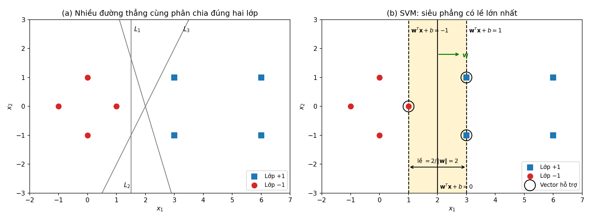
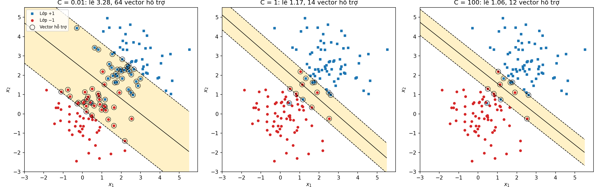
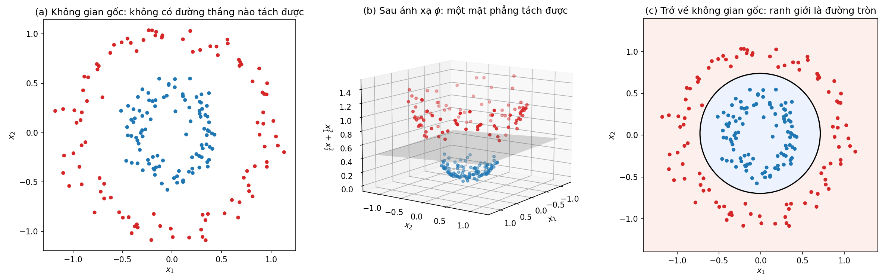
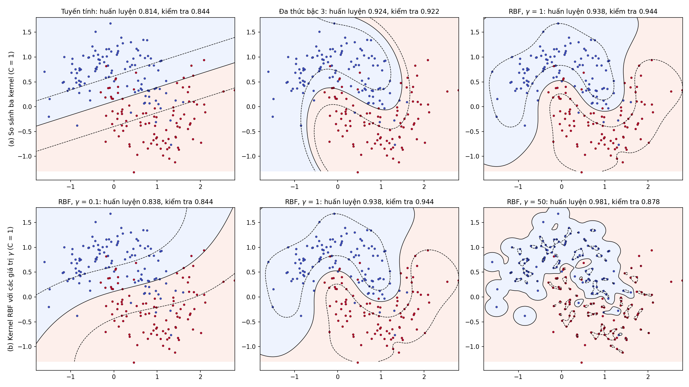
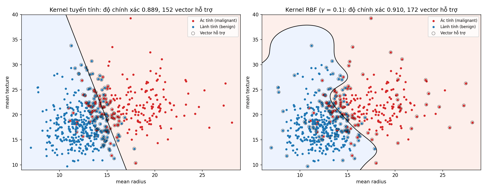

<style>
pre, pre code { font-size: 16px !important; line-height: 1.5 !important; }
</style>

# Bài 7. Máy véc-tơ hỗ trợ (SVM)

> Tài liệu tham khảo: *Giáo trình Machine Learning 2026*, Chương 10 – Máy vector hỗ trợ. SVM lề mềm và hàm kernel chỉ được nhắc tới trong giáo trình (phần câu hỏi ôn tập), tham khảo C. Cortes, V. Vapnik, *Support-vector networks*, Machine Learning, 1995; C. M. Bishop, *Pattern Recognition and Machine Learning*, Springer, 2006 (Chương 6, 7) và tài liệu scikit-learn (*Support Vector Machines*).
>
> Mã nguồn demo: thư mục [codes/](codes/), các file đánh số theo thứ tự trình bày trong bài, mỗi notebook chạy độc lập từ đầu đến cuối (mở bằng Jupyter, thư mục hiện hành là `codes/`).
>
> Danh sách thư viện và phiên bản đã dùng: [requirements.txt](../requirements.txt).

- [7.1. Mô hình SVM](#71-mô-hình-svm)
- [7.2. Thực hành: phân loại dữ liệu bằng SVM](#72-thực-hành-phân-loại-dữ-liệu-bằng-svm)
- [7.3. Kết luận](#73-kết-luận)
- [7.4. Câu hỏi ôn tập](#74-câu-hỏi-ôn-tập)

---

## 7.1. Mô hình SVM

**Máy véc-tơ hỗ trợ** (Support Vector Machine – SVM, V. Vapnik và cộng sự, 1992–1995) là một trong những thuật toán phân loại có giám sát mạnh và phổ biến nhất trước thời kỳ học sâu. Giống PLA và hồi quy Logistic (Bài 4), SVM phân loại bằng một siêu phẳng; điểm khác biệt là SVM chọn siêu phẳng **cách xa hai lớp nhất**. Nhờ thủ thuật kernel, SVM còn tạo được ranh giới phi tuyến.

### 7.1.1. Siêu phẳng phân chia (hyperplane) và biên tối ưu

#### a) Siêu phẳng

Trong $\mathbb{R}^d$, một **siêu phẳng** (hyperplane) là tập các điểm $\mathbf{x}$ thỏa

$$
\mathbf{w}^T\mathbf{x} + b = 0
$$

với $\mathbf{w} = [w_1, \dots, w_d]^T$ là vector trọng số và $b$ là hệ số tự do (bias). Trong không gian 2 chiều siêu phẳng là một đường thẳng, trong 3 chiều là một mặt phẳng.

- **$\mathbf{w}$ vuông góc với siêu phẳng** (vector pháp tuyến): với hai điểm $\mathbf{x}_A, \mathbf{x}_B$ bất kỳ trên siêu phẳng, $\mathbf{w}^T(\mathbf{x}_A - \mathbf{x}_B) = 0$. $\mathbf{w}$ quyết định hướng, $b$ quyết định vị trí của siêu phẳng.
- Siêu phẳng chia không gian thành hai nửa: $\mathbf{w}^T\mathbf{x} + b > 0$ (phía $\mathbf{w}$ chỉ tới) và $\mathbf{w}^T\mathbf{x} + b < 0$.

Ký hiệu nhãn $y_i \in \{-1, +1\}$ như PLA (Bài 4). Cho tập huấn luyện $\{(\mathbf{x}_i, y_i)\}_{i=1}^{N}$. Siêu phẳng **phân chia đúng** dữ liệu nếu mọi điểm nằm đúng phía:

$$
y_i(\mathbf{w}^T\mathbf{x}_i + b) > 0, \quad i = 1, \dots, N
$$

Khi đó dữ liệu gọi là **tách được tuyến tính** (linearly separable). Nhãn của điểm mới được dự đoán bằng hàm dấu:

$$
\hat{y} = \text{sgn}(\mathbf{w}^T\mathbf{x} + b)
$$

#### b) Khoảng cách từ một điểm tới siêu phẳng

Khoảng cách từ $\mathbf{x}_i$ tới siêu phẳng là

$$
\frac{|\mathbf{w}^T\mathbf{x}_i + b|}{\|\mathbf{w}\|_2}
$$

(tổng quát của công thức khoảng cách từ điểm tới đường thẳng $\frac{|ax_0 + by_0 + c|}{\sqrt{a^2 + b^2}}$). Với điểm được phân loại đúng, $y_i$ cùng dấu với $\mathbf{w}^T\mathbf{x}_i + b$, nên có thể viết **khoảng cách có dấu**:

$$
d_i = \frac{y_i(\mathbf{w}^T\mathbf{x}_i + b)}{\|\mathbf{w}\|_2}
$$

$d_i > 0$: điểm nằm đúng phía; $d_i < 0$: điểm bị phân loại sai.

**Lề** (margin) của một siêu phẳng là khoảng cách từ siêu phẳng tới **điểm gần nhất**:

$$
\gamma = \min_{i} \frac{y_i(\mathbf{w}^T\mathbf{x}_i + b)}{\|\mathbf{w}\|_2}
$$

**Lưu ý quan trọng:** nhân $\mathbf{w}$ và $b$ với cùng một số $k > 0$ không thay đổi siêu phẳng ($k(\mathbf{w}^T\mathbf{x} + b) = 0 \Leftrightarrow \mathbf{w}^T\mathbf{x} + b = 0$) và cũng không thay đổi khoảng cách $d_i$ (tử và mẫu cùng nhân $k$). Chỉ giá trị $\mathbf{w}^T\mathbf{x} + b$ thay đổi.

#### c) Biên tối ưu: siêu phẳng có lề lớn nhất

Khi dữ liệu tách được tuyến tính, thường có **vô số** siêu phẳng phân chia đúng (PLA dừng ở siêu phẳng đầu tiên tìm được, phụ thuộc vào khởi tạo và thứ tự duyệt điểm). Siêu phẳng nào tốt nhất?

*Ví dụ.* Dữ liệu 8 điểm: lớp $+1$ gồm $(3, 1), (3, -1), (6, 1), (6, -1)$; lớp $-1$ gồm $(1, 0), (0, 1), (0, -1), (-1, 0)$.



*Hình 7.1: (a) Nhiều đường thẳng cùng phân chia đúng hai lớp. (b) Siêu phẳng của SVM $x_1 = 2$ có lề lớn nhất; vùng tô màu giữa hai biên $\mathbf{w}^T\mathbf{x} + b = \pm 1$ không chứa điểm nào; các điểm được khoanh tròn là vector hỗ trợ. Mã nguồn vẽ hình: [images/plot_max_margin.ipynb](images/plot_max_margin.ipynb).*

```python
import numpy as np

X = np.array([[3, 1], [3, -1], [6, 1], [6, -1],
              [1, 0], [0, 1], [0, -1], [-1, 0]], dtype=float)
y = np.array([1, 1, 1, 1, -1, -1, -1, -1])

def signed_distance(w, b, X, y):
    """Khoảng cách có dấu d_i = y_i (w^T x_i + b) / ||w||."""
    return y * (X @ w + b) / np.linalg.norm(w)

for name, w, b in [('x1 = 2', np.array([1.0, 0.0]), -2.0),
                   ('x1 = 1.5', np.array([1.0, 0.0]), -1.5),
                   ('x1 + 0.3x2 = 2', np.array([1.0, 0.3]), -2.0),
                   ('x1 - 0.5x2 = 2', np.array([1.0, -0.5]), -2.0)]:
    print(name, signed_distance(w, b, X, y).min())
```

| Siêu phẳng | Phân loại đúng | Lề $\gamma$ |
|---|---|---|
| $x_1 = 2$ | 8/8 | **1.000** |
| $x_1 + 0.3x_2 = 2$ | 8/8 | 0.670 |
| $x_1 = 1.5$ | 8/8 | 0.500 |
| $x_1 - 0.5x_2 = 2$ | 8/8 | 0.447 |

Cả bốn đều phân loại đúng tập huấn luyện. Nhưng siêu phẳng $x_1 = 1.5$ nằm sát điểm $(1, 0)$: một điểm mới của lớp $-1$ hơi lệch sang phải là bị phân loại sai. Siêu phẳng **nằm chính giữa** khoảng trống giữa hai lớp, cách đều và xa nhất các điểm gần nhất của mỗi lớp, cho "vùng an toàn" lớn nhất và thường **tổng quát hóa tốt hơn** trên dữ liệu mới, ít nhạy cảm với nhiễu.

> **Ý tưởng SVM:** trong các siêu phẳng phân chia đúng dữ liệu, chọn siêu phẳng có **lề lớn nhất** (maximum margin hyperplane), gọi là **biên tối ưu**.

*Mã nguồn: [codes/01_hyperplane_distance.ipynb](codes/01_hyperplane_distance.ipynb).*

---

### 7.1.2. Bài toán tối ưu và khái niệm lề (margin)

#### a) Từ "lề lớn nhất" tới bài toán tối ưu

Mục tiêu "tìm siêu phẳng có lề lớn nhất" viết thành:

$$
(\mathbf{w}, b) = \arg\max_{\mathbf{w}, b}\left\{\min_{i} \frac{y_i(\mathbf{w}^T\mathbf{x}_i + b)}{\|\mathbf{w}\|_2}\right\}
$$

Bài toán max–min này khó giải trực tiếp. Dùng nhận xét ở mục 7.1.1 b): có thể nhân $(\mathbf{w}, b)$ với hằng số dương tùy ý mà siêu phẳng không đổi. Ta **chuẩn hóa** sao cho các điểm gần siêu phẳng nhất thỏa

$$
y_i(\mathbf{w}^T\mathbf{x}_i + b) = 1
$$

Khi đó mọi điểm thỏa $y_i(\mathbf{w}^T\mathbf{x}_i + b) \ge 1$ và lề bằng $\gamma = \dfrac{1}{\|\mathbf{w}\|_2}$. Bài toán trở thành: cực đại $\frac{1}{\|\mathbf{w}\|_2}$, tương đương cực tiểu $\|\mathbf{w}\|_2$, tương đương cực tiểu $\frac{1}{2}\|\mathbf{w}\|_2^2$ (bình phương để hàm khả vi, hệ số $\frac{1}{2}$ để đạo hàm gọn).

> **Bài toán tối ưu của SVM (lề cứng)**
> $$\min_{\mathbf{w}, b}\ \frac{1}{2}\|\mathbf{w}\|_2^2 \quad \text{với ràng buộc} \quad y_i(\mathbf{w}^T\mathbf{x}_i + b) \ge 1, \quad i = 1, 2, \dots, N$$

Đây là bài toán **quy hoạch toàn phương** (quadratic programming): hàm mục tiêu bậc hai lồi, các ràng buộc tuyến tính. Tính lồi bảo đảm mọi nghiệm cực tiểu địa phương là **tối ưu toàn cục**, nhưng tự nó không bảo đảm tính duy nhất. Riêng bài toán lề cứng khả thi với đủ hai lớp có vector $\mathbf{w}$ tối ưu duy nhất nhờ tính lồi nghiêm ngặt theo $\mathbf{w}$; hai lớp xác định $b$ tại vị trí lề lớn nhất. Các nhân tử đối ngẫu không nhất thiết duy nhất. Không suy rộng tính duy nhất này cho mọi SVM lề mềm hay mọi kernel.

#### b) Lề, hai siêu phẳng biên và vector hỗ trợ

Sau khi chuẩn hóa, ngoài siêu phẳng phân chia $H_0: \mathbf{w}^T\mathbf{x} + b = 0$ còn hai siêu phẳng song song:

$$
H_1: \mathbf{w}^T\mathbf{x} + b = 1, \qquad H_2: \mathbf{w}^T\mathbf{x} + b = -1
$$

Không có điểm huấn luyện nào nằm giữa $H_1$ và $H_2$. Khoảng cách giữa hai siêu phẳng biên là **độ rộng lề**:

$$
\text{Margin} = \frac{2}{\|\mathbf{w}\|_2}
$$

Các điểm nằm **đúng trên** $H_1$ hoặc $H_2$, tức thỏa $y_i(\mathbf{w}^T\mathbf{x}_i + b) = 1$, gọi là **vector hỗ trợ** (support vectors). Đây là các điểm gần ranh giới nhất, "đỡ" lấy hai biên của lề. Tên gọi "máy véc-tơ hỗ trợ" xuất phát từ đây.

#### c) Bài toán đối ngẫu và vai trò của vector hỗ trợ

Trong thực tế, người ta thường giải **bài toán đối ngẫu** (dual problem) thay cho bài toán gốc. Dùng phương pháp nhân tử Lagrange với nhân tử $\lambda_i \ge 0$ cho mỗi ràng buộc:

$$
\mathcal{L}(\mathbf{w}, b, \boldsymbol{\lambda}) = \frac{1}{2}\|\mathbf{w}\|_2^2 - \sum_{i=1}^{N}\lambda_i\big[y_i(\mathbf{w}^T\mathbf{x}_i + b) - 1\big]
$$

Cho đạo hàm theo $\mathbf{w}$ và $b$ bằng 0:

$$
\mathbf{w} = \sum_{i=1}^{N}\lambda_i y_i \mathbf{x}_i, \qquad \sum_{i=1}^{N}\lambda_i y_i = 0
$$

Thay vào $\mathcal{L}$ được bài toán đối ngẫu chỉ theo $\boldsymbol{\lambda}$:

$$
\max_{\boldsymbol{\lambda}}\ \sum_{i=1}^{N}\lambda_i - \frac{1}{2}\sum_{i=1}^{N}\sum_{j=1}^{N}\lambda_i\lambda_j y_i y_j\,\mathbf{x}_i^T\mathbf{x}_j
\quad \text{với} \quad \lambda_i \ge 0,\ \sum_{i=1}^{N}\lambda_i y_i = 0
$$

Hai tính chất quan trọng:
1. **Điều kiện bù** (một trong các điều kiện KKT): $\lambda_i\big[y_i(\mathbf{w}^T\mathbf{x}_i + b) - 1\big] = 0$. Điểm nằm ngoài lề có $y_i(\mathbf{w}^T\mathbf{x}_i + b) > 1$ nên $\lambda_i = 0$; chỉ các **vector hỗ trợ** mới có $\lambda_i > 0$. Do đó
   $$\mathbf{w} = \sum_{i \in \mathcal{S}}\lambda_i y_i \mathbf{x}_i$$
   với $\mathcal{S}$ là tập vector hỗ trợ. **Nghiệm chỉ phụ thuộc vào các vector hỗ trợ**: bỏ hết các điểm còn lại rồi huấn luyện lại vẫn được đúng siêu phẳng đó. $b$ tính từ một vector hỗ trợ bất kỳ: $b = y_s - \mathbf{w}^T\mathbf{x}_s$.
2. Dữ liệu chỉ xuất hiện qua **tích vô hướng** $\mathbf{x}_i^T\mathbf{x}_j$. Đây là chìa khóa của thủ thuật kernel (mục 7.1.3).

#### d) Ví dụ: giải bài toán tối ưu

Với 8 điểm ở mục 7.1.1, giải trực tiếp bài toán gốc bằng `scipy.optimize.minimize` (biến tối ưu $\theta = (w_1, w_2, b)$):

```python
from scipy.optimize import minimize

def objective(theta):
    w = theta[:2]
    return 0.5 * w @ w                       # (1/2) ||w||^2

constraints = [{'type': 'ineq', 'fun': lambda theta, i=i: y[i] * (X[i] @ theta[:2] + theta[2]) - 1}
               for i in range(len(y))]       # y_i (w^T x_i + b) - 1 >= 0
result = minimize(objective, x0=np.zeros(3), constraints=constraints, method='SLSQP')
w, b = result.x[:2], result.x[2]
print(w, b, 2 / np.linalg.norm(w))           # [1. 0.]  -2.0  2.0
print(y * (X @ w + b))                       # [1. 1. 4. 4. 1. 2. 2. 3.]
```

Nghiệm: $\mathbf{w} = (1, 0)$, $b = -2$, siêu phẳng $x_1 = 2$, độ rộng lề $2/\|\mathbf{w}\| = 2$. Ba điểm có $y_i(\mathbf{w}^T\mathbf{x}_i + b) = 1$ là $(3, 1)$, $(3, -1)$, $(1, 0)$: đó là các **vector hỗ trợ**.

**Kiểm tra bằng tay qua bài toán đối ngẫu.** Gọi $\lambda_1, \lambda_2, \lambda_3$ là nhân tử của $(1, 0)$, $(3, 1)$, $(3, -1)$ (các điểm khác có $\lambda = 0$). Từ $\sum\lambda_i y_i = 0$: $\lambda_1 = \lambda_2 + \lambda_3$. Từ $\mathbf{w} = \sum\lambda_i y_i\mathbf{x}_i$:

$$
\mathbf{w} = -\lambda_1(1, 0) + \lambda_2(3, 1) + \lambda_3(3, -1) = \big(3(\lambda_2 + \lambda_3) - \lambda_1,\ \lambda_2 - \lambda_3\big) = (2\lambda_1,\ \lambda_2 - \lambda_3)
$$

Để $\mathbf{w} = (1, 0)$: $\lambda_1 = 0.5$, $\lambda_2 = \lambda_3 = 0.25$.

Với scikit-learn, `SVC(kernel='linear')` giải bài toán đối ngẫu; `C` rất lớn tương đương lề cứng (mục e):

```python
from sklearn.svm import SVC

svm = SVC(kernel='linear', C=1e6).fit(X, y)
print(svm.coef_, svm.intercept_)      # [[1.0005 0.]] [-2.0011]  ~ w = (1, 0), b = -2
print(svm.support_vectors_)           # [[1, 0], [3, 1], [3, -1]]
print(svm.dual_coef_)                 # lambda_i * y_i = [-0.5, 0.25, 0.25]
```

Khớp với kết quả tính tay (sai khác nhỏ do sai số của bộ giải). Huấn luyện lại chỉ với 3 vector hỗ trợ cho cùng siêu phẳng.

*Mã nguồn: [codes/02_hard_margin_svm.ipynb](codes/02_hard_margin_svm.ipynb).*

#### e) SVM lề mềm và tham số C

SVM lề cứng có hai hạn chế: không có nghiệm khi dữ liệu **không tách được tuyến tính**, và rất nhạy cảm với **nhiễu** (một điểm ngoại lai có thể làm lề hẹp lại hoặc xoay hẳn siêu phẳng). **SVM lề mềm** (soft margin, Cortes và Vapnik, 1995) cho phép một số điểm vi phạm lề bằng các **biến bù** (slack variables) $\xi_i \ge 0$:

$$
\min_{\mathbf{w}, b, \boldsymbol{\xi}}\ \frac{1}{2}\|\mathbf{w}\|_2^2 + C\sum_{i=1}^{N}\xi_i
\quad \text{với} \quad y_i(\mathbf{w}^T\mathbf{x}_i + b) \ge 1 - \xi_i,\ \ \xi_i \ge 0
$$

- $\xi_i = 0$: điểm nằm đúng phía, ngoài lề.
- $0 < \xi_i \le 1$: điểm nằm trong lề nhưng vẫn đúng phía.
- $\xi_i > 1$: điểm bị phân loại sai.

**Tham số $C > 0$** cân bằng hai mục tiêu: lề rộng (số hạng thứ nhất) và ít vi phạm (số hạng thứ hai).

| $C$ | Ưu tiên | Hệ quả |
|---|---|---|
| Nhỏ | Lề rộng, chấp nhận nhiều vi phạm | Nhiều vector hỗ trợ, mô hình đơn giản, có thể chưa khớp |
| Lớn | Phạt nặng vi phạm, cố phân loại đúng mọi điểm | Lề hẹp, gần SVM lề cứng, dễ quá khớp với nhiễu |

Có thể viết lại bài toán dưới dạng không ràng buộc với **hàm mất mát hinge**:

$$
\min_{\mathbf{w}, b}\ \frac{1}{2}\|\mathbf{w}\|_2^2 + C\sum_{i=1}^{N}\max\big(0,\ 1 - y_i(\mathbf{w}^T\mathbf{x}_i + b)\big)
$$

Dạng này giống hồi quy có điều chuẩn L2 (Bài 3): hinge là hàm mất mát, $\frac{1}{2}\|\mathbf{w}\|^2$ là điều chuẩn, và $C$ đóng vai trò nghịch đảo của hệ số điều chuẩn. So với PLA (chỉ phạt điểm sai) và hồi quy Logistic (phạt mọi điểm), hinge phạt cả những điểm đúng nhưng **nằm trong lề**. Trong bài toán đối ngẫu, ràng buộc đổi thành $0 \le \lambda_i \le C$; vector hỗ trợ gồm các điểm nằm trên biên, trong lề và bị phân loại sai.

**Thí nghiệm:** 200 điểm từ hai cụm Gauss chồng lấn nhẹ, 140 điểm huấn luyện.

```python
from sklearn.svm import SVC

for C in [0.01, 0.1, 1, 10, 100]:
    svm = SVC(kernel='linear', C=C).fit(X_train, y_train)
    w, b = svm.coef_[0], svm.intercept_[0]
    xi = np.maximum(0, 1 - y_train * (X_train @ w + b))     # biến bù xi_i
    print(C, 2 / np.linalg.norm(w), len(svm.support_), (xi > 1e-6).sum())
```

| $C$ | Độ rộng lề $2/\Vert \mathbf{w}\Vert $ | Số vector hỗ trợ | Số điểm vi phạm lề ($\xi_i > 0$) | Độ chính xác kiểm tra |
|---|---|---|---|---|
| 0.01 | 3.276 | 64 | 62 | 0.933 |
| 0.1 | 1.861 | 27 | 27 | 0.933 |
| 1 | 1.166 | 14 | 12 | 0.933 |
| 10 | 1.058 | 12 | 10 | 0.933 |
| 100 | 1.059 | 12 | 10 | 0.933 |



*Hình 7.2: SVM lề mềm với $C = 0.01$, $1$, $100$. Nét liền: siêu phẳng phân chia; nét đứt và vùng tô màu: lề; vòng tròn: vector hỗ trợ. Mã nguồn vẽ hình: [images/plot_soft_margin.ipynb](images/plot_soft_margin.ipynb).*

$C$ tăng thì lề hẹp lại và số vector hỗ trợ giảm. Trên dữ liệu này hai lớp gần như tách được tuyến tính nên độ chính xác hầu như không đổi; với dữ liệu nhiễu hoặc kernel phi tuyến (mục 7.1.3), $C$ ảnh hưởng rõ tới quá khớp. $C$ là siêu tham số, chọn bằng kiểm định chéo.

*Mã nguồn: [codes/03_soft_margin_C.ipynb](codes/03_soft_margin_C.ipynb).*

---

### 7.1.3. Hàm kernel ánh xạ dữ liệu không tuyến tính

#### a) Dữ liệu không tách được tuyến tính

Lề mềm chỉ giúp khi dữ liệu "gần như" tách được tuyến tính. Với dữ liệu như hai vành khuyên lồng nhau (Hình 7.3a), mọi đường thẳng đều sai rất nhiều: SVM tuyến tính chỉ đạt độ chính xác 62% trên tập huấn luyện.

#### b) Ánh xạ sang không gian nhiều chiều hơn

Ý tưởng: dùng hàm $\phi: \mathbb{R}^d \to \mathbb{R}^D$ ($D > d$) biến đổi dữ liệu sang **không gian đặc trưng** mới, nơi dữ liệu tách được tuyến tính, rồi áp dụng SVM tuyến tính ở đó. Với dữ liệu vành khuyên, thêm chiều thứ ba là bình phương khoảng cách tới gốc tọa độ:

$$
\phi(x_1, x_2) = (x_1,\ x_2,\ x_1^2 + x_2^2)
$$

Điểm lớp trong có tọa độ thứ ba nhỏ, điểm lớp ngoài có tọa độ thứ ba lớn, nên một **mặt phẳng nằm ngang** tách được hai lớp.

```python
from sklearn.svm import SVC

def phi(X):
    return np.column_stack([X[:, 0], X[:, 1], X[:, 0]**2 + X[:, 1]**2])

svm_3d = SVC(kernel='linear', C=1).fit(phi(X), y)
print(svm_3d.score(phi(X), y))               # 1.0 (không gian gốc: 0.62)
print(svm_3d.coef_, svm_3d.intercept_)       # w ~ (-0.06, 0.18, -4.06), b = 2.10
```



*Hình 7.3: (a) Hai lớp vành khuyên không tách được bằng đường thẳng. (b) Sau ánh xạ $\phi$, một mặt phẳng tách được hai lớp. (c) Mặt phẳng đó ứng với một đường tròn trong không gian gốc. Mã nguồn vẽ hình: [images/plot_kernel_mapping.ipynb](images/plot_kernel_mapping.ipynb).*

Thành phần thứ ba của $\mathbf{w}$ áp đảo, siêu phẳng gần như là $-4.06(x_1^2 + x_2^2) + 2.10 = 0$, tức đường tròn $x_1^2 + x_2^2 \approx 0.52$ (bán kính khoảng 0.72) trong không gian gốc: **ranh giới tuyến tính trong không gian mới là ranh giới phi tuyến trong không gian gốc**.

Vấn đề: muốn biểu diễn ranh giới phức tạp cần $\phi$ có rất nhiều chiều. Ví dụ dùng mọi đơn thức bậc không quá 3 của 100 đặc trưng cho $D = 176\,851$ chiều; với ảnh $28 \times 28$ ($d = 784$) và bậc 4, $D$ khoảng $1.6 \times 10^{10}$. Tính và lưu $\phi(\mathbf{x})$ là không khả thi.

#### c) Thủ thuật kernel (kernel trick)

Ở mục 7.1.2 c), bài toán đối ngẫu chỉ dùng dữ liệu qua tích vô hướng. Trong không gian mới, tích vô hướng $\mathbf{x}_i^T\mathbf{x}_j$ được thay bằng $\phi(\mathbf{x}_i)^T\phi(\mathbf{x}_j)$. Nếu có một hàm $K$ tính được trực tiếp

$$
K(\mathbf{x}, \mathbf{z}) = \phi(\mathbf{x})^T\phi(\mathbf{z})
$$

từ $\mathbf{x}, \mathbf{z}$ trong không gian gốc, thì **không bao giờ cần tính $\phi$**. Hàm $K$ gọi là **hàm kernel**. Bài toán đối ngẫu trở thành

$$
\max_{\boldsymbol{\lambda}}\ \sum_{i}\lambda_i - \frac{1}{2}\sum_{i}\sum_{j}\lambda_i\lambda_j y_i y_j\,K(\mathbf{x}_i, \mathbf{x}_j)
\quad \text{với} \quad 0 \le \lambda_i \le C,\ \sum_{i}\lambda_i y_i = 0
$$

và hàm quyết định cho điểm mới:

$$
f(\mathbf{x}) = \sum_{i \in \mathcal{S}}\lambda_i y_i\,K(\mathbf{x}_i, \mathbf{x}) + b, \qquad \hat{y} = \text{sgn}(f(\mathbf{x}))
$$

Dự đoán là tổng có trọng số độ tương đồng $K$ giữa điểm mới và các vector hỗ trợ.

**Ví dụ: kernel đa thức bậc 2.** Với $\mathbf{x}, \mathbf{z} \in \mathbb{R}^2$:

$$
(\mathbf{x}^T\mathbf{z})^2 = (x_1z_1 + x_2z_2)^2 = x_1^2z_1^2 + 2x_1x_2z_1z_2 + x_2^2z_2^2 = \phi(\mathbf{x})^T\phi(\mathbf{z})
$$

với $\phi(\mathbf{x}) = (x_1^2,\ \sqrt{2}x_1x_2,\ x_2^2)$. Tính $(\mathbf{x}^T\mathbf{z})^2$ chỉ cần một tích vô hướng 2 chiều rồi bình phương, thay vì ánh xạ sang 3 chiều. Kiểm tra với $\mathbf{x} = (1, 2)$, $\mathbf{z} = (3, 1)$: $\mathbf{x}^T\mathbf{z} = 5$, $(\mathbf{x}^T\mathbf{z})^2 = 25$; $\phi(\mathbf{x}) = (1, 2\sqrt{2}, 4)$, $\phi(\mathbf{z}) = (9, 3\sqrt{2}, 1)$, $\phi(\mathbf{x})^T\phi(\mathbf{z}) = 9 + 12 + 4 = 25$.

#### d) Các hàm kernel thông dụng

| Kernel | Công thức $K(\mathbf{x}, \mathbf{z})$ | Tham số (scikit-learn) | Ghi chú |
|---|---|---|---|
| Tuyến tính | $\mathbf{x}^T\mathbf{z}$ | – | SVM tuyến tính; phù hợp khi số đặc trưng lớn (văn bản) |
| Đa thức | $(\gamma\,\mathbf{x}^T\mathbf{z} + r)^p$ | `degree` = $p$, `gamma` = $\gamma$, `coef0` = $r$ | Ranh giới là đa thức bậc $p$ |
| RBF (Gauss) | $\exp(-\gamma\Vert \mathbf{x} - \mathbf{z}\Vert ^2)$ | `gamma` = $\gamma > 0$ | Phổ biến nhất, mặc định của `SVC`; không gian đặc trưng vô hạn chiều |
| Sigmoid | $\tanh(\gamma\,\mathbf{x}^T\mathbf{z} + r)$ | `gamma`, `coef0` | Liên hệ với mạng nơ-ron; ít dùng |

**Kernel RBF** đo độ tương đồng: $K = 1$ khi hai điểm trùng nhau và giảm dần về 0 khi chúng xa nhau. $\gamma$ quyết định tốc độ giảm:

| $\Vert \mathbf{x} - \mathbf{z}\Vert $ | 0 | 0.5 | 1 | 2 | 3 |
|---|---|---|---|---|---|
| $K$ với $\gamma = 0.5$ | 1 | 0.883 | 0.607 | 0.135 | 0.011 |
| $K$ với $\gamma = 5$ | 1 | 0.287 | 0.007 | 0.000 | 0.000 |

Với dữ liệu vành khuyên, `SVC(kernel='poly', degree=2, coef0=1)` (17 vector hỗ trợ) và `SVC(kernel='rbf', gamma=1)` (34 vector hỗ trợ) đều đạt độ chính xác 100% ngay trên dữ liệu gốc, không cần tự tạo $\phi$. Notebook cũng kiểm chứng giá trị `decision_function` của scikit-learn bằng công thức $f(\mathbf{x}) = \sum_{i \in \mathcal{S}}\lambda_i y_i K(\mathbf{x}_i, \mathbf{x}) + b$.

*Mã nguồn: [codes/04_kernel_trick.ipynb](codes/04_kernel_trick.ipynb).*

#### e) So sánh kernel và ảnh hưởng của $\gamma$, $C$

Dữ liệu hai nửa vầng trăng có nhiễu (`make_moons`, 300 điểm, 70% huấn luyện). SVM dựa trên khoảng cách và tích vô hướng nên **luôn chuẩn hóa đặc trưng** trước (`StandardScaler`):

```python
from sklearn.pipeline import make_pipeline
from sklearn.preprocessing import StandardScaler
from sklearn.svm import SVC

for kernel, params in [('linear', {}), ('poly', {'degree': 3, 'coef0': 1}), ('rbf', {'gamma': 1})]:
    model = make_pipeline(StandardScaler(), SVC(kernel=kernel, C=1, **params))
    model.fit(X_train, y_train)
    print(kernel, model.score(X_train, y_train), model.score(X_test, y_test))
```



*Hình 7.4: (a) Ranh giới quyết định của ba kernel. (b) Kernel RBF với $\gamma = 0.1$, $1$, $50$. Mã nguồn vẽ hình: [images/plot_svm_kernels.ipynb](images/plot_svm_kernels.ipynb).*

| Mô hình ($C = 1$) | Độ chính xác huấn luyện | Độ chính xác kiểm tra | Số vector hỗ trợ |
|---|---|---|---|
| Tuyến tính | 0.814 | 0.844 | – |
| Đa thức bậc 3 | 0.924 | 0.922 | – |
| RBF, $\gamma = 0.1$ | 0.838 | 0.844 | 91 |
| RBF, $\gamma = 1$ | 0.938 | **0.944** | 71 |
| RBF, $\gamma = 50$ | 0.981 | 0.878 | 194 |

- **$\gamma$ nhỏ:** mỗi vector hỗ trợ ảnh hưởng tới vùng rộng, ranh giới rất trơn, gần tuyến tính: **chưa khớp**.
- **$\gamma$ lớn:** ảnh hưởng của mỗi điểm chỉ trong vùng rất hẹp, ranh giới uốn lượn bao quanh từng điểm: **quá khớp** (huấn luyện 0.981 nhưng kiểm tra chỉ 0.878).
- **$C$** cũng điều khiển độ phức tạp: với RBF $\gamma = 1$, $C = 0.01$ cho độ chính xác kiểm tra chỉ 0.411 (gần như đoán một lớp), $C$ từ 1 trở lên đạt 0.93 – 0.96.

$C$ và $\gamma$ chọn đồng thời bằng tìm kiếm lưới với kiểm định chéo (trên dữ liệu này chọn được $C = 1$, $\gamma = 1$):

```python
from sklearn.model_selection import GridSearchCV

pipe = make_pipeline(StandardScaler(), SVC(kernel='rbf'))
param_grid = {'svc__C': [0.1, 1, 10, 100], 'svc__gamma': [0.01, 0.1, 1, 10]}
search = GridSearchCV(pipe, param_grid, cv=5).fit(X_train, y_train)
print(search.best_params_, search.score(X_test, y_test))   # {'svc__C': 1, 'svc__gamma': 1} 0.944
```

*Mã nguồn: [codes/05_svm_kernels.ipynb](codes/05_svm_kernels.ipynb).*

#### f) Ưu điểm và nhược điểm của SVM

| Ưu điểm | Nhược điểm |
|---|---|
| Lề lớn giúp tổng quát hóa tốt; với kernel hợp lệ, bài toán lồi và nghiệm cực tiểu địa phương là tối ưu toàn cục | Huấn luyện chậm với dữ liệu lớn (thời gian khoảng $O(N^2)$ đến $O(N^3)$, bộ nhớ ma trận kernel $N \times N$): khó dùng khi $N$ hàng trăm nghìn |
| Hiệu quả với dữ liệu **nhiều chiều**, kể cả khi số đặc trưng lớn hơn số mẫu (văn bản, gen) | Nhạy cảm với thang đo đặc trưng: bắt buộc chuẩn hóa |
| Mô hình gọn: chỉ cần lưu các vector hỗ trợ | Phải chọn kernel và các siêu tham số $C$, $\gamma$ |
| Kernel cho phép ranh giới phi tuyến linh hoạt mà không cần tạo đặc trưng tường minh | Không trực tiếp cho xác suất (`decision_function` chỉ là điểm số; `probability=True` ước lượng thêm, tốn thời gian) |
| Ít bị ảnh hưởng bởi các điểm xa ranh giới | Khó giải thích hơn cây quyết định, nhất là với kernel phi tuyến |

SVM gốc là bộ phân loại **hai lớp**. Với nhiều lớp, scikit-learn tự động dùng chiến lược *một-một* (one-vs-one): huấn luyện một SVM cho mỗi cặp lớp rồi bỏ phiếu.

---

## 7.2. Thực hành: phân loại dữ liệu bằng SVM

### 7.2.1. Xây dựng mô hình SVM trên bộ dữ liệu có sẵn

Theo giáo trình, ta dùng bộ dữ liệu **Breast Cancer Wisconsin (Diagnostic)** có sẵn trong scikit-learn.

#### Bước 1: Đọc và khám phá dữ liệu

569 khối u, 30 đặc trưng số tính từ ảnh chụp tế bào (bán kính, kết cấu, chu vi, diện tích, độ nhẵn, … mỗi đại lượng có giá trị trung bình, sai số chuẩn và giá trị lớn nhất). Nhãn: `0` = ác tính (malignant, 212 mẫu), `1` = lành tính (benign, 357 mẫu).

```python
from sklearn.datasets import load_breast_cancer

cancer = load_breast_cancer()
X, y = cancer.data, cancer.target
print(X.shape, np.bincount(y))     # (569, 30) [212 357]
```

Thang đo các đặc trưng chênh lệch rất lớn: `mean area` từ 143 đến 2501, `mean smoothness` chỉ khoảng 0.05 – 0.16. Đây là dấu hiệu cần chuẩn hóa.

#### Bước 2: SVM tuyến tính với hai đặc trưng

Như giáo trình, dùng hai đặc trưng đầu tiên (`mean radius`, `mean texture`) để quan sát trực tiếp ranh giới phân loại và các vector hỗ trợ trên mặt phẳng:

```python
from sklearn.svm import SVC

X2 = X[:, :2]
model = SVC(kernel='linear', C=1).fit(X2, y)
print('Số vector hỗ trợ:', model.support_vectors_.shape[0])   # 152
print(model.score(X2, y))                                      # 0.889
```



*Hình 7.5: Ranh giới của SVM kernel tuyến tính và kernel RBF trên hai đặc trưng `mean radius`, `mean texture`; vòng tròn đánh dấu vector hỗ trợ. Mã nguồn vẽ hình: [images/plot_breast_cancer_svm.ipynb](images/plot_breast_cancer_svm.ipynb).*

Hai lớp chồng lấn nhiều trong không gian hai chiều này nên có tới 152 vector hỗ trợ: với SVM lề mềm, mọi điểm nằm trong lề hoặc bị phân loại sai đều là vector hỗ trợ. Hai đặc trưng chưa đủ thông tin; ta dùng đủ 30 đặc trưng.

#### Bước 3: Chia dữ liệu và chuẩn hóa

```python
from sklearn.model_selection import train_test_split
from sklearn.pipeline import make_pipeline
from sklearn.preprocessing import StandardScaler

X_train, X_test, y_train, y_test = train_test_split(X, y, test_size=0.2, random_state=42, stratify=y)

for kernel in ['linear', 'rbf']:
    raw = SVC(kernel=kernel).fit(X_train, y_train)
    scaled = make_pipeline(StandardScaler(), SVC(kernel=kernel)).fit(X_train, y_train)
    print(kernel, raw.score(X_test, y_test), scaled.score(X_test, y_test))
```

| Kernel | Chưa chuẩn hóa | Đã chuẩn hóa |
|---|---|---|
| Tuyến tính | 0.9561 | 0.9737 |
| RBF | 0.9298 | 0.9825 |

Chuẩn hóa cải thiện rõ, nhất là với RBF (khoảng cách $\|\mathbf{x} - \mathbf{z}\|$ bị chi phối bởi các đặc trưng có giá trị lớn như `area`). `Pipeline` đảm bảo `StandardScaler` chỉ học trung bình, độ lệch chuẩn từ tập huấn luyện (tránh rò rỉ dữ liệu, Bài 2).

#### Bước 4: Chọn kernel và siêu tham số bằng kiểm định chéo

```python
from sklearn.model_selection import GridSearchCV

pipe = make_pipeline(StandardScaler(), SVC())
param_grid = [{'svc__kernel': ['linear'], 'svc__C': [0.01, 0.1, 1, 10, 100]},
              {'svc__kernel': ['rbf'], 'svc__C': [0.1, 1, 10, 100], 'svc__gamma': [0.001, 0.01, 0.1, 1]}]
search = GridSearchCV(pipe, param_grid, cv=5)
search.fit(X_train, y_train)
print(search.best_params_)   # {'svc__C': 10, 'svc__gamma': 0.01, 'svc__kernel': 'rbf'}
print(search.best_score_)    # 0.9802
```

Một số cấu hình tốt nhất (độ chính xác kiểm định chéo):

| Kernel | $C$ | $\gamma$ | Kiểm định chéo |
|---|---|---|---|
| RBF | 10 | 0.01 | 0.9802 |
| RBF | 100 | 0.001 | 0.9780 |
| Tuyến tính | 0.1 | – | 0.9780 |
| Tuyến tính | 0.01 | – | 0.9736 |

SVM tuyến tính đạt kết quả gần như RBF: với 30 đặc trưng, dữ liệu đã gần tách được tuyến tính (SVM hiệu quả với dữ liệu nhiều chiều).

#### Bước 5: Đánh giá trên tập kiểm tra

```python
from sklearn.metrics import accuracy_score, classification_report, confusion_matrix, roc_auc_score

best = search.best_estimator_
y_pred = best.predict(X_test)
print(confusion_matrix(y_test, y_pred))
print(classification_report(y_test, y_pred, target_names=cancer.target_names, digits=3))
print(roc_auc_score(y_test, best.decision_function(X_test)))
```

**Kết quả:**

```text
[[41  1]          <- thực tế malignant
 [ 1 71]]         <- thực tế benign
              precision    recall  f1-score   support
   malignant      0.976     0.976     0.976        42
      benign      0.986     0.986     0.986        72
    accuracy                          0.982       114
ROC-AUC: 0.9977
```

Mô hình chỉ sai 2/114 khối u, Accuracy 98.2%, ROC-AUC 0.998. Trong chẩn đoán, lỗi nguy hiểm hơn là bỏ sót khối u ác tính (1 trường hợp, Recall của lớp malignant 0.976). `decision_function` trả về điểm số $f(\mathbf{x})$, không phải xác suất, nhưng vẫn dùng được để tính ROC-AUC vì chỉ cần thứ tự điểm số (Bài 4).

Mô hình chỉ cần **52 vector hỗ trợ** (25 ác tính, 27 lành tính) trong 455 mẫu huấn luyện để dự đoán.

*Mã nguồn: [codes/06_breast_cancer_svm.ipynb](codes/06_breast_cancer_svm.ipynb).*

---

## 7.3. Kết luận

- SVM phân loại bằng siêu phẳng $\mathbf{w}^T\mathbf{x} + b = 0$, dự đoán $\hat{y} = \text{sgn}(\mathbf{w}^T\mathbf{x} + b)$, và chọn siêu phẳng có **lề lớn nhất** (khoảng cách tới điểm gần nhất của hai lớp) để tổng quát hóa tốt.
- Sau khi chuẩn hóa để các điểm gần nhất thỏa $y_i(\mathbf{w}^T\mathbf{x}_i + b) = 1$, độ rộng lề là $2/\|\mathbf{w}\|$ và bài toán trở thành quy hoạch toàn phương lồi:
$$
\min_{\mathbf{w}, b}\ \frac{1}{2}\|\mathbf{w}\|_2^2 \quad \text{với} \quad y_i(\mathbf{w}^T\mathbf{x}_i + b) \ge 1
$$
- Nghiệm $\mathbf{w} = \sum_{i \in \mathcal{S}}\lambda_i y_i\mathbf{x}_i$ chỉ phụ thuộc vào các **vector hỗ trợ**, những điểm nằm trên biên của lề.
- **SVM lề mềm** thêm biến bù $\xi_i$ và tham số $C$ để chấp nhận vi phạm, tương đương cực tiểu hàm mất mát hinge có điều chuẩn L2. $C$ nhỏ: lề rộng; $C$ lớn: lề hẹp, dễ quá khớp.
- **Thủ thuật kernel**: bài toán đối ngẫu chỉ cần tích vô hướng, thay bằng $K(\mathbf{x}, \mathbf{z}) = \phi(\mathbf{x})^T\phi(\mathbf{z})$ để có ranh giới phi tuyến mà không cần tính $\phi$. Kernel thông dụng: tuyến tính, đa thức, RBF ($\gamma$ lớn dễ quá khớp).
- Khi dùng SVM: chuẩn hóa đặc trưng, chọn kernel, $C$, $\gamma$ bằng kiểm định chéo. SVM mạnh với dữ liệu nhiều chiều, cỡ vừa; chậm với dữ liệu rất lớn.

---

## 7.4. Câu hỏi ôn tập

### Câu hỏi lý thuyết

1. Trình bày ý tưởng cơ bản của SVM. Vì sao tối đa hóa lề giúp cải thiện khả năng tổng quát hóa?
2. Viết phương trình siêu phẳng trong không gian $d$ chiều. Chứng minh $\mathbf{w}$ vuông góc với siêu phẳng.
3. Viết công thức khoảng cách từ một điểm tới siêu phẳng và định nghĩa lề. Vì sao nhân $\mathbf{w}, b$ với $k > 0$ không làm thay đổi lề?
4. Trình bày các bước đưa bài toán "tìm siêu phẳng có lề lớn nhất" về bài toán $\min \frac{1}{2}\|\mathbf{w}\|^2$ với ràng buộc $y_i(\mathbf{w}^T\mathbf{x}_i + b) \ge 1$. Giải thích ý nghĩa các ràng buộc.
5. Vector hỗ trợ là gì? Vì sao nghiệm của SVM chỉ phụ thuộc vào các vector hỗ trợ?
6. Phân biệt SVM lề cứng và lề mềm. Ý nghĩa của biến bù $\xi_i$ và tham số $C$?
7. So sánh hàm mất mát hinge của SVM với hàm mất mát của PLA và hồi quy Logistic.
8. Kernel là gì? Trình bày ý tưởng của thủ thuật kernel. Vì sao thủ thuật này áp dụng được cho SVM?
9. Phân biệt kernel tuyến tính, đa thức và RBF. Ảnh hưởng của $\gamma$ trong kernel RBF như thế nào?
10. Nêu ưu, nhược điểm của SVM. Vì sao phải chuẩn hóa dữ liệu trước khi dùng SVM?

### Bài tập

11. Cho siêu phẳng $2x_1 - x_2 + 1 = 0$. Tính khoảng cách có dấu của các điểm $A(1, 1)$ nhãn $+1$, $B(-1, 2)$ nhãn $-1$, $C(0, 3)$ nhãn $+1$. Điểm nào bị phân loại sai? Tính lề của siêu phẳng với ba điểm này.
12. Cho hai điểm $\mathbf{x}_1 = (1, 1)$ nhãn $+1$ và $\mathbf{x}_2 = (-1, -1)$ nhãn $-1$. Tìm siêu phẳng SVM, độ rộng lề và các nhân tử $\lambda_1, \lambda_2$. *(Đáp số: $\mathbf{w} = (0.5, 0.5)$, $b = 0$, lề $2\sqrt{2}$, $\lambda_1 = \lambda_2 = 0.25$.)*
13. Với dữ liệu 8 điểm ở mục 7.1.1, thêm điểm $(2, 0)$ nhãn $+1$. Không cần giải, dự đoán siêu phẳng SVM lề cứng mới và các vector hỗ trợ. Kiểm tra lại bằng `SVC(kernel='linear', C=1e6)`.
14. Chứng minh $K(\mathbf{x}, \mathbf{z}) = (\mathbf{x}^T\mathbf{z} + 1)^2$ với $\mathbf{x}, \mathbf{z} \in \mathbb{R}^2$ là tích vô hướng $\phi(\mathbf{x})^T\phi(\mathbf{z})$ của ánh xạ $\phi$ sang $\mathbb{R}^6$. Viết $\phi$.

### Bài tập thực hành

15. (Giáo trình) Dùng bộ dữ liệu Iris: chọn hai đặc trưng và hai lớp versicolor, virginica. Huấn luyện SVM kernel tuyến tính, vẽ ranh giới, lề và các vector hỗ trợ với $C \in \{0.1, 1, 100\}$.
16. (Giáo trình) Với dữ liệu Breast Cancer (hai đặc trưng đầu), huấn luyện SVM kernel tuyến tính và kernel RBF, so sánh ranh giới phân loại. Lặp lại sau khi chuẩn hóa dữ liệu.
17. Với dữ liệu Breast Cancer (30 đặc trưng), so sánh SVM với hồi quy Logistic (Bài 4) và cây quyết định (Bài 6) bằng kiểm định chéo 5 phần: độ chính xác, F1 và thời gian huấn luyện.
18. Tạo dữ liệu `make_classification` với $N \in \{1000, 5000, 20000\}$ mẫu. Đo thời gian huấn luyện của `SVC(kernel='rbf')` và `LinearSVC`, nhận xét về khả năng mở rộng của SVM.
