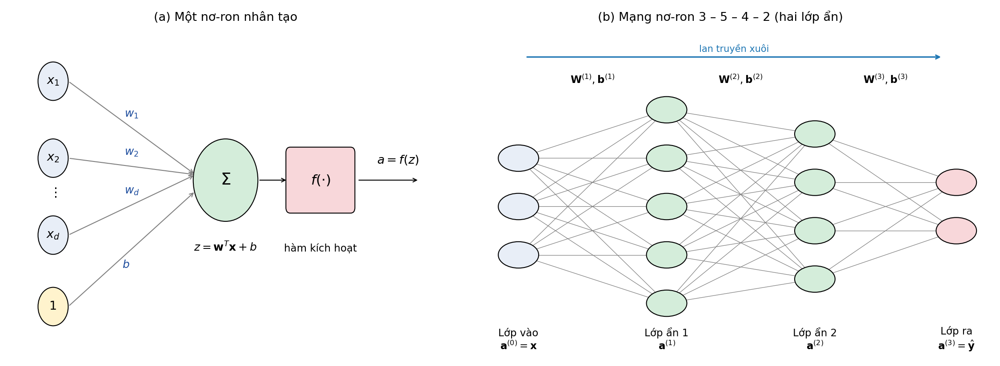
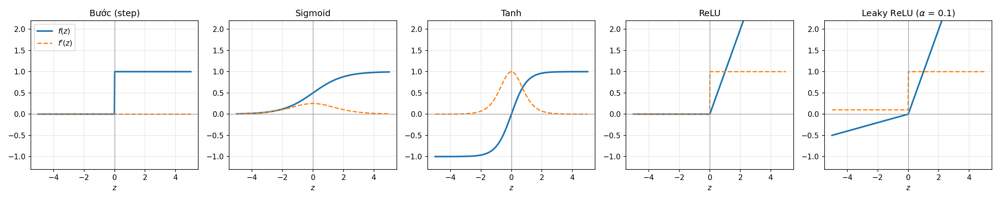
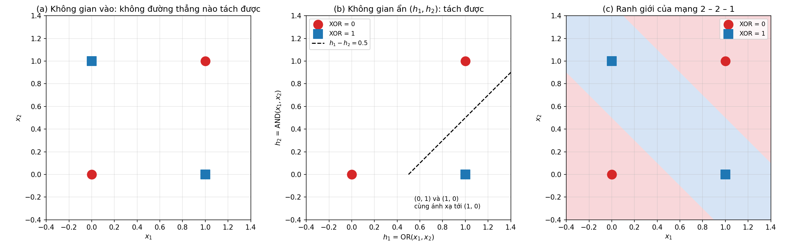
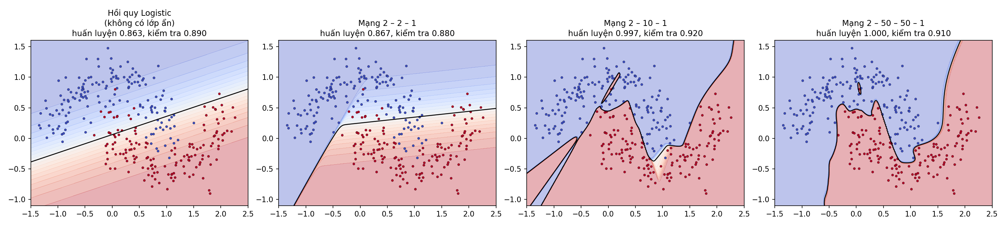
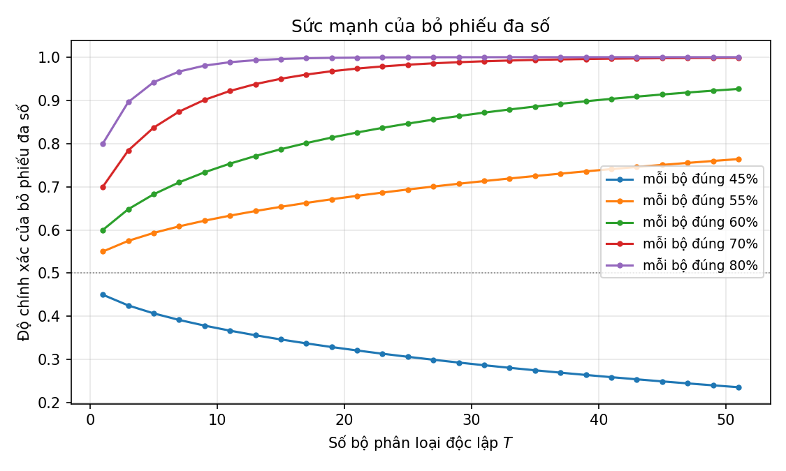
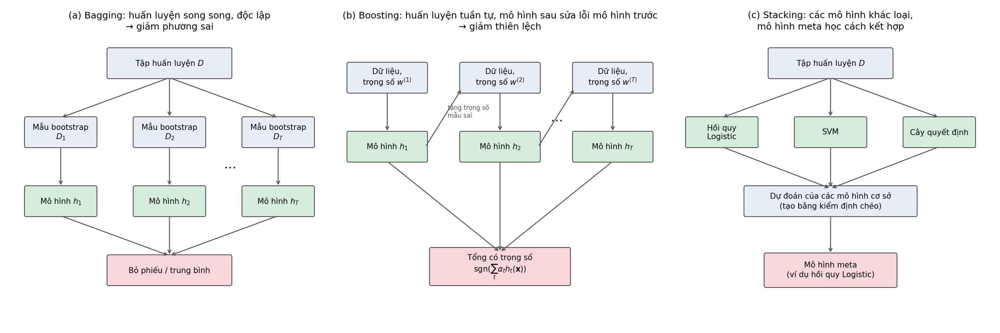
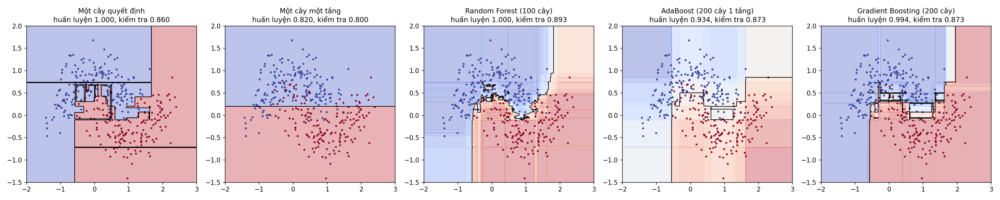
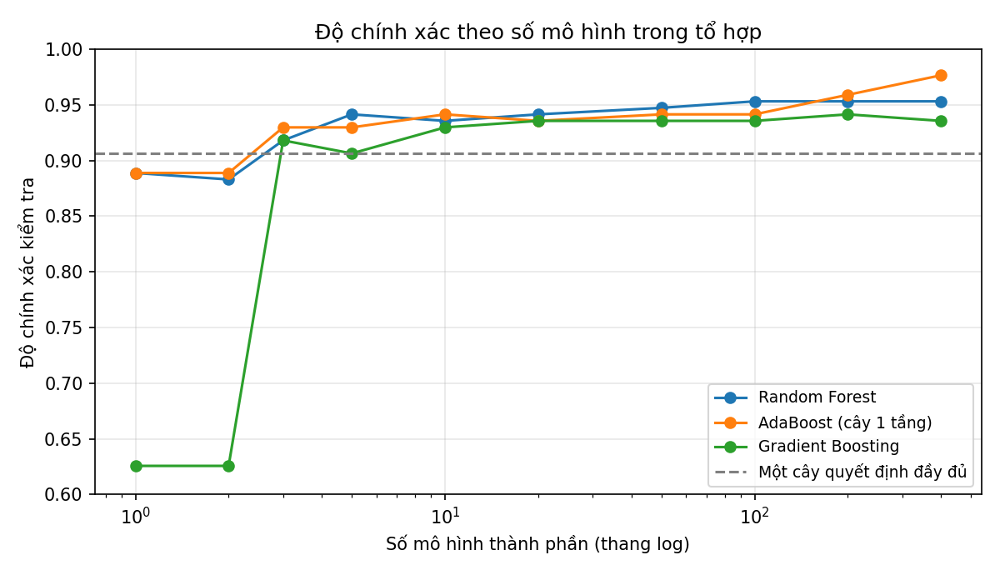

<style>
pre, pre code { font-size: 16px !important; line-height: 1.5 !important; }
</style>

# Bài 9. Mạng nơ-ron nhân tạo và Học tổ hợp

> Tài liệu tham khảo: *Giáo trình Machine Learning 2026*, Lời nói đầu; Chương 13 – Mạng nơ-ron nhân tạo; Chương 14 – Một số dự án học máy tiêu biểu (Random Forest). Bagging, Boosting, Stacking chỉ có Random Forest trong giáo trình, phần còn lại tham khảo L. Breiman, *Bagging predictors*, Machine Learning, 1996; Y. Freund, R. Schapire, *A decision-theoretic generalization of on-line learning and an application to boosting*, 1997; J. Friedman, *Greedy function approximation: a gradient boosting machine*, 2001; D. Wolpert, *Stacked generalization*, 1992; I. Goodfellow, Y. Bengio, A. Courville, *Deep Learning*, MIT Press, 2016 và tài liệu scikit-learn (*Neural network models*, *Ensembles*).
>
> Mã nguồn demo: thư mục [codes/](codes/), các file đánh số theo thứ tự trình bày trong bài, mỗi notebook chạy độc lập từ đầu đến cuối (mở bằng Jupyter, thư mục hiện hành là `codes/`). Notebook dùng PyTorch cần cài thêm thư viện `torch`.
>
> Danh sách thư viện và phiên bản đã dùng: [requirements.txt](../requirements.txt).

- [9.1. Mạng nơ-ron nhân tạo ANN](#91-mạng-nơ-ron-nhân-tạo-ann)
- [9.2. Học tổ hợp (Ensemble Learning)](#92-học-tổ-hợp-ensemble-learning)
- [9.3. Kết luận](#93-kết-luận)
- [9.4. Câu hỏi ôn tập](#94-câu-hỏi-ôn-tập)

---

## 9.1. Mạng nơ-ron nhân tạo ANN

### 9.1.1. Giới thiệu học sâu và vai trò của mạng nơ-ron trong Học máy hiện đại

#### a) Mạng nơ-ron nhân tạo

**Mạng nơ-ron nhân tạo** (Artificial Neural Network – ANN) là mô hình học máy lấy cảm hứng từ hệ thần kinh sinh học: não người có khoảng $10^{11}$ nơ-ron, mỗi nơ-ron nhận tín hiệu từ các nơ-ron khác qua sợi nhánh, tổng hợp lại và "phát" tín hiệu qua sợi trục khi đủ mạnh. Nơ-ron nhân tạo mô phỏng rất đơn giản quá trình này: nhận các đầu vào, tính tổng có trọng số, đưa qua một hàm kích hoạt. Ghép nhiều nơ-ron thành các lớp ta được một mạng.

Về mặt toán học, mạng nơ-ron là một **hàm số có tham số** $\hat{\mathbf{y}} = f(\mathbf{x}; \boldsymbol{\theta})$ ánh xạ đầu vào $\mathbf{x}$ tới đầu ra (giáo trình, Chương 13), được học bằng cách tối ưu hàm mất mát với Gradient Descent (Bài 5). Hồi quy tuyến tính, hồi quy Logistic và Perceptron (Bài 3, Bài 4) chính là các mạng nơ-ron một nơ-ron.

#### b) Học sâu

**Học sâu** (Deep Learning) là nhánh của học máy dùng mạng nơ-ron có **nhiều lớp ẩn** ("sâu"). Quan hệ: Trí tuệ nhân tạo ⊃ Học máy ⊃ Học sâu (Bài 1).

Khác biệt cốt lõi giữa học máy truyền thống và học sâu nằm ở **đặc trưng**:

| | Học máy truyền thống | Học sâu |
|---|---|---|
| Đặc trưng | Con người thiết kế thủ công (Bài 2: diện tích, số phòng; mô-men lực ở Bài 6) | Mạng **tự học** biểu diễn từ dữ liệu thô (pixel, ký tự, tín hiệu âm thanh) |
| Dữ liệu | Hiệu quả với dữ liệu nhỏ, vừa, dạng bảng | Cần nhiều dữ liệu; vượt trội với ảnh, văn bản, âm thanh |
| Tính toán | CPU là đủ | Thường cần GPU |
| Giải thích | Thường dễ hơn (cây quyết định, hệ số tuyến tính) | Khó giải thích ("hộp đen") |

Các lớp ẩn tạo ra các **biểu diễn trung gian**: ví dụ với ảnh, lớp đầu học các cạnh, góc; lớp sau ghép thành hoa văn, bộ phận (mắt, bánh xe); lớp cuối nhận ra đối tượng. Khả năng tự học đặc trưng phân cấp này giúp học sâu thay thế khâu thiết kế đặc trưng thủ công vốn tốn nhiều công sức.

#### c) Lịch sử và vai trò hiện nay

| Năm | Sự kiện |
|---|---|
| 1943 | McCulloch và Pitts đề xuất mô hình toán học của nơ-ron |
| 1958 | Rosenblatt đề xuất Perceptron và thuật toán PLA (Bài 4) |
| 1969 | Minsky và Papert chỉ ra Perceptron một lớp không giải được bài toán XOR (mục 9.1.2), nghiên cứu mạng nơ-ron chững lại |
| 1986 | Rumelhart, Hinton, Williams phổ biến thuật toán **lan truyền ngược** để huấn luyện mạng nhiều lớp (mục 9.1.3) |
| 1998 | LeCun dùng mạng tích chập (CNN) nhận dạng chữ số viết tay |
| 2012 | AlexNet (CNN huấn luyện trên GPU) thắng cách biệt cuộc thi ImageNet, mở đầu kỷ nguyên học sâu |
| 2017 – nay | Kiến trúc Transformer; các mô hình ngôn ngữ lớn, mô hình sinh ảnh |

Học sâu bùng nổ nhờ ba yếu tố: **dữ liệu lớn** (Internet, cảm biến), **phần cứng mạnh** (GPU), và **cải tiến thuật toán** (ReLU, khởi tạo trọng số tốt, Batch Normalization, Adam, …). Ngày nay mạng nơ-ron là nền tảng của hầu hết các hệ thống AI tiên tiến:
- **Thị giác máy tính** (CV): phân loại ảnh, phát hiện đối tượng, nhận dạng khuôn mặt, ảnh y tế, xe tự lái (mạng tích chập CNN).
- **Xử lý ngôn ngữ tự nhiên** (NLP): dịch máy, chatbot, tóm tắt văn bản, mô hình ngôn ngữ lớn (Transformer).
- Nhận dạng giọng nói, hệ thống gợi ý, sinh ảnh, âm nhạc, dự đoán cấu trúc protein, …

Tuy vậy, với dữ liệu dạng bảng, kích thước vừa phải, các mô hình truyền thống như học tổ hợp cây quyết định (mục 9.2) vẫn thường cho kết quả tốt ngang hoặc hơn mạng nơ-ron mà nhanh và dễ dùng hơn.

---

### 9.1.2. Cấu trúc mạng nơ-ron cơ bản: lớp vào, lớp ẩn, lớp ra và hàm kích hoạt

#### a) Nơ-ron nhân tạo

Một nơ-ron nhận $d$ đầu vào $\mathbf{x} = (x_1, \dots, x_d)$, mỗi đầu vào có một **trọng số** $w_i$, cộng thêm **hệ số tự do** (bias) $b$, rồi đưa qua **hàm kích hoạt** $f$:

$$
z = \sum_{i=1}^{d} w_i x_i + b = \mathbf{w}^T\mathbf{x} + b, \qquad a = f(z)
$$

$z$ là tổng có trọng số (net input), $a$ là đầu ra (activation) của nơ-ron. Bias đóng vai trò dịch chuyển ranh giới quyết định, tương tự hệ số $w_0$ trong hồi quy tuyến tính (giáo trình viết dạng ngưỡng $\theta = -b$).

- $f$ là hàm bước: nơ-ron là **Perceptron** (Bài 4).
- $f$ là sigmoid: nơ-ron là **hồi quy Logistic** (Bài 4).
- $f(z) = z$: nơ-ron là **hồi quy tuyến tính** (Bài 3).



*Hình 9.1: (a) Mô hình một nơ-ron nhân tạo. (b) Mạng nơ-ron truyền thẳng gồm lớp vào 3 nút, hai lớp ẩn 5 và 4 nơ-ron, lớp ra 2 nơ-ron; mỗi nơ-ron nối với mọi nơ-ron của lớp kế tiếp. Mã nguồn vẽ hình: [images/plot_neural_network.py](images/plot_neural_network.py).*

#### b) Kiến trúc mạng: lớp vào, lớp ẩn, lớp ra

Các nơ-ron được xếp thành các **lớp** (layer). Trong **mạng truyền thẳng** (feedforward network), còn gọi là **Perceptron nhiều lớp** (Multilayer Perceptron – MLP), tín hiệu đi một chiều từ lớp vào tới lớp ra, mỗi nơ-ron của một lớp nối với mọi nơ-ron của lớp kế tiếp (kết nối đầy đủ – fully connected).

- **Lớp vào** (input layer): nhận dữ liệu, mỗi nút ứng với một đặc trưng; không tính toán gì. Ví dụ ảnh $8 \times 8$ pixel có 64 nút vào.
- **Lớp ẩn** (hidden layers): các lớp ở giữa, biến đổi dữ liệu thành biểu diễn mới, trích xuất đặc trưng. Số lớp ẩn và số nơ-ron mỗi lớp là **siêu tham số** do người thiết kế chọn. Mạng có từ hai lớp ẩn trở lên thường được gọi là mạng sâu.
- **Lớp ra** (output layer): cho kết quả dự đoán. Số nơ-ron và hàm kích hoạt ở lớp ra phụ thuộc bài toán:

| Bài toán | Số nơ-ron lớp ra | Hàm kích hoạt lớp ra | Hàm mất mát |
|---|---|---|---|
| Hồi quy | 1 (hoặc số đại lượng cần dự đoán) | Tuyến tính $f(z) = z$ | MSE |
| Phân loại nhị phân | 1 | Sigmoid (xác suất lớp dương) | Cross-entropy nhị phân |
| Phân loại $K$ lớp | $K$ | Softmax (phân phối xác suất trên $K$ lớp) | Cross-entropy |

**Ký hiệu.** Mạng có $L$ lớp (không kể lớp vào), lớp $l$ có $n_l$ nơ-ron. Lớp $l$ có ma trận trọng số $\mathbf{W}^{(l)}$ kích thước $n_l \times n_{l-1}$ (phần tử $w^{(l)}_{ji}$ là trọng số từ nơ-ron $i$ của lớp $l-1$ tới nơ-ron $j$ của lớp $l$) và vector bias $\mathbf{b}^{(l)} \in \mathbb{R}^{n_l}$. Số tham số của lớp $l$ là $n_l \times n_{l-1} + n_l$. Ví dụ mạng 64 – 64 – 10 nhận dạng chữ số ở mục 9.1.3 có $64 \times 64 + 64 + 64 \times 10 + 10 = 4810$ tham số.

#### c) Hàm kích hoạt

| Hàm | Công thức | Đạo hàm | Miền giá trị | Ghi chú |
|---|---|---|---|---|
| Bước (step) | $f(z) = 1$ nếu $z \ge 0$, ngược lại 0 | 0 (không khả vi tại 0) | $\{0, 1\}$ | Perceptron cổ điển; không dùng được với Gradient Descent |
| Sigmoid | $\sigma(z) = \dfrac{1}{1 + e^{-z}}$ | $\sigma(z)(1 - \sigma(z))$ | $(0, 1)$ | Lớp ra phân loại nhị phân; dễ bão hòa |
| Tanh | $\tanh(z) = \dfrac{e^z - e^{-z}}{e^z + e^{-z}}$ | $1 - \tanh^2(z)$ | $(-1, 1)$ | Đối xứng quanh 0, thường hội tụ nhanh hơn sigmoid |
| ReLU | $\max(0, z)$ | 1 nếu $z > 0$, 0 nếu $z < 0$ | $[0, +\infty)$ | Mặc định cho lớp ẩn của mạng hiện đại; tính rất nhanh |
| Leaky ReLU | $z$ nếu $z \ge 0$, $\alpha z$ nếu $z < 0$ ($\alpha \approx 0.01$) | 1 hoặc $\alpha$ | $\mathbb{R}$ | Tránh nơ-ron "chết" của ReLU |
| Softmax | $\text{softmax}(\mathbf{z})_k = \dfrac{e^{z_k}}{\sum_{j=1}^{K}e^{z_j}}$ | – | $(0, 1)$, tổng bằng 1 | Lớp ra phân loại nhiều lớp |



*Hình 9.2: Các hàm kích hoạt (nét liền) và đạo hàm (nét đứt). Mã nguồn vẽ hình: [images/plot_activation_functions.py](images/plot_activation_functions.py).*

*Ví dụ softmax:* điểm số $\mathbf{z} = (2, 1, 0.1)$ cho xác suất $(0.659, 0.242, 0.099)$; lớp có điểm cao nhất có xác suất lớn nhất, các xác suất cộng lại bằng 1. Khi cài đặt, trừ $\max_j z_j$ trước khi lấy mũ để tránh tràn số (kết quả không đổi).

**Vì sao cần hàm kích hoạt phi tuyến?** Nếu bỏ hàm kích hoạt (hoặc dùng hàm tuyến tính), hai lớp liên tiếp cho

$$
\mathbf{W}^{(2)}(\mathbf{W}^{(1)}\mathbf{x} + \mathbf{b}^{(1)}) + \mathbf{b}^{(2)} = \underbrace{(\mathbf{W}^{(2)}\mathbf{W}^{(1)})}_{\mathbf{W}'}\mathbf{x} + \underbrace{(\mathbf{W}^{(2)}\mathbf{b}^{(1)} + \mathbf{b}^{(2)})}_{\mathbf{b}'}
$$

tức chỉ là **một** phép biến đổi tuyến tính: mạng bao nhiêu lớp cũng không mạnh hơn hồi quy tuyến tính. Hàm kích hoạt phi tuyến giúp mạng biểu diễn được các quan hệ phi tuyến phức tạp. Định lý xấp xỉ vạn năng (universal approximation) khẳng định mạng chỉ với một lớp ẩn đủ nhiều nơ-ron và hàm kích hoạt phi tuyến có thể xấp xỉ mọi hàm liên tục trên miền đóng, bị chặn với độ chính xác tùy ý.

*Mã nguồn: [codes/01_activation_functions.ipynb](codes/01_activation_functions.ipynb).*

#### d) Ví dụ: bài toán XOR

Hàm XOR cho 1 khi đúng một trong hai đầu vào bằng 1. Bốn điểm $(0, 0), (1, 1)$ (nhãn 0) và $(0, 1), (1, 0)$ (nhãn 1) **không tách được tuyến tính**: mọi đường thẳng chỉ phân loại đúng tối đa 3/4 điểm, nên Perceptron một lớp không giải được (thử với `Perceptron` của scikit-learn chỉ đạt 50%).

Mạng 2 – 2 – 1 với hàm bước giải được, với trọng số chọn tay:
- Nơ-ron ẩn 1 tính OR: $h_1 = f(x_1 + x_2 - 0.5)$.
- Nơ-ron ẩn 2 tính AND: $h_2 = f(x_1 + x_2 - 1.5)$.
- Nơ-ron ra tính "OR nhưng không AND": $\hat{y} = f(h_1 - h_2 - 0.5)$.

Tức $\mathbf{W}^{(1)} = \begin{bmatrix}1 & 1\\ 1 & 1\end{bmatrix}$, $\mathbf{b}^{(1)} = \begin{bmatrix}-0.5\\ -1.5\end{bmatrix}$, $\mathbf{W}^{(2)} = \begin{bmatrix}1 & -1\end{bmatrix}$, $b^{(2)} = -0.5$.

| $x_1$ | $x_2$ | $\mathbf{z}^{(1)}$ | $\mathbf{h} = (h_1, h_2)$ | $z^{(2)}$ | $\hat{y}$ | XOR |
|---|---|---|---|---|---|---|
| 0 | 0 | $(-0.5, -1.5)$ | $(0, 0)$ | $-0.5$ | 0 | 0 |
| 0 | 1 | $(0.5, -0.5)$ | $(1, 0)$ | $0.5$ | 1 | 1 |
| 1 | 0 | $(0.5, -0.5)$ | $(1, 0)$ | $0.5$ | 1 | 1 |
| 1 | 1 | $(1.5, 0.5)$ | $(1, 1)$ | $-0.5$ | 0 | 0 |



*Hình 9.3: (a) XOR không tách được tuyến tính trong không gian vào. (b) Lớp ẩn ánh xạ bốn điểm sang không gian $(h_1, h_2)$, ở đó một đường thẳng tách được hai lớp. (c) Ranh giới quyết định của cả mạng trong không gian vào là một dải. Mã nguồn vẽ hình: [images/plot_xor.py](images/plot_xor.py).*

Đây là ý nghĩa của lớp ẩn: **biến đổi dữ liệu sang một biểu diễn mới**, nơi bài toán trở nên đơn giản (tách được tuyến tính) với lớp sau. Trong thực tế ta không chọn trọng số bằng tay mà học chúng từ dữ liệu bằng lan truyền ngược.

*Mã nguồn: [codes/02_xor_forward.ipynb](codes/02_xor_forward.ipynb).*

---

### 9.1.3. Lan truyền xuôi và lan truyền ngược (backpropagation)

#### a) Lan truyền xuôi (forward propagation)

Tính đầu ra của mạng bằng cách truyền tín hiệu lần lượt từ lớp vào qua các lớp ẩn tới lớp ra. Đặt $\mathbf{a}^{(0)} = \mathbf{x}$, với $l = 1, 2, \dots, L$:

$$
\mathbf{z}^{(l)} = \mathbf{W}^{(l)}\mathbf{a}^{(l-1)} + \mathbf{b}^{(l)}, \qquad \mathbf{a}^{(l)} = f^{(l)}(\mathbf{z}^{(l)})
$$

Đầu ra của mạng là $\hat{\mathbf{y}} = \mathbf{a}^{(L)}$. Với cả tập dữ liệu, xếp $N$ mẫu thành các hàng của ma trận $\mathbf{X}$ ($N \times d$) thì $\mathbf{Z}^{(l)} = \mathbf{A}^{(l-1)}\mathbf{W}^{(l)T} + \mathbf{b}^{(l)}$: chỉ cần các phép nhân ma trận, rất hiệu quả trên GPU.

#### b) Hàm mất mát và bài toán tối ưu

Huấn luyện là tìm tham số $\boldsymbol{\theta} = \{\mathbf{W}^{(l)}, \mathbf{b}^{(l)}\}$ cực tiểu hàm mất mát trung bình trên tập huấn luyện:

$$
J(\boldsymbol{\theta}) = \frac{1}{N}\sum_{i=1}^{N}\mathcal{L}(\mathbf{y}_i, \hat{\mathbf{y}}_i)
$$

với MSE $\mathcal{L} = \frac{1}{2}(y - \hat{y})^2$ cho hồi quy, cross-entropy $\mathcal{L} = -[y\ln\hat{y} + (1 - y)\ln(1 - \hat{y})]$ cho phân loại nhị phân, $\mathcal{L} = -\sum_k y_k\ln\hat{y}_k$ cho phân loại nhiều lớp (Bài 4). Khác với hồi quy tuyến tính hay Logistic, hàm mất mát của mạng nơ-ron **không lồi**, không có nghiệm giải tích; ta dùng Gradient Descent (Bài 5):

$$
\mathbf{W}^{(l)} \leftarrow \mathbf{W}^{(l)} - \eta\,\frac{\partial J}{\partial \mathbf{W}^{(l)}}, \qquad \mathbf{b}^{(l)} \leftarrow \mathbf{b}^{(l)} - \eta\,\frac{\partial J}{\partial \mathbf{b}^{(l)}}
$$

Vấn đề là tính các đạo hàm riêng theo **hàng nghìn đến hàng tỉ** tham số nằm ở các lớp khác nhau. **Lan truyền ngược** giải quyết việc này một cách hiệu quả.

#### c) Lan truyền ngược (backpropagation)

Ý tưởng: áp dụng **quy tắc đạo hàm hàm hợp** (chain rule) từ lớp ra ngược về lớp vào, tái sử dụng các kết quả trung gian. Định nghĩa **sai số** (error) tại lớp $l$ là đạo hàm của hàm mất mát theo $\mathbf{z}^{(l)}$:

$$
\boldsymbol{\delta}^{(l)} = \frac{\partial \mathcal{L}}{\partial \mathbf{z}^{(l)}}
$$

**Bước 1 – sai số ở lớp ra.** Với lớp ra sigmoid và cross-entropy (hoặc softmax và cross-entropy, hoặc lớp ra tuyến tính và MSE), công thức rất gọn:

$$
\boldsymbol{\delta}^{(L)} = \mathbf{a}^{(L)} - \mathbf{y} = \hat{\mathbf{y}} - \mathbf{y}
$$

(chứng minh như gradient của hồi quy Logistic ở Bài 4: $\frac{\partial \mathcal{L}}{\partial \hat{y}} = \frac{\hat{y} - y}{\hat{y}(1 - \hat{y})}$ và $\frac{\partial \hat{y}}{\partial z} = \hat{y}(1 - \hat{y})$).

**Bước 2 – lan truyền sai số ngược về các lớp trước.** Vì $\mathbf{z}^{(l+1)} = \mathbf{W}^{(l+1)}f(\mathbf{z}^{(l)}) + \mathbf{b}^{(l+1)}$, theo quy tắc hàm hợp:

$$
\boldsymbol{\delta}^{(l)} = \big(\mathbf{W}^{(l+1)}\big)^T\boldsymbol{\delta}^{(l+1)} \odot f'(\mathbf{z}^{(l)}), \qquad l = L-1, \dots, 1
$$

trong đó $\odot$ là phép nhân từng phần tử. Mỗi nơ-ron ở lớp $l$ nhận một phần sai số của các nơ-ron lớp $l+1$, theo tỉ lệ trọng số nối giữa chúng, rồi nhân với độ dốc của hàm kích hoạt tại chính nó.

**Bước 3 – gradient theo tham số.** Vì $\mathbf{z}^{(l)} = \mathbf{W}^{(l)}\mathbf{a}^{(l-1)} + \mathbf{b}^{(l)}$:

$$
\frac{\partial \mathcal{L}}{\partial \mathbf{W}^{(l)}} = \boldsymbol{\delta}^{(l)}\big(\mathbf{a}^{(l-1)}\big)^T, \qquad \frac{\partial \mathcal{L}}{\partial \mathbf{b}^{(l)}} = \boldsymbol{\delta}^{(l)}
$$

tức $\frac{\partial \mathcal{L}}{\partial w^{(l)}_{ji}} = \delta^{(l)}_j\,a^{(l-1)}_i$: gradient của một trọng số bằng sai số ở đầu ra của cạnh nhân với tín hiệu ở đầu vào của cạnh.

> **Thuật toán huấn luyện mạng nơ-ron**
> 1. Khởi tạo các trọng số bằng giá trị ngẫu nhiên nhỏ (không khởi tạo tất cả bằng 0, vì khi đó mọi nơ-ron trong một lớp học giống hệt nhau), bias bằng 0.
> 2. Lặp qua các epoch, với mỗi mini-batch (Bài 5):
>    - **Lan truyền xuôi:** tính $\mathbf{z}^{(l)}, \mathbf{a}^{(l)}$ cho mọi lớp và hàm mất mát.
>    - **Lan truyền ngược:** tính $\boldsymbol{\delta}^{(L)}$, rồi $\boldsymbol{\delta}^{(L-1)}, \dots, \boldsymbol{\delta}^{(1)}$ và các gradient.
>    - **Cập nhật** $\mathbf{W}^{(l)}, \mathbf{b}^{(l)}$ bằng Gradient Descent (hoặc các biến thể như Adam).
> 3. Dừng khi hàm mất mát hội tụ hoặc đạt số epoch tối đa.

Chi phí lan truyền ngược chỉ cỡ chi phí lan truyền xuôi, thay vì phải tính riêng từng đạo hàm riêng. Các thư viện học sâu (PyTorch, TensorFlow) cài đặt sẵn cơ chế này dưới tên **tự động tính đạo hàm** (automatic differentiation).

#### d) Ví dụ tính tay

Mạng 2 – 2 – 1, lớp ẩn và lớp ra dùng sigmoid, hàm mất mát cross-entropy. Một mẫu $\mathbf{x} = (1, 2)$, nhãn $y = 1$, tốc độ học $\eta = 0.5$. Tham số ban đầu:

$$
\mathbf{W}^{(1)} = \begin{bmatrix}0.1 & 0.2\\ -0.3 & 0.4\end{bmatrix}, \quad \mathbf{b}^{(1)} = \begin{bmatrix}0\\ 0.1\end{bmatrix}, \quad \mathbf{W}^{(2)} = \begin{bmatrix}0.5 & -0.6\end{bmatrix}, \quad b^{(2)} = 0.2
$$

**Lan truyền xuôi:**

$$
\mathbf{z}^{(1)} = \begin{bmatrix}0.1 \cdot 1 + 0.2 \cdot 2 + 0\\ -0.3 \cdot 1 + 0.4 \cdot 2 + 0.1\end{bmatrix} = \begin{bmatrix}0.5\\ 0.6\end{bmatrix}, \qquad
\mathbf{a}^{(1)} = \sigma(\mathbf{z}^{(1)}) = \begin{bmatrix}0.6225\\ 0.6457\end{bmatrix}
$$

$$
z^{(2)} = 0.5 \times 0.6225 - 0.6 \times 0.6457 + 0.2 = 0.1238, \qquad \hat{y} = \sigma(0.1238) = 0.5309, \qquad \mathcal{L} = -\ln 0.5309 = 0.6331
$$

**Lan truyền ngược:**

$$
\delta^{(2)} = \hat{y} - y = 0.5309 - 1 = -0.4691
$$

$$
\frac{\partial \mathcal{L}}{\partial \mathbf{W}^{(2)}} = \delta^{(2)}(\mathbf{a}^{(1)})^T = \begin{bmatrix}-0.2920 & -0.3029\end{bmatrix}, \qquad \frac{\partial \mathcal{L}}{\partial b^{(2)}} = -0.4691
$$

Sai số lớp ẩn, với $\sigma'(z) = a(1 - a)$, $a^{(1)}_1(1 - a^{(1)}_1) = 0.2350$, $a^{(1)}_2(1 - a^{(1)}_2) = 0.2288$:

$$
\boldsymbol{\delta}^{(1)} = (\mathbf{W}^{(2)})^T\delta^{(2)} \odot \sigma'(\mathbf{z}^{(1)}) = \begin{bmatrix}0.5 \times (-0.4691) \times 0.2350\\ -0.6 \times (-0.4691) \times 0.2288\end{bmatrix} = \begin{bmatrix}-0.0551\\ 0.0644\end{bmatrix}
$$

$$
\frac{\partial \mathcal{L}}{\partial \mathbf{W}^{(1)}} = \boldsymbol{\delta}^{(1)}\mathbf{x}^T = \begin{bmatrix}-0.0551 & -0.1102\\ 0.0644 & 0.1288\end{bmatrix}, \qquad \frac{\partial \mathcal{L}}{\partial \mathbf{b}^{(1)}} = \begin{bmatrix}-0.0551\\ 0.0644\end{bmatrix}
$$

**Cập nhật** ($\mathbf{W} \leftarrow \mathbf{W} - 0.5 \times$ gradient):

$$
\mathbf{W}^{(2)} = \begin{bmatrix}0.6460 & -0.4486\end{bmatrix}, \quad b^{(2)} = 0.4345, \quad
\mathbf{W}^{(1)} = \begin{bmatrix}0.1276 & 0.2551\\ -0.3322 & 0.3356\end{bmatrix}, \quad \mathbf{b}^{(1)} = \begin{bmatrix}0.0276\\ 0.0678\end{bmatrix}
$$

Sau một bước, $\hat{y}$ tăng từ 0.5309 lên 0.6438 (gần nhãn $y = 1$ hơn), mất mát giảm từ 0.6331 xuống 0.4404. Notebook kiểm tra gradient bằng đạo hàm số (Bài 5): sai lệch chỉ khoảng $10^{-10}$.

#### e) Cài đặt bằng NumPy

Mạng 2 – $H$ – 1 (lớp ẩn ReLU, lớp ra sigmoid) trên dữ liệu hai nửa vầng trăng (400 điểm), huấn luyện bằng Batch Gradient Descent:

```python
import numpy as np

def sigmoid(z):
    return 1 / (1 + np.exp(-z))

def relu(z):
    return np.maximum(0, z)

def train_mlp(X, y, hidden=10, eta=0.5, epochs=3000, seed=0):
    rng = np.random.default_rng(seed)
    N, d = X.shape
    W1 = rng.normal(0, np.sqrt(2 / d), size=(hidden, d))       # khởi tạo He cho lớp ReLU
    b1 = np.zeros(hidden)
    W2 = rng.normal(0, np.sqrt(1 / hidden), size=(1, hidden))
    b2 = np.zeros(1)
    Y = y.reshape(-1, 1)
    for epoch in range(epochs):
        # Lan truyền xuôi
        Z1 = X @ W1.T + b1
        A1 = relu(Z1)
        A2 = sigmoid(A1 @ W2.T + b2)
        # Lan truyền ngược
        delta2 = (A2 - Y) / N                     # sai số lớp ra (chia N: gradient trung bình)
        dW2, db2 = delta2.T @ A1, delta2.sum(axis=0)
        delta1 = (delta2 @ W2) * (Z1 > 0)         # ReLU'(z) = 1 nếu z > 0
        dW1, db1 = delta1.T @ X, delta1.sum(axis=0)
        # Cập nhật trọng số
        W1 -= eta * dW1; b1 -= eta * db1
        W2 -= eta * dW2; b2 -= eta * db2
    return W1, b1, W2, b2
```

Với 10 nơ-ron ẩn, cross-entropy giảm từ 0.613 (epoch 1) xuống 0.264 (epoch 100) và 0.064 (epoch 3000); độ chính xác huấn luyện 0.970, kiểm tra 0.950, so với hồi quy Logistic (không có lớp ẩn) chỉ đạt 0.890.

| Mô hình | Hồi quy Logistic | 1 nơ-ron ẩn | 5 nơ-ron ẩn | 10 nơ-ron ẩn | 50 nơ-ron ẩn |
|---|---|---|---|---|---|
| Độ chính xác kiểm tra | 0.890 | 0.900 | 0.880 | **0.950** | **0.950** |



*Hình 9.4: Ranh giới quyết định (đường đen) và xác suất dự đoán của hồi quy Logistic và các mạng có số nơ-ron ẩn khác nhau (hàm kích hoạt tanh, huấn luyện bằng scikit-learn). Càng nhiều nơ-ron, ranh giới càng linh hoạt; mạng quá lớn có thể quá khớp. Mã nguồn vẽ hình: [images/plot_mlp_moons.py](images/plot_mlp_moons.py).*

*Mã nguồn: [codes/03_backpropagation_numpy.ipynb](codes/03_backpropagation_numpy.ipynb).*

#### f) Mạng nơ-ron với scikit-learn và PyTorch

**scikit-learn.** `MLPClassifier` (phân loại) và `MLPRegressor` (hồi quy) cài đặt mạng truyền thẳng, huấn luyện bằng lan truyền ngược với thuật toán tối ưu `adam` (mặc định), `sgd` hoặc `lbfgs`. Ví dụ nhận dạng chữ số viết tay (`load_digits`: 1797 ảnh $8 \times 8$, 10 lớp):

```python
from sklearn.neural_network import MLPClassifier
from sklearn.pipeline import make_pipeline
from sklearn.preprocessing import StandardScaler

model = make_pipeline(StandardScaler(),
                      MLPClassifier(hidden_layer_sizes=(64,), activation='relu', solver='adam',
                                    learning_rate_init=0.001, max_iter=300, random_state=0))
model.fit(X_train, y_train)
print(model.score(X_test, y_test))     # 0.9733
```

Mạng 64 – 64 – 10 (4810 tham số) hội tụ sau 172 epoch, đạt độ chính xác kiểm tra 97.3%. Ảnh hưởng của kiến trúc:

| Lớp ẩn | Số tham số | Huấn luyện | Kiểm tra |
|---|---|---|---|
| (5,) | 385 | 0.9911 | 0.9000 |
| (16,) | 1 210 | 1.0000 | 0.9600 |
| (64,) | 4 810 | 1.0000 | 0.9733 |
| (256,) | 19 210 | 1.0000 | 0.9756 |
| (64, 32) | 6 570 | 1.0000 | 0.9644 |

Trong lần chia và khởi tạo này, mạng 5 nơ-ron đạt 99.11% trên train nhưng chỉ 90% trên test, cho thấy khoảng cách tổng quát hóa lớn. **Chưa đủ cơ sở kết luận mạng bị thiếu khả năng biểu diễn hoặc underfitting chỉ vì ít nơ-ron**, bởi nó đã khớp gần hết nhãn huấn luyện. Muốn chẩn đoán cần xem train/validation loss, điều kiện hội tụ và nhiều lần khởi tạo hoặc kiểm định chéo. Các mạng lớn hơn cho kết quả test cao hơn trong thí nghiệm này, nhưng mạng hai lớp ẩn không tự động tốt hơn. Để so sánh, trên cùng dữ liệu: hồi quy Logistic 0.9689, cây quyết định 0.8556, SVM RBF 0.9822. Các điểm test ở đây minh họa kết quả của cấu hình cố định; lựa chọn kiến trúc phải dựa trên validation/CV.

*Mã nguồn: [codes/04_mlp_sklearn.ipynb](codes/04_mlp_sklearn.ipynb).*

**PyTorch.** Theo giáo trình, mạng 4 – 10 – 8 – 3 (ReLU) phân loại hoa Iris. PyTorch tự động tính gradient: `loss.backward()` thực hiện lan truyền ngược, `optimizer.step()` cập nhật trọng số.

```python
import torch.nn as nn
import torch.optim as optim

class NeuralNetwork(nn.Module):
    def __init__(self):
        super().__init__()
        self.fc1 = nn.Linear(4, 10)          # lớp ẩn thứ nhất: z = W x + b
        self.fc2 = nn.Linear(10, 8)          # lớp ẩn thứ hai
        self.fc3 = nn.Linear(8, 3)           # lớp ra: 3 điểm số (softmax nằm trong hàm mất mát)
        self.relu = nn.ReLU()

    def forward(self, x):
        x = self.relu(self.fc1(x))
        x = self.relu(self.fc2(x))
        return self.fc3(x)

model = NeuralNetwork()
criterion = nn.CrossEntropyLoss()            # softmax + cross-entropy
optimizer = optim.Adam(model.parameters(), lr=0.01)
for epoch in range(100):
    loss = criterion(model(X_train), y_train)   # lan truyền xuôi
    optimizer.zero_grad()                       # xóa gradient cũ
    loss.backward()                             # lan truyền ngược
    optimizer.step()                            # cập nhật trọng số
```

Mạng có 165 tham số; mất mát giảm từ 0.627 (epoch 20) xuống 0.061 (epoch 100), độ chính xác kiểm tra 100% (30 mẫu).

*Mã nguồn: [codes/05_iris_pytorch.ipynb](codes/05_iris_pytorch.ipynb).*

#### g) Một số vấn đề khi huấn luyện mạng sâu

- **Vanishing gradient** (gradient tiêu biến): công thức $\boldsymbol{\delta}^{(l)} = (\mathbf{W}^{(l+1)})^T\boldsymbol{\delta}^{(l+1)} \odot f'(\mathbf{z}^{(l)})$ gồm cả ma trận trọng số và đạo hàm kích hoạt. Riêng tích của 10 đạo hàm sigmoid không vượt quá $0.25^{10} \approx 10^{-6}$; đây **không phải cận trên của gradient đầy đủ**, vì còn các ma trận trọng số và nhiều đường truyền. Khi tích các Jacobian có chuẩn nhỏ, gradient suy giảm mạnh và các lớp gần đầu vào học rất chậm.
- **Exploding gradient** (gradient bùng nổ): ngược lại, khi các thừa số lớn hơn 1, gradient tăng theo cấp số nhân, cập nhật quá lớn, huấn luyện mất ổn định.
- **Cách khắc phục** (giáo trình, Chương 13): dùng ReLU cho lớp ẩn (đạo hàm bằng 1 khi $z > 0$); khởi tạo trọng số hợp lý (Xavier: $\text{Var}(W) = \frac{2}{n_{in} + n_{out}}$; He cho ReLU: $\text{Var}(W) = \frac{2}{n_{in}}$); Batch Normalization; cắt gradient (gradient clipping); kết nối tắt (residual connection) như mạng ResNet.
- **Quá khớp**: mạng có rất nhiều tham số nên dễ quá khớp; dùng điều chuẩn L2 (`alpha` trong `MLPClassifier`, Bài 3), dropout, dừng sớm (early stopping), tăng dữ liệu.
- **Chuẩn hóa đặc trưng** đầu vào giúp Gradient Descent hội tụ nhanh hơn (Bài 5).

---

## 9.2. Học tổ hợp (Ensemble Learning)

### 9.2.1. Khái niệm học tổ hợp và các phương pháp chính: Bagging, Boosting, Stacking

#### a) Khái niệm

**Học tổ hợp** (ensemble learning) kết hợp dự đoán của **nhiều mô hình** (gọi là mô hình cơ sở, base learners) để được một mô hình dự đoán tốt hơn từng mô hình riêng lẻ. Ý tưởng giống "trí tuệ đám đông": hỏi ý kiến nhiều chuyên gia rồi tổng hợp thường đáng tin hơn nghe một người.

Cách kết hợp phổ biến:
- **Bỏ phiếu đa số** (majority voting, phân loại): $\hat{y} = \text{mode}\{h_1(\mathbf{x}), \dots, h_T(\mathbf{x})\}$ (giáo trình, Chương 14).
- **Trung bình** (hồi quy, hoặc trung bình xác suất trong phân loại): $\hat{y} = \frac{1}{T}\sum_{t=1}^{T}h_t(\mathbf{x})$.
- **Tổng có trọng số**: mô hình tốt hơn có trọng số lớn hơn.

**Vì sao kết hợp lại tốt hơn?** Giả sử có $T$ bộ phân loại nhị phân **độc lập**, mỗi bộ đúng với xác suất $p > 0.5$. Bỏ phiếu đa số đúng khi hơn một nửa số bộ đúng, xác suất theo phân phối nhị thức:

$$
P(\text{đa số đúng}) = \sum_{k > T/2}\binom{T}{k}p^k(1 - p)^{T-k}
$$

| Số bộ phân loại $T$ (mỗi bộ đúng 70%) | 1 | 3 | 5 | 11 | 25 | 101 |
|---|---|---|---|---|---|---|
| Độ chính xác của bỏ phiếu đa số | 0.700 | 0.784 | 0.837 | 0.922 | 0.983 | $\approx 1$ |



*Hình 9.5: Độ chính xác của bỏ phiếu đa số theo số bộ phân loại độc lập. Nếu mỗi bộ tốt hơn đoán ngẫu nhiên ($p > 0.5$), độ chính xác tăng dần tới 1; nếu $p < 0.5$, bỏ phiếu còn tệ hơn. Mã nguồn vẽ hình: [images/plot_majority_vote.py](images/plot_majority_vote.py).*

Hai điều kiện để học tổ hợp hiệu quả:
1. Mỗi mô hình cơ sở phải **tốt hơn đoán ngẫu nhiên**.
2. Các mô hình phải **đa dạng**, mắc lỗi khác nhau (trong thực tế không hoàn toàn độc lập vì cùng học từ một dữ liệu). Nếu các mô hình giống hệt nhau, bỏ phiếu không cải thiện gì.

Ba chiến lược tạo sự đa dạng và kết hợp: **Bagging**, **Boosting**, **Stacking**.



*Hình 9.6: Sơ đồ ba phương pháp học tổ hợp. Mã nguồn vẽ hình: [images/plot_ensemble_methods.py](images/plot_ensemble_methods.py).*

#### b) Bagging và Random Forest

**Bagging** (Bootstrap AGGregatING, L. Breiman, 1996):
1. Tạo $T$ **mẫu bootstrap** $D_1, \dots, D_T$: mỗi mẫu gồm $N$ phần tử chọn ngẫu nhiên **có hoàn lại** từ tập huấn luyện $N$ phần tử.
2. Huấn luyện **song song, độc lập** $T$ mô hình cùng loại $h_1, \dots, h_T$, mô hình $h_t$ trên $D_t$.
3. Kết hợp bằng bỏ phiếu (phân loại) hoặc trung bình (hồi quy).

Mỗi mẫu bootstrap chứa trung bình khoảng $1 - (1 - 1/N)^N \approx 1 - e^{-1} \approx 63.2\%$ số phần tử khác nhau của tập gốc (thử với $N = 1000$: 62.2%, 64.1%, 63.6%). Khoảng 36.8% còn lại gọi là mẫu **out-of-bag** (OOB), dùng để ước lượng độ chính xác của tổ hợp mà không cần tập kiểm tra riêng (điểm OOB).

Bagging hiệu quả với các mô hình có **phương sai cao** (thay đổi nhiều khi dữ liệu thay đổi), điển hình là cây quyết định đầy đủ (Bài 6): trung bình hóa nhiều mô hình "dao động" làm giảm phương sai mà không tăng thiên lệch. Trên dữ liệu ung thư vú (Bài 7, 30% làm tập kiểm tra), 5 cây huấn luyện trên 5 mẫu bootstrap đạt độ chính xác 0.906 – 0.936 và **không thống nhất** dự đoán trên 14.6% số mẫu kiểm tra; bỏ phiếu của chúng đạt 0.924.

**Random Forest** (rừng ngẫu nhiên, Breiman, 2001; giáo trình, Chương 14) là Bagging các cây quyết định, thêm một nguồn ngẫu nhiên nữa: **tại mỗi nút**, chỉ xét một **tập con ngẫu nhiên các đặc trưng** (thường $\sqrt{d}$ đặc trưng với phân loại) khi tìm phép chia. Nhờ đó các cây khác nhau hơn (giảm tương quan giữa các cây), bỏ phiếu hiệu quả hơn so với Bagging thuần.

```python
from sklearn.ensemble import BaggingClassifier, RandomForestClassifier
from sklearn.tree import DecisionTreeClassifier

tree = DecisionTreeClassifier(random_state=0).fit(X_train, y_train)
bagging = BaggingClassifier(DecisionTreeClassifier(), n_estimators=100, oob_score=True, random_state=0)
forest = RandomForestClassifier(n_estimators=100, max_features='sqrt', oob_score=True, random_state=0)
for model in [bagging, forest]:
    model.fit(X_train, y_train)
    print(model.score(X_test, y_test), model.oob_score_)
```

| Mô hình | Độ chính xác kiểm tra | Điểm OOB |
|---|---|---|
| Một cây quyết định | 0.9064 | – |
| Bagging 100 cây | 0.9357 | 0.9548 |
| Random Forest 100 cây | **0.9532** | 0.9698 |

Random Forest còn cho biết **độ quan trọng của đặc trưng** (`feature_importances_`): trung bình mức giảm độ vẩn đục do mỗi đặc trưng đóng góp trên mọi cây. Với dữ liệu ung thư vú, quan trọng nhất là `worst perimeter` (0.171), `worst radius` (0.128), `worst concave points` (0.108).

*Mã nguồn: [codes/06_bagging_random_forest.ipynb](codes/06_bagging_random_forest.ipynb).*

#### c) Boosting

**Boosting** huấn luyện các mô hình **tuần tự**: mô hình sau tập trung vào những mẫu mà các mô hình trước làm sai. Mô hình cơ sở thường là **mô hình yếu** (weak learner), chỉ tốt hơn đoán ngẫu nhiên một chút, ví dụ cây quyết định một tầng (decision stump). Boosting chủ yếu giảm **thiên lệch**: từ nhiều mô hình yếu tạo thành một mô hình mạnh.

**AdaBoost** (Adaptive Boosting, Freund và Schapire, 1997). Nhãn $y_i \in \{-1, +1\}$, mỗi mẫu có trọng số $w_i$, khởi tạo $w_i = 1/N$. Với $t = 1, \dots, T$:
1. Huấn luyện mô hình yếu $h_t$ trên dữ liệu có trọng số $w_i$.
2. Tính sai số có trọng số: $\varepsilon_t = \sum_{i:\,h_t(\mathbf{x}_i) \ne y_i} w_i$.
3. Tính trọng số của mô hình: $\alpha_t = \dfrac{1}{2}\ln\dfrac{1 - \varepsilon_t}{\varepsilon_t}$ ($\varepsilon_t$ càng nhỏ, $\alpha_t$ càng lớn).
4. Cập nhật trọng số mẫu: $w_i \leftarrow w_i\,e^{-\alpha_t y_i h_t(\mathbf{x}_i)}$ rồi chuẩn hóa để tổng bằng 1. Mẫu bị phân loại sai ($y_i h_t(\mathbf{x}_i) = -1$) được **tăng** trọng số, mẫu đúng bị giảm.

Dự đoán cuối: $H(\mathbf{x}) = \text{sgn}\left(\sum_{t=1}^{T}\alpha_t h_t(\mathbf{x})\right)$.

*Ví dụ tính tay:* 10 điểm một chiều $x = 0, 1, \dots, 9$ với nhãn $y = (+, +, +, -, -, -, +, +, +, -)$. Không ngưỡng đơn nào phân loại đúng hết.

| Vòng | Cây một tầng chọn được | Mẫu sai | $\varepsilon_t$ | $\alpha_t$ |
|---|---|---|---|---|
| 1 | $x \le 2.5 \Rightarrow +1$, ngược lại $-1$ | $x = 6, 7, 8$ | 0.300 | 0.424 |
| 2 | $x \le 8.5 \Rightarrow +1$, ngược lại $-1$ | $x = 3, 4, 5$ | 0.214 | 0.650 |
| 3 | $x \le 5.5 \Rightarrow -1$, ngược lại $+1$ | $x = 0, 1, 2, 9$ | 0.182 | 0.752 |

Vòng 1: mọi $w_i = 0.1$, ba mẫu sai nên $\varepsilon_1 = 0.3$, $\alpha_1 = \frac{1}{2}\ln\frac{0.7}{0.3} = 0.424$. Sau cập nhật và chuẩn hóa, ba mẫu sai có trọng số $0.167$, bảy mẫu đúng có $0.071$: vòng 2 buộc phải ưu tiên phân loại đúng $x = 6, 7, 8$. Mỗi cây một tầng chỉ đúng 70%, nhưng tổ hợp $H(x) = \text{sgn}(0.424h_1 + 0.650h_2 + 0.752h_3)$ phân loại **đúng cả 10 điểm**. Ví dụ tại $x = 0$: $0.424 + 0.650 - 0.752 = 0.322 > 0 \Rightarrow +1$.

**Gradient Boosting** (Friedman, 2001) tổng quát hóa ý tưởng cho hàm mất mát bất kỳ. Với hồi quy và MSE: bắt đầu từ dự đoán hằng $F_0 = \bar{y}$; ở vòng $t$, huấn luyện một cây nhỏ $h_t$ dự đoán **phần dư** $r_i = y_i - F_{t-1}(\mathbf{x}_i)$ (chính là hướng ngược gradient của MSE theo dự đoán), rồi cập nhật

$$
F_t(\mathbf{x}) = F_{t-1}(\mathbf{x}) + \nu\,h_t(\mathbf{x})
$$

với tốc độ học $\nu \in (0, 1]$. Mỗi cây sửa một phần sai số còn lại của các cây trước; đây là Gradient Descent trong "không gian hàm" (Bài 5). Ví dụ dữ liệu $y = \sin x$ có nhiễu, cây độ sâu 2, $\nu = 0.5$: MSE huấn luyện giảm từ 0.178 (1 cây) xuống 0.027 (5 cây), 0.015 (10 cây), 0.002 (50 cây). Các thư viện XGBoost, LightGBM, CatBoost là các cài đặt Gradient Boosting hiệu năng cao, thường thắng các cuộc thi với dữ liệu dạng bảng.

```python
from sklearn.ensemble import AdaBoostClassifier, GradientBoostingClassifier

ada = AdaBoostClassifier(DecisionTreeClassifier(max_depth=1), n_estimators=200, random_state=0)
gb = GradientBoostingClassifier(n_estimators=200, learning_rate=0.1, max_depth=3, random_state=0)
```

Trên dữ liệu ung thư vú: một cây một tầng đạt 0.889, AdaBoost 200 cây một tầng đạt **0.959**; Gradient Boosting 200 cây đạt 0.942 ($\nu = 0.1$) và 0.936 ($\nu = 1$).

*Mã nguồn: [codes/07_boosting.ipynb](codes/07_boosting.ipynb).*

#### d) Stacking và Voting

**Voting** kết hợp các mô hình **khác loại** (hồi quy Logistic, SVM, k-NN, cây quyết định, …) bằng bỏ phiếu nhãn (*hard voting*) hoặc trung bình xác suất (*soft voting*).

**Stacking** (xếp chồng, Wolpert, 1992) thay quy tắc kết hợp cố định bằng một **mô hình meta** (meta-learner) học cách kết hợp:
1. Huấn luyện các mô hình cơ sở khác loại trên tập huấn luyện.
2. Dùng dự đoán của các mô hình cơ sở làm **đặc trưng đầu vào** cho mô hình meta (thường là mô hình đơn giản như hồi quy Logistic). Để tránh quá khớp, các dự đoán này phải tạo bằng **kiểm định chéo**: dự đoán cho mỗi mẫu đến từ mô hình không được huấn luyện trên chính mẫu đó.
3. Mô hình meta học được nên tin mô hình cơ sở nào nhiều hơn, trong tình huống nào.

```python
from sklearn.ensemble import StackingClassifier, VotingClassifier
from sklearn.linear_model import LogisticRegression

voting = VotingClassifier(base_models, voting='soft')
stacking = StackingClassifier(estimators=base_models, final_estimator=LogisticRegression(), cv=5)
```

Với bốn mô hình cơ sở hồi quy Logistic (0.959), SVM (0.947), k-NN (0.947), cây quyết định độ sâu 4 (0.906) trên dữ liệu ung thư vú: hard voting 0.947, soft voting 0.942, stacking 0.953. Mô hình meta gán trọng số lớn cho SVM (2.85) và hồi quy Logistic (2.67), nhỏ nhất cho cây quyết định (1.24). Ở đây tổ hợp **không vượt** mô hình cơ sở tốt nhất: khi một mô hình đơn đã rất tốt và các mô hình còn lại kém hơn, kết hợp không chắc cải thiện.

*Mã nguồn: [codes/08_stacking_voting.ipynb](codes/08_stacking_voting.ipynb).*

#### e) So sánh ba phương pháp

| | Bagging (Random Forest) | Boosting (AdaBoost, Gradient Boosting) | Stacking |
|---|---|---|---|
| Cách huấn luyện | Song song, độc lập | Tuần tự, mô hình sau phụ thuộc mô hình trước | Mô hình cơ sở song song, sau đó mô hình meta |
| Mô hình cơ sở | Cùng loại, thường mạnh, phương sai cao (cây sâu) | Cùng loại, yếu (cây nông) | Khác loại |
| Tạo đa dạng | Mẫu bootstrap, tập con đặc trưng ngẫu nhiên | Trọng số mẫu, phần dư | Thuật toán khác nhau |
| Kết hợp | Bỏ phiếu, trung bình | Tổng có trọng số | Mô hình meta học cách kết hợp |
| Giảm chủ yếu | Phương sai | Thiên lệch (và phương sai) | Tùy mô hình cơ sở |
| Nguy cơ quá khớp | Thường giảm nhờ trung bình hóa; vẫn phụ thuộc độ sâu cây, cỡ lá và dữ liệu | Có thể quá khớp nếu quá nhiều vòng, cần chỉnh $\nu$, số cây | Cần kiểm định chéo cẩn thận |
| Song song hóa | Dễ | Khó (tuần tự) | Một phần |

---

### 9.2.2. So sánh mô hình đơn lẻ và mô hình tổ hợp về hiệu năng và khả năng tổng quát hóa

#### a) Thí nghiệm trên dữ liệu ung thư vú

So sánh bằng **kiểm định chéo lặp lại** (5 phần × 5 lần lặp = 25 lần huấn luyện cho mỗi mô hình): trung bình độ chính xác trên phần kiểm tra cho biết hiệu năng, độ lệch chuẩn cho biết độ ổn định.

```python
from sklearn.model_selection import RepeatedStratifiedKFold, cross_validate

cv = RepeatedStratifiedKFold(n_splits=5, n_repeats=5, random_state=0)
for name, model in models.items():
    result = cross_validate(model, X, y, cv=cv, return_train_score=True)
    print(name, result['train_score'].mean(), result['test_score'].mean(), result['test_score'].std())
```

| Mô hình | Huấn luyện | Kiểm tra (trung bình) | Kiểm tra (độ lệch chuẩn) | Thời gian huấn luyện (s) |
|---|---|---|---|---|
| Cây quyết định | 1.0000 | 0.9283 | 0.0196 | 0.005 |
| Hồi quy Logistic | 0.9885 | **0.9772** | 0.0153 | 0.006 |
| SVM RBF | 0.9873 | 0.9736 | 0.0131 | 0.005 |
| Bagging (100 cây) | 1.0000 | 0.9585 | 0.0178 | 0.41 |
| Random Forest (100 cây) | 1.0000 | 0.9599 | 0.0179 | 0.14 |
| AdaBoost (200 cây một tầng) | 1.0000 | 0.9708 | 0.0144 | 0.53 |
| Gradient Boosting (200 cây) | 1.0000 | 0.9634 | 0.0212 | 0.67 |
| Stacking (Logistic + SVM + cây) | 0.9893 | 0.9754 | 0.0153 | 0.11 |

(Thời gian đo trên máy biên soạn, chỉ dùng để so sánh tương đối.)

**Nhận xét:**
- **So với mô hình cơ sở của chúng**, các mô hình tổ hợp cải thiện rõ: cây quyết định đơn lẻ khớp hoàn toàn tập huấn luyện nhưng chỉ đạt 0.928 khi kiểm tra; Bagging, Random Forest đạt khoảng 0.96, AdaBoost từ các cây một tầng (mỗi cây chỉ khoảng 0.89) đạt 0.971.
- Trên dữ liệu này, hai lớp gần như tách được tuyến tính nên **hồi quy Logistic và SVM** đã rất tốt; các tổ hợp cây không vượt qua được chúng. Học tổ hợp không phải lúc nào cũng thắng một mô hình đơn phù hợp với dữ liệu.
- Mô hình tổ hợp tốn thời gian huấn luyện gấp hàng chục tới hàng trăm lần.

#### b) Dữ liệu phi tuyến

Với dữ liệu hai nửa vầng trăng có nhiễu (500 điểm, kiểm định chéo 5 × 5), ranh giới phi tuyến làm mô hình tuyến tính mất lợi thế:

| Mô hình | Huấn luyện | Kiểm tra |
|---|---|---|
| Cây quyết định | 1.0000 | 0.852 ± 0.035 |
| Hồi quy Logistic | 0.8474 | 0.846 ± 0.025 |
| Random Forest (100 cây) | 1.0000 | 0.877 ± 0.031 |
| AdaBoost (200 cây một tầng) | 0.9269 | **0.885 ± 0.026** |
| Gradient Boosting (200 cây) | 0.9838 | 0.872 ± 0.034 |



*Hình 9.7: Ranh giới quyết định trên dữ liệu hai nửa vầng trăng (70% huấn luyện, 30% kiểm tra). Cây đơn lẻ tạo nhiều vùng nhỏ quanh điểm nhiễu; cây một tầng chỉ có một ngưỡng; Random Forest cho ranh giới mượt hơn nhờ lấy trung bình 100 cây; AdaBoost và Gradient Boosting ghép nhiều cây nhỏ thành ranh giới phức tạp. Mã nguồn vẽ hình: [images/plot_ensemble_boundaries.py](images/plot_ensemble_boundaries.py).*

#### c) Ảnh hưởng của số mô hình thành phần



*Hình 9.8: Độ chính xác kiểm tra trên dữ liệu ung thư vú theo số mô hình thành phần. Mã nguồn vẽ hình: [images/plot_n_estimators.py](images/plot_n_estimators.py).*

| Số mô hình | 1 | 5 | 10 | 50 | 100 | 200 |
|---|---|---|---|---|---|---|
| Random Forest | 0.889 | 0.942 | 0.936 | 0.947 | 0.953 | 0.953 |
| AdaBoost | 0.889 | 0.930 | 0.942 | 0.942 | 0.942 | 0.959 |
| Gradient Boosting | 0.626 | 0.906 | 0.930 | 0.936 | 0.936 | 0.942 |

Trong thí nghiệm này, độ chính xác nhìn chung tăng rồi ổn định, nhưng không tăng đều ở mọi bước. Với Random Forest, thêm cây thường làm giảm dao động do lấy mẫu ngẫu nhiên và đưa dự đoán tới mức ổn định; **không bảo đảm accuracy luôn tăng hoặc mô hình không thể quá khớp**. Cần kiểm soát độ sâu, cỡ lá và đánh giá bằng OOB hoặc CV. Với Boosting, quá nhiều vòng có thể quá khớp nên số cây và tốc độ học cần chọn bằng kiểm định chéo. (Gradient Boosting với 1 cây và tốc độ học 0.1 mới chỉ dịch dự đoán một chút từ giá trị hằng nên độ chính xác thấp.) Nhận định về accuracy theo số cây tham khảo Probst và Boulesteix, [*To tune or not to tune the number of trees in random forest?*](https://arxiv.org/abs/1705.05654).

*Mã nguồn: [codes/09_single_vs_ensemble.ipynb](codes/09_single_vs_ensemble.ipynb).*

#### d) Tổng kết: mô hình đơn lẻ hay mô hình tổ hợp?

| Tiêu chí | Mô hình đơn lẻ | Mô hình tổ hợp |
|---|---|---|
| Độ chính xác | Phụ thuộc mức phù hợp của mô hình với dữ liệu | Thường cao hơn mô hình cơ sở; hàng đầu với dữ liệu bảng |
| Khả năng tổng quát hóa | Mô hình phương sai cao (cây sâu) dễ quá khớp | Bagging giảm phương sai, Boosting giảm thiên lệch: tổng quát hóa tốt hơn, ổn định hơn |
| Độ ổn định | Có thể thay đổi nhiều theo dữ liệu huấn luyện | Ổn định hơn (độ lệch chuẩn nhỏ hơn) |
| Thời gian huấn luyện, dự đoán | Nhanh | Chậm hơn $T$ lần (Bagging song song hóa được) |
| Bộ nhớ, triển khai | Nhỏ, đơn giản | Lưu $T$ mô hình |
| Khả năng giải thích | Cây quyết định, hồi quy tuyến tính dễ giải thích | Khó giải thích; chỉ có độ quan trọng đặc trưng |
| Siêu tham số | Ít | Nhiều hơn (số mô hình, tốc độ học, độ sâu cây, …) |

**Gợi ý thực hành:**
- Luôn bắt đầu bằng một mô hình đơn giản (hồi quy Logistic, cây quyết định) làm mốc so sánh.
- Với dữ liệu dạng bảng, Random Forest là lựa chọn mặc định mạnh, ít cần tinh chỉnh; Gradient Boosting thường cho độ chính xác cao nhất nếu được tinh chỉnh tốt.
- Khi cần giải thích quyết định (y tế, tín dụng) hoặc tài nguyên hạn chế, cân nhắc mô hình đơn lẻ.
- Với ảnh, văn bản, âm thanh và dữ liệu rất lớn: mạng nơ-ron sâu (mục 9.1).

---

## 9.3. Kết luận

- **Mạng nơ-ron nhân tạo** ghép các nơ-ron $a = f(\mathbf{w}^T\mathbf{x} + b)$ thành các lớp: lớp vào, các lớp ẩn, lớp ra. Mạng có nhiều lớp ẩn là nền tảng của **học sâu**, tự học biểu diễn đặc trưng từ dữ liệu thô và là cốt lõi của thị giác máy tính, xử lý ngôn ngữ tự nhiên hiện đại.
- **Hàm kích hoạt** phi tuyến (sigmoid, tanh, ReLU, softmax ở lớp ra) giúp mạng biểu diễn quan hệ phi tuyến; không có nó, mạng nhiều lớp chỉ tương đương một mô hình tuyến tính. Lớp ẩn biến đổi dữ liệu sang biểu diễn mới, như ở bài toán XOR.
- **Lan truyền xuôi** tính $\mathbf{z}^{(l)} = \mathbf{W}^{(l)}\mathbf{a}^{(l-1)} + \mathbf{b}^{(l)}$, $\mathbf{a}^{(l)} = f(\mathbf{z}^{(l)})$. **Lan truyền ngược** dùng quy tắc hàm hợp tính sai số $\boldsymbol{\delta}^{(L)} = \hat{\mathbf{y}} - \mathbf{y}$, $\boldsymbol{\delta}^{(l)} = (\mathbf{W}^{(l+1)})^T\boldsymbol{\delta}^{(l+1)} \odot f'(\mathbf{z}^{(l)})$ và gradient $\partial\mathcal{L}/\partial\mathbf{W}^{(l)} = \boldsymbol{\delta}^{(l)}(\mathbf{a}^{(l-1)})^T$; trọng số được cập nhật bằng Gradient Descent.
- **Học tổ hợp** kết hợp nhiều mô hình đa dạng để dự đoán tốt và ổn định hơn. **Bagging** (Random Forest) huấn luyện song song trên các mẫu bootstrap, giảm phương sai; **Boosting** (AdaBoost, Gradient Boosting) huấn luyện tuần tự, mô hình sau sửa lỗi mô hình trước, giảm thiên lệch; **Stacking** dùng mô hình meta học cách kết hợp các mô hình khác loại.
- Mô hình tổ hợp thường tổng quát hóa tốt và ổn định hơn mô hình cơ sở, nhưng tốn tài nguyên hơn, khó giải thích hơn, và không phải lúc nào cũng thắng một mô hình đơn phù hợp với dữ liệu.

---

## 9.4. Câu hỏi ôn tập

### Câu hỏi lý thuyết

1. Học sâu là gì? Nêu điểm khác biệt chính giữa học máy truyền thống và học sâu. Vì sao học sâu phát triển mạnh từ khoảng năm 2012?
2. Trình bày mô hình toán học của một nơ-ron nhân tạo. Perceptron, hồi quy Logistic, hồi quy tuyến tính là trường hợp riêng của nơ-ron nhân tạo như thế nào?
3. Mô tả kiến trúc mạng nơ-ron truyền thẳng: vai trò của lớp vào, lớp ẩn, lớp ra. Chọn số nơ-ron và hàm kích hoạt ở lớp ra cho bài toán hồi quy, phân loại nhị phân, phân loại 10 lớp.
4. Vì sao mạng nơ-ron cần hàm kích hoạt phi tuyến? So sánh sigmoid, tanh và ReLU.
5. Vì sao Perceptron một lớp không giải được bài toán XOR? Mạng có một lớp ẩn giải quyết bằng cách nào?
6. Trình bày quá trình lan truyền xuôi. Viết công thức cho lớp $l$.
7. Trình bày thuật toán lan truyền ngược. Vì sao cần quy tắc đạo hàm hàm hợp? Viết công thức tính $\boldsymbol{\delta}^{(l)}$ và $\partial\mathcal{L}/\partial\mathbf{W}^{(l)}$.
8. Hiện tượng vanishing gradient và exploding gradient là gì? Nêu các cách khắc phục.
9. Học tổ hợp là gì? Vì sao kết hợp nhiều mô hình có thể tốt hơn một mô hình? Điều kiện để học tổ hợp hiệu quả?
10. Trình bày Bagging và Random Forest. Mẫu bootstrap, mẫu out-of-bag là gì? Random Forest khác Bagging thuần ở điểm nào?
11. Trình bày thuật toán AdaBoost. Ý nghĩa của $\varepsilon_t$, $\alpha_t$ và quy tắc cập nhật trọng số mẫu?
12. Trình bày ý tưởng của Gradient Boosting và Stacking.
13. So sánh Bagging, Boosting và Stacking. Bagging chủ yếu giảm thành phần nào của sai số, Boosting chủ yếu giảm thành phần nào?
14. So sánh mô hình đơn lẻ và mô hình tổ hợp về hiệu năng, khả năng tổng quát hóa, chi phí và khả năng giải thích. Khi nào nên dùng mô hình đơn lẻ?

### Bài tập

15. Một mạng có 20 đầu vào, hai lớp ẩn 32 và 16 nơ-ron, lớp ra 3 nơ-ron. Tính số tham số. *(Đáp số: $672 + 528 + 51 = 1251$.)*
16. Tính softmax của $\mathbf{z} = (1, 2, 3)$. Nếu cộng thêm 100 vào mọi phần tử của $\mathbf{z}$ thì kết quả thay đổi thế nào?
17. Thiết kế (chọn tay trọng số) mạng nơ-ron dùng hàm bước tính hàm XNOR (bằng 1 khi hai đầu vào bằng nhau).
18. Với ví dụ tính tay ở mục 9.1.3 d), thực hiện thêm một bước lan truyền xuôi, lan truyền ngược và cập nhật từ các tham số mới. Kiểm tra lại bằng notebook.
19. Có 7 bộ phân loại độc lập, mỗi bộ đúng 60%. Tính xác suất bỏ phiếu đa số đúng. *(Đáp số: khoảng 0.710.)*
20. Với ví dụ AdaBoost 10 điểm ở mục 9.2.1 c), tính tay trọng số các mẫu sau vòng 1 và kiểm tra lại giá trị $\varepsilon_2 = 0.214$.

### Bài tập thực hành

21. Với notebook lan truyền ngược bằng NumPy: thay ReLU bằng sigmoid ở lớp ẩn, so sánh tốc độ giảm hàm mất mát. Thử các tốc độ học 0.05, 0.5, 5.
22. (Giáo trình) Với mạng PyTorch phân loại Iris: thay đổi số nơ-ron lớp ẩn, tốc độ học, thêm một lớp ẩn; ghi nhận ảnh hưởng tới hàm mất mát và độ chính xác.
23. Dùng `MLPClassifier` phân loại dữ liệu ung thư vú. Chọn kiến trúc và hệ số điều chuẩn `alpha` bằng `GridSearchCV`. So sánh với SVM (Bài 7) và Random Forest.
24. Dùng `RandomForestRegressor` và `GradientBoostingRegressor` dự đoán giá nhà ở Bài 3. So sánh RMSE, $R^2$ với hồi quy tuyến tính và cây quyết định (Bài 6); vẽ độ quan trọng của đặc trưng.
25. (Giáo trình, Chương 14) Tải dữ liệu động đất (ví dụ từ USGS Earthquake Catalog), tạo nhãn "động đất mạnh" khi cường độ $\ge 5$, xây dựng mô hình Random Forest dự đoán từ vĩ độ, kinh độ, độ sâu; đánh giá bằng ma trận nhầm lẫn và báo cáo phân loại. Lưu ý dữ liệu mất cân bằng.
